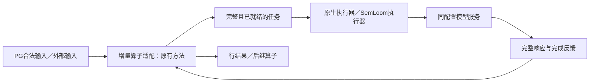

# 语义系统与同后端方法对照

本方案补充同应用任务的数据库与语义系统比较，随后补同后端的简单控制与工作量控制。
研究对象为 PostgreSQL 内置 AI 语义算子的外部分布式物理执行与调度优化。
执行层既有结果继续引用[四路径报告](../results/postgresql/text_map_four_path_comparison_20260930/README.md)；
本方案的原生提示、解析、请求量和质量分别记录，具体身份按[对照规范](reference/对照规范.md#execution-comparison-levels)。
当前准备把下面12条文本Map路径放入同一轮比较。就绪计时按[既有方案](SQL就绪计时.md)扩展；
各新增入口先核对准备、提交和完整消费，再生成具体运行清单。下方已执行清单保留原运行设计与身份。
带日期的已执行章节保留原要求，逐次结果由各主报告维护；当前容量筛查状态见[首次停止记录](../results/postgresql/native_adapter_integration_20261009/README.md#capacity-screening-stop)。

## Palimpzest 原生与固定计划执行

本节为新增 PZ 工作流；下方历史文本矩阵、模型与额度不自动复用。
PZ 与 LOTUS 平行，先原生 Q3 完整过滤／count，再检查同物理计划的模型调用交接。
目标分列 native、Daft、Ray Data、IMLane作者CP、IMLane作者Ray、SemLoom 六臂，另加 native-adapted 控制，
共享同一 prepare/finish 以隔离适配成本。查询级 ExecutionStrategy 在选定计划后、原线程池提交前交接就绪工作，
最终消息／缓存／provider 与 SDK 请求准备后才交实际调用，回原 SDK／PZ 解析、stats 和 DataRecordSet。
仅 completion 桥保留作原生／诊断，不称完整后端替换；不全局选择 executor、不每行新建图。
首版只接受已核单调用的单模型 LLMFilter、单字段 ONE_TO_ONE LLMConvertBonded 及普通扫描／谓词／投影／结构 count，
LIMIT／join／distinct／语义聚合或未核多字段补问明确 unsupported；关闭 mixtures／critic／RAG／split-merge 后仍实查计划。
附件新版807ed301／1.5.3接口与依赖不套旧6ef tag；默认 work1 是请求计数，完整计划与 fresh query 状态分别冻结。

| 项目 | 本阶段明确范围 |
|---|---|
| 来源 | SemBench c814e380、PZ 0.8.2.sem_agg＝6efc1984；[固定依赖](../../code/requirements/palimpzest.txt)独立安装，核实际源和版本 |
| 语义／执行 | 原 Movie 方法、提示、解析、缓存、依赖和结果合同；原生 parallel／workers64／join64，PZ 可决定合法过滤顺序 |
| 输入 | 复用原2000行 Movie CSV／清单 e753baa5；taken_3 共120行，由 preflight 再核，不截断、复制或换成 Map |
| 先行检查 | 本地原库 CPU 与 fixture；完整过滤及关系结果双审，重复 reviewId 保留出现身份；Q2 LIMIT5 不假设5调用 |
| 最小模型轮 | 一次原生 Q3，无独立模型 warm-up 或多模型矩阵；优化／采样／validation 如有实际调用均计入；本配置显式无 validator |
| 服务 | 已授权单4090、已有 Qwen2.5-7B-Instruct、vLLM0.25.1；单实例、max-model-len8192、memory0.90。原计划prefix cache开启；[本轮实录](../results/diagnostics/palimpzest_movie_20261015/native-model.json)为float16、prefix cache关闭，差异显式保留 |
| 上限 | 最多2000次实际模型 POST（允许原优化器重排后的额外工作），请求120秒、查询600秒；服务准备另计、资格轮不作性能重复统计 |
| 资源／停止 | LOTUS优先；共享lease recover_stale=false，缺资格／busy即停；任何非法配置、错误、失联、关联或清理问题保存现场后停止该轮，不自动扩大矩阵 |
| 观测 | 配置与完整计划身份、逐请求／usage／失败账、完整查询与服务准备、设备与实际进程退出；缺失字段 unavailable |

原生完整查询成功后才探索有界 pending-call 交接，保留原 Generator、SDK 的请求准备与响应解释；
合理原生 batch／对象生命周期可不同，资源预算可比。单轮与 fixture 不提供性能或尾延迟结论。
部署先声明资源／服务预算及固定或经固定版本核实的原生自动模式；PZ只确定语义就绪，后端拥有派发／worker／背压。
适配器持有上限仅为准备内存合同，不统一各臂实际并发；自动调度不等于已验证在线调优。
[接口与版本边界](../../code/src/semantic_methods/palimpzest/README.md)、
[已有软件结果](../results/diagnostics/palimpzest_movie_20261015/README.md)维护实际状态。
当前实现已完成查询私有的A／B交接、一次选择／fresh状态和最小CPU后端软件资格；
实际17次fixture POST与旧原生120模型分列；固定bebf的原2000行模型轮已有六臂720POST及SemLoom首发前失败，整体未完成，剩余120不扩大。
后续62018855的同进程Daft→SemLoom CPU组合各2次合成HTTP／COUNT1及正常退出已通过，旧CPUr1／r2失败保留、本阶段累计6fixture；不补回旧R3内部异常或模型资格，模型720／840余120仍不变。
再后续独立R4在620完成SemLoom120POST／COUNT7，1682项原件独审通过；累计模型840／840余0。完整物理计划相同，源码绑定与metadata初始锚变化使完整身份不同，不把两轮拼成同身份七臂或性能比较；R3失败及原计划要求分别保留。

本轮单独固定`bebf682b`及一次选定计划；`adde01a6`两轮零POST失败保留，原2000行／taken_3的120个出现身份不变；
ordinary谓词必须先于唯一LLMFilter及结构COUNT，选择阶段以实际发送闸拒绝所有模型POST。
original-native、native-adapted、Daft、Ray Data、作者IMLane CP／Ray、SemLoom各一次，
每臂硬限120次实际POST、累计840，无模型预热或自动重跑；原生64worker／2000POST的上表仅保留其历史阶段要求。
新轮PZ workers／join为20，Daft原生并发20；Ray Data为2actor×2异步批×1行，作者IMLane为4执行lane／原桥8host线程，
SemLoom容量20／2Ray worker／批8。driver为4CPU／0GPU、共同服务单4090，prefix cache显式关闭；不统一各后端实际并发或对象寿命。
准备窗口64call／64行、单请求及响应各128KiB、输入／批16MiB、响应留存8MiB，均为适配持有合同而非整进程RSS保证。
请求／批／关闭120秒；健康查询不另设总时限，unknown立即停新POST；main ready优先，正常共享lease串行。
共享选计划、服务准备及逐臂fresh／worker setup／完整查询／close分列，HTTP时延保留直接SDK与代理上游两种范围。
同时保留完整过滤与COUNT质量、invalid、usage／价格缺项、全部失败及实际退出；每臂单查询／120请求不支持稳定尾分位或性能排名。

## 原生执行接入与IMLane软件检查

2026-10-12按用户确认的顺序，在独立工作树从整合源码`3f893ffe`继续；本轮不合并main。
研究对象为PostgreSQL 内置 AI 语义算子的外部分布式物理执行与调度优化。
此次工程验证先保留LOTUS／DuckDB AI的方法与原生对照，再替换完整调用的执行者。
LOTUS1.2.4与DuckDB AI0.4.14的原提示、SDK转换、parser、用量、NULL、行关联和错误解释保持；
Daft0.7.21、Ray Core2.56.1和Ray Data2.56.1分别作为独立baseline，由原生执行器管理并行，
Ray Data另管理数据批次与背压；公共表示不调用SemLoom Core。Ray Core使用原生actor／task
API及静态分片，自写执行拓扑按代码规则标为`diagnostic_reference`，作为独立执行参照。
原生LOTUS／DuckDB、已有SemLoom及固定Map的Daft／Ray Data入口均作受影响回归。

| 新路径 | 保留的方法动作 | 本次检查 |
|---|---|---|
| LOTUS方法＋Daft Native／Ray Core／Ray Data | 原LM未缓存批次、原SDK转换和解析、整批返回及缓存／统计合并 | 完整请求值、响应元数据、usage／logprobs、重复输入、HTTP／JSON／SDK错误与取消退出 |
| DuckDB AI方法＋Daft Native／Ray Core／Ray Data | 当前SQL vector准备、原NULL与行位置、`FinishCompletion`及两个completion函数的错误解释 | 实际编译扩展、原社区／patched native配对、逆序结果、逐行try错误、首次致命解析停止及连续vector |
| IMLane作者执行器 | 固定作者源码、DBEnd数据转换、Coordinator及Python／Ray executor | 独立构建、Arrow输入输出、同步／异步和连续调用、自有进程与共享内存退出 |

新增执行器只接收原方法已生成的完整请求，返回HTTP状态、完整正文与调用身份；传输错误单列，
不补造HTTP状态。多模型、级联、Join及新的跨vector执行方法不进入本轮。
单Map公共接口继续检查原缓存行为；既有成对配置的零重试及显式未支持政策保持，不自动改变设置。

初始工程清单只访问localhost确定性响应fixture，模型0；HTTP正文由实际库生成与解析。
接续公共入口已登记三种方法的IMLane CPython／作者Ray模式，真实三方法消费与常驻复用48次软件POST通过；
前轮失败保留，详细来源见[本轮接入](../results/postgresql/native_executor_baselines_20261012/README.md)。
较早单GPU轮仅完成三条warmup／24真实POST，SemLoom初始化失败与软件修复分列，测量0。
新独立授权轮已完成六路径18查询／144真实POST，每条8预热＋16测量，完整请求／原解析／消费及退出通过；
原32占用名额与新144分开，原累计名额和时间不因接续或修复重置。小型人工输入不支持任务质量或饱和结论。
双GPU仍只准备下述方案；新轮剩48名额未使用，不转作双GPU运行。
LOTUS／DuckDB各使用8个独立CPU名额、最多4096输入行、32MiB请求批、按原调用设置的响应上限，
Ray对象存储256MiB，单查询120秒，每组fixture最多4000次POST、最长10分钟。
IMLane构建使用8个CPU名额、独立Python／Arrow环境，构建暂存最多30GiB、最长3小时；
fixture共享内存最多2GiB、进程RSS最多8GiB、单查询120秒、最多128次无模型函数调用。
各运行重新核对实际CPU、软件来源、环境和资源；不占用GPU或修改其他查询服务。

行为、计数、资源或退出检查首次失败即停止对应清单；保留失败，修正确定问题后使用新的运行身份
重跑受影响项。完整源码摘要、预检、实际库版本、全部成功／失败、请求数及零模型声明分别记录。
正式性能排名、服务饱和与真实质量不从本轮替身耗时推导；计时保留准备、提交和完整消费。
结果按实际接入验证与独立构建分别登记，源文件及私有环境、编译产物和大日志保存于仓库外。

### LOTUS六路径同机模型双副本检查

用户已授权在现有服务器完成双GPU工程smoke。已按下列固定旧源码完成18查询／144POST、每卡72，实际身份及退出通过，
[全部原值](../results/postgresql/native_executor_baselines_20261012/README.md#lotus-dual-model)保留；SDK／客户端寿命／容量及关闭诊断的软件修补由独立owner推进，未并入本轮。
较早候选草案的单双卡重测和到达轮询由本节替代：
本次只启动同机2×TP1、PP均1的两个独立Qwen2.5-7B-Instruct服务，使用已核缓存文件，不下载或新增实例。
单卡参照为[已测144POST](../results/postgresql/native_executor_baselines_20261012/README.md#lotus-six-model)，
双卡新增一次公共透明路由跳转，固定服务历史与小样本差异明确保留，不能据此报可靠加速或性能排名。

| 对象 | 本次固定条件 |
|---|---|
| 方法 | 原LOTUS、Daft、Ray Data、SemLoom、IMLane CPython、IMLane作者Ray；同一原formatter／最终LOTUS parser；中间响应解释不同 |
| 服务 | GPU0与GPU1各一个独立服务、API／engine PID和GPU UUID；同权重及tokenizer逐文件SHA256 |
| 参数 | BF16、context4096、max-num-seqs16、batched-token2048、显存比例0.8、eager、前缀缓存关闭；temperature0、top_p1、输出上限16 |
| 输入 | 沿用同8条人工文本和独立行ID；相同完整请求值、原解析和消费，不作benchmark任务质量证明 |
| 路由 | 完整请求JSON值摘要固定到副本；源行0–3预先映射GPU0，4–7映射GPU1，重复文本行1／2同副本；每查询4／4，不按HTTP到达序号识别源行 |
| 执行设置 | 每条driver同8CPU、C8／线程8；原Ray／SemLoom物理设置不变；IMLane2执行器／实测threads6，作者Ray2CPU／0GPU／128MiB对象存储 |
| CPU | driver与共同路由72–79，GPU0服务80–87，GPU1服务88–95；启动前重新核空闲，自有资源登记；CPU8–15留给独立SemBench任务 |
| 模型名额 | 新独立上限288，含预热、检查、失败及未知；计划18查询／144POST，每条8预热＋16测量，不为用完额度扩大样本，不借旧轮剩48 |
| 时间 | 两个服务共用一次启动期限15分钟，模型测试10分钟；单查询120秒／HTTP30秒，另留清理时间；失败不重置期限 |
| 软件资格 | 累计最多64次localhost替身POST，实际完整响应、错误／取消、固定副本、零隐式重试及清理；失败在软件阶段修，不反复新开模型轮 |

公共路由从不可变摘要清单选择固定服务；所有六条路径只看到同一个端点、相同额度与响应。
它不获得服务负载，不增加批次、接纳政策、故障转移或重试，也不改变编码后的请求正文。
未知摘要在发送前报错；完整状态、gzip、重复响应头与响应字节仍由原观察网关保留。
重复源行ID在原方法层登记，路由只能识别完整请求值，不能把传输序号当作源行身份。
现有PG Map v6多副本CLI保持独立；SemLoom自有多副本路由不加入本轮，后续消融需要单独计划。

软件通过后复用既有SSH master，只读核两GPU、CPU、端口、共享内存、模型／源码及现有driver／服务环境。
他组资源占用、缺依赖或模型时停止，不安装、不清理他组进程。服务与driver固定到同一源码归档并保存SHA256。
每服务记录实际PID／start ticks、engine GPU UUID、就绪耗时和同配置；只看到两个model名字不足以证明两个GPU副本。

六个group固定顺序串行执行，预热与两次测量分别保存，group／作者进程／模型冷启动单列。
每查询记录原parser、结果消费、EOF与该查询清理完成的耗时；每请求记录内层观察区间和公共路由实际上游HTTP区间。
按副本保存真实POST、输出token、完整请求值与GPU利用采样；采样周期及可能漏掉短任务的情况明确记录。
同一host的单调时钟只用于对应采样窗口，不用跨worker时钟相减来制造模型纯计算时间。
请求与查询分别列n、全部值、P50／P95／P99／max、消费吞吐、错误／超时。
n=2查询／16请求的P99仅为样本最大值；单→双原值与比值只作有限诊断，正式SemBench需真实任务、质量和扩大重复条件。

首个解析、行关联、计数、副本身份、退出、期限或名额错误即停止全轮，保留剩余未完成格与失败；
不修改配置填满其他格，不隐式重跑。取消或超时后未知远端工作保留责任，不能因caller退出宣称远端停止。
只结束已记录PID／start ticks属于本轮的Coordinator／Ray／API资源；核自有存活、共享内存、端口及GPU进程，既有SSH master保留。

### 可选async的剩余公开CLI软件核查提案

以本次native整合提交作为唯一运行源码，先保存完整Git SHA和实际worker/source摘要；已完成的四非IMLane路径与两作者组件矩阵不重跑。
可选async已通过作者生命周期和完整Q1查询API，默认仍同步。下面两窗口只补实际公开CLI的常驻owner、HTTP观测代理、原查询parser/官方evaluator和退出，模型/GPU0。
回应沿第三软件窗口的完整消息摘要确定True/False，不读取gold；保留原CSV/清单/查询和2000行关系，沿既有作者两模式/配置，实际UDF摘要须为新async函数。

| 独立窗口 | 实际公开CLI单元 | 计划逻辑/传输POST | 各自硬上限 | 停止时限 |
|---|---|---:|---:|---:|
| Q2/Q3入口 | CPython与作者Ray各Q2、Q3；每原WHERE完整120调用，warmups0/repeats1 | 480/960 | 512逻辑/1024传输POST | 600秒 |
| Q1入口 | 两作者模式各原Q1完整2000调用；warmups0/repeats1 | 4000/8000 | 4096逻辑/8192传输POST | 900秒 |

两窗口各从首个零POST预检之前开始，含服务/作者就绪和清理间隔，最后90秒留作清理；不可借用第三窗口或彼此剩余份额，失败不自动重跑。
CPU建议继续用父统筹确认空闲且单独批准的8–15，避开task-10的16–23；无安装、下载、作者重建或既有进程清理。
运行前只读预检固定数据/库/桥/作者/worker源码及私有公开配置；若实际拓扑不是owner网关＋fixture两跳，先重算传输额度并取得对应授权。
每模式同一CLI owner连跑各自查询，检查owner/LM/Coordinator身份、max_batch_rows2000、同Coordinator未知责任保护、source行身份/完整正文、多重集、完整响应、ledger扣记关闭和原评价；Q2/Q3正文与第三窗口保存的同查询摘要对照。
Q1软件评价与完整2000分类错误按原值记录，不把替身质量判为模型质量；performance配对、单独128/4096容量与组件异常矩阵不加入本提案。
查询结束确认实际退出、全部自有PID/创建时间、HTTP活动/连接和共享内存；未知远端请求仍标unavailable。公开CLI通过也不声称模型/GPU质量、RSS、连接复用或性能收益。
两窗口需要覆盖具体资源和限额的新授权后执行；四非IMLane路径及已验证同步baseline的模型小轮可独立按后节推进，不等async补充。

### 原Movie任务的同口径单卡与双卡小轮提案

本节保存父任务统筹的执行前计划。[实际模型小轮](../results/diagnostics/native_sembench_model_20261012/README.md)已完成质量六路径和完整单卡、部分双卡；双卡11槽后CLI启动确认异常停止，剩7槽未运行。原首次时钟与分项额度保持，下面不按结果改写原计划。
最新[软件接线](../results/diagnostics/native_release_actual_software_20261012/README.md)在固定d004e720以公开CLI完成四非IMLane路径原Q2/Q3，
1080逻辑调用／2160传输POST、原parser／官方evaluator与退出通过；它不代替以下真实模型质量检查。
IMLane模型小轮优先已经验证的同步完整调用接法，保留CPython／作者Ray两个模式；可选async已通过作者生命周期和完整Q1查询API，公开CLI／Q2/Q3按前节独立补充后再申请加入模型比较，不作为其他baseline的启动条件。
若作者的新公开配置尚未交接，四条已可运行路径可按自身分项预算先做质量和数量，作者格明确未运行，不等待async，也不把未用份额转借扩大其余格。

| 固定对象 | 下一轮选择 |
|---|---|
| 任务与数据 | 原SemBench Movie Q2；原CSV与2000行清单e753baa5保持，原WHERE产生完整120调用。保留原LIMIT5、120出现分类审计及官方评价，不重写提示或解析。 |
| 六路径 | N原LOTUS、D Daft Native、R Ray Data、S SemLoom、I同步IMLane CPython、J同步IMLane作者Ray。运行前固定发布SHA、所有实际库／作者二进制和配置摘要。 |
| 模型 | 已缓存Qwen2.5-7B-Instruct，权重与tokenizer逐文件摘要、已安装vLLM版本及源码摘要；不下载、不更换模型或量化。 |
| 服务 | 单卡GPU0一个张量并行1／流水线并行1副本；双卡GPU0与GPU1各一个相同副本，同BF16、context4096、max-num-seqs16、batched-token2048、显存比例0.8、eager、前缀缓存关闭。每模式核实际engine PID／start ticks／GPU UUID。 |
| 生成 | 原Q2的temperature0、top_p1、max_tokens8、stop换行、一次完整非流式响应、缓存false、重试0；实际请求值与模型服务计数核对。 |
| 原生控制 | 四非作者路径沿已测C4／线程8、Ray actors2／async2／batch1、SemLoom workers2／batch2／held8／active4；作者两模式沿既有C6与实际作者线程设置。记录声明和实际HTTP峰值，不把不同原生控制称同形调度。 |
| CPU建议 | 父统筹核空闲后，所有driver／作者资源同72–81十CPU，GPU0 API 82–89、GPU1 API 90–97；保留线程8配置，避开task-10 CPU16–23。这是待批准的配置，不是已分配资源；模型机器profile需重新满足，不借软件8<10诊断宣称满足。 |
| 路由 | 单／双卡都采用同一已有透明固定正文摘要路由与同一逻辑端点，单卡表全指GPU0，双卡表事先按120出现权重分到两副本。同值重复请求保留同副本；未知摘要拒绝、零重试／故障转移，不按到达顺序辨认源行。 |

先在仓库外保存完整运行签名：任务／输入、权重／tokenizer、GPU／driver、服务参数、原生控制、物理配置、协议、观察模式和源码。
逐个GET预检端点、CPU／GPU空闲及所需既有依赖；缺资产、版本不符、其他owner占用或机器profile缺项时交父处理，不安装或结束他组资源。
真实Qwen tokenizer先核120个完整提示能否装入context4096；不用fixture的合成usage作真实token预算。
单／双拓扑为两个签名；本小轮不宣称服务饱和、最优配置或长期稳态，正式规模／饱和比较另行计划。

| 次序 | 计划实际模型调用 | 分项硬上限 | 排期估计／停止时限 |
|---|---:|---:|---|
| 单卡质量与调用量 | 6路径×120＝720，无预热 | 768，失败及未知均扣记 | 预计5–10分钟／最多10分钟 |
| 单卡交错测量 | 6路径×3轮×（1预热＋1测量）×120＝4320 | 4608，预热与失败均扣记 | 预计15–25分钟／最多30分钟 |
| 双卡交错测量 | 同4320 | 4608 | 预计15–25分钟／最多30分钟 |
| 合计 | 9360 | 三项合计9984，剩余不转借 | 服务建立累计最多15分钟；整轮从首次服务启动最多85分钟 |

预计45–70分钟为排期假设，不来自软件fixture吞吐；首次真实质量段保存实际时长供父决定是否批准后续段，失败不重置时钟。
每分项最后120秒保留清理；单查询120秒／单请求30秒。每种服务建立消耗同一累计15分钟准备预算，重新启动不增加预算。
质量段未通过请求身份、完整120调用、原解析、消费／清理及原方法差分时停止后续；
原LOTUS自身的gold质量原值先交父确认适用性，不以执行成功代替任务质量，不修改标签／提示使评价通过。
两类POST分开记：一次模型推理只算1逻辑调用；每逻辑调用若经过owner网关、固定路由、模型API三跳，则有3次传输POST。
三跳传输硬上限相应2304／13824／13824，合计29952；若实测拓扑不是三跳，运行前重算并批准，不能少记中间POST或把两跳当两次模型推理。
三本账共同记录失败与未知；不把服务health GET或网络未发出的SDK重放当模型调用。

交错通过每槽一个真实公开CLI配置执行：单臂原Q2、warmups1／repeats1／max_attempts240、新私有目录；
每槽完成后确认退出，再启动下一槽。mode=performance用于计时，原臂预期完整值unavailable保持；质量段为qualification。
单卡三轮预先顺序为`N D R S I J`、`J I S R D N`、`R S I J N D`；双卡分别反向。
它们是固定轮换，三轮并非完整六轮位置均衡；不按默认arm-stack把某路径所有测量堆在一起，也不根据已见快慢换序。
每槽的executor冷启动、就绪、预热、准备、实际SQL/API提交、首行、统一消费及清理分别保存；完整query时间和ready-query时间同时报，观测成本不估算扣除。
两种服务的启动／预热／历史请求数与路由跳数分别保存，GPU1冷启动不藏入另一模式的已热数字。

输出保留全部n=3测量、原质量与调用量、每副本调用／token／GPU占用、原生CPU／内存／共享内存、失败及剩余未运行格。
只有能独立观察的时间才单列，不把HTTP区间解释为纯GPU计算；n=3仅作有限同任务观察，不能用P99或显著性包装性能排名。
仅清理本轮登记PID／start ticks的Ray、Coordinator及API；未知远端责任继续标未知，不因为caller退出宣称停止。
父批准具体资源、签名和分项预算后才执行本提案；async未来合格时另固定源码和预算，不重写已完成同步baseline的结果。

### 原Q2双卡七个缺项的独立补测

原85分钟模型小轮已结束，[原件](../results/diagnostics/native_sembench_model_20261012/README.md)完整保存质量六路径、单卡18槽、双卡11槽及启动JSON异常。
父任务按用户既有服务器验证授权提出新独立窗口；原首次时钟、原账本及退出失败保持，不恢复旧额度。
先完成[零模型启动诊断](../results/diagnostics/native_sembench_model_dual_supplement_20261012/README.md)和有限两轴审阅，再只补双卡第二轮J与第三轮D N J I S R。

每槽沿原公开CLI预热1／测量1／max_attempts240，新计划1680逻辑模型调用／5040三跳POST；
新硬上限2048逻辑／6144POST／1800秒，从新增外层controller启动计，含建立服务、查询和清理，最后120秒保留清理，服务建立累计最多900秒。
失败／未知／全部预热均记入新额，超时或异常停止，不自动重新启动或新增匹配对照。

固定原执行源码3bd53587、缓存模型／tokenizer／vLLM、原CSV／2000清单／gold、提示／生成／parser、正文摘要路由与六路径原生配置。
仅私有bootstrap标记写入改为完整临时文件后原子替换；发送函数AST保持，比较实现不改。
两个原GPU重新建立独立服务，CPU沿72–81／82–89／90–97，避开task-10 CPU16–23；不安装、下载或结束其他owner。
新服务状态／轮次与旧样本不同；原11槽与新7槽分别给query与request的n／分位数／max／全部值、质量和错误，不能称原轮连续n3或据此因果排名。
若发现需要改比较源码或数据才能运行，保存确切阻塞后交父处理，不把不同版本样本合成同一矩阵。

2026-10-13实际接续：七项补测先完成五项后遇私有Ray目录长度预检错误停止；本人另允许22字节短目录与仅S／R的新600秒／512逻辑／1536POST窗口，实际480逻辑／1440POST、150.487秒通过。原11项与两补测5＋2项分别保存，三个时钟和账本未重置；[分波原件与核验](../results/diagnostics/native_sembench_model_dual_supplement_20261012/README.md)继续保留失败和小样本限制。

## 统一Map比较

| 路径 | 实际执行方式 | 在总表中的用途 |
|---|---|---|
| PostgreSQL＋SemLoom（Daft＋Ray） | PG拥有语义与查询生命周期，Daft物化批次、Ray worker调用模型 | 自有主系统 |
| PG-source direct | 普通SQL读取，再由有界HTTP客户端执行完整请求 | 固定语义的简单执行参照 |
| 原生Ray Data SQL→HTTP | 原生SQL reader与HTTP Processor，由Ray拥有执行 | 固定语义的原生执行系统 |
| 原生Daft Native SQL→HTTP | 原生SQL读取与单行异步批次用户函数，由Daft拥有执行 | 固定语义的原生执行系统 |
| LOTUS1.2.4 Map | 原生`sem_map`，LOTUS拥有提示、解析和执行 | 同任务语义系统 |
| Sema作者产物 | 原生SQL语义投影，作者Linux二进制 | 同任务数据库语义系统 |
| DuckDB1.5.4＋ai0.4.14 | 原生SQL `ai_try_complete` | 同任务社区AI扩展 |
| Daft0.7.21 prompt | 内置`prompt`＋Native runner | 同任务框架内置生成函数 |
| PG＋SemLoom本地HTTP | PG语义Map与SemLoom本地执行，使用独立选定的请求数配置 | 主实现的内部执行参照 |
| PG本地HTTP请求数控制 | 固定请求数上限，按输入顺序提交 | 同后端简单控制 |
| PG本地HTTP token表征与宽额度 | 模型文本单位token的工作量描述及相同组织，额度足够宽 | 同后端描述与组织成本 |
| PG本地HTTP工作量控制 | 与上一行同请求数上限、描述和组织，仅降低在途工作量额度 | 同后端工作量限制作用 |

总表为每行保留用途、源码／配置与运行来源；统一排名使用同一轮、相同输入集合的测量。
用户确认核心对照为SemLoom（Daft＋Ray）、原生Daft和原生Ray Data三种系统身份。
SemLoom拥有自有任务接纳与执行控制，原生Daft／Ray基线分别拥有自己的执行与调度。
完整语义系统保留各自原生提示和解析，固定语义的执行参照核对相同消息与生成设置；
共同应用任务允许放在同表，但耗时、质量、实际请求和token工作量同时解释。
Daft内置prompt与Daft Native SQL→HTTP为不同入口，各占一行。主实现的worker复用、物化方式等
具体配置写入配置列；若另作对照，每种配置使用独立行和运行身份。

共同指标包含完整应用耗时、准备耗时、就绪后SQL／API提交至统一消费结束、首行、吞吐、
准确率、失败／缺行／重复、实际调用与token用量、HTTP在途峰值及CPU／内存／GPU资源。
完整查询、批量单行交付、统一代理HTTP分别给出样本数与P99／P99.99；
客户端请求起止可观察时另报真实请求耗时，缺项注明原因。预热、全部重复、慢样本和失败按身份保存。
查询与行／HTTP分别计数；小样本P99.99若选中最大值，只作样本观察，总体估计是否可靠另按样本设计判断。

新一轮使用同一模型服务配置与物理资源、相同原始输入、轮换执行顺序，各路径保留原生执行所有权。
每个系统的有限配置选择机会单独记录；三种控制同时面对独立选定的请求数参照。
首次请求失败、资源超限、缺行／重复／关联错误、非法输出或清理错误即停止当前清单，不自动重跑。
主实现、direct、原生Ray Data与Daft Native的新增就绪入口先验证；Ray后端与组织控制的组合
通过接入检查后才增加相应行。本表的三个方法控制当前按已有本地HTTP路径准备。
OceanBase `AI_COMPLETE`已有SQL适配；[现有对照记录](reference/对照规范.md)保存过容器初始化失败，
本轮尚未确认指定服务器有可用实例。恢复连接后先只读核对，满足输入、原生调用和计时要求后再列入新清单，
不把适配存在写成已运行，也不将尚不可运行的产品填成零耗时。

Map使用同一原始评论关系与二值情感任务，各系统保留自己的原生提示和解析。
不对原生系统注入SemLoom组织、提交或路由策略。请求预算与透明观察只记录实际发送，
不改变正文、不重试、不缓存响应。每条查询包含输入读取、原生输入构造、执行和完整结果消费；
模型服务启动、离线数据准备及事后质量评价单列。

Sema来源固定为[作者仓库](https://github.com/BITQiKangK/SemaSystem/tree/3f2c7182bdaa26c1e8925f486585da25337e687e)，
公开文件为`Sema.zip`，实际二进制版本`v0.0.1 8c2d3bd2`，摘要
`15a534667a668a152524a8756fe5d66c0fa9c9822e73d26029e1a71693a56ec3`。
公开版本发送JSON字符串生成要求，但未暴露请求级输出长度旋钮；服务统一默认输出上限128，
其他Map系统显式请求128。保存实际请求与服务配置，不能据此称提示或模型工作量相同。
当前只验证作者二进制与SQL入口，不声称已审查其未公开实现或复现全部作者实验。

## 原生baseline性能预演（2026-10-09）

用户要求先测已可运行baseline的表现。范围为PG-source direct、原生Ray Data、原生Daft Native、
LOTUS Map、DuckDB AI、Daft内置prompt和Sema七条路径；新增SemLoom适配由工程任务完成后另做成对验证。
本轮使用同一Movie输入集合、缓存Qwen2.5-7B-Instruct、GPU0单实例与既定服务配置。
各原生系统保留自己的提示、解析、提交与并发控制，记录不同模型工作量，不将整体差异全部归因调度。

先用确定性替身核对七个入口，再进行每路径16行正确性、128行规模检查。
有限配置比较采用128行、4／16／64三个并发候选；Sema采用1／4／8个原生线程。
每候选预热一次、测量三次，配置确定后以512行预热一次并轮转顺序测量十次。
共175条真实查询、最多51,184次模型POST，最长60分钟，最后120秒保留清理；单查询最多120秒。
首次协议、关联、缺行、重复、非法输出、计数、配置或超时错误停止本轮，保存失败，不自动重跑。
候选选择只代表这些有限点的表现，不声明已达到持续供给或服务饱和平台；正式扩展按新的实际签名另行安排。

观测保留完整应用与准备耗时、实际提交SQL／原生接口至读完结果、首行与消费、代理请求阶段、
模型计数／token／队列，以及driver、原生子进程、PG、Ray和模型服务资源。
代理阶段区分接收、读请求体、发送前记账、上游往返、返回观察与响应写出；HTTP往返不等于纯模型计算。
原生请求池之前的任务就绪／排队无法观测时写不可观测，不将代理抵达作为完整请求起点。
请求与整查询分别报告P99／P99.99、样本数和最大值；每路径十次查询不能支持总体极端尾部结论。
同时保存准确率、全部输出、实际调用／token、HTTP峰值、失败／重试和后台工程活动，排查资源干扰。
后台编译或工程检查有明显影响时，本轮结果保持性能预演身份，不并入最终性能排名。

运行代码来自一致交接版本`cbfd952b`，私有有限控制脚本与源码包分别记录散列。
使用仓库外runtime配置并保存只读预检；模型与driver解释器隔离，新输出使用数据盘独立目录。
本会话先负责该baseline运行，整合任务的真实模型预演随后执行，避免同时占用GPU0。

已完成175条查询／51,184次POST，账本／代理／服务计数及独立清理一致；各路径十次512行测量仍是有限预演。
原运行主报告`experiments/results/postgresql/native_baseline_performance_20261009/README.md`由baseline会话单独交付，
合入时保留该入口与实际源码身份；适配器模型试跑不与之合并样本。

## 原生与SemLoom的常驻查询补测（2026-10-09）

用户要求排除服务和执行器启动，比较系统准备完成后的实际查询耗时。本轮承接已完成的13条
工程适配路径，保留原来的首次运行结果；不从旧耗时中扣除首批工作来估算预热结果。
研究对象仍为PostgreSQL 内置 AI 语义算子的外部分布式物理执行与调度优化；本轮为外部输入
及原生SQL适配的生命周期观察，不代表PG多算子接入或完整性能排名。

用户补充的审查意见建议先查清生命周期与首次payload，而不是扩大系统名单。
真实模型本轮采用共同固定Map的Daft／Ray／SemLoom三条，以及LOTUS单Map的原生／
SemLoom本地执行诊断／SemLoom Daft＋Ray三条。本地诊断保留同一执行核心，绕过Daft／Ray，
不称普通HTTP或LOTUS原生。首组先完成这六条路径；DuckDB和Sema按下述追加清单继续，
两Map的已有接入证据保留，本次不重复模型测量。
每条路径在独立调用进程中复用连接、LM、Ray会话及SemLoom请求worker，按预先声明的路径顺序
分块执行；需要Ray时各自使用8CPU集群，不让另一条路径的闲置actor占其逻辑名额。
全部路径共用同一模型服务；本轮不称随机化交错比较，顺序与前后服务计数保留。
补充只读核对原生Daft可复用客户端和batch设置，
采用的实际实现及其局限明确记录，不把固定接法称为原生最佳性能。
原生Ray Data按原API管理每个执行图的actor，若图间自动重建，保留该行为并记录身份；
不能通过更换其执行器制造常驻收益。无法证明复用的对象明确列出，不称完全预热。

输入复用已有资格集合的前8行与已有规模集合的128行，保持原始行ID、文本和参考答案，
不是新留出的质量数据。单Map原生与SemLoom核对实际完整调用值。之前两Map的后继任务变化
及Sema后置接入的供给差异继续由原报告说明，不借本轮六条路径补测消除这些缺项。

每路径先进行1次8行正确性查询；随后分别在8行和128行执行固定2次同形状预热及5次测量。
共90条查询，最多5,760次真实模型POST；运行最长30分钟，
单查询120秒，最后120秒保留清理。预热不足或耗时仍变化时记录原值及初始化事件，
不追加预热、改变配置或只选快样本；该范围不提供总体P99／P99.99或服务饱和结论。

使用指定服务器GPU0、缓存Qwen2.5-7B-Instruct和独立driver／vLLM解释器；服务BF16、
单实例、context4096、max-num-seqs128、max-num-batched-tokens8192、FCFS、chunked-prefill开启、
prefix-cache关闭，单调用输出上限128。SemLoom保持请求4、worker2、batch2、payload2MiB、
对象8MiB、Ray对象存储256MiB；原生库配置沿用前次小清单，不能根据本轮性能在线选择。
实际签名、CPU分工、服务命令及模型／二进制摘要由运行配置和只读预检保存。

调用方释放新查询至统一消费EOF为主要指标，保留实际SQL／原生API提交时刻；
当前查询特有的输入处理、提示构造、图创建、物化及消费都计入，一次性准备和owner退出另计。
同形状预热不提前准备当前测量查询的首批数据；不从旧时间或日志累计时间扣出所谓纯执行耗时。
保留输入／方法准备、首批生成内部步骤、对象写入、请求就绪／提交／返回、HTTP各阶段、
首行与全部结果、逐次质量、调用／token、资源曲线以及跨查询的对象身份。
首批工作观察内部墙钟；本次固定源码没有单函数线程／进程CPU探针，该项写不可观测。
进程树观察从准备开始覆盖到退出，包括RSS、可取的PSS、CPU时间及创建身份，不能冒充单函数CPU。
对象写入保留单次分布、每查询次数和累计／时间线覆盖，重叠部分不扣减总时间。
本轮保持完整诊断观察，低扰动观察的敏感性检查尚未完成时明确说明；不关闭请求保护或通过扣除日志改写耗时。
缺乏独立起止的组织、纯排队或模型内部计算写不可观测；没有数据库写回时明确说明。
每查询结束核对行／调用对应、资源全部归还、缓存政策、代理／账本／服务计数；
协议、关联、非法值、计数、配置、超时或清理错误首次出现即停止，保留失败，不自动重跑。
正常分类错误保留在质量分母，不作为系统错误抹去。

先通过真实库HTTP替身的跨查询复用与旧入口回归，再打包固定源码并启动有限后台owner。
原始成功、失败、预热及测量全部保留；结果进入现有适配主报告，生命周期与性能结论分开。

执行状态与实际来源见[常驻模型报告](../results/postgresql/native_adapter_integration_20261009/README.md#persistent-model)，
全部原值、准备失败、观察成本及统计用途由该报告维护。

### DuckDB AI与Sema的常驻查询追加

本节保留追加模型前的诊断、修复与工程检查要求，相关修复及模型复核已经完成，见
[持续成本修复](../results/postgresql/native_adapter_integration_20261009/README.md#adapter-performance-repair)与
[修复来源模型复核](../results/postgresql/native_adapter_integration_20261009/README.md#repair-model)。
诊断使用既有完整请求／响应和有上限的HTTP替身，记录调用次数、函数墙钟与线程／进程CPU、
实际线程位置、接纳／提交／响应／释放及查询时间轴，不把profiler输出作为系统性能排名。
同时检查平均HTTP在途和仍有必要工作时的空档；上游HTTP区间不等于GPU模型内部计算。
旧模型记录没有批请求返回时刻时明确写未采集，不按其余事件猜测。
修复保持提示、解析、usage／费用统计、错误、取消、资源责任和实际出站核验，
不通过扩大并发、删除统计或去掉请求保护制造速度改善。
常驻管理另行检查部分初始化失败：事件记录成功后代理进入失败、执行实例成功后LM／
tokenizer初始化失败，均须关闭已取得资源；正常关闭不能重复执行后端退出。
查询错误、清理错误、状态读取与摘要写入错误分别保存：已有查询第一错误继续作为主要错误，
没有查询错误时传播最早的退出或记录错误。回归包含取消等待者、迟到结果归还容量、
未知远端工作、部分接纳、结果重排及协议失败；替身成功和真实模型资格分开记录。

用户要求同时覆盖原生数据库语义系统。追加DuckDB AI原生／SemLoom批次接入两条，
以及Sema原生直连／透明转发／SemLoom请求服务三条，不重跑已完成的六条路径。
先用真实扩展与作者二进制的HTTP替身检查各路径连续查询和8行改为128行时的输入、
行ID、调用数与结果更新；核对DuckDB同一连接、Sema同一进程确实复用，避免沿用旧表或旧请求。
DuckDB使用已固定的公开扩展补丁，原生臂仍由扩展拥有调度；实际库加载环境单独记录。
Sema保留原生SQL、提示、线程和解析，其后置服务仍受上游请求供给影响，不能称执行器替换。
若Sema请求服务的Core或worker按查询创建，该事实和耗时一并保留，写为作者SQL进程常驻、
后置执行核心逐查询创建，不称执行器充分预热。不能通过改变原生算法来配平这项差异。

每路径沿用首组的1次8行正确性、8行与128行各2次预热和5次测量，共75条查询，
最多4,800次真实模型POST，最长30分钟、单查询120秒、末尾120秒用于清理。
模型、GPU0、CPU分工、服务配置、输入与参考答案沿用首组，追加运行重新保存只读预检、
二进制／模型摘要、固定源码与实际配置；不使用已耗尽的首组调用账本。
路径按预先声明顺序在独立调用进程中分块执行，共用模型服务，保留全部成功与失败重复。
不在线调参、增加预热、追加超时或重跑成功单元；首次协议、关联、计数、超时或清理错误即停止。

修复与真实库检查全部通过后，还须对LOTUS原生／SemLoom本地／SemLoom Daft＋Ray三条
按相同15查询清单做修复后模型复核，最多45查询／2,880次POST。
可与上述五条合成一个有限owner，合计120查询／7,680次POST，仍为30分钟、单查询120秒，
以新的账本记录修复后源码；若路径仍未通过检查就保留具体问题，不启动该合并清单。
固定Map旧路径以受影响的fixture回归覆盖，不能把它的提示换进LOTUS来缩短耗时。
新结果与旧负结果分开记录，同方法前后比较保留实际请求、token、质量及观察配置。

时间口径和证据要求沿用上节。当前输入替换、CSV／表导入和提示装配均计入新查询释放到EOF，
同时直接记录SQL提交到EOF，不能将两者混称。Sema三条路径比较实际完整请求和返回值，
DuckDB两条路径比较完整批任务与返回值；调用／token或原生供给不同就单列，不据此做纯调度归因。
每形状五次查询的P99／P99.99仅为有限样本观察；追加结果进入同一适配主报告，注明与首组
共用配置但分时运行，不能把跨系统耗时合并为相同算子策略的排名。

实际库检查、源码身份及后续修订分别由[最终共同检查](../results/postgresql/native_adapter_integration_20261009/README.md#adapter-final-source)
和[模型复核](../results/postgresql/native_adapter_integration_20261009/README.md#repair-model)定位，不将后续CPU修订写入既有GPU来源。

### 修复后的有限容量校准

已有八路径120查询／7,680 POST对应`adapter-repair-source02`／`aef350b2`，
结果见[修复来源模型报告](../results/postgresql/native_adapter_integration_20261009/README.md#repair-model)。
SemLoom请求4仍是接入及修复诊断配置，不能代表合理调优后的最终性能；Sema原生峰值128也不是最佳点证明。
参数拆分与无模型准备已有实现和实际库验证；真实GPU扫描与最终比较配置仍待完成。
准备来源及已测条件见[容量准备记录](../results/postgresql/native_adapter_integration_20261009/README.md#capacity-preparation)。
新校准使用完成参数接线后的实际实验源码与独立运行身份；旧`aef350b2`模型记录继续保留为修复历史。

公共只读审计核对`a24ca67b`的31份源码，Core已有独立活动请求数C与持有任务数H。
单查询与常驻入口已提供`--max-held-tasks`和`--sema-native-threads`，
活动请求数C继续取`options.concurrency`；现有Core和后端机制保持。
省略新增可选值时保留旧行为；调参显式固定`sema_native_threads=4`、H=128，C作为扫描变量。
C4也须在H128下重新取得参照；旧H4／C4与新H128各点不能连成只改变C的同一条曲线。
不能改用通用`NativeGraphOptions.num_threads`冒充Sema HTTP容量，它还管理通用CPU／原生图资源。

候选C为4、8、16、32、64、128，按观察逐步筛查，不承诺全部跑完；相邻值接近、回落或不可达时
再决定有限邻近点。每候选新建匹配容量的owner和worker pool，不能沿用C4池并只修改options值。
固定H=128、输入与结果各128MiB、每项metadata最多1,024字节；两名worker、集群CPU8、
每actor CPU1、payload batch2／window2MiB、Ray对象存储256MiB及模型服务签名保持。
worker2／batch2不固有地把SemLoom限制在4：actor并发和HTTP连接容量随C装配，Core仍控制全局C。
新512行调参输入的实际库fixture已核对目标C与未归还Arrow backing buffer计数，
保留统一8MiB传输对象额度；结果只适用于已登记输入与配置，不扩为所有合法载荷的容量证明。
若需要调整字节额度，单列准备检查，不能在各C点悄悄扩大物理资源或留存。

作者固定README及二进制设置的只读核对确认：SQL线程数不是HTTP在途上限；
`llm_rate_limit`表示每秒速率，0为不限速，不能当C；`semantic_batch_size`改变联合提示与请求粒度，保持1。
目前没有核实原生HTTP最大在途或输出token旋钮；原生请求不含`max_tokens`，共同服务默认生成设置另记。
不改后置请求补token字段，也不凭当前128或旧512行峰值256推断作者隐藏池大小。

首轮Sema校准沿用当前逐查询创建Core与worker的部署，选点解释为该部署及查询规模下的合理C。
查询释放至完整消费为主指标，实际SQL提交至完整消费为辅助指标，两者都直接记录；
不将该结果称为纯模型服务或常驻后置执行器的最佳并发，不从旧总时间减去准备中值构造常驻结果。
常驻Core／worker复用另作实现与合法生命周期检查，不作为本轮有限校准的前提。

128行保留为历史小查询；选点另用数百条独立输入，使窗口多次补充，按实际持续时间决定是否增加规模。
不用复制相同文本伪装独立输入，不机械要求每条满60秒；保留未参与选择的最终验证集合。
主选点采用合法完成行数／释放至完整消费时间，全部分类错误仍在质量分母。
记录全部重复、实际prompt／generation token、错误／重试、资源与前端正文留存，
并用共同上游dispatch至完整响应体读取重算平均／峰值在途，另观察vLLM running／waiting、KV使用与preemption。
按部署版本核对实际可采指标；HTTP在途不能代替GPU执行序列，字段不可取时说明缺项。

预先声明近最佳吞吐差异ε=5%，在有效已测点中选择达到最佳吞吐95%的最低C，
对候选及邻近点作交错重复；差异小于测量不确定性时记录不能区分。
最高可达点仍改善时登记“已测最佳、尚未观察到平台”，不以宽平台或硬件绝对极限为继续比较的条件。
随后在未参与选择的数据上核对质量、资源及完整查询，并确定各系统自己的比较配置。

系统比较给原生、透明及SemLoom各自合理调参机会，不要求参数数字相同。
若解释SemLoom相对简单请求数控制的增量，另设“Sema＋简单有界转发控制”参照；
可复用已有服务完整请求／响应和退出处理，给TCPConnector独立容量，默认透明路径保持0。
它尚未实现，不称原生；须核对实际发送／收据、连接池等待、正文留存和超时，
不能把forwarded计数或接纳之后的gateway时间当作完整请求起点。
简单有界转发不阻塞首轮SemLoom容量筛查；声称后置组织／调度具有额外收益前，须补齐该对照。
首轮清单先用C4／16／64，LOTUS与DuckDB原生／SemLoom各三点，Sema原生／透明各保留作者线程4的配置，
加Sema／SemLoom三点，共17配置。每配置8行检查一次、512行预热两次及测量三次；
合计102查询，最多43,656次调用、3,600秒，单查询120秒，首次协议、关联、计数、超时或清理错误停止且保留。
合法但错误的分类继续计入质量分母。候选与邻近点的交错复验、独立评价在筛查后另列清单。
原生DuckDB请求池上限64保持；SemLoom批回调位于该池之前，未使用的原生设置不得限制其C128。
本轮Movie任务明确返回`POSITIVE/NEGATIVE`，应用允许值和参考表示必须一致；启动前核对全部参考文件。
首轮清单的标签不一致已触发停止，修订与零模型检查见[启动记录](../results/postgresql/native_adapter_integration_20261009/README.md#capacity-screening-stop)。
校准后的运行清单再声明源码、环境、资源、停止条件和具体调用数；有效校准与比较尚未完成。

### 整查询尾延迟追加

2026-10-10用户要求增加完整查询次数。首轮容量筛查保持原清单；完成来源、调用、质量和退出复核后，
按每条路径的已测配置，在未参与选点的512行评价集合上记录200次完整查询。
先覆盖LOTUS原生／SemLoom、DuckDB原生／SemLoom和Sema原生／透明／SemLoom七条现有路径。
每条拆成十组，每组1次8行检查、2次512行预热和20次512行测量，短组顺序轮换，组内复用现有常驻组件。
合计1,400条测量查询，连同检查和预热最多1,610条查询／789,040次模型调用，独立运行最多6小时。
每查询仍为120秒；首次协议、关联、计数、超时或清理错误停止，不重跑已完成组。
保留每组的准备、组件身份、全部原值与直接记录的释放／SQL提交至EOF；Sema Core／worker仍逐查询创建。
200次的整查询P99取第198个排序值，P99.99仍取最大值；不据此声称总体极端尾部已经准确估计。
请求分位与整查询分位分别计算；原始Daft／Ray及服务事件单独复算，缺少独立起止的阶段保持不可观测。
本节为追加设计，当前正在执行的仍是首轮容量筛查，具体选点和启动身份尚待其结果。

2026-10-10首轮17配置已完成，查询与模型服务调用核对通过。追加先以调参集合执行十组候选／邻近配置复验，
每组保持1次8行检查、2次512行预热和3次512行测量；共60查询／25,680次调用，最多30分钟。
复验后按前述95%吞吐规则保存每条路径的配置，再开始七路径各200次完整查询；评价期间保持所选配置。
复验组先轮换各系统候选，再逆序轮换邻近配置；评价组每次轮换起始路径，奇数组反向执行。
复验和追加合计最多1,670查询／814,720次调用、6.5小时，查询和组的120／900秒上限保持，数据盘空闲至少40GiB。
同一模型服务连续运行，复验失败会停止整个清单；已完成组不重跑。源码沿用`00623f6e`，只增加仓库外有限编排。
Sema原生／透明仍仅使用作者线程4，不能称原生最佳配置；SemLoom仍逐查询创建其后置Core与worker。

## HTTP修订与适配成本诊断

先处理观测网关的查询间空闲连接，保留查询内连接复用及失败POST不重试。
独立运行先测Sema后置SemLoom C64：8行检查一次、512行预热两次及测量五次，
每查询之间暂停6秒以覆盖空闲连接切换，共8查询／最多3,592次真实调用、30分钟。
使用GPU0、缓存Qwen2.5-7B、前述相同服务配置、H128、worker2／batch2和作者线程4。
人工暂停不计入查询耗时；本段检验连接与生命周期，不用暂停后的结果作性能选点。

适配成本另以同一调参集合完成最多12配置，每配置1次8行检查、2次512行预热及3次512行测量，
最多72查询／30,816次调用、45分钟。优先比较DuckDB原生／相同批接入的本地Core HTTP／Daft＋Ray，
C4与C64分别记录准备、任务推进、原生消费、HTTP和返回；再比较Sema逐查询／组级Core复用及简单有界转发。
每项只改变明确记录的执行设置，Sema原生作者线程4另作完整路径参照，不能冒称相同HTTP容量。
新可选路径先通过实际库替身的关联、正文、取消、资源及连续查询检查再进入真实模型诊断；
共享模型启动与组级初始化另计，实际SQL提交至完整消费直接记录，不通过相减估计。
每查询120秒，首次协议、关联、计数、超时或清理错误停止，保留全部样本且不自动重跑。
本段不恢复七路径各200次评价；源码和运行身份另存，旧来源和未确认的尝试继续保留。
执行结果：HTTP修订8查询／3,592次调用在`649b5386`完成；成本诊断10配置在`986e61e5`、
最后两配置在`08523a20`完成，合计72查询／30,816次成功调用。全部重复与原件定位见
[分层诊断报告](../results/postgresql/native_adapter_integration_20261009/README.md#adapter-cost-diagnosis)。

## 最新版本三系统短对照

使用本轮修订后的整合源码，完整提交以运行来源清单为准；LOTUS、匹配补丁的DuckDB原生分支和Sema作者二进制分别比较原生、SemLoom Daft／Ray、SemLoom Arrow／Ray。
每路径1次8行检查、1次512行预热及5次512行测量，共63查询／最多27,720次真实调用、30分钟。
九配置按系统轮换原生和物理路径的先后顺序，逐配置保留全部重复；不同组的启动另列，不把本轮当交错长期稳态评价。
共享GPU0和缓存Qwen2.5-7B，BF16、单卡、上下文4096、服务并行序列128、批token上限8192、前缀缓存关闭、分块prefill开启。
driver使用8个CPU，模型进程另用16个CPU；SemLoom C64／H128、worker2／物理batch2、窗口2MiB、对象8MiB。
Sema作者线程4，接入使用组级复用；原生请求池继续由作者管理，实际HTTP峰值单列。
DuckDB两物理路径同用默认接纳模式，推进／消费计时开启；不把准备块诊断悄悄混入物理后端比较。
使用既有Movie调参512行和对应参考标签，提示、解析、模型角色及生成设置同家保持，缓存与重试保持原计划政策。
先检查源码／二进制／模型摘要、依赖、GPU空闲和磁盘，再进行上述检查与预热；不在线调参，不据C64宣称最佳配置。
逐次记录源／准备、实际SQL或API提交至EOF、完整查询，以及已观测的Arrow／Daft准备、传输、接纳、HTTP、返回和消费。
单请求同时报告共同入口HTTP与任务就绪至原调用者完整响应，缺少时刻写不可观测；服务HTTP不当纯模型计算。
每路径2,560个测量请求，整查询仅5个样本，近邻秩P99等于最大值；各阶段的分位或累计时间不相加为查询耗时。
每查询120秒，组900秒，数据盘空闲至少20GiB；首次错误停止，不自动重跑，保存已完成、失败和未确认尝试。
结果追加到[现有工程报告](../results/postgresql/native_adapter_integration_20261009/README.md)，原始观测独立归档及校验，原200次评价保持停止。
执行结果：`fd319309`的九路径63查询／27,720次调用通过，全部阶段、请求及五次查询原值见[当前短对照](../results/postgresql/native_adapter_integration_20261009/README.md#latest-three-supplier-short)。

## DuckDB与Sema接纳、传输及返回成本

2026-10-11按用户要求继续定位接入后的额外耗时，保持两家提示、模型请求、原生解析和算子方法。
先保留当前版本的可复现CPU计数与真实Ray模拟HTTP对照，再分别检查元数据核对、对象分批和Sema结果唤醒。
修订只减少重复检查或等待；不向原生baseline注入SemLoom调度，不将并发差异算作适配收益。

模拟对照固定活动请求64、持有任务128、worker2、准备约2MiB、对象8MiB和Ray对象存储256MiB，
仅将物理batch从2行改为8行。每配置8／128行检查、512行预热及两次512行测量，最多8配置／13,376次模拟HTTP，
GPU及模型调用0。关联、完整请求内容、容量与每查询退出均须通过；首次错误停止并保留原件。

整合修订及共同回归通过后，真实模型短测最多17配置：DuckDB原生，Sema原生及64并发简单转发诊断，
两家各Daft／Ray、Arrow／Ray的修订前后batch2，以及修订后batch8。
另保留Sema Daft／Ray batch2仅修改接纳、仅修改唤醒的两项，分别对应独立源码提交，不把组合差异全部归给通知。
每配置8行检查、512行预热、两次512行测量，最多68查询／26,248次真实调用、30分钟含启动及清理。
沿用最近短测的GPU0、缓存Qwen2.5-7B、BF16、单卡、上下文4096、服务并行序列128、批token8192、前缀缓存关闭；
driver与模型分别使用原有8／16个CPU。其他容量、数据与生成设置保持，配置选择在测量前登记，不在测量中调参。
两家分别轮换配置顺序，保存各自源码、预热、全部重复值与完整请求值／字节核对；首次错误停止，不重试。

直接记录准备、提交至EOF、HTTP请求、RPC两侧、接纳累计、分批生成、对象写入以及Sema服务到达／接收／交付／写出。
单请求P99保留实际样本；每配置两条测量查询的P99仍是样本最大值，不解释为总体尾部能力。
64并发简单转发属于诊断，不能冒称作者原生配置；原生Sema的隐藏供给池和新适配的容量差异另列。
CPU、模拟HTTP与真实模型结果分别报告；只有完整查询和资源处理均受益时才采用局部修订，batch8仅作为已测配置保留。

17配置模型对照已完成；通知等待与当场记录的Sema候选未改善整查询，默认恢复短轮询及延后观测，保留交付／响应就绪／调用者恢复时刻。
另已复现Core满额收取后仍允许等待已完成尾批的问题；只增加一次继续检查提示，不增加动作、请求或存储额度。
下一次有限核对使用原实现与上述修订后的DuckDB／Sema × Daft／Arrow，各保持batch2、活动64、持有128及原模型设置，
共8配置；每配置8行检查、512行预热、两次512行测量，最多32查询／12,352次模型调用，20分钟含启动及清理。
四组新旧顺序轮换，首次错误停止、不重试；保存源码、完整请求值与字节、全部重复及退出状态。
先通过共同回归及四条实际库／Ray模拟HTTP连续查询，再运行模型；新旧差异只解释本输入的物理执行，整查询P99仍为两次样本最大值。

恢复延后记录后另证实观察回调异常不能仅写事件循环日志，已用既有首错／取消／退出处理修订。
该异常处理来源只追加Sema Daft／Ray、Arrow／Ray两个配置核对，仍使用B2／C64／H128和原模型、输入。
每配置8行检查、512行预热、两次512行测量，最多8查询／3,088次模型调用，10分钟含启动清理，首次错误停止、不重试。
先做Sema透明／接入旧路径回归和两条实际库连续模拟查询；保持已经完成的DuckDB对照，不重跑原生系统。
回调故障注入与真实模型正常调用分别保存；模型原件与上一来源核对完整请求值和字节，性能结果不混合源码。

2026-10-11继续只检查Sema接纳与派发。工程决策候选是在服务原有HTTP调用者之间使用一个接纳锁，
只有下一位调用者向Core重试；接纳后即释放锁，模型执行和结果消费继续使用原并发与使用权。
保留公共接纳校验、原提示／参数／解析及完整响应；等待锁同样计入原请求期限，取消不得遗留锁或发送已停止请求。
先以实际HTTP与公共Core模拟256行、H128／C64的到达批次，记录接纳次数、零前缀、校验缓存、容量扫描与线程CPU；
另以64行、H8／C4检查容量压力，至少三次重复，模型／GPU／Ray／作者SQL调用均0，不将模拟数值扣出模型查询耗时。
旧路径回归与作者二进制、Daft／Ray及Arrow／Ray连续模拟查询通过后，原流程和单项修订各测两条物理路径，
保持B2／C64／H128、原数据与模型配置。每配置8行检查、512行预热、两次512行测量，
最多16查询／6,176次真实调用、15分钟含启动和清理；四组原流程／修订顺序轮换，首次错误停止、不重试。
保留全部请求内容核对、时刻、资源及退出状态；整查询P99仍为两次样本最大值。
只有接纳重试确实减少、完整查询未见性能反例且生命周期检查通过，才保留候选；否则保留证据并恢复原默认。

### Sema薄转发、本地Core与Ray的分层诊断

针对用户补充的6767b918源码审阅，先采用已修订接纳的当前版本定位剩余执行成本，不重跑九路径总表。
工程决策是显式开放现有完整响应本地传输，保留同一Core、接纳锁、轮询、发送前检查、取消和结果使用权；
命名为`sema-method-semloom-local-diagnostic`，不作为新默认，也不替换作者SQL执行器。
简单参照另命名`sema-bounded-pipeline-diagnostic`，复用原aiohttp连接器并保留最多128份已接纳请求／响应直到写出，
连接64；等待接纳的正文仍归原HTTP调用者，受查询请求上限控制。旧简单转发诊断的行为保持。

三层为薄转发、本地Core、Core＋Ray；Ray同时保留Daft和Arrow两个物理点，共四配置。
同一512行Movie输入、Sema4线程、联合提示大小1、模型请求值和字节、生成参数与原解析保持。
Core活动64／持有128、物理B2／worker2及原GPU0／Qwen2.5-7B服务条件保持；本地Core不创建Ray。
薄转发使用aiohttp，Core本地使用httpx，Ray仍使用现有worker；连接实现和活动额度覆盖阶段分别报告，
不将两层时间相减称为纯Core或纯Ray成本，不取消容量检查和错误观察。

先通过受影响路径回归、已接纳响应慢写出、取消、发送前失败及作者二进制四配置连续模拟查询。
模拟只核对行为与探针，模型0。真实诊断每配置8行检查、512行预热、三次512行测量，
最多20查询／8,224次真实调用、15分钟含启动与清理；首次错误停止、不重试、不在线修改配置。
四配置按薄转发、本地Core、Daft／Ray、Arrow／Ray执行，同一模型服务持续持有；顺序影响及仅三次重复另列，
三条测量SQL的P99仍是最大值，不声称总体高分位或正式独立评价。

仓库外探针只在本轮启用：记录offer次数／接纳前缀／检查项、advance次数／交付数、usage调用数／扫描记录数、
控制线程CPU和各探针自身CPU；保留原Core事件的提交／终态时刻与前端接收／接纳／完整返回／写出。
就绪使用实际服务正文读取时刻，作者池前就绪继续不可观测；没有可信活动取得时刻的字段不补造。
将已排队但活动有余量的快照与合法可派发状态分清；已完成至Core终态、交付与消费的观察不跨异机时钟相减。
先依据四点结果判断公共控制或物理链条的优先级；未确认主要成本前不增加等待机制或提高batch。

首次模型服务启动后，仓库外准备清单未同步诊断路径名，驱动在0查询／0模型调用时停止，资源已清理。
失败运行20、两份原清单及来源保留；修正每项schedule的arm与manifest一致，增加实际CLI四点／32次替身检查，
通过后仅以新运行21执行上述同一四点范围，最多20查询／8,224次调用、15分钟；旧账本和失败不修改，不重发任何已发送请求。

### Sema当前版本匹配与独立输入短测

保留单等待者接纳与当前物理配置，依据用户附件补原生、薄转发及SemLoom的同轮比较。
使用既有按电影分组的512行评价集合，核对与调参集合的电影、原始ID及文本无交集；
检查留存清单和已完成摘要中的使用记录。独立性指未用于本轮修订选择，不声称所有历史材料均已穷尽。
提示、联合提示大小1、作者4线程、模型与生成设置保持，先记录token长度分布，不截断原文。
模型仍为GPU0上的缓存Qwen2.5-7B、BF16、TP1、上下文4096、128序列／8192批token、前缀缓存关闭。

Daft／Ray及Arrow／Ray各一组，组内分别保留原生直达、C64／H128薄转发和C64／H128 SemLoom；
两组各复用作者进程和各路径设施，Ray设施在原生与薄转发测量时闲置，其CPU和存储持有单列。
每路径8行检查一次、512行预热一次、三次512行测量，三轮轮换起始路径，第二组逆序；
合计30查询／最多12,336次真实调用、15分钟含启动和清理。单查询120秒、组600秒，首次错误停止、不重试。
先通过两组三路径的实际CLI替身检查，使用8→8→128行更换输入并核对资源、关联和取消后的已验证行为。
每组设施启动另记，直接比较实际SQL提交至EOF与完整应用耗时；保留HTTP／服务阶段、token、质量、资源及全部重复。
三次SQL的P99仍为样本最大值；不同覆盖阶段的活动额度与原生请求池能力分别说明，不把后置C64称为原生同容量。
此处是固定配置的独立输入短比较，不声称已达到持续服务饱和或完成新调度算法评价；不依据本轮结果在线调参。
执行结果：`78c45679`完成两组三路径实际CLI18查询／864次替身及30查询／12,336次真实调用，
输入交集为0、十二组成对完整请求一致、清理通过；各重复与等待细分见[同轮匹配报告](../results/postgresql/native_adapter_integration_20261009/README.md#sema-matched-evaluation)。

## 跨系统算子策略与SemLoom执行接入总体设计

日期：2026-10-09。本文为跨系统接入的唯一总体设计。公共任务入口、LOTUS、DuckDB、Sema及原生Daft／Ray执行参照已整合；
源码、实际库检查与失败修订归[工程报告](../results/postgresql/native_adapter_integration_20261009/README.md)。
新增路径由独立实验入口选择，已有十二路径与原生默认保持；实际能力从[代码状态](../../code/INFRA_STATUS.md)
与[证据台账](../results/EXPERIMENT_EVIDENCE_REGISTRY.md)核对，模型性能结论仍需实际成对运行。

### 目标与首版范围

研究目标为**PostgreSQL 内置 AI 语义算子的外部分布式物理执行与调度优化**。
每个系统保留自己的算子方法，在同一方法下比较原生执行与SemLoom Daft＋Ray执行。
替换范围按实际接点分别解释：LOTUS与DuckDB AI可在原模型请求池之前交接完整任务；Sema当前仅有后置请求服务，保留原SQL执行器与请求池。
池前接入也只替换模型请求执行部分，不表示接管整个数据库查询执行器。
不同系统之间无需使用相同级联算法；同一系统的成对运行需保持提示、模型角色、生成设置、
采样／校准／阈值、联合提示、缓存政策和结果解释一致，并核对实际工作与质量。

首版实现单模型文本Map、完整响应适配，以及一条两Map串行链的外部输入验证。
不全面重写已有算子优化，不先建设任意查询图、全表校准、跨行Join或并行阶段展开。
级联和多个真实模型角色等到具体消费者需要时增加；不把单模型连通解释为这些能力已经支持。
PG继续拥有SQL、普通子计划、快照、权限及查询生命周期；外部执行接口不接收原始SQL重新取数。

### 职责与两个接点

| 拥有者 | 决定与保存的内容 |
|---|---|
| 数据库或原系统 | 合法输入、算子配置、原始行与输出归属、查询取消和错误政策 |
| 算子方法与薄适配 | 提示与解析、方法选择、模型角色、算法必需的等待、当前阶段是否具备执行资格 |
| SemLoom核心 | 已就绪任务的组织、接纳、提交、服务选择、共享容量及结果留存与归还 |
| Daft／Ray后端 | 有限数据块的物理准备、传输和任务执行；池前接入路径不复用原模型请求池，Sema上游原池仍保留 |
| 模型服务 | 实际推理与服务内部批处理；服务配置与资源在成对实验中一致 |

方法接点承接有限输入与继续执行；目标任务接点位于原生请求池、限流、排队及物理批次提交之前。
当前LOTUS与DuckDB AI具有上述池前接点；Sema只在原生HTTP抵达后创建任务，不适用这一执行器替换设计。
全表校准等算法必需的等待继续保留；仅因原实现采用整表物化或逐批返回造成的等待可以替换。
接点之前已被原生执行器限制的供给，不能通过后置HTTP接入自动恢复。
单算子任务接通不等于跨算子流水；后者还要求输出可以及时交给同一方法的后继。

### 公共信息与实现复用

复用[SessionEngine](../../code/src/scheduling/core/session.py)、
[任务与完成接口](../../code/src/scheduling/core/session_contract.py)、
[方法继续执行](../../code/src/semantic_methods/README.md)及现有Daft／Ray传输。
新增适配处理真实供应商差异，不建立第二套调度、排队、容量管理或方法决策核心。
具体类型和跨语言协议由公共入口任务依据LOTUS、DuckDB两个消费者确定，总设计不预定另一套通用接口。

| 信息 | 首版需要保留的含义 |
|---|---|
| 查询、算子、行、阶段和请求身份 | 同一行可有多个阶段；响应乱序不改变归属；物理分组不重写逻辑身份 |
| 完整调用说明 | 原系统已选消息、模型与生成参数；供应商SDK的参数转换需与原生请求核对 |
| 工作量与局部性 | 显式描述来源、单位和校准身份；获取信息与估算的成本计入耗时 |
| 就绪与继续执行 | 只交出合法就绪任务；结果触发下一阶段；输入结束不等于不再有后继任务 |
| 完整响应 | 原始响应体、HTTP状态及必要响应元数据；保留用量、置信信息与错误，原系统解释结果 |
| 所有权与退出 | 接纳前后谁保存输入、谁留存结果；取消、错误、未知远端结果及清理都有明确处理 |

原系统的一次完整模型调用为任务单位。首版Map每行一次；原方法以后生成的多行联合提示保持整体，
不能借数据组织拆分或合并提示。阶段标识本身不能代替真实的数据依赖和执行资格。
成功响应已有原始字节通路；PG文本完成结果会提取字段，固定模型传输会归并错误类别，
因此跨系统结果适配需另行保留完整响应，旧PG默认接口和错误行为继续接受回归检查。
当前方法驱动支持按行串行继续执行，QueryRegistry只登记流数量；不据此声称已接收完整查询依赖图。

### 接入工程收敛

当前复核及局部修订见[工程检查](../results/postgresql/native_adapter_integration_20261009/README.md#adapter-engineering-audit)。
保留原方法、完整响应、行关联和单一Core接纳；物理配置可显式选既有Arrow／Ray，不把Daft使用作为SemLoom身份要求。
后续工作按实际消费者分别推进：公共层复用不可变任务校验、LOTUS有限准备与按需证据留存、
跨vector查询Job与批次session分开。现有准备块只作诊断，不把适配器的容量预判断复制到其他供应商。
不新增自动后端选择、万能执行器或完整查询图；上述后续实现不作为当前单Map成本观测已经完成的证明。

### 已采用接点与源码调查

以下决定来自固定源码、原生请求核对和实际库检查。公共入口复用既有Core与Daft／Ray执行；
供应商接点、SDK转换及响应处理由各自局部说明维护，具体观测与失败进入工程报告。

| 系统 | 固定来源与采用位置 | 保留的供给与适用范围 |
|---|---|---|
| 自有PG | 旧provider、增量Map与旧错误策略保持；私有PG18.3执行旧查询／direct回归 | 新外部输入入口不改变PG语义，不声称已接入PG多Map |
| LOTUS1.2.4 | `b1a85fd7a66fabed8a1585d44d7597d592b4433f`；`LM._process_uncached_messages`进入原生RPM／TPM等待及LiteLLM请求池之前 | 原DataFrame、完整消息、缓存逻辑、统计及解析保留；单Map成对实验关闭缓存并保留整批返回等待 |
| LOTUS两Map | 同版本formatter与parser；复用已有`MethodDriver`逐行继续执行 | 阶段等待原生、阶段等待SemLoom、逐行SemLoom三条路径；后继请求使用真实前继结果，仅外部文本输入 |
| DuckDB AI0.4.14 | upstream `9b7b16a5d5bfa97180b8be48d69bd9a4a4106419`；`PrepareCompletion`后、`RunProviderJobs`前的完整C ABI批次 | 原SQL当前vector和原生解析保留；SemLoom分支跳过原线程池、请求控制、重试及缓存；SQL整vector返回仍保留 |
| Sema作者产物 | v0.0.1、产物名含`8c2d3bd2`；已核对二进制摘要，接公开`llm_url` | 直达、透明转发与SemLoom请求服务三条补充路径；作者SQL、线程、请求池、联合提示及parser保持，原生任务就绪不可观测 |
| 原生Daft／Ray Data | Daft0.7.21／Ray2.56.1；共同完整调用在图外生成，再进入各自原生执行图 | 原生图拥有并发和缓冲；其HTTP kernel不启动SemLoom，旧SQL reader路径继续保留 |
| Daft内置prompt | Daft0.7.21的`OpenAIPrompter.prompt`与表达式源码 | 公共接口合并内容转换、SDK调用和结果文本提取，未提供独立完整调用／响应导出；保留完整系统比较 |

不能取得合适接口的系统，不逆向猜造作者实现；保持原生整体比较，或将可实现的请求服务接入标为补充观察。
2026-10-12的[Sema池前可行性核对](../../code/src/execution_provider/adapters/sema_request_service.md#prepool-feasibility)未找到当前公开产物可小改使用的入口；不增加二进制注入或算子重实现任务。
继续保留Sema原生完整路径、薄转发及后置同核心静态比较；线程与限速调参不改接点，联合提示设置不作为执行器改造手段。
原池前组织归因先使用已交付的LOTUS／DuckDB接点。若以后取得Sema源码或稳定入池前回调，再按同方法小型试验核对。
新增路径明确命名为对应系统方法＋SemLoom，不覆盖或重命名未修改的原生基线。

### Sema后置原生执行接入（2026-10-12）

用户已要求并行实现Daft Native、Ray Data及IMLane。复用现有Sema请求服务与公共完整调用表示，
不复制LOTUS／DuckDB接点、不建设另一套调度器。三条路径仍在原请求池之后，保留作者SQL、
提示、联合提示、模型参数、解析和原生供给；不能解释为Sema数据库执行器替换。

| 实施部分 | 复用与新增职责 | 完成要求 |
|---|---|---|
| Sema HTTP接收与回送 | 继承现有`SemaRequestService`；将当前已抵达的有限请求快照交给公共`NativeCallExecutor` | 不等待整查询请求到齐；同一原始正文只发送一次；相同正文的不同请求分别关联 |
| Daft Native | 复用Daft0.7.21原生异步函数图；公共执行器来自`25935d02` | 核对实际库、完整响应、错误、取消、已接纳输入和未写出结果的容量 |
| Ray Data | 复用Ray2.56.1 HTTP Processor；独立调用方拥有Ray会话 | 不套用SemLoom Core；检查实际图执行、无自动重试、乱序结果和退出清理 |
| IMLane | 复用另一个实施会话的作者DBEnd构建和完整HTTP调用入口 | 只增加Sema调用侧适配；没有实际可用构建时明确写pending，不用模拟执行器冒充 |
| 共同入口与记录 | 父任务整合Sema路径选择、资源参数和阶段记录 | 旧原生、薄转发及SemLoom入口保持；不改原系统算子设置 |

公共调用采用`NativeCall`和`NativeCallOutcome`，保存完整正文、必要HTTP头、请求出现身份、
期限及响应容量；状态码、重复响应头、原始正文和传输错误交回现有服务处理。
`row_id`在这条路径中仅承载HTTP请求序号，不能标为Sema源行身份。
执行函数采用`iter_batch(calls, cancelled=..., timeout_s=...)`；IMLane适配遵循相同调用形式。
只有输入快照与完成回送由Sema适配处理，原生图或IMLane拥有批内任务执行与并发。

接纳后保留请求或响应名额直到HTTP写出或异常退出，最多128项；每个快照最多128项、32MiB，
单请求及响应最多8MiB、期限120秒。原查询请求总数和SQL期限沿现有显式配置。
一次只有一个原生快照执行，后续已抵达请求留在有限队列；不引入等待填满、长度排序、
自动并发调参或跨查询调度。该源适配可能影响供给，因此快照大小与数目必须报告，
性能比较保留原生直达、薄转发和同核心静态SemLoom，并逐项核对真实调用内容与数量。

阶段记录分别说明：服务/库初始化，HTTP抵达至读完正文，等待取得输入名额，快照形成，
原生图开始至结果被调用侧收到，完整响应收到至HTTP写出，以及SELECT提交至SQL结果消费结束。
图开始不是实际模型POST起点，图返回不是GPU纯计算；模型HTTP起止只采用实际网关或执行kernel观测。
不同进程时钟不直接相减；缺少原池前就绪、源行关联或模型内部时间时写unavailable及原因。
请求P99使用服务抵达至写出或实际模型HTTP两种明确口径，整查询P99另计，均附样本数及最大值。

先以本地确定性服务验证：顺序到达不等整查询、等值请求、乱序完成、原始正文/完整响应、
非成功HTTP、传输错误、超时、取消与慢写出。再用实际Daft/Ray及作者IMLane执行无模型往返，
保留失败与实际清理报告；子任务不占GPU、不重启共享Ray、不修改共享模型服务。
父任务共同验证通过后再准备短真实模型试跑，另记实际源码、环境和运行计划，
不将本地替身检查写成真实模型性能证据。

实际库之后，父任务另做作者SQL正确性试跑：Daft与Ray Data各8行一次，原作者二进制摘要必须匹配，
模型响应由本地确定性HTTP服务提供，合计最多16次fixture POST、真实模型0。
每次使用8CPU、零GPU，Ray按现有查询入口使用256MiB对象存储，独立短目录和动态localhost端口，
总期限5分钟、单查询120秒；首次错误停止这项试跑并保留，修订后使用新的运行标识。
检查实际SELECT结果、原生输入/请求/消费计数、名额归还、正常图清理及阶段样本；
这些耗时只用于工程诊断，不能作为模型性能或饱和证据。IMLane先通过真实DBEnd往返，再按同样方式追加作者SQL。

### 成对比较与观测

先保留未修改的原生系统，再按实际可实现的共同入口增加适配后原生执行、SemLoom固定执行和待测物理方法。
共同入口若改变原生执行流程，适配后原生路径单独命名；新增适配与序列化成本通过原生路径核对。
同一适配后的短算子链可比较分阶段等待与逐行继续执行；不借此声称已经替换原数据库完整执行器。
原生系统各自保留合理配置，在同资源上限下比较；线程数、批大小和HTTP实际在途数分别记录。

| 指标 | 起止与解释 |
|---|---|
| 完整应用耗时 | 查询准备入口至统一消费端读完结果，保留各系统准备工作明细 |
| 就绪查询耗时 | 数据、连接和组件就绪后，实际提交SQL／原生接口至结果全部读完；不从完整耗时减去准备时间估算 |
| 请求端到端延迟 | 完整任务已就绪、尚未本次执行器准备与排队，至原调用者取得完整响应；供给受限路径缺起点时写不可观测 |
| 数据执行阶段 | 输入供给、方法准备、组织、表示／传输、接纳等待、模型、返回／消费和中间结果留存分别记录 |
| 质量与工作量 | 行／任务关联、输出质量、实际调用与各角色token、失败／重试及资源峰值；客户端尝试不冒充服务端执行证明 |

请求与整查询分别保留全部样本、P99与P99.99。统计单位为模型调用或完整查询，不将一次联合提示的多行当独立请求。
样本不足时报告有限样本分位值与最大值，不宣称已测准总体极端尾部。
按执行时延自适应选择方法的系统，先固定方法选择；实际任务集合或质量不同的运行另报差异。
请求服务补充观察保留原生直达、透明转发和SemLoom服务三条路径，记录上游供给与后置等待。
每次模型POST只累计记一次；旧透明观察代理不因记录事件而变成新的执行器。

### 工程任务与依赖

| 任务 | 交付与完成条件 | 依赖及改动职责 |
|---|---|---|
| 公共任务执行与完整响应 | 基于现有核心提供有限批次入口、关联、退出及完整响应适配；完成乱序、背压、错误、取消和旧PG路径回归 | 首先明确最小接口；拥有公共执行适配、相关测试与局部说明，不改原生算子算法 |
| LOTUS批次与增量方法适配 | 固定源码调查、单Map成对入口、原始请求／响应核对；再用原提示与解析完成两Map外部输入继续执行 | 消费公共接口；拥有LOTUS专属方法适配与测试，不重写级联或扩展PG多Map |
| DuckDB AI批次适配 | 固定版本源码调查、最小可编译改动和单Map接入；证实SemLoom分支跳过原工作线程与请求控制，保留原生解析 | 消费公共接口；拥有公开扩展的最小补丁、构建适配与测试；无法替换时交付具体阻断证据 |
| Sema请求服务适配与能力核对 | 核对作者产物；可实现时提供透明转发与SemLoom请求服务成对入口，保留完整响应及查询退出 | 消费公共接口；拥有Sema接入及测试，保留原生供给身份，不伪称干净执行器替换 |
| 执行参照与整合验证 | 核对Daft／Ray及内置prompt接点；整合已通过接入，补统一指标、同方法比较与PG兼容回归 | 消费上述交付；拥有实验入口与总文档同步，不并行改写各供应商或公共模块 |

实现会话从一致的本地交接版本创建独立工作树，记录所用提交；不修改本会话工作树或main。
各任务先完成自己的源码调查与不依赖公共接口的检查；公共接口未确定时不复制一套临时生产实现。
任务提交仅包含自己拥有的文件和验证；公共模块变更由公共任务负责，总入口与状态同步由整合任务负责。
交接包含提交、改动范围、上游版本、检查原值、未完成项和源码所证明的供给范围，不能以计划或mock替代真实接入。

首轮并行工作以工程实现、确定性替身和可用原生库验证为主。真实模型由整合任务集中安排，
先读runtime规则、保存只读预检并编制有限资源、配置、重复与停止清单，不并行抢占同一GPU。
用户已有持续服务器使用授权，工程阶段不重复索取额度批准；失败运行、旧报告与原始证据继续保留。
接口整合的fixture检查模型调用为0；随后13路径／39查询／384次模型预演通过，来源、原值、差异及退出归工程报告。
原生baseline的175查询／51,184次运行独立保留。模型性能、多模型角色、真实级联、
跨行Join、并行展开及PG多Map保持`pending`。

依据：[LOTUS LM](https://github.com/lotus-data/lotus/blob/b1a85fd7a66fabed8a1585d44d7597d592b4433f/lotus/models/lm.py)、
[LOTUS Map](https://github.com/lotus-data/lotus/blob/b1a85fd7a66fabed8a1585d44d7597d592b4433f/lotus/sem_ops/sem_map.py)、
[DuckDB批次执行](https://github.com/leonardovida/duckdb-ai/blob/9b7b16a5d5bfa97180b8be48d69bd9a4a4106419/src/duckdb_ai_extension.cpp)、
[DuckDB provider](https://github.com/leonardovida/duckdb-ai/blob/9b7b16a5d5bfa97180b8be48d69bd9a4a4106419/src/duckdb_ai_provider.cpp)、
[Sema作者说明](https://github.com/BITQiKangK/SemaSystem/blob/3f2c7182bdaa26c1e8925f486585da25337e687e/README.md)、
[Kalypso: Relational LLM Serving](https://arxiv.org/html/2607.23815v2)与
[既有前端审计](../../docs/research/lotus_postgresql_execution_layer_fit_20260821.md)。
Kalypso提供方法与执行分离的参照；本设计不据此承诺远端KV缓存驻留或复制其完整执行栈。

## 输入与设置

- 目标为用户指定服务器，单张RTX4090、GPU0；另一张卡不计入本轮资源。
- 使用已缓存Qwen2.5-7B-Instruct，revision为`a09a35458c702b33eeacc393d103063234e8bc28`；
  vLLM0.25.1、BF16、单模型实例、FCFS、context4096、max-num-seqs128、batched-token8192，
  分块输入处理、前缀缓存关闭，显存比例0.8。保留实际启动参数与模型文件身份。
- 驱动与模型服务使用现有独立环境。查询驱动及PG使用相同8个可用CPU；各原生系统保留自身并行设置。
  实际HTTP峰值另测，不把Daft的并发参数或Sema线程数视为相同的在途上限。
- 复用既有原始Movie CSV。按电影分组划分调参128行与评价512行，排除已知使用过的电影、原始ID和文本；
  资格检查取调参前16行。保留源摘要、选择种子、排除记录和token长度；不截断原文。
- 原始SemBench Movie Q3使用固定checkout `c814e3807e72d4cf876b852b17e77f3cc94575c2`与既有2000行源，
  `taken_3`共120行。PG和LOTUS各16行检查，再各1次预热＋3次完整查询。逐行真假审计与原始COUNT评分同时保留。
  这是首次该查询的模型比较，不能把它与Map的新评价集合并为一个独立样本集。

## 有限运行清单

| 内容 | 配置与轮次 | 真实请求最大数 |
|---|---|---:|
| 五系统Map检查 | 每系统16行一次 | 80 |
| Map有限选点 | 每系统3点，128行，每点1次预热＋3次轮换测量 | 7680 |
| Map独立评价 | 每系统固定选点，512行，1次预热＋3次轮换测量 | 10240 |
| PG／LOTUS原始Movie Q3 | 两路径各16行检查；各4×120行 | 992 |
| 同后端控制检查 | 请求数FIFO、仅token表征、工作量FIFO各8行 | 24 |
| 工作量有限选点 | 两点，各4×128行 | 1024 |
| 三控制独立评价 | 每控制4×512行 | 6144 |
| **合计** | 新账本；含全部预热 | **26184** |

Map的前三类原生API与PG请求数候选为4/16/64；Sema按原生线程数1/4/8比较，批量大小保持1。
每系统获得三个有限候选及相同重复机会，以完整查询耗时中位数选点，保存选择摘要后才评价。
该选点只代表已测集合，不表示稳态吞吐平台或充分搜索后的最优配置。

同后端三控制复用现有PG Map与组织接口：简单请求数FIFO使用前组PG选点；
token表征但不限制使用C64与足够宽的工作量额度；工作量FIFO在C64下只选4096/16384两点，
其余输入、顺序、存储与观测保持。tokenizer初始化和描述成本计入查询时间。
组织信息的增量、实际限制与代价按[数据组织](数据组织.md#m1-throughput-platform)核对；
持续供给或平台条件不满足时停止相关方法结论，保留已执行结果，后续条件阶段不自动运行。

## 质量、资源与停止

主表记录全部重复、完整耗时、首行、有效完成、合法标签、真假错误、输出差异、实际调用与token工作量。
Sema的JSON字符串与其他系统的纯文本结果分别保存原值及各自解析后的值；不补标签或删掉错误行。
普通分类错误进入质量分母；关联、缺行、重复、非法输出、计费、配置或超时错误立即停止当前清单。
完整查询、准备、模型活动与结果消费分别解释，不把启动耗时或观察开销直接算成调度方法收益。

整体最多45分钟，单查询最多120秒，保留最后120秒清理。每次实际发送先提交持久计数；
累计上限26184，不退款、不重试、不复用历史额度。首次失败保留已完成与失败单元，
没有新授权不补跑失败单元或开始另一份清单。

原始输入、输出、协议与账本在仓库外保存；公开材料保留脱敏的身份、计数、全部重复和复算入口。
结束核对PG、模型与子进程、请求活动、GPU、端口及临时ACL恢复。单进程RSS不当作完整系统唯一物理内存。

真实运行须取得覆盖以上清单、服务器、资源和停止条件的用户授权；本方案本身不启动模型。
多Job、图像、Filter真实成本校准及更多组合查询继续按各自计划，不能由本轮单Map或Q3替代。

## 首次执行与拟补充清单（2026-10-08）

用户已批准上述两组按顺序执行。首次真实清单在32次调用后停止：PG＋SemLoom的16行检查通过，
Sema的16行均为非法分类标签；其余系统、调参、独立评价、Q3与方法组未开始。
[运行报告](../results/postgresql/semantic_system_comparison_20261008/README.md)保留原始响应、计数与停止核对。
Sema原生JSON字符串的解析与返回值一致，尚不能认定具体模型或结构化生成实现为原因。

用户于2026-10-08进一步要求处理Sema并继续其他系统，覆盖本节修订清单。
使用新运行标识和新预算，沿用原硬件、缓存模型、输入、有限选点与重复次数，总上限22,600次和45分钟。
Sema先核对原生格式，再尝试在SQL应用指令中明确JSON字符串；作者二进制、请求schema与解析保持。

| 顺序 | 内容 | 请求最大数 |
|---|---|---:|
| Sema处理 | 同提示保留／移除JSON格式各8次，再以明确JSON字符串的原生SQL检查16行 | 32 |
| 原生入口检查 | LOTUS Map、Daft prompt、DuckDB AI各16次；既有PG检查保留 | 48 |
| 四系统有限选点 | PG、LOTUS、Daft、DuckDB各3点，每点4×128行 | 6144 |
| 四系统独立评价 | 每系统固定选点，4×512行 | 8192 |
| 原始Movie Q3 | 依原方案PG／LOTUS检查及4次完整查询 | 992 |
| 同后端方法组 | 依原方案检查、工作量选点与三控制评价，条件不满足则停止后续阶段 | 7192 |
| **新清单合计** | 含全部预热；45分钟、GPU0、单查询120秒 | **22600** |

前16次定位结构化生成对标签的影响：完整消息保持，显式移除`response_format`的路径记录为诊断。
随后16次仅改变作者SQL中的应用指令，明确所需JSON字符串编码，不修改传输正文或修补输出；
通过后才认为该格式适配可用。诊断允许保留非法标签，HTTP、关联、计数和长度错误仍停止；
随后完整系统比较继续首次错误即停、不重试。Sema原始失败作为覆盖结果保留，未通过则不参与有效排名。
不改作者二进制、传输请求schema、输出解析或模型。Sema格式通过但方法持续供给条件不满足时，
可将不再使用的方法额度中的最多3,584次用于Sema原生三线程候选及独立评价，依原五系统机会和重复次数；
总上限22,600不变。若方法条件满足则优先完成方法组，Sema重复评价另记待完成。

## 文件容量修订后的补充清单

Sema格式修订已通过16行真实检查；四系统的三点调参完成。当前清单在Daft的512行预热因
进程文件描述符不足停止，已发送8,009次，另有0请求的准备失败；原件保持。
512行模拟检查在临时驱动soft limit8192下通过；新入口先检查`3×源行数+128`的保守文件额度，
检查只读，不替原生系统限流。共同驱动使用8192额度与相同8个CPU，模型服务条件沿用。

LOTUS新设置显式使用`LITELLM_LOCAL_MODEL_COST_MAP=True`，关闭启动时的远端价格元数据获取；
该设置来自已安装LiteLLM的公开环境选项，调度与提示保持。旧联网等待及数据不作为新配置的排名依据，
LOTUS三点调参重做，PG／Daft／DuckDB保留已完成且文件额度未触及的128行调参身份。
用户于2026-10-08授权在确认可运行后使用真实模型。五条Map路径各512行和PG／LOTUS原始Q3
各16行已通过同环境模拟验证，实际模型请求为0；随后执行本补充清单，最大14,408次、45分钟、
GPU0和缓存Qwen2.5-7B：

| 内容 | 请求最大数 |
|---|---:|
| 五系统同环境16行检查 | 80 |
| LOTUS本地元数据三点调参 | 1536 |
| Sema修订格式三线程候选调参 | 1536 |
| 五系统512行评价，各1次预热与3次轮换测量 | 10240 |
| PG／LOTUS原始Movie Q3检查与评价 | 992 |
| 同后端三控制的8行工程检查 | 24 |
| **合计** | **14408** |

此前完整查询和失败保持，预留未发送的263次不退款。新清单有独立预算及运行身份；
原来只有预热的评价不混入新的测量聚合。新评价仍与128行调参集合分开，但512行集合已被部分使用，
称为同集合工程补测，不称为首次未见样本。
已完成容量扫描的持续供给不满足计划要求，工作量选点与方法性能评价继续待完成；
本清单的24次只检查工程路径，不支持方法收益结论。首次错误停止、不自动重试。

该清单的实际执行与剩余方法资格归[主报告](../results/postgresql/semantic_system_comparison_20261008/README.md#文件容量修订后的完整补测2026-10-08)，本方案保留原设计要求。

## 单请求与完整查询尾延迟

### 任务完成时间与工作量的解释

后续比较关注保持语义、质量与资源约束时的到达至结果可用时间、共享服务质量及有效吞吐。
下列口径用于解释本方案的测量；已有结果按原记录保留，未采集字段写明缺项与原因，不用估计值补齐。

完整任务时间为`T_job = t_result_available - t_arrival`，其中`t_arrival`指预定的任务到达／释放时刻；
就绪后的时间为
`T_ready = t_result_available - t_ready`，其中就绪点及其满足的条件在配置中预先声明。
两者采用同一结果终点，后者是前者的嵌套区间。预热且可复用的执行设施可作为实验前提，
其建立成本与复用历史另列；任务特有的读取、准备、估计、组织和准入等待仍在`T_job`内。
多查询从各自预定到达／释放时刻计时，终点包含任务要求的业务解析、交付或写回；
离线gold评价另计。结果在内存可用与持久写回属于不同任务终点，比较时保持一致。

历史原Movie的ready query固定为原SQL／API提交至统一消费EOF，完整query另含本次查询准备，
冷启动与清理在slot中保存，官方评价在EOF后单列；该边界及原值继续有效，
不追认成外部到达计时，也不把旧`release`字段名称当作外部到达证据。
[已有阶段分析](../results/diagnostics/native_sembench_model_dual_supplement_20261012/README.md#retained-stage-analysis)
给出实际字段、区间并集与缺项，不代表已实现所有业务终点。

准备、传输、等待、模型及消费跨度可能并发或嵌套，不能直接相加为完整任务时间。
阶段解释采用可比较的时钟、明确的事件记录者与结果归属；跨进程跨度有同钟或校准依据才相减，
无依据时保留各自时长。互斥区间分解与关键路径另行说明，累计资源工作不等同墙钟。

逻辑请求数、物理批次数与资源工作量分别报告，token、帧、字节及驻留等工作量写明单位与来源。
多个独立请求装入同一物理批次时保留完整消息、生成参数、输出关联及错误规则；
拼接提示或改变语义属于另一任务配置。固定工作量`W`在同一完成窗口的有效吞吐`W/T`与完成时间
互为换算，不能记为两项独立收益；稳态或开放到达吞吐另按实际窗口及完成工作解释。

长短查询各自报告完成时间与推进，独占参照使用相同资源与任务条件。
可接受的后台损失来自明确的应用／服务假设及实际对照，不新增统一百分比门槛。
查询P99使用查询完成样本；[匹配Q2](../results/diagnostics/native_sembench_model_dual_supplement_20261012/README.md#matched-budget-repair)
的每路径每拓扑四次测量与480个请求分别计数，两个服务历史亦分开，不能用请求数放大查询样本量。
全部重复值、失败、超时与未完成状态保留；未完成任务不当作已知完成时长或从记录中消失。

执行设施缓存、结果缓存、模型前缀缓存、输入准备表示缓存与文件／系统页缓存各自记录设置及复用历史，
不能从其中一种复用推定另一种收益。实际观察与记账开销保持在所属测量中，不估算后扣除。
GPU利用率、队列与请求延迟用于解释供给和瓶颈，任务级收益由相同语义、质量及资源下的任务结果支持。

阶段口径的已有软件例证见[LOTUS→Core→Daft/Ray阶段A](https://github.com/3444374/ai-operator-execution-optimization/blob/9673682c5845afc3d53c1e38739677f8614b217d/experiments/results/diagnostics/lotus_image_text_compatibility_20261013/README.md#stage-a-daft-ray)。
该记录从本次专属源核验／元数据准备至原行结果消费，ready与关闭另列；重叠区间、采样RSS边界、失败及冷样本仍归原件。
准备缓存释放与URI／结果租约释放分别解释。两臂准备次数及显式URI复制相同，消费者准备未显示超过强静态的工作或驻留优势；
这是零模型软件接线与阶段观察，不支持VLM质量、速度排名或外部到达负载结论。

这些口径补充现有报告的解释，不回填缺失观测，也不把尚未覆盖的指标设为无关软件验证的统一前置条件。

### 已有全扫描观察

用户于2026-10-08要求五系统与三种同后端控制同时比较单请求端到端和完整SQL/查询的P99、P99.99。
现有全扫描数据按查询准备入口到每行被统一消费端读取计算行级分布，另保留完整查询和release至EOF。
每行一个完整模型调用；外部逐请求到达时刻没有记录。原件的7,704行时刻已离线恢复，模型0，
结果归[主报告](../results/postgresql/semantic_system_comparison_20261008/README.md#三种同后端控制及两类尾延迟)。

现有五系统每条路径1,536行／3条完整查询，三控制各8行／1条查询，P99.99最近秩均落在样本最大值。
完整查询的P99也落在最大值。保留这些样本值和缺项，不把行数当作独立SQL数量，不声称高分位资格。

### 已授权的有限扩测清单

用户于2026-10-08批准以下新清单，旧14,408次额度不继承；最大823,424次、6小时、用户原服务器GPU0，
缓存Qwen2.5-7B及原vLLM服务条件。每个查询仍使用相同8个CPU、soft file limit8192，
单请求30秒、单查询120秒、预留最后120秒清理，首次错误即停止，不重试、不退款、不自动开始另一份清单。
用当前同一512行集合表征重复批量查询的延迟，保持原生提示／解析／执行和质量审计，称同集合扩展观察。

五系统保持已选择的PG C16、LOTUS C16、DuckDB C64、Daft C64、Sema4线程。
三控制统一C64：请求数FIFO；token work组织与宽W262144；同一work组织与W4096。
两种work路径的窗口64、组内16、组work4096保持；请求数FIFO的组织仍为其原路径。
新增C64请求数控制与原C16工程检查分别标识；现有PG C16作为已经调优的静态参照。
组织信息、准备、HTTP和消费等待分别解释；持续供给和方法资格仍按数据组织方案，不自动认定方法收益。

| 内容 | 每路径数量 | 路径数 | 最大模型请求 |
|---|---:|---:|---:|
| 同环境真实资格 | 16行一次 | 8 | 128 |
| 512行完整预热 | 1条查询 | 8 | 4096 |
| 固定512行完整查询轮换测量 | 200条查询 | 8 | 819200 |
| **新清单合计** | 1616条查询，含资格与预热 | 8 | **823424** |

测量部分每路径102,400个行／请求观察，200条完整查询；保存每次原始时刻、身份、失败和全部尾部样本，
不只导出成功子集，也不使用服务直方图的插值来代替逐条时刻。始终同时报告行数和独立查询数，
按查询分组的变化另列。模型预算同时覆盖全部资格和预热，执行前刷新只读环境／版本／源码／模型核对。
三控制各512行的模拟路径通过，共1,536次本地响应、模型0，资源清理通过；只读环境检查与身份核对通过。
该清单已停止，实际执行与故障见[主报告](../results/postgresql/semantic_system_comparison_20261008/README.md#tail-transport-failure)，完整应用与补测判断见[分析](../results/postgresql/semantic_system_comparison_20261008/README.md#tail-comparison)。

这份清单扩大行级P99/P99.99与查询P99的观察，不能承诺总体高分位资格；查询P99.99的最近秩仍是200条中的最大值。
行级观察也共享查询准备和排队，不视为102,400次独立查询。若按“上方约10个观察”选择P99.99目标，
需约100,000个对应统计单位：以512行SQL为单位时，每路径约51,200,000次模型调用，8路径约409,600,000次。
这只是数量换算，不是普遍充分样本阈值，也不授予如此规模的执行；独立性、到达模式和统计精度仍须单独设计。

6小时为停止上限，按当前冷驱动完整耗时作有限预算估计，可能不能完成全部200轮；届时保留未完成状态。
单行SQL、小批量SQL或常驻驱动会改变工作负载或生命周期，若选用须单列新配置和0模型检查，不能替代原512行SQL。

### 实验记账与主实现返回链路的补充观察

用户要求结合侧边聊天《审查四路径结果并定位准备开销》，同时补SemLoom Daft/Ray主实现的返回链路诊断。
该聊天的现行来源为main `91aec567`中的[返回分段报告](https://github.com/3444374/ai-operator-execution-optimization/blob/91aec567/experiments/results/diagnostics/map_queued_preparation_20261008/README.md#ray-return-wait)。
其真实Ray、模拟actor结果表明局部接收等待减少可以伴随完整消费变慢；不能把线程记账直接推荐为默认。

八路径原运行使用已核对源码与配置。已有事件补出查询准备、PG任务观察至HTTP开始的有符号时差、
HTTP结束至Map完成和统一行交付，以及原生代理收到上游响应后的观察处理。
HTTP观察包含发送前持久登记及记录；事务完整起止、原生客户端回调和原生响应至行交付的同钟关联没有采集，明确保留缺项。
这些行级时段会重叠，累计值不从完整查询时间中扣除，也不改名为纯模型或GPU时间。

独立主实现诊断使用main `91aec567`的Core、Daft物化及Ray传输；actor只校验fixture字节、等待20–26毫秒并返回确定结果。
四组为即时／准备追加与同步／线程登记的组合，每组16行检查、1024行预热及三次交错测量，
合计20次运行、最多16,448次模拟actor行处理、600秒，HTTP／模型／PG／GPU均0。
最多留存128行、活动请求与work64、batch16、准备2MiB、对象4MiB、Ray8个CPU槽位与256MiB对象存储；
保留当前默认，不增加准备计时等待，不取消逐行持久登记。它在当前模型扩测结束并核对清理后执行，避免改变正在测量的运行条件。

在原worker结束→driver future回调→Map读取之外，新增实际`reserve`调用起止、调用线程CPU时间、
自愿／非自愿上下文切换和有序消费时刻，依据出现序号核对请求／登记／调用／结果及资源归还。
线程CPU与墙钟的差只说明该线程未持续执行，不能单独区分存储等待、解释器调度或OS抢占。
任务分批、提交时间和全部耗时同时报告；一次探针不能证明模型路径的净收益。

本机最小复现与服务器探针的实际结果统一归[主报告](../results/postgresql/semantic_system_comparison_20261008/README.md#main-return-observation)，本方案只保留设计与采集要求。
服务器探针已完成，实际结果见上述主报告；该诊断不含模型请求。

## LOTUS 图像建库后连续查询（2026-10-15）

问题是已有图库与同一方法所有者内，实际完整查询及模型／worker复用的表现；主测始终经过完整LOTUS检索，独立原生API检查仅用于定位，不代表PG、并发服务、饱和或可靠尾分位。基于`277d8f48`，复用原生LOTUS1.2.4 `sem_index`／`sem_search`、FaissVS及既有六个RM接点，不添加模型池或改变作者执行。

每路径一个新进程，单GPU、FP32、slow处理、batch32、Torch线程1／1；stock原生RGB PIL，替换路径PNG等级1；HSE窗口2、一个预处理／模型worker、固定encoded容量58,110,400及块上限29,055,200 bytes。使用原64图与图片ID139／2587／6723、文本bird、K10。先原生建库，再在同一owner／FaissVS内按原顺序执行五轮四查询，共六进程120查询、126完整矩阵、474图片行及30文本行。首轮全部保留，不另做隐式预热或扣除首请求；图库计算本身已让图片模型处理真实输入，不称整机冷启动或后续稳态。原生cache关闭，不清系统pagecache，不提前编码未来查询。

查询输入在提交前为已准备RGB PIL／文本；时间从调用`sem_search`前到完整DataFrame返回，包含该路径实际编码／PNG／传输、框架排队、建图／actor创建、原生加载与方法处理。旧`elapsed_s`继续包含输出检查，新增返回时刻明确分开；启动、源读／解码、建库、首查询、后续查询、关闭／写出及进程物理退出另存。串行单客户端、仅一个在途查询，不构造或声称外部排队负载。

使用显式`--query-repeats 5 --observe-model-reuse`。观测实际CLIP模型UUID／PID与整数调用计数；stock采用标准Torch子模块hook，SemLoom仅在阶段间取ready快照，Ray的身份计数随原UDF结果返回，Daft按实际放置取本地快照或明确未采集。构造记录一模型一次，复用已有私有写出工具；元数据的实际计算／传输成本保留，不把析构请求当物理退出。hook计数错误或缺失记录时，不声称已证明复用。默认不启用观测。

Ray2.56.1支持单图内callable actor复用、batch与CPU／GPU流水、背压；本轮每同步RM批次一张独立执行图是当前适配位置的选择，不是框架固有限制。固定版本未发现仅靠公开参数跨独立Dataset执行保留原pool的最小接点；动态长source需要额外交接／取消协议，batch32下还需验证尾批停等。保留现有单图64行／两模型批次与在线1行图的真实行为；不提前给未来请求做embedding，不声称Ray Data最佳在线性能。原生出处及采用说明见[LOTUS目录](../../code/src/semantic_methods/lotus/README.md#连续查询观测)。

分别保存各payload五次完整原值、首轮与后四轮，报告n／min／median／max；图片与文本分列，stock文本CUDA、替换文本CPU。P99／P99.99保持空值。所有图库和查询完整512向量、原生排序／ID／分数与旧、本轮stock同形状对照；保留1e-5数值容差和2e-5范数要求、全部失败及慢值。仅在SDK、源码／输入身份、完整输出、资源及物理退出检查通过后继续下一路径。共享lease正常排队，recover_stale=False；A文本检查优先，不停止foreign进程。健康工作不设累计／单格墙钟中止时限，退出／故障／取消后沿用已有30秒清理及未知状态owner存活处理，不重建监督平台。

#### 图像原生最小接入对照

按用户补充要求，在上述常驻任务内核查接入复杂度。固定Ray2.56.1的[批推理示例](https://raw.githubusercontent.com/ray-project/ray/ray-2.56.1/doc/source/data/batch_inference.rst)使用Dataset→加载模型的callable class→map_batches→消费结果；拆CPU预处理是可选吞吐优化。明确保留/精简如下：

| 环节 | 决定及验证 |
|---|---|
| LOTUS sem_index/sem_search/FaissVS | 保留原生方法、索引及完整DataFrame返回 |
| 统一PNG传输 | 旧默认保留作对照；显式候选Direct直接RGB PIL，Ray在计时内PIL→uint8 HWC数组；HSE使用已核内容的原JPEG字节，经同PIL解码得到原RGB，省去重复PNG编码 |
| Ray CPU/GPU两个callable | 旧staged作对照；候选一个GPU资源callable内同slow预处理及同CLIP，省CPU actor和中间pixel tensor传输；预处理占GPU actor时段、失去跨批重叠，不能预先断言更快 |
| Ray batching/池/streaming | batch32、ActorPoolStrategy(size=1)、iter_batches完整消费交给Ray；不加SemLoom容量调度和私有常驻池 |
| 每RM新执行图 | 这是同步RM适配方式；固定版本没有简单公共参数共享跨Dataset actor池。长数据流需在线路由及结束协议，预编码未来查询会改变任务，本次不实现 |
| Daft图像输入 | 保留encoded bytes→原生RGB decode；不为统一接点绕开其native图像类型。slow预处理仍在GPU资源UDF内 |
| Daft向量Python float列表 | 核查公开Arrow缓冲视图替换，必须覆盖offset、chunk、null、维度与float32，并保留最终结果拥有与排序语义 |
| ID/shape/finite/norm/全量输出 | 保留必要结果检查；全向量跨路径核验与文件摘要留在实验侧，不塞入框架调度 |
| 关闭与物理退出 | 保留完整消费、失败后拒绝复用、owned进程监督；不以构造事件推断释放 |

旧默认不悄悄切换。先做显式候选的CPU真实slow预处理数学检查，再在同一短run中比较9格（stock、Direct旧/原生输入、SemLoom static、HSE旧/原源字节、Ray staged/原生输入单callable、Daft）。每格64图一次建索引、5轮×4条查询，合计9个模型CLI、180条查询、189份完整矩阵；逐格与旧及本轮stock核验后进入下一格。保留全部首轮与失败，P99/P99.99仍为空。与旧6格计划相比仅增加三个显式候选，不新增规模、并发或平台。原生最小候选与常驻结果均保持diagnostic_reference身份。

旧64图HSE的gallery RM 7.941秒中，后端执行前PNG1串行编码3.190秒（约40.2%）；CPU准备累计1.334秒、GPU actor service累计0.361秒可能重叠，不能相加，未观察transport/H2D/kernel。此证据只来自原64图，不外推256图。去PNG属于共享接入减负，不作为SemLoom调度创新。应用范围说明按实际模型加载位置区分：stock/Direct/SemLoom的实际启动在startup，Ray每图及Daft首次native调用的延迟加载仍在index/query中；混合文本设备差异保留，不直接作路径性能排名。

固定`485c86a8`的上述九格已完成，实际失败、续跑、完整查询原值与模型计数见[同题报告](../results/diagnostics/lotus_native_image_retrieval_20261014/README.md#resident-query-measurement)。保持同一执行实现，昂贵诊断显式开启；原生返回前实际发生的转换、建图、排队、加载、结果恢复均留在查询时间内。旧PNG与staged图仍作回归参照；不从两次运行时间相减推算精确适配成本，不把每个RM新建图当作LOTUS的语义要求。

#### Daft 原生 RGB 图片输入

本轮采用“长生命周期LOTUS进程内连续执行独立完整查询”的外部场景，统一语义、资源预算与结果要求，
允许各后端采用所选版本合理的原生内部生命周期。图级worker／模型重建不自动视为接入错误；
查询内实际发生的初始化全部计入，服务级启动另报，不把重复加载扣作一次性冷启动。
适配器额外转换优先精简；官方服务化组合作为明确命名的另一配置，不是主测前置项。
整体性能差异可包含生命周期收益；调度机制收益另用模型位置、worker、传输与解析可比的静态消融证明。

在上述已发布结果之后，补Daft合法RGB输入，复用已有RM的`rgb_pil`表示和`--native-image-input`显式选项。
通过固定Daft0.7.21的公开图片类型接收HWC uint8数组，转换发生在RM／executor完整计时内；
不提前resize／crop／normalize，不改变既有stateful UDF、slow处理、模型、资源、batch或结果恢复。
默认encoded bytes与原生`decode_image(mode=RGB)`继续作为对照，不以统一数据表示改变其他后端数学。

先用实际SDK验证逐像素及全部`pixel_values`，包括变尺寸、height或width为3等布局歧义输入；
新RGB与旧PNG／Daft decode均使用原显式`channels_last`，不把它推定为其他路径默认布局推断的同义实现。
验证完整float32输出与Arrow缓冲区生命周期、最终矩阵独立拥有、行ID／尾批、无效后缀零提交及已有错误关闭处理。
CPU通过并独立审阅后，固定本次源码和输入再运行模型。

模型资格仅三格：原生stock、Daft旧PNG1、Daft新RGB。每格同12张原图库、batch32、FP32／slow、
Torch线程1／1，原生建库后在同owner内按`image-139`、`bird`顺序运行两轮，共12条查询与15份完整RM矩阵。
保留首轮、关闭结果缓存，无额外预热或未来查询预计算；逐格全量向量、原生index／vecs与完整top10核对。
记录实际模型UID／PID／出生身份与forward次数，预期每格图片3次／14行、文本2次／2行；不从耗时推定复用。
分别记录显式准备、图库读／解码、索引、四次完整查询、关闭／写出及进程退出，原生返回前的实际转换和建图全部计入。
这是小规模接入资格，P99／P99.99保持空值，不作为稳态、吞吐或路径性能排名。

E文本模型优先；获得其自然完成窗口后才按现有共享lease排队，`recover_stale=False`，不停止foreign工作。
复用已有进程监督／30秒退出后清理，不新增监督平台或健康任务墙钟期限。失败与未确认工作保留并停止后续格，
先完整跑通新旧路径及输出／退出检查，再清理本次确认不再使用的代码；仍用于对照的PNG实现保留。
实际状态与结果补入[原主报告](../results/diagnostics/lotus_native_image_retrieval_20261014/README.md)，不改写已发布九格运行。

上述三格已固定`793204cc`完成，Linux144项／25个通过子测试、12条完整查询及15矩阵与退出见
[Daft RGB记录](../results/diagnostics/lotus_native_image_retrieval_20261014/README.md#daft-rgb-input)。
E文本完成后才获取本轮lease，三模型CLI均成功，随后已向新增文本native小轮交接窗口；不追加图像矩阵。

#### Ray Data 与 Serve 组合配置

用户授权新增`LOTUS + Ray Data + Ray Serve 常驻 CLIP`，固定 Ray2.56.1。
普通同步`map_batches`函数经公开 handle 调一个服务副本；单 GPU、FP32、同 slow processor、batch32，
Data 任务 CPU1／GPU0，副本 CPU1／GPU1，runtime CPU4／GPU1。原 Ray 图内模型配置继续保留，
不将各后端统一改造为服务，不把生命周期收益自动解释为调度收益。
公开 API 选择与对象责任见[接入说明](../../code/src/semantic_methods/lotus/README.md#ray-data-与-ray-serve-的独立配置)。

先真实 CPU SDK 检查两个独立33行图、32+1尾批、相同模型实例与完整返回，另核像素／slow 张量、
错误／取消与自有应用退出。模型检查限定 stock／原 Ray RGB 图内模型／新 Serve 三格，各12图库建库，
两轮`image139,bird`，K10，总12查询／15完整矩阵；同源身份、关闭答案缓存、首条保留。
新服务实际构造1、UID／PID／出生身份保持且图片调用数随查询增加；任务和图片／结果引用按查询释放。
服务启动、索引与完整查询分别计时，查询内准备／建图／RPC／模型成本不扣除。
原始失败保留，错误或未知工作停止后续复用；先确认自有物理退出再释放共享 lease。
本轮只做小规模语义、数值与生命周期检查，不形成稳态、并发服务或可靠尾分位结论。

固定`460d3870`完成上述三格、193项服务器测试及4个子测试、12查询／15矩阵，独立原件审核通过；
完整时间、实际模型复用与原失败见[同题补充](../results/diagnostics/lotus_native_image_retrieval_20261014/README.md#native-input-and-serve)。

#### 普通图片输入的自动选择与回归

固定`460d3870`三格实际 LOTUS 小轮已成功退出，原件独立复算与公共输入精简分开记录。
新入口按 executor 的 `input_kind` 自动选择；Direct、Ray、Daft、Serve 接 RGB PIL，SemLoom 仅在
同一对象、尺寸及当前像素摘要匹配时复用已核源字节，其余合法 PIL 使用无损 PNG1。
删除旧 native／PNG 调参开关。Ray fused／staged 保留不同原生图；Daft encoded 文件入口仍可显式使用。
不改作者方法、缓存、模型数学、索引或资源处理，不新增输入表示平台。

源码和定向回归通过后，使用新固定提交执行八配置：stock、Direct、SemLoom static、HSE、
Ray fused、Ray staged、Daft RGB、Ray＋Serve。各12图库、一次建索引、图片139和文本bird各一次，
K10、FP32、slow processor、batch32，合计16条完整查询与24份完整矩阵；不做额外预热。
保持原单GPU、Ray CPU4 slots、Torch线程1／1及HSE容量；slots不解释为物理CPU硬限制。
固定同一数据和模型身份，答案缓存关闭，首条保留，不扩大规模或启动长测。

CPU先检查实际图库像素及完整slow张量，再检查所有受影响SDK／fixture。GPU每格核完整向量、范数、
ID／top10与stock；stock文本CUDA和替换文本CPU分别说明。RGB臂不得发生PNG编码，SemLoom gallery12行
和图片query1行应复用源字节且fallback为0；合法变换／缺源的真实像素回退由CPU反例单独覆盖。
记录实际模型UID、调用计数、启动、建库和完整查询；不要求各配置具有相同内部生命周期。
共享lease正常排队，禁止恢复foreign责任；错误或未知清理停止后续格，先核出生身份物理退出再释放。
复用现有监督入口，健康工作不设新的累计墙钟中止；失败原件保留，修复须使用新的运行身份。
这轮只验证新的普通入口，不据单次值作排名、稳态或可靠P99／P99.99结论。

固定`17ac2aeb`按上述八格完成，247项服务器测试及31个子测试零跳过；16查询／24矩阵、
输入复用／fallback、实际模型身份、全向量与退出经独立核查，原值及适用范围见同一
[结果小节](../results/diagnostics/lotus_native_image_retrieval_20261014/README.md#native-input-and-serve)。未追加长测。
