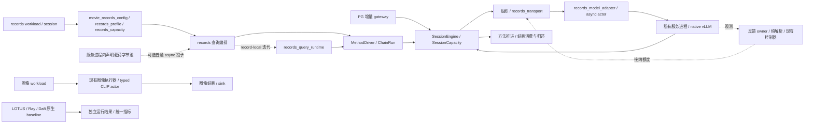
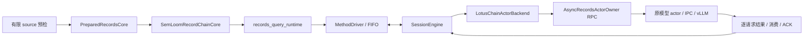

# Records 执行模块整理与容量责任

本记录对应 PostgreSQL 内置 AI 语义算子的外部分布式物理执行与调度优化中的执行工程整理。
本页按各批源码与运行身份保留过程；早期结构表不表示最新接入状态。PG／旧 HTTP 已按
[现用入口整理](../runtime_entry_cleanup_20261105/README.md)退役，当前组合见
[时间安排与组合检查](#experiment-timeout-composition)。
基准为 PR #90 的 `bfb9100e2f3fa090fdf2304359979b853236e06a`，tree 为
`c8a86b0bcff8bf0161dcbbd005bc2660060d228e`。该 PR 当时为 Draft，未合并。
本地候选只做 CPU 检查，尚待独审与统一 Git 整合；不提供模型性能结论。
同步两份 CPU 归档的当前公开格式见[路径规范化与复算](#public-cpu-evidence-copy)：公开副本删除个人 home 前缀，
私有原件及其 SHA 保留。下方早期“准确恢复原始 JSON”的叙述按当时私有原件解释，当前公开副本按各自公开摘要恢复。
机器摘要见 [checks.json](raw/checks.json)，完整输出通过运行标识
`semloom-runtime-refactor-20261104` 和其中的 SHA-256 交接。

## 整个 SemLoom 的当前结构与替换范围

这是早期源码的职责图，不代表最新入口或所有路径已经完成相同的实机资格。PG 增量路径、外部 records workload
与图像路径分别保留自身接入身份；原生 baseline 自己执行和调度。



| 部分 | 现在的实际状态 | 本次是否替换执行实现 |
|---|---|---|
| SQL、快照、权限与查询生命周期 | 数据库与已有 gateway／carrier 负责；各接入路径分别验证 | 否 |
| 方法语义、prompt/parser、合法后继 | `semantic_methods` 与已有 compatibility adapter；LOTUS 不替代数据库语义 | 否 |
| 组织、准入与任务责任 | 共享 Core、`SessionCapacity`、既有组织器与策略 | 否 |
| records 查询编排 | 记录链 owner 与 record-local 迭代已分开；普通 Core 与 `PreparedRecordsCore` 继续存在 | 已拆开组装与迭代，推进顺序保持 |
| 配置和容量解析 | 普通／Session 共用解析；普通 async Filter／rolling 的存储与 R 已在 CPU 候选分开 | 普通 async SDK 新增服务进程内互不重复的载荷授予候选；CLI、rolling 授予和硬件探测仍未完成 |
| 快照观测 | 原 owner 仍负责锁、时钟和采样；本次提取纯解析与报告字段 | 已拆分纯函数，控制算法未变 |
| 模型适配与传输 | 共用编码、actor 与传输不再依赖单 Filter 查询 host | 已拆开依赖方向，原交接实现保持 |
| 原生模型服务 | 共享请求值与同步／异步实例分开，原 actor／IPC 与 vLLM 继续执行 | 当前同步缺省、完整提示和 fused 实际上下文已有 CPU 候选；原生对照显式保留原参数，真实模型及计算中关闭仍待检查 |
| 图像与其他后端 | 原有实现和各自 baseline 继续保留 | 否 |
| 未接入的 UCB 原型 | 当前模块与导出已退出，准确原件及五项原测试保留供历史恢复 | 仅清理无运行入口的原型 |

目前完成了可核验的结构整理、参数校验修正，以及确认退出维护的原型和历史工具清理；整个 SemLoom 重构尚未完成。

### 全模块实施清单

起始静态清单覆盖当时 `code/src` 的 458 个 Python 文件和 127 个脚本入口，另列 PG C 载体与测试。
目录和脚本的逐文件信息见 [module_inventory.json](raw/module_inventory.json)。
字面引用扫描区分现行、结果、历史文件；没有引用不是删除证据，动态导入和仓库外调用仍需人工核对。

| 模块与源码入口 | 复用／重构／退出安排 | 尚未完成与依赖 |
|---|---|---|
| PG carrier：`code/postgres/semloom_pg` | 复用 SQL、计划、快照、权限及取消职责；只随真实接入补必要修改 | 新 batch/reorder 路径单独核对，不能借 records fixture 取得 PG 资格 |
| gateway／wire：`execution_provider` | 复用版本化任务／结果与 accepted-prefix；按连接、路由、查询生命周期拆职责 | 模型／IPC 与数据库生命周期分别验证 |
| 算子语义：`semantic_methods` | 复用同步 reference、prompt/parser、NULL／错误／顺序策略 | 中性语义与 LOTUS compatibility 分开，不能由调度改写 |
| 算子链：`lotus_record_chain_core`、`MethodDriver` | 重构 query host，保留合法后继、原数据和 Extract 完整关系处理 | 需同输入、多阶段及取消／晚到结果对照 |
| 数据源／准备／sink：`data` | 复用 Arrow／Daft／PG 读写；按 source、准备与消费分别计时和持有 | 不引入全量 collect；CPU 准备与派发交错另批处理 |
| work 描述：`planning` | 复用中性 work descriptor，逐步退出模态专用字段向公共策略的渗透 | token／frame 换算留 adapter，旧身份保持 |
| Core 责任：`scheduling/core` | 复用单一 `SessionCapacity.records`、租约与已确认终态；避免第二套记账 | 受新能力影响时补旧路径检查，不为统一外观重写 |
| 组织：`scheduling/organization` | 复用 ready 选择、token／字节组批、帧与候选计量缓存 | 不改变已提交批成员；准备交错需完整查询计时 |
| 动态接纳：`submission_control` | 专项重构现代资源策略；旧算法退出普通入口前必须有替代 | 动态会话拥有四个策略文件与专项测试，保留 `update_supply(...)` |
| 容量／资源责任 | 本会话集中 Core／Method／IPC 解析；R、结果、续算和字节分别表达 | 普通 async SDK 可从同一服务池领取互不重复的逻辑字节；未配置池的旧缺省保留，实际硬件容量尚未接入 |
| 路由／多 Job：`endpoint_routing` 与公共 runtime | 复用现行路由和公平性接口；清理前核对普通、诊断、历史调用 | 多副本／多卡结论仍需真实部署资格 |
| 异步 runtime：`scheduling/runtime` | 复用已有 backend、wake、借用与退休证据；缩减反向依赖 | 共享字段变化由双方先协调，unknown 不提前归还 |
| 模型适配：`records_model_adapter` 与 actor owner | 本批解除 async actor 对 query host 的反向引用，保留类身份 | 真 Ray 序列化和服务运行仍需独立资格 |
| 模型服务：`serving/backends` | 复用 IPC、ready 与已解析模型能力；vLLM 管实例内 token／KV | 不改 vLLM 源码；未知能力不当无限，显式参数保持 |
| 图文模态：`modalities` | 复用 tokenization、图像准备和 typed CLIP；公共调度仅消费能力描述 | 图像旧 HSE 与普通入口分别核对，不能外推多卡 |
| 配置／默认值 | 已拆容量与执行配置；继续核参数来源、显式／省略及缓存身份 | PID 非法窗口已修正并保留旧源；dtype／显存比例另验，不盲改 |
| 观测：`observability` | 已拆纯资源／快照解析；采样、时钟、消费和控制分别整理 | 整组额外增长失败保留；不刷新旧样本来取得通过 |
| 环境／进程责任：`infrastructure` | 复用 preflight、私有配置、监督和资源归属 | 不修改运行中 GPU 会话或把本机检查当服务资格 |
| 原生对照：`baselines` | 保留系统自己的 graph、调度与结果评价 | 历史投影精确恢复；不把 SemLoom 控制注入 baseline |
| 实验编排：`experiments` | 将运行器限定为现有能力的配置与编排，逐项核旧实验身份 | 删除前核 source、质量、调用额度与失败证据 |
| 脚本：`code/scripts` | 全量登记后分保留、历史恢复、删除；薄 CLI 入口不因短小被误删 | 六项旧工具已退出维护；其余候选逐个查独有用途，现用清单保留证据 |
| 测试：`code/tests`、PG tests | 复用行为、协议、CPU／SDK 与历史差分；减少依赖固定源码位置 | 原失败不能删除或改 skip；真实库与 GPU 检查另列 |

当前先修省略 IPC 总额的大单项问题并组合已审动态策略，再迁移同步默认、启动清理和准备交错；
旧入口继续按实际替代关系清理。研究观察排在工程与实验问题之后。

### 继续批次：模型适配依赖

基于 `ee367861` 建立独立工作树，原候选工作树保持干净供独审。
原 async actor 从 `lotus_records_core` 导入结果编码、容量失败表示与 actor 基类，连带加载查询编排。
本批新增 [records_model_adapter.py](../../../../code/src/execution_provider/adapters/records_model_adapter.py)，
由查询 host 依赖模型适配，async actor 直接复用该模块；不增加 query loop、队列或容量账本。
原 `_ActorOwner`、`_CoreModelActor` 的旧导入与序列化位置保持，其余四个 helper 保持同一对象。

六份提取定义的语法树不变；新增检查在新进程中禁止加载 query host，确认 async actor 可独立导入。
该检查改前失败，改后通过；原 actor 类型的 pickle 路径也通过。
源码位置读取器随 `_measure` 的实际提供模块更新，原历史 oracle 仍只读摘要匹配原件。
改前相关 110 项成功；最终候选 130 项全部成功，无失败、错误或跳过，运行中源码未变。
首次新增检查与四项旧源码位置失败的输出保留，未改断言取得通过。
这证明本批 CPU 接口与生命周期回归，不证明模型加载、真实 Ray 或性能改进。

### 继续批次：PID 非法配置

原 PID 配置接受小数／布尔请求窗口和布尔数值参数，声明探针实际输出过 `2.5` 或 `True` 窗口。
现按原字段单位检查：窗口及初始窗口须为整数；增益、目标和积分额度须为有限数值，布尔与不可表示的大数拒绝。
另有反例确认极大整数窗口在旧检查后仍会使 PID 浮点运算溢出，现按其实际数值表示检查有限性，未加任意计数上限。
默认值、有效数值的表示、PID 公式和三个运行方法保持，未改任何现代资源控制器。
16 条有效轨迹的 112 次决定与改前逐字节一致。

三项非法配置检查改前复现问题；修后相关 195 项全部成功，包含 profiler 配置、现行算法与历史恢复检查。
准确原 `pid.py` 保存到既有 bfb 历史目录，五份投影各追加一条 override；原摘要／投影身份保持。
3010 条历史绑定仍只有原十处不匹配，新增为零。
[机器摘要](raw/pid_configuration_checks.json)保留改前拒绝检查、有效轨迹及检查输出摘要。

### 继续批次：请求准入计数

相同类型问题也存在于通用准入：旧静态额度、动态初始窗口、在途计数及策略输出会接受布尔或小数。
现按原请求单位检查整数，非法在途计数在读取观察器／调用策略之前拒绝；非法策略输出不能覆盖现有额度或写成功 trace。
原更新间隔仍接受零与有限正数，布尔、非数值及不可表示值明确拒绝。
没有增加容量上限、修改默认值或调整旧／新控制器公式。

四项反例改前复现问题；修后相关 291 项全部成功，包含 Core、异步请求、调度、容量等待与 profiler。
旧五份投影已经各自指向原准入源码，保留这些映射，不重复保存或改写旧摘要。
[机器摘要](raw/admission_count_checks.json)记录反例及最终检查。

脚本盘点另核对 590 份生产／脚本 Python 文件的静态本地模块导入，没有发现目标模块缺失；
它不能证明所有脚本都有用途。旧 eager 汇总虽没有名称引用，仍与现行配置及其测试共享场景 ID，
这条间接关系已确认，因此本轮保留，不把它当无用脚本删除。

### 继续批次：测试接到当前异步交接

六个帧计量测试的 owner fixture 缺少实际引擎声明，本批仅为 fixture 声明显式、有限的合成上下文；
另补完整请求超长拒绝与省略上下文且没有 ready 时拒绝两项检查，没有给生产恢复 4096 默认值。
帧计量、打包旁路和请求统计相关 31 项全部成功，原选择 oracle 的语法树与所有原有断言保持。

两个 token 责任测试仍暂停已退出当前路径的阻塞方法，现暂停实际非阻塞交接的 accepted 回执；
原 W 归还、unknown 保留和迟到结果断言全部保留，两项定向检查成功。
prompt 审计改读实际 `try_submit_core` 事件，并要求覆盖全部输入 occurrence；重试的提示须保持一致。
原 prompt／结果对照断言保留，Q1／Q3／Q2／Q3 复用检查已成功。

随后选择 668 个不同方法：666 成功、1 个动态增长测试失败、1 个真实 Ray 资格检查跳过，错误为零；
运行期间源码保持。10 毫秒增长检查再次未升档，226 次更新因缺测或过期被拒，未修改采样资格或放宽断言。
初次错误、旧三项失败及全部重跑原件继续保留，不能把本轮写成整体通过。
本批只修改测试，四份受影响历史投影原件保持，未增映射或改写旧摘要。
[机器摘要](raw/fixture_checks.json)记录原断言核对、定向结果与完整重跑。

### 继续批次：链执行与共享传输

原 `LotusChainActorBackend` 和链查询 host 都要导入单 Filter 查询 host 才能取得传输与清理函数。
现由 [records_transport.py](../../../../code/src/execution_provider/adapters/records_transport.py)
集中原传输、异步等待、期限检查与 producer 清理；两个查询 host 依赖该模块，链 backend 直接使用共享模型 helper。
四份提取定义保持原语法树；单 Filter host 的其余定义保持，链 host 只改配置来源导入。
没有第二个执行循环、额外容量账本或新的重试规则。

新进程检查确认链 backend 与 host 能在禁止加载单 Filter host 时导入；原导入与序列化位置保持。
初轮回归暴露遗漏 `TaskKey` 导出，现已恢复，并保留原 backend／失败类型导出。
清理时钟和 backend mock 接到实际定义模块，断言保持；另两个旧优先级测试的暂停点接到当前 accepted 交接，
原 W、提交顺序、unknown 和迟到结果断言保持。

定向 21 项成功后，生命周期／历史对照完整 215 项全部成功，无失败、错误或跳过，运行中源码保持。
原初轮 4 个失败方法、15 个错误方法的输出保留，不能把它们从记录中移除。
历史 3010 条绑定仍为原十处不匹配，manifest 保持；本批仍只取得 CPU 资格。
[机器摘要](raw/transport_checks.json)列原断言核对、早期问题与最终检查。

### 本轮最终合并检查

在 `f548d4ed4678b9229cf5c840ae0219d7ea467d5a`、tree
`5a8cb33ccded60158130d7838db594ef15cb410d` 上合并两组方法并去重：
752 个不同方法中 751 成功，1 个真实 Ray 资格检查跳过，无失败或错误；运行期间源码保持。
随后只补结果记录，Python 源码与受测摘要逐项相同。
本次动态增长检查通过，之前两次零升档及最初额外失败原件仍保留，不能据此声称其时序问题已解决。
模型、真实 Ray 与 GPU 运行仍为零；本地候选尚待独审，未推送或合并。
[最终摘要](raw/final_engineering_checks.json)列源码身份、完整原输出摘要与历史核对。

### 后续独立批次：配置预检直接读取声明

在保留 `eb8c3836` 独审工作树的新分支中，将 `movie_records_config.py`、Session 的 `check_plan`
及矩阵固定容量校验直接接到 `records_capacity`／`records_profile`，不再为读取配置导入查询 host。
三个文件的非导入语法树保持；默认值、返回、异常、实际 owner 工厂和缓存身份均未改。
新增两个新进程检查，禁止加载查询及模型 owner：改前均复现反向导入，改后配置与公开 Session 预检均成功。
相关 167 项全部成功，无失败、错误或跳过；运行期间源码保持，未启动真实服务。
[摘要](raw/config_import_checks.json)保存改前 107 项、两项反例与改后结果。

查询主循环只读核对确认 `_tick` 仍先填充再推进；结果归还已经通知既有 wake，不能据此新增重复唤醒。
准备交错的行为改动与既有候选分别核对，本批没有改它的顺序或时钟。

### 后续行为批次：独立预算提供有限 IPC 缺省值

原独立预算调用仍须重复填写六个 IPC 字段，省略或只调反馈间隔会在创建 owner 前被拒。
现在仅在已声明完整独立预算时，以 `active_requests` 提供 IPC 请求／命令槽，以 `held_tasks` 提供结果槽，
输入／结果总字节取各自预算，控制预留沿原公式。显式值优先，未知字节和容不下一项的额度仍拒绝。
没有新增手工参数、物理容量推断或第二个账本；Core、Method 与 IPC 继续分别持有和归还额度。
普通 `budget=None` 的旧默认尚未改变，因此这不是普通默认 R 已全面解耦的结论。

三项新增反例改前复现缺省拒绝，修后相关 118 项全部成功；包括省略／部分覆盖、不同旧 R／查询 C、
缓存等价与隔离，以及复用原完整生命周期场景的 unknown、取消、迟到结果与回收检查。
另有 90 组旧默认与 30 组完整显式配置差分，返回／异常无差异；历史 3010 条绑定保持原十处不匹配。
原“缺省必须拒绝”用例按这项已授权行为变化更新，保留显式未知字节的拒绝断言及改前输出。
[机器摘要](raw/independent_IPC_checks.json)保存原反例、差分及最终检查；没有真实模型／Ray／GPU 资格。

### 后续批次：旧脚本的实际清理与用途登记

`estimate_operator_cost.py` 的私有 `_signature` 已无调用；现行分组及两种 context／candidate 身份使用
`scenario_group`／`_payload_signature`。移除该七行旧 helper，其余语法树保持，相关 20 项 CPU 检查成功。
完整原脚本逐字节存入既有 bfb 历史目录，未删除唯一来源。

七个没有现行名称引用的入口分别核对后保留，用途登记到[脚本入口](../../../../code/scripts/README.md)。
其中 PGAI 的 `--help` 首轮因顶层导入可选 `psycopg` 失败，改为实际 `connect` 时导入；
连接参数与其余函数语法树保持。重跑七项 CLI 全部通过，检查禁止模型／Ray／数据库驱动导入、网络、监听及子进程。
没有执行 SQL、加载模型或运行服务；首次依赖错误输出保留，不用安装依赖掩盖它。

两份准确旧源共增加十条历史来源映射，3010 条绑定保持原十处不匹配，新增为零；原摘要及投影身份保持。
当前没有确认整份脚本可删除，不能将这项私有 helper 清理写成历史脚本已全部清空。
[机器摘要](raw/script_cleanup_checks.json)登记旧源、测试、首次 CLI 失败和最终结果。

### 后续批次：记录查询迭代与 owner 组装分开

将完整 `_RecordLocalRows` 及原期限检查移入
[records_query_runtime.py](../../../../code/src/execution_provider/adapters/records_query_runtime.py)，
让查询迭代独立于模型／传输／容量组装。原 host 导入与序列化位置保持，没有新增控制循环或任务记录。
两份提取定义和 owner 其余定义的语法树保持；准备、advance、消费、采样顺序与异常处理均未改。

新进程检查禁止加载两个查询 owner、async actor 及反馈组织模块，仍可导入迭代器并检查取消。
相关 153 项全部成功，无失败、错误或跳过，覆盖原数据、合法后继、Extract、W、结果消费、unknown、取消与回收。
历史 3010 条绑定仍有原十处不匹配，没有新映射。该结构整理不等于准备与派发交错已完成。
已有 `b258c575` 候选仍默认关闭，尚未与当前独立预算组合验证；本批只读其来源，不重复实现或导入。
[机器摘要](raw/query_runtime_checks.json)保留准确源码与检查结果。

### 后续四批的最终合并检查

在 `ce75c7c5c37191ceb70b4822c3fef78fefef5a0a`、tree
`aa69f857bd9c16626e544d9dd35b613416853b98` 上合并去重：956 个不同方法，955 成功，
1 个真实 Ray 资格检查跳过，无失败或错误；运行期间源码保持。随后只补记录，Python 文件与受测摘要相同。
此前 897 项合并检查、最初反例、CLI 缺驱动与历史失败原件全部保留，不以最新通过替代旧时序问题。
[最终摘要](raw/followup_final_checks.json)记录完整原输出与源码身份。

动态专项 `b99d9f05` 的两项采样修正及后续计数倒退修正已通过对应增量独审，未发现新阻断；
该结论不覆盖本工作树组合，公共工厂仍未切换。已只读核对其接口及补丁摘要，下一批接实际 owner／IPC／存储许可，
保持源引擎／查询／原生采样身份，拒绝旧调参字段的隐式套用，不制造缺失的拒绝计数。
本轮仍未运行真实模型、Ray、GPU、SQL 或服务，未推送或合并。

### 新接线批次：保留已审控制器原件

上一批实际 HEAD 为 `a59f4236cd8d6eabe06c1ddce1d89b7322ef18d9`，tree
`5f436cacb611e7bf8e67a1d15a62ddb3a99d4cc3`；早先聊天回复拼错的完整字符串不属于 Git 交付。
落盘交接和 bundle 均使用上述真实值，原审查工作树保持干净。

新独立工作树先导入 `b99d9f05` 的三个生产文件与三个测试文件，六份字节均与已审候选相同。
相同模块选择在当前底稿运行 327 个不同方法，全部成功；原 332 项中的五项 UCB 原型已从现行模块退出，
准确原件与原测试仍由已有归档检查恢复，未将这些用例误记为新失败或跳过。
历史 3010 条绑定仍为原十处不匹配，未改公共工厂或默认行为。
[摘要](raw/policy_import_checks.json)记录源码、补丁与测试身份；组合独审尚待安排。

### 新接线批次：原生采样与窗口策略分开

`records_native_sampler.py` 接管原单 RPC、Source 资格、取消与回执状态，批反馈复用同一实现。
十五份采样方法的语法树保持；查询及窗口控制状态留在调用方，没有新请求队列或容量记录。
新增独立导入检查确认采样器不加载查询 owner 或窗口策略。

初轮 124 项有十个方法失败，原因是模拟时钟仍只注入旧模块；现同时接到采样与策略的实际模块，
原快照断言全部保留。最终相关 126 项全部成功，无失败、错误或跳过，初轮输出保留。
[摘要](raw/native_sampler_checks.json)列准确方法与输出；公共工厂、源端时钟映射及默认 R 尚未在该批改变。

### 主要结构问题

- 查询 runtime 仍处理 source、方法阶段、准备填充、派发、结果、取消和关闭，仍有跨类私有属性依赖。
  `_RecordLocalRows._tick` 先填充再推进的行为也没有因本次提取而改变。
- R 的默认换算仍混合请求、驻留与存储；完整独立预算虽已支持，普通入口仍不够清楚。
  完整关系和审计对象不都计入现有逻辑字节额度。
- 现代请求反馈仍沿 `AscendingRequestController → SupplyFeedbackController → ResourceFeedbackController → AimdAdmissionController`
  继承。源码中的 `low_load_kv_usage`、`congestion_kv_usage`、增减步长仍有实际读取，
  不能说旧 AIMD 已经被完全替换，也不能删除基类后留下唯一调用路径无法执行。
- 快照资格、压力、性能试探和历史兼容交织；一次 10 毫秒测试未升档不能单凭结果判定硬件不足或算法错误。
  本次保留了整组额外失败，尚无原因已查清的结论。
- 初次盘点时 `BoundedStageWorkController` 仍在生产目录，仅见测试与历史材料；
  后续已单独[移出生产模块](#stage-work-retirement)，原历史检查和供给控制方法保留。
- 配置校验并不一致：只读 CPU 声明探针确认 PID 接受小数或布尔窗口，并可输出同类型窗口。
  该缺陷随后已修正；有效旧配置轨迹与历史原件分别验证，详见 PID 继续批次。

### 两条实施路线

| 路线 | 可执行起点 | 收益与主要风险 | 判断 |
|---|---|---|---|
| 扩大渐进重构 | 先拆部署容量与请求策略，再拆查询 host，接着将现代反馈改为独立策略输入／输出；每批以原路径作对照 | 能复用已有任务责任、IPC、取消、方法语义与测试；若只搬函数而不解除职责耦合，问题会继续存在 | 当前优先 |
| 并行新实现 | 在独立工作树实现新的 SemLoom query runtime，先接 sealed-task producer 和合成 backend，再逐条接原 provider | 可以重新组织模块；需重新证明所有晚到终态、未消费结果、取消、重排和质量行为，不能假定重写后更快 | 保留为替代方案 |

推荐继续较大范围渐进重构，同时允许用一个独立的新 host 切片检验接口设计；不用新旧两个控制器共同决定同一请求。
当前源码不能支持“删除整个仓库即可解决问题”的判断。若新 host 仍必须读取旧 owner 的大量私有状态，
应以该具体阻断评估独立实现，而不是继续增加薄 wrapper。

迁移按职责逐批推进：

1. 先交本页全貌、已改／未改和失败原件；当前候选保持可恢复，停止无证据的大量删除。
2. 与资源控制专责统一现代策略的输入、压力证据及容量来源；把仍有效的保护与旧试探规则分别核对，
   有可测试替代后再退出旧生产分支，历史具名选项从原投影恢复。
3. 将准备、接纳、派发、消费编排聚合到单一 query runtime，复用方法与 Core 的现有事实记录，避免第二套任务账本。
4. 用同一输入运行同步 reference 与候选，核 Filter→Map 原数据、合法后继、Extract 关系、关联、顺序、NULL／错误、
   exactly-once、未消费结果、unknown 与迟到终态；PG 接入另验 accepted-prefix、快照和取消。
5. CPU／SDK 通过并独审后，由唯一实机会话比较同模型、生成、服务和资源配置下的完整查询时钟与质量。
   首次／复用和 source、准备、传输、排队、模型、消费分列；不把 CPU 或单次组件检查当性能收益。
6. 逐入口替换后删除无调用的旧分支和配置；实验 CLI 先查调用、文档、CI 与历史恢复，再决定保留、归档或删除。

以上两条路线都保留原生 baseline 的执行所有权、历史摘要、失败证据与恢复材料。
本次没有启动新的 Ray／模型／GPU 实验，也没有删除用户原仓库或其未提交文件。

### 已实际完成的旧原型清理

对 UCB 查过维护代码、脚本、公开导出、文档与历史投影：未发现运行调用，profiler 也未提供该选项。
仓库无 `.github` workflow；现有 `pyproject.toml` 为代码检查配置，未发现 UCB 的 CI 执行入口。
理论文献中的 UCB 名称与旧研究计划仍保留各自用途，不据此删除文献或历史结果。

本批删除当前 `code/src/scheduling/submission_control/ucb.py`、四项公共导出及当前测试文件中的五项原型用例。
先核对并保存准确 bfb 的实现、原导出和完整原测试文件，再修改当前路径；没有丢弃唯一字节。
五份历史投影共追加十条来源映射，原 expected 摘要和投影 ID 不变。
原五项用例仍从准确旧源运行；归档不是算法被现代控制器等价替换的证明。

清理前相关 43 项全部成功；清理后现行控制、历史策略、阶段工作与归档恢复共 61 项全部成功。
61 项包含一个内部运行原五项用例的恢复检查，不另外相加。完整 3010 条历史绑定保持原十处不匹配，新增为零。
UCB 清理时 PID 探针只记录缺陷，随后配置修正另批实现；仍在执行的 AIMD／EWMA／HOL-age／PID 未删除。
古早脚本仍需按实际调用与恢复关系逐项审查，本轮没有无证据地批量删除，也不声称整个项目已清理完成。

### 与动态专项的实际交集

只读核对 `/tmp/semloom-capacity-bfb-integration-20261104` 时，该工作树以 bfb 为父提交，
正在修改 `adaptive.py`、`request_scan.py`、`stage_work.py`、`resource_probe.py`、
`scheduling/core/models.py`、`scheduling/runtime/observations.py`、`lotus_chain_token_batches.py` 及三个专项测试。
这是未提交候选，不能写成 PR 已有能力。本次不修改其工作树，也不继续编辑这些策略文件。

与本会话已经提交的第二批只有 `lotus_chain_token_batches.py` 存在文件交集，
本会话集中在纯解析／报告与薄委托，原状态方法保持；整合者仍需对照专项的新调用与报告字段逐方法处理。
当前 UCB 清理文件与上述只读清单没有交集。
容量解析先接兼容导入，再接观测纯函数，随后整合动态专项；默认 R 的行为迁移须单独验证，不能混入移动代码。

## 容量实际归属

以下为源码核对结果。R 是旧 `RecordsResources.max_active_batches`，C 是查询接纳窗口；
IPC 表示模型进程间通信。已有独立资源对象继续负责记账，没有新增控制器。

| 资源 | 实际记账与归还 | 旧默认换算 | 显式独立声明 |
|---|---|---|---|
| Core 驻留任务 | `SessionCapacity.records`；结果租约归还后删除记录 | `held_tasks=R` | `budget.held_tasks` |
| Core 输入／结果字节 | 真实输入长度与每任务结果预留；随记录保留 | 各为 R × 单项额度 | `budget.input_bytes/result_bytes` |
| Core 模型请求／工作量 | 记录上的 compute 状态；确认终态后归还 | 请求和普通请求工作量为 R | `budget.active_requests`；既有可选 token 工作量仍单独解释 |
| Method 续算及最终结果 | `MethodBudgetPool`；消费者归还最终行后释放 | R 个续算；R × 完整逐行预留 | `budget.method_runs/method_bytes` |
| IPC 请求／结果／命令／控制槽 | `AsyncEngineLimits` 与原进程 owner；沿原 ACK、消费和清理路径归还 | 请求、结果、命令槽从 R 换算；控制预留保持原式 | 完整独立预算提供有限缺省值，`async_limits`可部分覆盖 |
| IPC 输入／结果字节 | 原进程 owner 持有；unknown 不能当已完成 | 输入总额从 owner R 换算；结果总额从结果槽换算 | 显式总额和单项额度分别保留 |
| 引擎序列／每轮 token／模型上下文 | vLLM 解析与实际 ready 回执 | 异步省略值已交给引擎 | 显式值保留；实际模型长度仍检查 |

旧默认的 R 仍会同时影响多种容量。本批将该换算集中表达，保留历史行为；
不能据此称普通默认已经完成 R 解耦。显式独立预算已能分别生效，并能为省略的 IPC 字段提供有限缺省值；
当前仍须声明完整 Core／Method 预算，不自动探测硬件，普通调用方配置还需继续简化。
完整预期关系、调用审计及 Python 对象开销不都包含在上述逻辑额度中，不能把它们称为进程内存上限。

## 可达执行链与验收

维护配置经 `movie_records_config`、`create_records_core` 进入普通 Core 或
`PreparedRecordsCore`。后者复用 `SemLoomRecordChainCore`：方法产生合法 ready 请求，
`PreparedTokenOrganizer` 组织传输批，原 transport、async actor 与私有模型进程负责交接，
Core 处理逐成员终态和结果，Method 推进合法后继，消费者归还最终行。
这条 records 路径保持外部 workload／fixture 身份；PG gateway 使用共享 Core 不能代替其自身接入检查。

| 验收对象 | 本批保持的行为与已有检查 | 尚需处理 |
|---|---|---|
| 合法依赖与原数据 | Filter→Map 原数据、逐记录补位、Extract 完整关系要求；运行既有多阶段 CPU 用例 | 新推进策略须另验完整查询与输出 |
| 准备、传输、模型、消费 | 主推进方法与 actor 方法定义保持；慢结果不改批成员 | `_tick` 先填充再推进的交错候选另审 |
| 容量及 unknown 责任 | Core、Method、IPC 沿原对象保留额度；结果未消费和未知终态不提前归还 | 普通默认仍耦合 R；完整关系与审计占用另核 |
| 引擎参数 | 不改已接入的实际上下文、原生序列／token 默认委托 | dtype 与显存比例默认另行核对 |
| 查询时钟与质量 | 不移动 start/evaluate/消费时钟，不改 prompt/parser、输出或计量字段 | 真模型、真实 Ray、多卡与完整查询比较尚未验证 |

## 首批：容量与执行配置分离

新增 [records_capacity.py](../../../../code/src/execution_provider/adapters/records_capacity.py)，
集中原 `RecordsCapacityBudget`、`CoreRecordsCapacity` 及 IPC 解析；各资源仍消费
`SessionLimits`、`MethodCapacity`、`AsyncEngineLimits`。
新增 [records_profile.py](../../../../code/src/execution_provider/adapters/records_profile.py)，
集中 sync/async 选择、具名历史选项和 token 组批选项的验证。
旧 `lotus_records_core` 导入保留同一对象，容量类型的序列化路径保持。
异步 actor 与链直接引用容量模块；生命周期、模型分配、关闭与 ACK 代码不搬动。

六份提取定义的语法树与 bfb 完全相同；其余 Core、链和异步 actor 的类／函数定义保持。
402 组声明回放的结果、错误类型与消息相同，包含普通／独立预算、C、R、IPC、历史选项与非法值。
原套件 145 项为 144 成功、1 既有失败；候选相同 145 项加 4 项新检查为 148 成功、相同 1 项失败，
没有错误或跳过。新检查覆盖旧导入、序列化、各预算只改变所属资源，以及独立预算不随旧 R 改变。
既有失败为 `CoreFeedbackTests.test_actual_new_method_prompts_Q1_Q3_Q2_Q3_reuse_one_model`，
本批没有改写它。两个套件运行期间源码均未变化。

随后扩大检查发现历史策略的测试读取器只在旧文件查找配置函数，产生 4 项新失败。
已让当前源码读取跟随显式 `records_profile` 导入，历史 oracle 仍只从 manifest 核对的原件读取，
重复定义立即报错；该组 18 项修订后全部通过。初次 4 项失败的原输出保留。
另在独立 bfb 原源码工作树复现 2 项 token 生命周期失败和 6 个帧计量方法错误
（共 68 次错误事件，含子用例），这些不是本批引入，不能改报成功；具体标识见机器摘要。

五份历史投影的 3010 条绑定保持原 10 处不匹配，本批新增 0；原 manifest、摘要、投影身份和副本不变。
此前配置工作的六项失败及资产／SDK 缺项仍从原报告读取，本批没有重跑全部用例，
不能将不同源码或范围的数字相加，也不能称整体回归全绿。

## 第二批：纯观测与快照报告

[records_feedback_observation.py](../../../../code/src/execution_provider/adapters/records_feedback_observation.py)
接收已有观测值和复制的 RPC 状态，负责资源值解读、CPU 观测时段检查、快照头、有限整数及报告字段拼装。
`BatchSupplyFeedback` 保留旧方法名作为薄委托；`_read_resource` 仍先调用其原可替换的 `_resource_view`。
组织器、实际采样、原锁、时钟、样本消费、收尾与控制决定留在原处。

1,234 组改前／改后回放字节一致，覆盖缺测、非法类型、非有限数、大整数、多设备、CPU 观测时段，
以及关闭、未取回终态、取消 Future、保留引用、回执缺项等报告状态。
语法树检查确认 `PreparedTokenOrganizer`、`RequestSupplyFeedback` 和其他状态修改方法完全相同，
报告复制责任信息的原取锁范围相同；没有重做帧头计量或候选缓存。

并发报告测试原先按旧函数的源码行号暂停，提取后出现 1 个方法的 2 次错误事件。
现只将暂停点移到实际报告函数，保留后台晚到终态、原报告 unknown 与后续报告 closed 的全部断言；
快照与资源诊断相关 52 项全部通过。初次错误输出保留。

最终去重相关检查选择 326 个方法：315 成功、4 个方法失败、6 个方法错误、1 个方法跳过。
错误共 68 次事件，包含帧计量的子用例；跳过为未选择真实 Ray CPU 检查。
相同顺序的准确 bfb 对照选择 322 个旧方法：312 成功、3 个方法失败、相同 6 个方法错误、1 个方法跳过。
候选新增的 4 个容量检查均成功，但最终整组另有反馈增长断言失败，不能宣称没有剩余问题。

该额外失败为 `CoreFeedbackTests.test_unbudgeted_feedback_grows_on_CPU_IPC_once_and_matches_fixed_results`：
当轮 232 次控制调用中 229 次记录 `missing_or_stale_feedback`，没有扩大窗口。
原套件两次较小范围检查通过，准确 bfb 的整组对照通过；预定两组原源码／候选单项配对均通过。
完整整组失败保留，原因仍待查，不能仅凭重跑成功归为原有失败或视作已修复。
普通 Core 反馈方法的语法树未变；本批不修改其时间、采样或策略来取得通过。
独审与该时序问题完成核对前，不进入发布整合。

另用已有含 LOTUS 1.2.4／DuckDB 的 CPU 环境检查上下文、旧 Session、普通 token 入口及配置：
81 项选择中 80 成功、1 项跳过，没有失败或错误。该组保留自己的解释器与依赖身份，
不与上述重叠用例累加；跳过原因和方法标识见机器摘要。同步、IMLane、常驻／独立查询兼容仅有 CPU 资格。

## 默认 R 解耦的后续实施次序

1. 以本次已集中表达的容量解析为唯一入口，保留具名历史／同步选项的旧换算。
2. 对普通入口补齐部署资源声明的来源与共享方式，再将请求额度与驻留／结果／续算存储分别绑定。
   复用已有类型与有限字节声明；未知值继续拒绝或保留原有限配置，不能当无限额度。
3. 在配对 CPU 用例中核输入、未消费结果、未知终态、跨查询复用与缓存身份，再交独审和实机比较。

本批不增加用户必须逐项填写的参数，也不从剩余显存或原生序列数推导宿主存储额度。
少量配置的普通入口仍需以上来源核对；没有新增容量策略或声称已自动选择硬件最优值。

## 后续拆分与并行职责

| 对象 | 当前核对与下一步 | 分工 |
|---|---|---|
| R 与默认配置 | 先完成本批结构提取，再以配对 CPU 用例验证少量声明如何解析为已有独立额度；未定默认不能写成最佳值 | 本会话统一安排 |
| 纯观测解析与报告 | 本批已提取无状态资源解读、快照头及报告拼装；原锁、时钟、样本消费和控制决定保持 | 本会话 CPU 候选，待独审 |
| 准备／派发交错 | `_RecordLocalRows._tick` 仍先填充再推进；变更会影响调度与完整耗时，不能作为单纯移动代码处理 | 已有准备交错会话负责行为候选 |
| 压力样本消费 | 待 RPC 时清除未消费样本的候选已有独立证据；提取不改 `_consume_snapshot` | 已有压力会话负责修正 |
| 取消与审计交付 | bfb 保留被接收方暂拒的审计回执；计算退休、审计交付和 ACK 分别核对 | 已有生命周期会话继续负责 |
| `adaptive.py` | Aimd、EwmaAimd、HolAgeAimd 在 PG profiler 可达；ResourceFeedbackController 在普通 records 可达 | 动态专项负责替换前的核对，本会话不并行修改 |
| `request_scan.py` | AscendingRequestController 在 request feedback 可达，并复用原几何搜索／成对证据 | 先列现行和历史调用方，再决定是否归并 |
| 帧与候选计量 | 原 `_header_sizes` 缓存及已有重复计量修正保持 | 不重新实现同类缓存 |
| Git 与实机 | 每批 CPU 证据交独审，准确候选交唯一 Git 整合；GPU 会话独立使用服务与测试计划 | 本会话不推送或合并、不启动模型／Ray／GPU |

普通默认 R 解耦、完整关系与审计内存、真实库及模型资格均为后续工作，
不能用本次代码提取或 CPU 通过替代。多卡路由仍属待验证设计。

文件交集须按方法核对：压力候选也修改 `lotus_chain_token_batches.py`，但本批未改其样本消费方法；
生命周期会话使用 `lotus_record_chain_core.py`，本批仅调整容量导入。整合时不能用整文件覆盖对方修改。
状态、台账与 README 也有文档交集，由唯一 Git 整合者逐项处理。


## 原生采样时间与实际服务归属

实际 vLLM ready 新增自身实例标识及内存分配／错误处理归属；它不提供物理可用请求数。
同主机模型 actor 根据私有子进程原生时间给出采样年龄，driver 使用 RPC 发起时刻保守映射，
同一源序号重复读取保留首次时间。无效年龄、不同实例／查询、逆序或同序号改时均拒绝。
现有公共策略尚未切换，旧采样与模型参数保持；新增信息只在验证过的 ready 上产生。
51 项 CPU 检查全部成功，含实际 ready 打包和 actor 快照、跨时钟偏移及进程收尾；
不加载模型、不启真实 Ray／GPU。3010 条历史来源保持原十处不匹配，无新增。
[摘要](raw/native_source_checks.json)登记准确输出身份；真实服务与整树独审仍待完成。


## 公共工厂与实际资源许可接线

普通 Core、滚动 token、Movie CLI 和 session 的 `kind="resource_feedback"` 现选择已审 b99 策略，
三个原策略文件逐字相同。新 adapter 复用已有 Core、传输、单 RPC 采样与完成回执；
请求从一开始，仅改变未来选择。同次 provider 读取返回观察值与其准确源对象，许可不借用较新的缓存帧。
许可来自实际 owner／Core／IPC／结果字节；vLLM ready 只说明分配及错误处理归属。
原生拒绝计数仍未知，未捏造零；没有已接通的独立内存压力来源时，要求该来源的配置直接拒绝。

新入口拒绝旧 KV／busy 阈值选项，不导入跨查询推荐。显式 `legacy_resource_feedback`、两种具名历史配置
及直接传入旧 typed 对象保留原策略，历史缓存只接受该显式选项。旧数值、方法规则和原生 baseline 保持。
Core 的旧反馈原方法语法树保持；3010 条来源仍只有原十处不匹配，摘要和映射不改。

最终 309 个不同方法为 308 成功、1 个上游 checkout 资格跳过，无失败或错误。
覆盖实际本地 CPU IPC、两次查询复用、空查询、缺 ready 拒绝、较小结果字节额度、同次采样来源、
快后继／慢同批成员、取消／unknown、配置、历史缓存及策略状态机。
[机器摘要](raw/public_request_wiring_checks.json)保存每次选择、首次错误和准确输出摘要；各轮相互重叠，不相加。
初轮逻辑 Movie 时钟只接旧模块，现同时传给采样模块且保留全部原断言。
两项 10 毫秒旧增长检查在一次扩大运行失败、干净底稿与后续候选检查成功，时序原因仍未解决。
一次不存在的测试模块选择错误已保留，修正选择后才得到上述最终结果。

本地候选待整树独审，未推送或合并。普通默认 R 和 b258 准备交错组合仍待后续实现与测试；
本轮没有模型、真实 Ray、GPU 或服务器运行，不证明查询性能或多卡能力。


## 公共工厂独审后的测试与说明修订

独审发现两个历史差分用例没有迁移当前侧的显式旧策略选择和计算工作量属性；
现已修正，原 ee39 来源及全部数值、交付、工作量、顺序断言语法树保持。
原链接的校准说明改为给出可直接解析的新配置，并明确当前请求从一开始、不支持跨查询 hint／缓存；
几何、压力模式及条件续扫段落全部标为显式历史路径。采样文件多余尾空行已清理。
新增说明示例检查与历史／公共入口共 30 项 CPU 检查全部成功，运行中源码保持。

独审原 309 项为 305 成功、3 个方法在本地 Unix socket 创建时被拒、1 项上游 checkout 跳过；
另选的 18 项中有上述两个新增错误。原独审与作者运行各自保留，不以本轮改报原检查通过。
这棵修订树的普通默认 R 仍是声明量、未指定预算时仍与存储相连；没有自动硬件额度。
默认容量与准备交错另批验证，本次待复审且未推送、合并或运行真实模型／Ray／GPU。
[修订摘要](raw/wiring_review_checks.json)记录准确原输出与独审来源摘要。


## 普通默认 R、存储分配与校准身份

普通 async Filter／rolling token 工厂、Movie 预检／执行、session 和离线校准现在共用一个配置解析结果。
C 只限制未来请求选择；R 仍来自调用方声明，默认值 2 未改，也没有自动探测硬件。
省略完整 budget 时，Core 字节来自已有 IPC 有限总量并至少容纳一个自身单项；
Method 字节按单阶段完整 continuation 与输入／结果整项容量推导，任务和行数保护位于字节容量之上。
结果槽、IPC 字节及请求许可继续独立生效；显式较小 IPC 总量／单项不扩大，完整显式 budget 和 typed IPC 保持。
因此这些值仍可限制接纳，但它们是软件分配，不能称物理内存余量或可持续模型并发。

发现并修正离线校准仍按旧 C 解释存储的问题；新默认使用 `records_capacity_policy_v2` 记录实际解析结果，
C 扫描不重新分配存储，原生每轮序列数不再截断新外层请求候选。旧显式历史策略沿用原分配和身份。
低层直接构造、非 rolling 整批默认、同步／异步模型规范及生命周期仍待迁移，不宣称整个 R 问题已完成。

最终 388 个不同 CPU 方法为 387 成功、1 个上游 checkout 资格跳过，无失败或错误；
模型、真实 Ray、GPU 和外部服务运行为零。覆盖硬 R／软 C、Core／Method／IPC、不同显式帧大小、
unknown 预留、连续查询／消费／收尾、空查询、配置示例、历史差分及缓存隔离。
首次旧默认预期、非法布尔入参和遗漏的校准解释均按原运行保存；各轮重叠，不合并相加。
[机器摘要](raw/default_capacity_checks.json)保存准确输出摘要和未迁移范围。
3010 条历史来源仍只有原十处不匹配，manifest／原摘要未改；候选待独审且未推送或合并。


## 历史启动脚本退出维护目录

按现用调用、测试导入、配置和可恢复来源核对后，移除以下三条旧启动入口，共 281 行：

| 移除文件 | 原行数 | 保留用途 |
|---|---:|---|
| `code/scripts/experiments/run_saor_project_mechanism.py` | 103 | 旧 Project 机制运行的准确来源 |
| `code/scripts/experiments/run_saor_feeding_ceiling.py` | 79 | 旧直接供给上限运行的准确来源 |
| `code/scripts/experiments/run_saor_feeding_gap_diagnostic.py` | 99 | 旧供给间隙运行的准确来源 |

没有现用 Python 或测试导入这三条脚本，配置中的相关记录属于历史源码摘要，原始结果不改。
历史原件从 10073 字节压缩为 3651 字节，五份具名投影新增十五条恢复映射；逐文件 SHA、
投影身份和已有映射保持。解码长度取原件实际字节数，不作为执行或模型策略参数。

49 项针对性 CPU 检查全部成功，含保留的 SAOR 离线分析；加入历史差分及说明示例后，最终 68 项全部成功。
三个恢复后 CLI 的解析检查成功，
模型模块、网络、服务和进程创建均被测试拒绝。原完整历史检查仍在五份投影遇到原来源问题，
3010 条来源的原十处不匹配保持，首次失败输出保留。已有输出目录现在在读源前明确拒绝，
保留其中原文件；没有输出覆盖或模型运行。
[清理摘要](raw/obsolete_entry_checks.json)登记逐文件来源、检查与剩余项。

当前保留仍有调用的 native-system 入口、离线汇总器和实际后端；没有把全部 SAOR 文件当作无用代码删除。
本地候选待独审，未推送或合并；其他过期执行流程与入口继续按同样方式逐项清理。


## 历史源码缺失映射修复

原 3010 条来源中的十处不匹配来自两份维护文件后来改变、历史映射未补齐。
只读查询原仓库保留的 Git 历史，找到与全部五份既定 SHA 完全相同的原件：

| 来源文件 | 准确 Git 来源 | 原件字节数 |
|---|---|---:|
| `code/src/observability/metrics/resources.py` | `e8eb34555ad39d575a5d86b54260eca0e72cf701` | 13747 |
| `code/src/scheduling/core/session_policy.py` | `219094151c59346f106c77545730f6941e15821b` | 5070 |

原件按实际来源目录各保存一次，五份投影只增加十条对应映射。维护实现、预期逐文件 SHA、
投影 ID、原始来源版本、全部既有映射及压缩元数据保持；原仓库和用户工作文件未写入。
修复后 3010 条来源全部匹配，五份完整投影实际构造并逐文件核对成功。
51 项 CPU 检查全部成功，无错误、失败或跳过；旧失败输出和当时十处问题的记录全部保留。
[机器摘要](raw/history_source_repair_checks.json)记录精确来源与原输出摘要。

这只修复可验证的代码恢复，不补报旧失败运行、上游环境、真实模型、质量或性能。
没有模型／真实 Ray／GPU 或外部服务访问；候选待独审，未推送或合并。

### 原生参数测试跟随公共容量解析

扩展回归在共享模型规范提取前的 `29de82b` 上复现四个未迁移方法：旧断言仍把 C 当作 owner R，
把结果槽绑定 R，且旧缓存用例选择了当前无提示策略。只迁移三处容量断言与一处显式历史选择，
保留省略／显式模型参数和签名差分断言，并补当前策略拒收旧缓存的检查。
相关 47 项全部成功，无错误、失败或跳过；生产源码、历史映射和原生 baseline 行为保持。
[机器摘要](raw/capacity_native_test_checks.json)保留改前 14 项的全部失败及错误摘要和原件 SHA。

### 查询容量测试覆盖独立驻留额度

提取前原树又复现七个未迁移方法。测试现分别核对 owner R、当前 C、实际请求峰值和输入／结果
驻留额度；全部原输入、usage、逐查询回收、取消回执、小 RPC 池与调用次数检查继续保留。
52 项全部成功，生产代码未改。一份准确旧测试保存为恢复来源，五份投影只追加映射，
3010 条来源全部匹配，既定摘要不改。[机器摘要](raw/query_capacity_test_checks.json)
保留改前结果、一次错误迁移 RPC 池断言的失败、来源缺项发现和最终检查，原始输出保持。

### 同步与异步共享请求值提取

共享定义迁到 [vllm_protocol.py](../../../../code/src/serving/backends/vllm_protocol.py)，
包含 EngineSpec、GenerationSpec、解释器检查、完整请求身份／内容校验与结果转换；十三份原定义
语法树保持。四十份调用文件只改变共享定义的导入位置，旧导入和旧 pickle 名称继续解析为同一对象。
异步 kernel 与 IPC 可在禁止加载同步 owner 的新进程中导入，异步采样也不再借用同步类的方法。
没有复制请求／结果转换，也没有引入新调度器或改写模型实例的执行算法。

跨模块组选中 1350 个方法，实际运行 1345 个；1315 成功、30 个方法跳过，另一个包含五个选中方法的类
因缺固定 vLLM 源码跳过。没有失败或错误，运行期间源码保持；使用已有固定版本 CPU 环境，
禁止真实 Ray 初始化与 vLLM 加载。覆盖同步管道、异步 IPC、CPU 原生 Daft、方法链、取消、
回执／ACK、资源反馈和历史恢复；没有真实模型或性能资格。新增二十条准确恢复映射后，3010 条全部匹配。
[机器摘要](raw/engine_protocol_checks.json)保留改前导入失败、首轮环境／旧数值问题、所有跳过与原件摘要。

本批仅拆共享定义与方法借用。`legacy_*` 属性、同步的旧默认和启动失败清理仍待迁移；
共享 BF16／0.8 未改，GenerationSpec 的 max_tokens=8 仍属于算子输出语义。
省略 IPC 总额的大单项独审反例与 c4d5e5c 的动态策略组合另批处理，不能据本组检查声称它们已完成。
原五项基线失败与旧跳过保留原证据，本组选定检查不为它们补报资格。

### 省略 IPC 总额时容纳声明的大单项

独审发现普通默认从既有 16 MiB 总额构造 typed IPC 时，会先拒绝已声明的 32 MiB 单项，
之后的 Core 存储推导执行不到。修正只对省略的 input_bytes／result_bytes 取既有默认与
对应有效 IPC 单项的较大值，再运行原类型检查；显式总额和 typed limits 不改，小总额不能容纳
自己的单项时仍拒绝，Core 与 IPC 分别声明较小单项也继续保留。没有按 R 扩大字节、增加策略或改模型参数。

相关 107 项 CPU 检查成功，无失败、错误或跳过；覆盖普通／rolling、不同 R、Core／IPC 大单项、
显式小额度、非法类型、session 解析及原有 unknown／取消。作者直接重放原审查脚本的 16 个
构造案例全部接纳，均未分配模型；原脚本未改，重放不等于独立复审。
[机器摘要](raw/implicit_ipc_total_checks.json)保存改前错误、最终结果与原件摘要；真实模型仍未验证。

### 已审动态策略与真实回执工作量接线

实际入口现组合已审 `c4d5e5c0a66b61e117bd6a71bc13c06a4d93149b` 的三份生产文件及四份测试，
七份原件字节一致；普通与 rolling 路径继续通过明确的 update_supply 调用它。
许可取实际 Core／IPC／结果字节声明，接纳观察与已接受的 native 来源成对读取，
真实 session 与 model owner 在首次派发前绑定；原采样、时钟和 RPC 责任实现保持。
旧 KV／busy 阈值只由显式历史选择使用，当前策略没有跨查询提示或自动硬件容量。

进一步修正普通路径工作量只随消费更新的问题：把已交付累计值与同 session 的已校验保留回执合并，
在读取 native 观察时间前捕获；已消费、其他查询和重复读取不重复计数。unknown／失败不计为
成功工作，缺失成本保持未知。复用既有累计值和仍由传输持有的结果，不另保存结果或资源账本。
原消费、ACK、释放、取消和历史反馈方法语法树保持。

定向组合 441 项 CPU 检查全部成功，无失败、错误或跳过，运行期间源码保持；
覆盖已审策略的全部相关组、实际普通／rolling 工厂、源绑定、RPC 与大单项修正。
历史 3010 条来源全部匹配。[机器摘要](raw/current_request_policy_checks.json)保存工作量改前反例、
准确策略摘要与组合结果；更广回归按其自身提交和源码指纹单独交接，不叠加计数。
R 仍是默认 2 的调用方声明，IPC 默认许可仍有限；这些值不表示硬件探测。
整个候选仍待独审和真实模型验证，同步默认及准备交错尚未迁移完。


## 已有完整预算时省去旧 R 声明

普通 async Filter 与 rolling 工厂现可保留显式 `max_active_batches=None`，实际 owner 请求许可
从已有完整预算取得，Core、Method、IPC 分别保持自己的计数与字节额度。无完整预算时提前拒绝，
包括 `max_inflight="auto"`；不会回落到旧值或将缺测当无限。调用方原配置与 None 声明保持，
CLI、常驻／隔离 session、离线身份和真实 CPU IPC 的连续查询均有覆盖。

原九项反例全部发生配置错误；修正后相关 167 项全部成功，无跳过，历史 3010 条来源全部匹配，
没有改预期摘要或投影身份。见[检查摘要](raw/unspecified_request_checks.json)；完整输出以运行标识
`semloom-automatic-request-capacity-20261104` 与其中摘要交接，各组重叠不能相加。
普通省略默认仍为 2，默认 IPC 结果槽仍为 8；自动容量、默认迁移及真实模型资格尚未完成。
本批未改动态控制器或 native 采样；先前独审发现的回执与压力问题由专项修正，组合仍待复审。


## 未知工作量下的 native 压力与容量组合

已审 `54b1f526` 的两文件增量按准确原字节接到 None／完整预算候选。native 观察继续使用
自身来源的新鲜度；回执工作量不可用只暂停性能比较，不吞掉真实压力。原序号／时间去重、
unknown 的资源持有、消费、ACK 与归还保持，actor、transport 和 async backend 字节与 7702 相同。

首次完整组合选中 1556 方法，运行 1551：1518 成功、三项错误、30 方法跳过，另有五方法的类跳过。
两项错误是新资源读取要求旧 namespace 提供方法，现改为直接检查声明值并增加相容反例。
另一项发生于晚到结果用例：原 fixture 在 actor 接纳后即关闭，却断言必定有成功终态。现在使用
有明确延迟的 CPU 响应，确认真实成功回执后再阻住向 Core 的交付，原 W 持有和关闭断言保持。
66 项定向检查成功；原首次输出与原树探针均保留，不将人工阻塞提交的诊断混称为首次错误。
[组合摘要](raw/capacity_pressure_composition_checks.json)记录最终完整回归与独审状态。
默认 R、自动资源容量、同步默认和真实模型资格仍未完成。


## 脚本与测试逐文件清理

按本批起点源码盘点 132 个脚本 Python 文件与 509 个测试／fixture 文件，共 641 项。
每项记录实际导入、源码／测试字面引用、当前指引、历史与结果证据，另列文档中的统一 unittest
发现命令；没有将摘要中的文件名当成运行调用，也没有因没有逐文件调用记录而删除测试。
[完整压缩清单](raw/entry_inventory.json.gz)包含每个文件的保留／退出决定，
[摘要](raw/entry_slimming_checks.json)提供原长度、压缩摘要与获取完整本机输出的运行标识。

| 退出维护的文件 | 行数 | 当前处理 |
|---|---:|---|
| `code/scripts/profiling/daft_text_organizer_smoke.py` | 129 | 生产组织器与维护行为测试保持；旧 CSV 入门探针从准确来源恢复 |
| `code/scripts/baselines/time_duckdb_ai_baseline.py` | 207 | 统一 native baseline 入口与同一 DuckDB adapter 保持；旧单分片外推仍按历史解释 |
| `code/scripts/data/build_opening_multijob_manifests.py` | 166 | 旧选择算法仅作明确历史恢复，不声称另一生成器等价 |

共移除 502 行、18636 字节，原字节压缩为 6692 字节。五份历史投影仅增加十五条来源映射，
3010 条来源全部匹配；实际生成五份历史代码树，十五次恢复后 CLI 解析全部成功，服务、
数据库、模型和进程启动均被解析检查拒绝。原生 DuckDB、统一 CLI、Arrow／Daft 组织器
及既有历史检查共 46 项全部成功，无失败、错误或跳过。原始实验和全部既有测试保持，
没有运行模型、真实 Ray、GPU 或下载。各组有重叠，不能相加为更多独立测试。

仍有五个脚本没有经本次静态扫描找到现用调用，先保留其独有分析、质量或导入用途，
逐个核对后再决定；其清单保留在完整证据中。薄 CLI 与 fixture 按用途保留，不按行数退出。
当前全项目重构仍未完成，自动容量、同步默认与准备交错继续独立处理。


最终扩大组合基于 `99798045630002b1eb2d5c82112951320ecc5344` 的准确代码，选中 1593 方法，
运行 1588：1557 成功、一项失败，无错误；另有 30 方法跳过和一个含五方法的类跳过。
全部 1289 个 code 文件摘要与受测源码匹配，运行中源码未改。前轮三项错误不再出现。
剩余失败是原 `CoreGeometricTests` 在探索预算内未升档，与 `7eda` 原独审记录的失败方法相同；
其原测试、旧 `_CoreFeedback` 语法树与 7702 相同，不改阈值、删除或跳过该项，也不改报全部成功。
首次完整输出、定向修正、原树探针和最终完整输出分别按自身运行标识保存，不能相加。
最终组合仍需独审；普通省略 R 为 2、默认 IPC 结果槽为 8，None 仍要求完整有限预算，
自动容量、同步旧默认及准备交错尚未完成。无模型、真实 Ray 或 GPU 运行，未推送或合并。


## static 容量预检修订与公共采样交接调查

独审发现原组合允许 static session 的 `R=None` 通过 CPU 检查，实际 driver 先调用
Ray 初始化再因缺少有限额度而报错。现于 static 预检和 driver 启动分别核对额度，并把
已有 Core 容量解析移到创建私有目录及触碰 Ray 之前；没有新增解析器、控制器或固定额度。
直接绕过计划检查也会提前拒绝，普通 async／rolling 的 None 加完整预算、旧静态显式值、
Core／Method／IPC 各自额度保持。初始反例、六项新用例及扩大检查见
[预检摘要](raw/static_capacity_preflight_checks.json)，原 f208 与既有失败输出保持不变。

geometric 的失败已由独审在准确 7702 与 f208 分别复现。公共 provider 会在 regular poll
返回 None 时清掉当前帧，却保留已见序号，随后同序号无法重新发布；确定性回放已有
“不插空轮询有两次调整、插空轮询零调整”的见证。它是实际交接问题，不能只称随机时间抖动。
原失败只有聚合，尚不能证明每次失败的唯一原因均相同。

新增一次 128 请求 CPU 跟踪观察到 428 次 pending RPC 空返回、213 次缺少 snapshot、
267 次重复／旧序号；该次有两次升档。128 个原调用身份、返回数量、请求计数与资源归还
核对通过。跟踪会改变调度时序，不能据其升档关闭原失败、计算性能收益或替代原用例。
第一版诊断 wrapper 错读现代 sampler 的锁字段，输出保留但排除；修正后的跟踪错误为零。
[调查摘要](raw/geometric_source_handoff_checks.json)和[压缩事件](raw/legacy_provider_trace.json.gz)
分别登记来源、限制和真实事件；本批 provider、sampler 与控制器源码均保持。

当前阻碍包括旧 geometric 功能资格，以及复用同一 provider 的普通现代请求／rolling
交接检查；不同策略类和已通过的局部压力用例不足以证明全部路径不受影响。下一项需明确
pending 与不可用／非法返回，保留原时间和序号、查询身份及 unknown RPC 责任，不能改阈值凑绿。
此外，晚到 known fixture 只覆盖已成功但尚未交付的结果，不覆盖 accepted 仍计算时关闭；
首轮 ModelCallFailed 的生产唯一原因仍未证明，原输出不能被后续定向通过替代。


本修订最终相关组 205 方法全部成功，无失败、错误或跳过；准确 code 目录的 1290 个文件
摘要均与受测源码匹配。原六项用例的首轮失败及一处静态 close 参数误用保留，
fixture 修正没有更改生产关闭实现。历史五份投影实际还原、3010 条来源核对成功。
这些是本修订的局部资格，不能替代原完整组合结果或关闭上述公共 provider 与关闭时序问题。
候选待复审，未推送、合并，也未运行模型、真实 Ray 或 GPU。


## 同步模型的实际上下文回执

基于 `f2089db2774a7d3efdf30f3a28240e9dc19dc7f5` 的独立工作树，仅为同步 ready 增加
同一实例原生上下文的读取、自校验和已存在身份格式的发布。来源对应
[vLLM 0.25.1 的 LLM.model_config](https://raw.githubusercontent.com/vllm-project/vllm/v0.25.1/vllm/entrypoints/llm.py)。
缺失、布尔／非整数、非正数、显式不符、输出上限不容纳及同实例改变均拒绝 ready；
现有私有管道正常传递回执，失败时仍保留已分配实例供原关闭流程回收。

生产改动 16 行。原 `LLM(...)` 构造调用与五个运行／采样／结果／关闭方法语法树相同；
同步旧 4096／8／4096、BF16、显存比例与 native chat 执行保持，异步和控制器文件未改。
新增原六项反例未通过；补齐后八项直接检查成功，再增加两项实际本机管道检查。
补充的关闭未确认反例先失败，再增加 ready 检查后通过；确认后仍可查询已关闭回执。
最终相关组选中 146，运行 143 项全部成功；一个含三方法的类因上游 checkout 缺失而跳过。
首次最小环境的进程权限与缺 DuckDB 问题保留，使用既有完整 CPU 解释器和获准的进程检查
后通过，没有删除测试或安装依赖。历史 3010 条来源全部匹配，原摘要和投影身份保持。
[检查摘要](raw/sync_context_checks.json)记录运行标识、原输出摘要和来源证明。

本批是后续迁移的准备，同步旧默认、链与缓存完整传播、构造中途失败清理尚未完成；
CPU stub 故意报告不同长度以验证读取来源，不证明真实 vLLM 会忽略构造参数。
未运行模型、真实 Ray 或 GPU，候选待独审，不继承前一组合的完整回归或真实模型资格。


## 已审容量预检与同步回执的组合

以 `58be4756` 加入 `7a312188`，生产文件无重叠；五份文档通过相同前缀核对后保留双方追加，
没有选择单方覆盖。独审各自检查范围未发现新增问题，但未验证组合树；其同步组因缺 DuckDB
有三项未运行及类级错误，作者原环境同三项因缺上游 checkout 跳过，两者不可合称已独审通过。
本组合使用既有完整 CPU 解释器，结果及准确方法见[组合摘要](raw/reviewed_context_capacity_checks.json)。

geometric 原失败、待完成采样清除缓存帧的机制与唯一原因未定继续保留；同步旧默认、部分构造失败
清理及自动容量尚未完成。绕过 check_plan 的非法组批参数仍可能先调用 Ray 初始化，再由工厂拒绝；
本组合不声称所有非法配置都能提前拒绝。没有模型、真实 Ray 或 GPU 运行。


## 直接 session 启动的组批参数检查

独审在 `f208` 与 `58be4756` 均确认：绕过 check_plan 的 `batch_concurrency=0/True`
先启动 inert Ray，再由工厂拒绝。本批在 `2d857924` 组合上，将现有组批选项解析移到启动前，
并调用正常预检已使用的 `resolve_record_batching`；工厂继续接收同一份选项，没有新默认或策略。

[CPU 摘要](raw/session_batching_preflight_checks.json)保留原反例、修正及相关结果。初始正例通过，
无效输入在检查目录／Ray 调用时出现断言失败，未运行真实 Ray。一次相关检查命令误含不存在的
测试模块，原加载错误保留；随后按实际文件清单更正，未把命令错误记作依赖问题或生产修复。
合法有限固定批仍延后模型启动，已有 rolling 完整预算路径继续单列。geometric 失败、自动容量
及同步旧默认未由本改动解决；实际模型和最终组合的独审仍需后续处理。


## 准备与派发交错移入当前组合

基于 f208 的独立工作树移植已审 b258c575；不是覆盖整份旧文件。原始 token 帧头／候选
计量缓存、原生上下文检查、现代请求控制器、当前资源类型和关闭／不确定责任保持。查询循环
位于已拆出的 records_query_runtime，原方法调用与别名继续保留。公共工厂增加两个显式
选项，均默认关闭；只支持原有限 source 预检后的固定 rolling 请求，不加入 Movie JSON／CLI。

原候选按 R 判断能否继续准备，当前组合使用 MethodBudgetPool.runs，原 Method 字节判断
仍有效；一次 offer 不成功就保留原退让。RPC 通知现在由实际开关选择，不再因为 held_tasks=1
而被关闭；已有 RPC 槽与 Core 接纳仍决定是否接收，通知本身不授予或归还资源。

[原始检查摘要](raw/prepared_supply_composition_checks.json)保留两个未移植时的反例，以及移植后
首次 67 项中的两项测试失败：拆分后测试时钟仍指向旧 core 模块。三处时钟 patch 移到当前
query 模块，原断言语法树全部保留。新公共工厂正例最初给 CPU 子进程准备了 step_0 的响应，
实际普通 Filter 使用 filter；改为同一实际阶段后定向通过，没有更改生产错误处理。

新增检查分别让 Method 行数大于／小于请求数、Method 字节先于行数用完、held_tasks=1
但请求数为 4，并运行 None 加完整预算的正常工厂；查询须完成且资源与保留引用清零。
原候选的 CPU 单许可负结果约 355.590ms 对 54.501ms 保留，原因仍未知；后续一次未复现
不能替换原结果。没有新模型、真实 Ray／GPU 或速度结论，自动容量和几何失败仍另行处理。

首次完整相关组选中 1733、运行 1728：1685 成功、13 方法错误（24 条子用例记录），
30 方法及一个含五方法的类跳过。错误仅见于两种缺省开关访问：原精简 owner 和 namespace
fixture 没有新属性。补回未声明即关闭的兼容行为后，原用例及交错／独立预算合计 86 项通过；
不删除原测试或断言。完整最终组合仍需重跑；首次这一组 geometric 通过但其源码未改，
不能将旧失败写成已修复。


## 当前统一候选与后续工程范围

当前组合包括已审的容量提前检查与同步实际上下文回执、直接 session 的组批参数提前校验，
以及移入现用模块的准备交错／RPC 通知候选。八个交错生产文件按 ad0bdd5e 核对，session
按 18ad4382、同步模型按 7a312188 核对，六份文档合并保留双方追加。
[组合原始摘要](raw/system_followup_checks.json)记录准确源码、所有方法与未执行范围；
不能将先前补丁各自通过等同于组合通过。此前 geometric 及其他基线失败保留原记录，
单次通过不证明采样交接已修；完整真实模型检查仍未进行。

本批调用关系如下，只描述有限 LOTUS producer 的候选路径，不表示 PostgreSQL 接入已完成：



### 旧入口的逐文件判断

补充清单扫描 647 个 Python 脚本／测试文件，含 129 脚本和 518 测试／fixture；仅为静态来源
判断，不代表全部执行。首轮只匹配完整模块名，漏记脚本同目录的裸模块导入；现在也检查
包内相对导入。[补充清单](raw/entry_inventory_followup.json.gz)与首轮原件分别保留，
[审计摘要](raw/entry_capacity_source_audit.json)保存字节／摘要、五项逐文件判断及局限。

图像 bottleneck helper 确有两个现用预处理调用，予以保留。其余四项分别承担 SAOR 原结果
身份／授权核验、原生请求一致性、历史任务变换或 embedding 离线语义比较，尚无等价替代；
其中请求一致性职责仍出现在现用 provenance，但未建立当前直接命令调用，属于待补接线。
未发现不含测试方法、又没有记录调用的非包测试 helper。本批没有新增删除，也不删短测试充数；
前批已退出的六个工具及其准确历史恢复保持。

### 同步旧默认仍在使用的位置

源码共有 14 文件、22 处 legacy 属性读取，完整符号／方法／行号见来源审计。它们覆盖同步
LLM 构造与长度检查、fused worker 把省略上下文写成显式 4096、fused Core 检查、非异步
实验预检，以及原生 LOTUS／Daft／Ray 的原参数。普通 async 的三项省略已交给引擎，不能将
这 22 处直接解释为 async 构造也被覆盖。共享 BF16 与显存比例仍未由本批修改。

下一批需分别验证当前同步构造的省略／显式值、同一模型的 ready 长度、prompt 加输出总长、
缓存／跨查询身份，以及失败 ready／部分分配／关闭未确认。历史参数须显式保持，原生 baseline
继续拥有各自执行，不以修改当前同步默认顺带改掉它们。当前只有真实上下文回执，尚未完成
同步默认省略或 fused 链上的完整传播。

### 自动容量的实现前提

| 当前来源 | 能证明的事实 | 不能直接提供的值 |
|---|---|---|
| host available RAM | 主机共享内存现状 | 此服务已获可长期持有的 payload 字节 |
| cgroup limit／headroom | 可见祖先组的额度与当前余量 | driver、模型和其他进程之间未重复分配的内存 |
| native running／waiting／KV／抢占帧 | 同一模型实例内的实际压力 | 主机输入、状态和未消费结果的存储许可 |
| Core／Method／IPC 声明 | 各自有限逻辑字节与槽许可 | 实测 RSS 或自动发现的硬件容量 |

自动容量尚未实现：普通 R=2、默认 IPC 结果槽=8 仍在；None 加完整预算只移除了调用方的旧 R，
仍使用有限 active_requests 和独立声明。下一步需确定服务实际持有的字节授予来源，复用现有
输入／状态／prepared／结果记账，根据各项实际剩余字节和完整单项包络接纳，不能把主机余量
重复花给多个管理对象。模型相关值从该实例 ready 后解析，并随模型或管理对象变化重新检查。
unknown、取消和未消费结果继续保留各自责任；缺少授予证明时提前拒绝，不将未知视为无限，
也不把换一个固定计数或百分比称为自动容量。当前逻辑字节尚不能证明 Python／元数据 RSS。

### geometric 采样交接待处理

已确认普通 poll 返回空值会清除缓存帧并保留 source_sequence，之后同序号帧无法重新接纳；
新鲜 native 压力修正不等于解决了这个交接。原失败的唯一原因仍未证实。后续修复应区分
RPC 等待中、没有有效观测、无效响应三种状态，保留原时间和一次消费，继续检查 epoch、
模型／session 身份以及 unknown 的 RPC 持有。本批未改采样器或控制器阈值。

最终统一 CPU 组选中 1805 方法，运行 1797：1767 成功、30 方法跳过，无失败或错误；
两个类合计八方法未运行。所有前轮选中方法均在本轮，原 13 项错误方法均通过，代码文件
1297 份摘要与最终源码匹配，运行中未变；逐项原件见压缩 JSON。此处只报告本次选中范围，
不把未执行、旧问题或真实模型验证写成成功。


### legacy 等待中帧交接的最小修正

只修改 `_CoreFeedback` 对已有非阻塞观察者的采样入口：新 RPC 尚未完成时保留一个同模型、同查询的
原始有序号帧。原时间、代数、速率与一次消费由原观察者处理；没有有效来源、错误响应、请求到期、
模型／查询变化仍清除。无序号帧不会在后续轮询制造新样本。公开 `sample()` 等待时仍返回空值，
到期取消后仍持有原 ref／Future，不重新派发或释放不确定请求。现代 `RecordsNativeSampler` 已在等待中
保留 `last_native`，本批未改其实现、公共观察者或控制器，也不改原 geometric 的增长断言。

[交接摘要](raw/pending_frame_checks.json)对应四次不累加的运行：八项原反例中五项失败；修正后的
相关 49 项有 43 成功、一个原 geometric 失败、五跳过；补齐反例后确定性 34 项通过；最终相关完整
组选中 1815、运行 1807，1777 成功、30 方法跳过，两个类共八方法未运行。最终代码 1298 份摘要
一致且运行中未变，五个历史投影可准确还原，3010 个来源绑定无差异。逐方法原件分别无损压缩，
原失败没有改判或删除。前一 64193 独审的 1752 成功与其 15 项 Daft 环境错误、类级 DuckDB 缺失
仍属于那一环境，不能与本次成功数合并，也不扩大默认关闭 SDK 的使用资格。

geometric 本轮通过，修正后的上一轮仍失败，故旧问题继续标为未完成。一次只观察控制器输入的
[完整年龄跟踪](raw/geometric_age_trace.json.gz)与[分类摘要](raw/geometric_age_trace_summary.json)中，
416 次输入有 221 个由观察者标为新鲜且带服务指标，212 个仍因年龄超过控制器设置的 10 毫秒被拒绝。
该 CPU 替身的模型事件间隔包含 25 毫秒等待，四秒探索时间内不保证出现足够有效比较窗口。
该次跟踪改变了观测开销，且没有运行前后源码指纹；它使用加入无序号保护之前的适配器草稿，
可按相邻回归记录还原其摘要。它只分类该次观测，不能证明先前失败的唯一原因，更不是性能比较。
新增手动时钟用例明确检查：保留帧不会跳过原有年龄拒绝。后续需与控制器负责者核对样本年龄与
比较窗口的含义，并用可重复输入验证；本批没有放宽阈值，也不以增大探索时间换取通过。

### 同步默认与自动容量继续处理

[逐调用来源与实施顺序](raw/sync_capacity_followup_design.json)重新核对 14 文件的 22 处旧默认读取。
同步 `ready` 已可从同一实际 LLM 读取上下文；构造和 `_max_model_len` 检查、fused worker 的显式 4096
重写及共享预检尚未迁移。固定版本原生源码中，上下文回执 API 可用；chat 渲染与请求加入在原生层
相连，提示加输出总长的提前拒绝还须核对准确 API，不能假设原生 prompt 检查已经提供同样语义。
下一批应先让 native baseline 自己显式保留原参数，再迁移当前同步省略／显式行为、实际长度、fused
准备、关系复用与缓存身份，并验证失败 ready 和部分分配后的关闭。BF16／显存比例本批没有改。

容量仍不是自动解析：普通 R=2、默认 IPC 结果槽=8，None 仅支持完整有限预算。实际 vLLM 配置
不等于空闲容量；cgroup 祖先额度／余量也不证明服务独占它。后续须先接入真实部署的字节授予和
所属对象，再复用 Core／Method／IPC 对同时持有的输入、续体、准备数据与未消费结果记账，
避免重复花费同一份内存。缺少该来源时不视为无限，不替换为另一个固定计数或百分比，也不新建
压力控制器。当前只有上述实现计划，没有新增硬件探测或自动容量代码；完整查询、模型与 GPU 检查仍待进行。


### Movie 准备模式的完整入口接线

单次 Movie 与 session JSON 增加 preparation_mode，serial／省略保持原路径；interleaved 与 event_driven
映射到已审 SDK。纯解析和实际包装器使用同一检查，只允许固定 rolling token 请求，动态反馈与其他
backend 提前拒绝；直接 session start 不先创建目录或 Ray。启用模式分别进入校准身份和实际回执，
未启用时不增加身份字段。实际 worker CLI、连续查询同模型复用及 None 加完整有限预算均有 CPU 用例。

[接线摘要](raw/preparation_cli_checks.json)记录最终与 e60c 的组合：1826 方法选中、1818 运行，
1788 成功、30 方法跳过，两个类共八方法未执行；全部 1299 个代码摘要匹配，运行期间未变，历史 3010
绑定与五项准确还原保持。原八项用例、31 项相关检查与新增后期错误检查不相加为独立数量。
[各轮原件](raw/preparation_cli_methods.json.gz)复用已有源摘要再记录各轮增量，按摘要说明可恢复
每份原始 JSON 的准确字节；本地原件及失败日志仍保留，没有为工程检查重复存储整套来源清单。

新 fixture 的 sentiment 值最初不符合原 source schema，之后已按原值修正；另有新断言错误假定
serial 在后期提示报错前总是零提交，实际本入口可已有四个合法完成请求。现在逐项比对 CPU 原生成功
事件和保留回执／用量，保持 query_completed=False，原失败均保留。合法前缀取决于具体输入、资源
和调度顺序，两种模式都不承诺错误查询零提交，也不声称严格错误副作用等价。

此候选没有改同步构造、动态控制器、模型／IPC 默认或原 geometric 断言。geometric 本轮通过仍不等于
旧不稳定已解决；前轮失败和负计时继续保留。普通 R=2、结果槽=8 与自动容量待实现状态保持，
新入口只有明确替身的 CPU 资格，真实模型、Ray/GPU 和完整查询比较仍待相应环境核验。


### 同步逐调用的实际模型上下文

ready 与每次 run_prepared 现在调用同一实际 ModelConfig 核对：沿用同一 owner／spec 身份，拒绝
未知、显式配置不匹配或同一实例长度变化；输出上限在 chat 及调用数预留前检查，拒绝项不消耗下一次
合法调用的额度。运行中的长度缓存使用实际值。构造、chat 调用、结果转换和关闭保持原实现，
CLI 六个生产文件与 8698012 准确匹配。该增量没有省略同步构造旧默认，fused 的 4096、完整
渲染提示加输出的预检、BF16／显存比例及自动容量均不由此宣称完成。

[逐调用摘要](raw/sync_generation_checks.json)保留八项初始反例和全部中间运行；
[公开副本](raw/sync_generation_methods.json.gz)沿用既有源摘要加每轮增量，可恢复规范化后的 JSON；
私有原件摘要和获取对应关系见[路径规范化](raw/cpu_public_path_normalization.json)。
首次相关检查的四方法／六条错误来自本地 psutil 无法读取进程列表，确认本工作树没有遗留 CPU 子进程后，
获准的本机 CPU 复查覆盖相同方法。一次执行连接短暂断开后先读取原会话，取回 43 项成功的既有结果，
没有重复启动该轮检查，也未改用其他环境。

第一轮完整组合为 1795 成功、一个优先级关闭断言失败，原件保留。该 fixture 在接纳回执尚未交付时
关闭，却没有先确认模型成功；源码本身不足以推出 succeeded。父候选和当前候选各一次对照均通过，
且拦截同步构造的调用数均为零；这些对照不能证明原失败的唯一原因。现在优先级用例复用原有
“确认模型成功后延迟交付”的完整检查，显式保持 successor_first，并保留用量、Core 持有、无 parser／
后继重放等断言，删除重复等待逻辑及两个无用 import。旧方法身份保持，原失败不改判；
接纳但仍在计算的关闭情况仍待单独证明，这次测试维护不构成生产关闭逻辑修复。

修正 fixture 后 43 项目标检查成功，最终实际组合选中 1834、运行 1826，
1796 成功、30 方法跳过，两个类共八方法未执行；全部 1300 个代码摘要匹配，
运行期间未变，五个历史投影和 3010 个来源绑定准确。原 geometric 本轮通过仍不证明其不稳定问题已修。
新增同步八项和 CLI 十一项都在本轮，既有默认及历史 native 参数未被改写；没有实际模型、Ray/GPU 或性能结论。

自动容量继续缺少实际授予来源。补查的 ResourceMonitor 明确声明 kernel_memory_limit_enforced=False，
它对已观测 RSS 做看门狗检查，不能直接当成服务独占 payload 字节。没有将它、主机余量或 vLLM 的
配置槽数改名为可用内存；普通 R=2、默认结果槽=8 和现有有限独立预算仍保持。


<a id="sync-default-ownership"></a>
### 同步构造、原生对照与完整提示

本批以已审 129c5555 为起点，分别检查参数选择、现有执行接线和原生对照。当前 SemLoom 的
同步构造省略未指定的上下文、序列和组批 token 参数，显式值保持；实际 ModelConfig 由同一实例
返回。fused 不再把 None 改为 4096，首次调用、后续阶段及关系复用均核对 spec／模型身份和实际长度，
组批审计记录对应摘要。普通与 static session、Core cascade 的当前预检也不再借用原生对照缺省。

同步完整提示经 vLLM 原生渲染一次，先检查提示 tokens 加输出上限，再调用原生请求加入与等待；
超限、渲染或 ready 出错都明确保留未提交状态，调用数不增加。开始原生提交后异常继续为 unknown，
预留不退；返回提示 tokens 不匹配则失败并保留已观测用量。模型分配及清理 unknown 仍单独保留。
原生 Ray／Daft／IMLane 现在明确选择 baseline 参数适配，仍传原 4096／8／4096 或显式值并使用
原 LLM.chat；共用原 IPC、方法和关闭实现。旧公开类型导入、LOTUS HTTP 与 Kalypso 实现保持。

[检查摘要](raw/sync_default_checks.json)记录最终准确组合：选中 1936、运行 1928，
1898 成功、30 方法跳过，两个类共八方法未执行；共 38 项未运行。
新增行为用例 29 项，扩充选择的既有用例与各轮重跑不重复相加。全部 1306 个
代码摘要与本地候选匹配，运行期间未变。两类原生子进程实际跨 CPU 管道传回 ready 并确认进程退出；
这不确认 GPU 退出。受限进程查询的原错误及获准本地复查均保留，后查没有遗留本工作树 CPU 子进程。

首次组合发现原生 fixture 替换了旧共享类、历史两份 IMLane 文件缺少原件路由；修正 fixture 又使一份
历史测试需保留原字节。共保存三份准确旧源并增加十一条映射，3010 条来源、五个完整投影、原 SHA、
投影身份及既有映射保持。下一轮组合记录了 RPC 包装器进入与实际回执到达之间的时序断言错误：
[受控延迟](raw/sync_ack_order_control.json)在两种 RPC 宽度下使原断言失败，等待实际事件后通过；
只改 CPU 用例，不改变生产顺序、等待或额度。[公开副本](raw/sync_default_methods.json.gz)保存
17 轮 JSON 的规范化去重表示，复用原源摘要清单并逐轮核对公开副本；私有原件及摘要另外保留。

[固定上游函数体检查](raw/sync_native_pipeline_source_check.json)比较原 chat 与当前接线的渲染选项、
完整 EngineInput、采样和队列参数及语义／用量字段，使用 CPU renderer 和 engine 替身；
实例身份和实测时间不参与值相等判断。它没有执行实际 LLM 构造、真实 tokenizer／模型或 GPU。
[容量与剩余旧读取](raw/sync_capacity_sources.json)列出实际来源及 25 处原生／兼容读取，不做无证据删除。

BF16、显存比例 0.8、单卡支持、普通 R=2 与默认结果槽=8 仍保持。自动容量缺少服务独占字节授予，
共享 cgroup 余量、RSS 看门狗与 vLLM 配置不能代替该来源。geometric 本轮通过不证明其不稳定已修，
计算中关闭仍未单独证明；真实模型、Ray／GPU、PG 接入和完整查询比较均未由此补全。整个项目重构未完成，
本批待准确树独审，不推送、不合并 main。

<a id="public-cpu-evidence-copy"></a>
### 公开 CPU 副本与仓内复算

独审确认同步运行行为的已检查部分，同时指出公开归档仍有个人 home 前缀、补充检查缺少仓内入口，
以及旧同步说明与当前实现不一致。本修订只处理证据和说明，489 份已有运行时 Python 文件保持，
不把原检查改写为新树的完整系统、真实 Ray／Daft 或模型资格。

[规范化映射](raw/cpu_public_path_normalization.json)登记两份原压缩包及 24 份私有 JSON 的 bytes／SHA，
以及各公开副本的新摘要和修改位置。公开格式为 semloom.cpu_methods.public_source_delta.v2，
只将个人 home 前缀替换为占位符，保留失败用例、栈后缀、行号、用量和代码摘要；共替换 40 处前缀。
恢复 source_sha256 后以 JSON 的 ensure_ascii=False、indent=2 加换行序列化，可准确恢复公开副本，
使用 public_json_* 核对；original_json_* 继续指向仓库外原件，原 v1 压缩包与未改的来源清单可恢复其准确字节。
公开包不包含反向推导个人路径所需的值。当前报告内压缩 JSON 和普通 JSON 均已检查个人 home 前缀。

[仓内入口](../../../../code/scripts/analysis/check_sync_cpu_evidence.py)分别运行 native-pipeline 和 ack-order，
用法见[脚本说明](../../../../code/scripts/README.md#同步-cpu-补充检查复算)。
[复算来源](raw/sync_supplemental_reproduction.json)给出固定 vLLM v0.25.1 的 URL 和字节摘要；
原私有准备文件比官方文件多一个尾部换行，11 个方法的语法树摘要相同，现在按官方原始字节校验。
ACK 负例由当前用例反向替换一个 wait 并核对原方法语法树摘要，无需访问本地未发布 Git 节点。
两个 CLI 均已运行；它们只执行明确的 CPU 替身，不安装或下载依赖。

[修订检查](raw/public_evidence_checks.json)保留脱敏前两个失败子例、新的 JSON tuple／list 比较修正和复查：
53 项相关检查成功，四项新增证据检查在最终源码上成功。不同轮次不相加；原 f577 的 1898 成功、38 未运行
保持原身份，本轮没有重跑该整套选择。独审原有一项 runtime import 守卫失败、两项缺 Daft 仍无资格，
未用替身将它们改报成功。历史 3010 条来源保持，原 negative／unknown 记录均未删去。

未发布的旧版本与原件留在本地；发布候选应从已核对的 PR 起点建立相同修订内容，避免把旧个人路径
所在的本地节点一同推送。新提交与树仍须复审。R=2、默认 IPC 结果槽=8、自动物理字节授予、
旧 geometric 不稳定、计算中关闭和实际模型／GPU／完整查询比较仍未由本轮补全。

<a id="computing-close-cpu"></a>
### 计算中关闭的独立 CPU 检查

[新增用例](../../../../code/tests/execution_provider/test_computing_query_close.py)保留此前确认成功但延迟交付的检查，
另外让实际 CPU 子进程在首次 close 时仍停留于计算。FIFO 与后继优先分别覆盖晚到成功、失败和 unknown；
三项方法包含六个场景。首次短等待返回 unknown 时，原请求／输入／结果额度仍被持有。
同一子进程结束并取得清理证据后才归还，实际结果和用量只记录一次；不解释结果、不推进后继、不补报查询完成。
重复 close 不新增调用。Ray RPC 由线程替换，推理由明确的 CPU fixture 替换，Core 与本地 IPC 使用实际实现。

[检查摘要](raw/computing_close_checks.json)及[逐方法原记录](raw/computing_close_methods.json.gz)
保留首次六个报告层级读取错误、三项复查和最终 66 项相关回归。首次错误来自测试把 process_exit_confirmed
读取在 ipc_close 之上一层，只修正该读取；生产代码没有改变。三项新增方法已包含在 66 项中，不重复相加。
源码摘要按既有 source_delta 格式复用 pending_frame_final_methods.json.gz，可准确恢复三份原始 JSON。
已有 489 份运行时 Python 文件与父候选相同，最终 1311 份代码摘要匹配；仅有 CPU 资格，仍需独审。

这六个受控场景不证明所有关闭竞争均已解决，也不确定旧偶发失败的唯一原因；实际 Ray、模型和 GPU 退出尚未验证。
原 geometric 不稳定、原失败输出及未执行项继续保留，不据本批检查宣称整个重构完成。

### 自动容量的实际来源

[源码核对](raw/service_grant_source_audit.json)区分三个已有负责者：共享 Core 的 JobRegistry 核对服务存储授予，
MethodBudgetPool 管理续算载荷的生存期，IPC 保留自己的输入／结果／命令额度。增量 provider 已从同一 Core
分配 Job；私有 records 查询仍自行建立 Core 和 Method pool，尚未接收同一服务拥有的字节授予。

下一步应复用这些负责者，把服务实际控制的有限字节分别分给同时存在的输入、序列化副本、未消费结果和 unknown
持有。不能让每个副本都取得整份额度，也不能用共享 cgroup 余量、RSS 看门狗、模型长度或 vLLM 配置声称已有独占授予。
未知或外来授予应在工作进程创建前拒绝，连续／并行查询、慢消费及部分清理须各自检查。
这是源码与待接线事项的记录，没有实现自动硬件容量；普通 R=2、默认 IPC 结果槽=8 继续存在，未用其他固定数替换。

<a id="actor-capacity-source"></a>
### 统一直接 actor 的容量配置并派生计数

直接 AsyncRecordsActorOwner 先前另写一份 2 MiB 的 IPC 缺省组装，忽略调用方给出的 Core 单项大小。
[反例与检查](raw/actor_capacity_source_checks.json)记录小额单项未拒绝大输入、较大单项仍被旧默认拒绝，
以及修订前后实际 CPU 子进程的结果。现在直接 owner 复用公共解析器；显式 IPC 对象和字段不覆盖，
独立预算仍要求显式有限 IPC，普通省略值逐字段保持。动态策略和 vLLM 参数未改。

较大选择额外纳入三项原有失败：两处提示观测仍看 run_core，而现用路径已经改为 try_submit_core；
另一处仍把驻留数和传输任务数都认作请求数。父候选上相同三项得到同样失败，原记录保留。
维护检查现观测实际请求，继续比较原提示、相同实例、调用关联及未完成同伴下的补位；存储和请求分别核对。
原 f577 的 1936 项选择不含该模块，不改写当时数字；其他已知原问题也不由本次迁移改报。

CoreRecordsCapacity.with_storage_bytes 接收已经授予的输入、结果和续算字节，返回原有完整预算。
请求数取完整 IPC 结果预留能容纳的个数，存储计数在该字节数可容纳值之上保留一个名额；输入字节不随 R 缩放。
续算计数由合法最小行预留推导，实际状态／结果的字节检查先起作用。R=None 可沿公共普通、rolling 及现代反馈
工厂使用这些值；没有第二套调度、记账或物理探测，也不添加 CLI 开关。
[接口说明](../../../../code/src/execution_provider/adapters/README.md#byte-derived-records-capacity)列出前提和未覆盖内容。
两次 CPU 查询在同一实例处理各十四行，实际驻留超过旧默认八行，关联、原结果和归还均通过；这不是硬件容量或性能结论。

[逐方法记录](raw/actor_capacity_source_methods.json.gz)按原 source_delta 格式保存十次运行，可准确恢复各原始 JSON。
直接 owner 修订及旧检查迁移的较大选择为 1956 项、1948 运行、1916 成功，32 方法及两个类共八方法未执行。
加入字节派生后的准确组合检查为 143 项、142 成功、1 项缺固定上游资产未运行；较大选择不重标为最终组合的执行，
已有容量方法语法树相同，新增转换与 actor 接线在组合中共同检查。最终 1313 个代码摘要匹配，五份历史投影的 3010 条来源不改。
各选择存在重叠，方法数不相加。四轮成功查询的已消费标记、注册任务、结果、引用与 Core 持有均回到零，
因此没有按最初怀疑删除这部分保护；首次探针加载格式错误同样保留。

[服务来源核对](raw/service_grant_source_audit.json)补充实际可复用对象和后续接线：现有 PG Job 授予只属于同一共享 Core，
私有 records 实例另建 Core／backend，不能复制标签或建立未使用的 Core 来声称已经全局记账。
当前尚无实际服务／部署授予来源可证明独占性和跨实例归属；模型停止也不等于未消费结果已经归还。
新增转换仅处理已有逻辑字节，不建立这些事实。全查询关系、审计保留、Python／Ray 对象和模型内存仍需各自负责，
普通未配置路径继续为 R=2／默认结果槽=8。实际 Ray、模型、GPU、完整查询内存和性能均未由本批验证。

成功查询的标记保留检查另补到上述[仓内常驻测试](../../../../code/tests/execution_provider/test_core_query_method_reuse.py)，
不只依赖私有探针。新增方法运行四轮、每轮三行，核对同一实例的注册、结果、引用、标记和 Core 归还。
[最新组合原记录](raw/actor_capacity_followup_methods.json.gz)为 144 项、143 成功、1 项未运行；
代码运行中未变，1313 个代码摘要与最终内容匹配。前一组合及私有探针的原身份和摘要保留，轮次数不相加。

<a id="capacity-source-clock-composition"></a>
### 容量候选与已审来源期限修正的组合

在 418473fb 容量候选上单独接入已审 faab48cd 的五文件增量，来源为
faab48cd350963bd788cb6d379ed3ab9ba3a8a81，原树 a92a1da87390c192de321ff551eee3bf8084c021。
这五份内容与已审文件逐字节相同，容量转换、actor 来源修正和维护测试继续保持 418 的内容。
没有同时编辑动态专项工作区，也没有新增控制器或修改现代请求策略。

修正只使 legacy_resource_feedback 的 sample 响应使用同一 provider 已声明的 stale_after_s，
不再把工作测量窗当作第二次来源期限。未绑定构造参数的直接调用继续使用原年龄规则，
历史 window 响应、ResourceFeedbackConfig 的序列化和提示结构不改。原 provider 的 0.5 秒声明与
工作窗 0.01 秒分别承担来源与测量职责；这里没有用新的固定数替换测量设置。

[组合摘要](raw/capacity_source_clock_checks.json)及[逐方法原记录](raw/capacity_source_clock_methods.json.gz)
覆盖双方选择的并集：2019 项选中、2011 运行、1974 成功，无失败或错误。
37 项方法及两个类共八项方法未执行，共 45 项；其中六项需真实 Ray，包含专项保留的五项。
其余缺项按固定 SDK／源码／SemBench 资产及显式运行选项逐项登记，不改报成功。
全部 1316 个代码摘要与组合内容一致，五份具名历史投影的 3010 条来源继续准确匹配。
这不是整个仓库所有测试或真实模型资格，各轮选择不相加；准确组合仍待独审。

组合中的 474 份原输入在未绑定时精确复现零次调整、零测量；绑定原报告来源期限后为四次调整、七个测量。
248 份新鲜且服务指标完整的输入不再因工作窗年龄被拒绝。原输入、年龄、计数、测量窗和四秒探索额度保持，
这只是在旧输入上的策略回放，后续输入没有随新策略重新采集，不能解释为新查询时间、吞吐或 GPU 收益。
原几何查询 fixture、压力、重复／过期来源、未知任务持有、普通／rolling 容量及关闭均参与组合检查。

来源时钟仍限于已验证的同机情形，异机 native 时间映射未提供。后续执行须声明本次交付的最终源码版本，
或使用独立 admission 缓存；现有键不会自动散列 controller 代码，不能沿用旧实现的声明身份而推定没有缓存混用。
新的 trace 另记 controller.source_stale_after_s，不能仅从原 options 推断实际来源期限。
本批未运行正式查询或复用持久缓存；真实 Ray、模型、GPU、全查询内存和服务独占字节授予仍未验证。
普通默认 R=2／结果槽=8 未由此删除，整个项目重构仍未完成。


<a id="service-payload-grants"></a>
### 普通 async 的服务进程内载荷授予

在 7a4338547a95f9bf88f05793b423c5808a09b5fa 上新增静态分配接线，未改动态专项四份源码或
_CoreFeedback 的语法树。原共享 Core 的 Job 授予仍只管理其自身任务；本批把一个服务进程声明的
载荷总额分给实际 records 模型 owner，不建立未使用的 Core，也不复制逐任务责任表。
[接口与范围](../../../../code/src/execution_provider/adapters/README.md#service-payload-grants)说明现用入口。

新 RecordsPayloadPool 在同一进程内原子分配互不重复的逻辑字节。计划分别计入 Core、待提交输入、
一份最低续算额度、IPC 两端、actor／transport 的声明副本和关闭结果，完整计划须容纳于池的剩余额度。
普通 Filter 仍用既有 Core／IPC；这份最低续算额度只保留其完整预算声明，不声称创建了 MethodDriver。
这不是 RAM 预留、空闲内存观察或第二个请求控制器。跨实例须共用同一池，不能各自宣称拥有整份总额。
准备／序列化临时对象、整份关系、审计对象、Python／Ray RSS 和模型／GPU／KV 不由该逻辑总额代表。

服务池经公共 create_records_core 显式启用后，可省略 resources；原 R=2／结果槽=8 不参与该路径。
显式 resources 须给 max_active_batches=None，R 和槽数经现有字节预留派生；现代接纳仍从一开始。
池或授予句柄拒绝复制、序列化和跨进程使用；模型 ready 必须提供同一实际 engine／producer 身份。
实例跨查询复用不重新领取；清理未知、RPC 未返回、Core／transport 仍持有或真实回执未转交时，授予继续保留。
take_unconsumed_results 只转交一次已关闭查询的回执，保留 unknown 和既有用量，不执行 parser 或后继；
旧报告快照保持。服务关闭只停止新分配，未完成授予不强行回收。

[检查摘要](raw/service_payload_checks.json)与[逐方法公开记录](raw/service_payload_methods.json.gz)保存九次运行。
首次缺模块、首次工厂缺参数两项新功能反例，以及之后的相关检查均保留。
完整组合首次在沙箱中运行时，既有 Unix socket 与进程身份读取报权限错误，记录 13 份断言失败、
50 份错误条目，部分属于同一方法的不同子场景，不能把这些条目相加为方法数。
随后获准在同一准确源码和选择上运行本机 CPU fixture：2043 项选中、2035 运行、1998 成功，无失败错误。
37 方法及两个类的八方法未执行，共 45 项，其中六项需真实 Ray；原固定 SDK／源码／SemBench 缺项保留。
本批新增 24 方法全通过；各轮选择重叠，不累计成功数。

最终 1319 个代码文件的摘要与完整组合一致，五份具名历史投影的 3010 条来源准确匹配，原生模型参数和
baseline 源码未改。原全仓失败、跳过及早期历史十处差异的记录不重写，也不被本次选择覆盖。
公开归档只规范化首次权限失败中的 106 处个人 home 前缀；原件私有保存并分别记录原件和公开摘要。
归档沿用 source_delta 格式，可恢复全部公开 JSON；original_json 校验字段指该公开副本，
private_original 校验字段指规范化前原件，失败身份、栈行号、代码摘要和用量不改。

本批仍待准确提交独审，没有推送或合并。CLI／session 服务启动、prepared／rolling、多进程共享与重启恢复
尚未接入；无池旧入口仍为原缺省。自动硬件容量、真实 Ray／模型／GPU、异机时钟、全查询内存与性能未验证。
来源期限候选在此次 CPU 选择通过，不据此宣布全部 geometric 时序问题或整个项目重构完成。

<a id="ray-provider-fixture"></a>
### 真实 Ray 前置检查中的 provider 替身修订

专用执行会话在 7a4338547a95f9bf88f05793b423c5808a09b5fa 上报告：五项真实 Ray CPU 方法执行，
四项成功，取消失败后复用查询的一项因 IdleProvider 缺少 stale_after_s 报错，另有一项尚未执行；模型生成尚未开始。
原报告和停止记录保留，其摘要登记于[检查记录](raw/ray_provider_fixture_checks.json)，本地未重复真实 Ray。

源码确认生产 NonBlockingMetricsObservationProvider 在启动采样线程前已保存构造时的 stale_after_s。
测试替身先前丢弃全部构造参数；本批只让它保存相同的采样函数、轮询间隔、来源期限和关闭等待，继续不启动后台线程。
不为生产实现补猜测值，也不改变取消、Future、来源年龄或模型行为。

三个默认运行的 CPU 反例检查初次来源期限、下一查询复用同一 provider 的实际期限，以及 finish 报告。
首次新增检查中两项复现缺字段，另一项读取了错误的控制器属性；原件保留，观测字段已改为 current_window。
随后将父提交的准确 IdleProvider 类语法树在内存中代入同一组正确检查，三项均复现缺字段；磁盘源码未换回旧实现。
[逐方法原记录](raw/ray_provider_fixture_methods.json.gz)沿原 source_delta 格式保存并可准确恢复三轮 JSON。
修订后的相关选择为 148 项、143 成功、五项真实 Ray 方法未执行，无失败错误；全部 1316 个代码摘要匹配。
生产源码保持不变；这不补报本地真实 Ray 或模型资格，也不解决另行审查的服务池未确认观测 RPC 问题。
补丁仍待独审及专用会话在后续准确源码上续测，不推送或合并 main。


<a id="service-snapshot-retention"></a>
### 服务授予等待原观测 RPC 的终态证明

3f47 独审发现旧反例：采样线程已停、计算 RPC 已归还，但原 snapshot RPC 的 Future 仍未结束时，
授予却被归还，8,274,688 字节可被另一 owner 重领。原探针、失败和审查保留，摘要见
[本轮检查](raw/service_snapshot_checks.json)。这是真实 Core／actor／CPU 私有管道加显式 Ray／模型替身的工程反例，
没有据此声称发生真实 Ray、模型或 RAM 行为。

本批在 3f47 上先组合 c7ba0740 的测试替身修订，三个文档的追加段落均保留；其测试源码逐字节相同。
随后复用 records_feedback_observation.snapshot_rpc_report 纯解析及 RecordsNativeSampler 的原 Future 收取过程，
新增同名方法只在原采样线程停止后收取，并在原锁中读当前请求／引用／终态回执。
现代普通 Core 关闭使用该实时证明；未完整时继续报告 unknown。授予归还再次核对实时 sampler，
不读取旧查询 finish 报告来猜测已完成，也不把仅本地 Future 的取消当成远端返回。
实际返回或抛错后，可以在其他持有与结果转交均完成时归还；不发替代 RPC，不改模型结果或动态策略。

[四项常驻反例](../../../../code/tests/execution_provider/test_service_feedback_rpc_retention.py)修订前均复现错误关闭，
修订后覆盖原 RPC 仍等待、真实异常终态、取消本地读 Future、第二 owner 及两个半额 owner 的字节责任。
取消读 Future 的用例最后只恢复同一原 RPC Future 来收取已返回的 CPU 证据，没有实现跨进程恢复。
旧查询报告继续保留当时未完整的状态，关闭报告单独记录 feedback_close 当前证明。
[逐方法原记录](raw/service_snapshot_methods.json.gz)准确保存修订前、相关检查及完整组合三次运行。

准确完整组合为 2050 项选中、2042 运行、2005 成功，无失败或错误；37 方法及两个类的八方法未执行，共 45 项。
其中六项需要真实 Ray，其余固定 SDK／源码／SemBench 等缺项保持原原因。四项新 RPC 检查和三项替身检查均通过；
各轮选择重叠，不能累计成功数。全部 1320 个代码摘要匹配；五份历史投影的 3010 条来源准确，原失败记录不改写。
_CoreFeedback 的语法树、四份动态专项源码、原生模型参数和 baseline 源码保持。

本组合仍待独审，未推送或合并。CLI／session、rolling 和恢复仍未接入；不能把逻辑授予当自动 RAM 探测。
rolling 还须对实际 Method 驻留及整份未消费原回执另行授予，不能仅沿用 R 份结果；完整投影也含身份和传输元数据。
当前私有通道只有创建时的 socketpair，无跨进程重连证明；快照或 PID 消失不能恢复为空池。
真实 Ray／模型／GPU 和全查询内存继续由后续准确源码的专用检查处理，整个重构未完成。


<a id="service-entry-recovery"></a>
### 普通服务入口、原实例清理与结果拷贝

在 bd5275f1d294a18a2ef478ad0c03142b319950e8 的已审观测 RPC 修订上，接入同进程恢复、完整交付声明，
以及普通 Movie CLI／resident 与 isolated session 的显式服务字节配置。原待发布提交未修改。
[现用配置](../../../../code/src/experiments/movie_matrix.README.md#record-service-payload)说明可用字段与拒绝条件；
[适配接口](../../../../code/src/execution_provider/adapters/README.md#service-payload-grants)说明字节、实际 owner 和结果责任。

纯预检和工厂共用 records_service_config，check 不领取或创建 owner。实际完整计划领取先于 Ray；
不能领取预检计划时在目录及模型启动前拒绝。连续查询共用同一实际进程池，外来池不由 session 关闭。
该显式路径不继承 R=2／默认结果槽=8，但无池旧入口保持；总字节是服务声明，不是自动 RAM 探测。
未给 admission 时沿用静态许可，显式现代逐请求反馈仍从一开始；原生模型参数和 baseline 不改。

Core 与入口在 actor 启动前绑定已验证的原 module／job／node；启动后和远端清理前复核，
原连接结束或改变时不借用新连接。首次不可观测的旧 fixture 保持兼容，不据此取得恢复资格。
原启动异常不会被清理异常替换。观察函数从可选预算模块提取到中性模块，try 主体 AST 保持。
直接重复 close 曾在模型已确认关闭、Ray 已结束时抛错，两个常驻反例的原错误保留。
现只在实际原身份、actor API／kill-request 证明、Core／transport／data RPC 及现代采样终态均完整时快返。
旧 closed 字样、错误 producer、旧 sampler 取消、错误线程或非法等待时间不能代替这些证明。
快返不接受本地结果，也不主动归还授予；晚到成功或 unknown 均保留原用量并只转交一次。

结果接受前先保存完整原回执与查询账目，同步文件及父目录，再比较并接受同一快照。
写入／目录同步／接受失败会保留结果、字节和同进程重试句柄；旧完整文件复用，部分写入不覆盖。
最终池记录失败仍附完整 session_report。只有本地保存待完成时可以结束 Ray；
仍有原计算或观测 RPC 时保留原连接，关闭状态为 unknown，原 RPC 结束后可重试同一 owner。
字节已经归还而 Ray 关闭报错时保留原 driver，普通 worker 也保存原 runtime tuple 及明确结束函数。
连接保留或未知时不发 runtime_closed；跨进程、私有 worker 退出或 socketpair 重连均不由此支持。
旧失败报告不因后续资源结清改成查询成功。

prepared 普通投影另删除会马上被覆盖的整份 calls 复制，并在永久关闭时清除额外迭代引用。
只有实际同一流健康 EOF、Core／transport／data RPC／审计交接都清空时，迭代才借用原稳定快照；
unknown 与缺证明仍读实时调用，旧报告保持。完整数组字节由已核每项及同一编码标点求和，不再二次编码整数组。
这不新增派发、ACK 或归还动作，也未消除所有必要结果副本。完整交付声明已经实现并检查实际普通投影，
但服务 rolling 的 Method 驻留、完整未消费结果及保存副本授予还没有接线，不能仅用 R 份结果代表整查询。

[本轮摘要](raw/service_entry_checks.json)与[逐方法公开原记录](raw/service_entry_methods.json.gz)保留全部运行，
最终准确组合为 2128 项选中、2120 运行、2083 成功，无失败或错误；
37 方法和两个类的八方法未运行，共 45 项，其中六项需真实 Ray。
固定 SDK／源码／SemBench 资产等缺项按方法登记，不改报成功；本批 78 个新增方法全部通过。
全部 1330 个 code 文件摘要匹配。五份具名历史投影的 3010 条来源准确；
四份动态源码、_CoreFeedback 的 AST、模型／baseline 源码和历史声明保持。各轮选择重叠，不能累计成功数。
早期全仓失败、跳过与十处历史差异仍保留原身份，本轮选择不能覆盖它们或宣称整个仓库所有测试通过。

原记录包含新功能缺模块／参数、一次错误选择器、工厂 spy 重复统计同一对象和 JSON tuple／list 断言修正。
startup 原反例中后续七个资源不足错误来自首个失败后复用同一已持有池，不是七个额外生产缺陷；
最终 fixture 各场景独立。结果拷贝联合检查最初有三个方法的 socket 权限错误，随后同源窄范围检查通过，原件保持。
首次手写历史核对误用了当前文件／gzip 归档本身，后来改用现有 read_source 复核，两个错误记录仍在摘要中。
[终端警告](raw/service_copy_terminal.json)另保存一次 LiteLLM 成本表域名读取失败：环境变量多写了一个 L，
随后已改正并离线运行。该轮至少有一次网络尝试，未发生真实模型调用，不能称为零网络尝试。
公开逐方法 JSON 没有个人 home 前缀，source_delta 可准确恢复每份原 JSON；私有原件与终端摘要另存。

候选仍待准确最终树独审，未推送或合并；bd527 的发布许可不被此变更代替。
真实 Ray／vLLM／GPU、异机时钟、geometric 实际查询时序、自动物理容量、rolling 服务授予和跨进程恢复仍未完成。
本批属于 CPU 工程证据，不提供性能、PG 接入或完整项目完成结论。


<a id="rolling-service-delivery"></a>
### 严格 JSON 快照与 rolling 服务交付

对 1ae92934 的独审发现：Python 相等判断会把 JSON 数字 0 与 false 认成相同，
持久文件复用和 expected 回执接受两处可能因此接受不同快照。独立修复 3a3a589d1724540935a60d03c197d48919de563a
使用中性 json_content_equal，保留 scalar 类型、数组顺序与对象内容，拒绝非 JSON、非有限或循环输入。
两处原反例和新的 completion_tokens=0 反例均先复现，修复后原选择 16 与相关选择 155 均通过；
选择重叠，不累计为总数。旧文件污染时不覆盖、不接受、不归还；对象键序变化仍可接受。
原独审及修复前失败保留，不能把原 1ae 候选当成已经通过此项检查。

本轮另将完整交付声明接到 rolling 普通 Filter 的实际 SDK 工厂及原 chain，
[调用方式](../../../../code/src/execution_provider/adapters/README.md#rolling-service-grants)使用一个有限服务字节池，
按实际 source／query 身份声明完整结果；R、Method 和 IPC 由同一计划解析，完整 N 份结果单独计量。
十一项完整数组角色分别覆盖 raw、parsed、adoption、failure raw、error calls、chain／stream close、
ordinary projection、merged getter、consumer snapshot 和 transfer；两个单项 codec 空间另计。
它们对应具体持有或工作副本，不是给请求窗口任意乘一个比例。连续 session 使用每个实际 query 中最大的完整数组。
R=1 的 CPU 用例仍能保留完整十二项结果，在只消费一项后将另外十一项明确转交；不会把整查询结果缩成 R 项。

授予绑定 actual unstarted child，ready 读取实际模型／producer，并在模型操作前核对原 Ray module／job／node。
resident 查询完成仍保留同一模型及授予；最终 actual cleanup、RPC、Core、transport 与结果转交共同决定归还。
部分退休保留原 child 弱引用及原证书，只能同一对象续退；证书污染或替换 producer 保持占用。
服务关闭先准备可独立持有的完整报告，再显式解除私有 N 结果数组与原 iterator 引用，
不依赖垃圾回收；后续 wrapper 报告只保留计数、清理和身份 metadata。调用方已有报告与行值保持原样。
unknown／未消费结果不会提前退休或归还，也没有请求重放和第二套调度控制器。

预审抓到的原循环引用反例也保留：关闭后池为零而原 child 的 raw 与 close arrays 各有两项，
即使后台传输线程已停也不能据此免费保留。修正以关闭 GC 的实际 Pool／CPU 通信反例核对后台数组移除。
首轮 actualPool 的七个错误来自新增 fixture 未初始化假 Ray 及非法 CSV sentiment；
修正 fixture 后通过，没有放宽生产身份规则。其他早期错误、被误写的选择器及原断点记录均独立保存。

[本轮检查](raw/rolling_service_checks.json)和[逐方法／日志原记录](raw/rolling_service_methods.json.gz)
给出实际组合选择、全部 source SHA 和未运行项；先前各轮与本轮有重叠，不累计通过数。
[物理容量与恢复调查](raw/physical_capacity_recovery_design.json)基于 1ae 的 27 份准确源码，状态是 design_only，
不是物理容量实现。cgroup limit／usage 是观测；只有 payload 真正使用已成功取得的独占存储才能声称物理授予。
额外占一块空内存、同时继续在 Python／Ray 分配原副本不能证明此事。

匿名 socketpair、PID 和进程内 owner 句柄不能重建已退出的 owner；客户端重连也需要原服务仍活着及新增监听接线。
当前 actor ACK 可早于 durable 服务结果，fsync-before-take 不足以保证 owner 死亡后的结果恢复。
未来必须先保留持久结果与消费 ACK 的原身份和顺序，未知调用不自动重放，也不能凭描述文件恢复为空池。
这些条件是现有源码与工程判断，不是方法性能结论；后续反例清单和实施顺序已列在同一调查文件。

本轮没有接 rolling Movie CLI／session 的完整保存副本，也没有自动物理容量或跨进程重启恢复。
既有 prepared source 仍物化整份 source／expected relation；这部分、Python／Ray 开销及调用方审计副本没有
被本批交付授予覆盖，不能宣称完整查询内存已受服务池保护。
无服务池的默认 R／结果槽、原生模型与 baseline 参数保持；真实 Ray、模型、GPU、实际进程退出、
geometric 查询时序及其余全项目重构仍未完成。候选待准确最终树独审，未推送或合并 main。

本轮首个完整选择记录三项旧 snapshot close 的新增属性错误，以及本机进程／socket 权限错误和派生断言。
关闭路径现仅在实际服务 runtime 绑定存在时检查相应 actor 字段，保留旧 owner 构造和原断言；
相关 48 项通过后，再在获准的 CPU 环境重查最终源码。首轮不改报通过，也不把新增属性错误归因于环境。

最终 181 模块选择 2172 方法、运行 2164，2127 成功，失败／错误为零。
37 个方法及两个类的八方法未运行，共 45 项，含六项真实 Ray；原原因逐方法保留。44 个本批新增方法均成功，
原严格 JSON 两反例与原退休三反例另在最终源码上全部通过，不与完整选择累加。全部 1337 个 code 文件摘要
与运行记录一致；原生模型／baseline、四份动态专项、legacy feedback AST 和五份历史投影的 3010 条来源保持。
完整选择仍不是整个仓库所有测试，旧失败、旧跳过及历史差异不由本轮改写。

第一次完整执行的通道中断，没有最终 JSON／日志，检查确认无同名原进程后才用新标识重跑；它没有通过数。
第二份完整输出保留 13 个失败和 53 个错误记录，含 subtest；其中三项是已修的新属性错误，其余包含权限错误
及派生断言。最终获准 CPU 环境的准确源码检查以新标识保存，没有覆盖它们。
33 份原运行及日志已无损归档；一份权限失败记录包含个人本机路径，公开副本另行脱敏，私有原件字节／摘要保留。
source_delta v2 可恢复每份公开 JSON／日志并核对公开摘要；未脱敏的 32 份与原件字节相同，脱敏一份另外登记原件摘要。
公开解压内容没有个人 home 前缀，公开副本不用于重建被移除的个人路径。


<a id="rolling-transfer-repair"></a>
### rolling 结果先返回、原对象再清理

对 99aa3ee9 的独审发现两项交接问题；此前严格 JSON 比较已通过该准确树的独审范围。
第一项在不带 expected 的取回中先标记消费、再运行退休清理，RuntimeError 或 KeyboardInterrupt
可使调用没有返回行，重试却得到空数组并归还额度。第二项在解除 owner 后才清 iterator，
两次赋值之间中断会留下完整报告和无法继续归还的授予。原候选、三份业务失败及显式 expected 控制均保留。

修订另从原 99aa 建树，不改原提交或原件。无 expected 的非空取回现在只交出本地行，
不在该调用内运行可能失败的退休；调用方得到结果后再用 owner.close 或原池 retry_cleanup 清理。
这改变新 rolling 服务接口的归还时机：该次返回后授予继续保留，后续清理才归还。空取回不转交唯一结果，
可继续完成剩余清理；显式 expected 表示调用方已有完整快照，原接受／退休流程保留。
本地取回若在交付状态赋值时中断，会恢复先前的 delivered／报告，使原结果仍可取回。
普通无池、非 rolling 和原生 baseline 不因本修订新增退休动作或修改语义。

wrapper 先解除 iterator、delivery 和查询跟踪，最后才解除原 producer；在前面任一步中断仍有
原 child 和原证书可继续。在最后的 owner 写入后中断，剩余状态已经满足实际本地结清检查。
外部旧报告和已交付行不原地修改，unknown／未消费或原 RPC 未确认仍保留授予。
源码说明中笼统的 prepared／rolling pending 已收窄为未接 rolling Movie CLI／session 持久副本；
当前仍只有有限普通 Filter SDK 与进程内原对象清理，不是物理授予或重启恢复。

四个仓内反例保留相同输入和故障条件，核对先返回结果后的清理失败、本地交付赋值中断、最后 producer
写入及提前 iterator 解除中断。旧独审探针中的“取回必须触发退休异常”和“owner 解除后 iterator 仍在”
两种中间状态已被刻意移除，不把旧断言改报成功；原探针文件及修复前完整失败保持。
[本轮检查](raw/rolling_transfer_checks.json)与[公开逐方法记录](raw/rolling_transfer_methods.json.gz)
分别保存原复现、修订及相关回归。另有一次新增探针对旧实现的 KeyboardInterrupt 逃出 unittest，
退出 130、没有最终方法计数；它不替代原四方法完整复现，也不计为成功。

待审 99aa 和其证据均保持；流式保存候选停在另一工作树，未混入此修订。
本批不运行真实 Ray／模型／GPU、不推送或合并；整体重构、rolling CLI 保存、关系存储、物理容量和跨进程恢复仍未完成。

最终 182 模块选中 2176 方法、运行 2168，2131 成功，失败／错误为零。
37 方法和两个类的八方法未运行，共 45 项；原原因及六项真实 Ray 选择保留。本批四个新方法全部通过，
显式 expected 原控制在最终源码另通过一次，选择不与完整回归累计。全部 1338 个代码摘要匹配运行记录。
四份完整 JSON／日志的 source_delta 可还原原字节，新增逃出 unittest 的中断仍只有已知退出 130、没有方法通过数。
四份动态专项、模型／baseline 和历史投影来源保持；只读预审未发现新增问题，仍待准确最终树独审。
本批不为未完成的保存编码或整个项目重构提供通过结论。

<a id="bulk-probe-ready-report"></a>
### 批量 CPU 探针补齐异步就绪报告

服务器对较早 c7ba0740 的检查报告：原真实 Ray 五项及资源采样一项通过，标准 CPU 205 项中两项失败，
未启动模型。原件由执行会话保存；本处只读核对其交接，不把服务器报告计作本次本机运行。
两个失败均为批量公开探针的 off/on：模拟 IPC 缺少 ready_report，实际 actor 在 snapshot 内读取它，
采样器记录 AttributeError 并保留未确认调用。实际 AsyncEngineProcess 始终创建该属性并在就绪后使用报告；
现有真实 Ray 夹具也提供它，没有据此证明生产实现存在同类缺陷。

本批另从 5175fa10 建树，先复现同样两项失败。六份相关测试／源码在 c7ba0740 与 5175fa10 相同，
因此较新组合也受夹具遗漏影响。修订只给模拟 IPC 增加实际协议已有的 engine UID、请求内存归属、
就绪状态和单调时钟字段，owner 复用同一报告。保留同一次真实 actor snapshot 的返回值，检查年龄与
原生引擎、序号、源时间及声明时钟一致；不为探针增加第二次 RPC。
生产采样、默认参数和原始批成员／generation、分页、丢 ACK 重放、各成员一次完成、事件与关闭断言保持。
本轮改动没有真实 Ray、模型或 GPU 调用，未修改受审 5175 工作树或证据，没有推送或合并。

本机完整 workflow.TESTS 的九模块、205 方法全部通过，无失败、错误或跳过；四个独立公开探针
single-off、single-on、batch-off、batch-on 全部通过。批量两种模式均只有一次 snapshot RPC，
年龄证明通过且采样终态已收集。另有九项集中检查全部通过，其中两项与完整选择重叠，不累计为额外成功。
[检查摘要](raw/bulk_probe_ready_checks.json)与[原失败／方法／探针记录](raw/bulk_probe_ready_methods.json.gz)
保存实际来源和每次运行。测试记录中的 HEAD 是建树来源；运行期间无代码变化，最终代码摘要与记录逐项核对，
提交身份另由交接提供，没有把未提交修改称为一次 clean workflow.qualify。

归档保存 29 个公开文件，原两项失败未改写；全部公开副本与私有原件字节相同，源码摘要复用已保存的
pending_frame_final_methods.json.gz。按归档 source_basis 取 source_sha256，对每份 json_source_delta
应用 changed／removed，再排序 source_sha256，用 ensure_ascii=False、indent=2 加末尾换行编码；
其余文件按 text 的 UTF-8 直接恢复。每份都核对 public_bytes 与 public_sha256，29 份均匹配。
可在同一 CPU 环境复跑 workflow.py 的 TESTS 模块和两个 probe_record_resource*_handoff.py 的 off/on；
服务器仍需在经过独审的准确整合源码上重跑标准检查，再由其原计划决定后续模型运行。
rolling CLI 保存、整关系存储、物理容量授予和跨进程恢复仍是其他未完成工作。

<a id="host-memory-pressure"></a>
### 独立内核内存压力与物理存储前置工作

本批从 9da299e9 独立建树；只读核对 PR90 当时同为该准确提交，Draft、未合并。
Q2b 并行工作使用 MMQA 诊断入口，本批不修改其脚本／实验实现，已有候选与流式保存工作树保持。
主机可用字节或 cgroup headroom 仍只是观测：当前 RecordsPayloadPool 划分声明载荷额度，
实际 Python／Core／IPC／Ray 仍各有存储，不能把这份逻辑计划称为物理 RAM 授予或常驻内存（RSS）上限。

本批先完成已有独立 safety 输入的实际来源。新 CgroupMemoryPressureSource 只读当前进程可见 cgroup v2
的 memory.pressure 与 memory.events，逐层检查祖先；压力停顿统计（PSI）只使用累计停顿时间，事件使用回收／内存耗尽（OOM）的计数增量。
这些字段含义来自 [Linux cgroup v2 文档](https://docs.kernel.org/admin-guide/cgroup-v2.html#memory)和
[PSI 文档](https://docs.kernel.org/accounting/psi.html)，采用为工程实现选择，不据此声称研究创新或性能收益。
没有新增利用率百分比、空闲字节阈值、硬件请求数、控制器、线程或 RPC，也不写实际内核文件。

一个上锁的源在连续读取间保留基线、实际序号、进程与层级身份。首次、缺 PSI／事件、权限错误、计数回退、
读取途中迁移和不支持的平台保持未知，不把局部清洁值补为完整 false；层级／计数身份变化另起 source UID。
清洁值只表示两次读取之间没有观测到事件／停顿增量，不证明内存充足，也不保证未来分配成功。
MetricSources 已启用时，将该报告放到 sources.host.memory_pressure；新内核文件读取的成本在原采样路径内。

实际模型 actor 的同一个资源 snapshot RPC 带 PID、Core 查询身份和捕获时钟，新的 MemoryPressureBinding
核对这些字段与独立源的 UID、序号、时钟和区间，保守映射到驱动单调时钟。重复样本保留原时间，
新序号不能重新标记旧源时间；同序号内容冲突或本查询中更换来源后继续拒绝该来源。
即使本次原生推理统计缺失，已确认的同源内存压力仍能交给已有 ResourceRequestController；不改它的算法。
降档只影响后续提交，原有 Core 任务、未知调用、未消费结果和 RPC 责任没有被归还。

现有 require_memory_feedback=true 从原先配置拒绝改为显式可选接线，普通／rolling 工厂均支持，缺省仍是 false。
来源未知只阻止增长，初始一个请求或原已验证窗口仍可能继续；它不会暂停全部工作或防止所有 OOM。
采样范围是模型 actor 的可见层级，可能包含兄弟进程；driver、Ray 和该层级外的模型 worker 不因此取得内存保护。
原生引擎参数、四份动态策略实现、普通无池 R 的原解释与各 baseline 没有随本批修改。

分层检查覆盖内核计数、来源／查询、实际 actor、控制消费、公开工厂、resident 跨查询与关闭。
82 项集中选择全部通过；其中新增方法与后续完整选择重叠，不累计为额外成功。
首轮一项收尾断言在采样器未关闭时误要求完整证明，另两条生命周期曾用错测试驱动 API／控制线程，
原输出保留；修订只纠正测试清理与推进方式，没有放宽生产线程要求或原结果断言。
只读预审未确认新增生产缺陷；曾提出的年龄疑问经实际同步读取调用核对后撤回，不列为已修缺陷。
最终 184 模块选择 2201 项、运行 2193 项，2156 成功，无失败或错误；25 个新增方法全部成功。
37 个方法和两个类的八方法未运行，共 45 项；原跳过原因及六项真实 Ray 选择保留。
标准 workflow.TESTS 205 项与四个公开探针在最终代码上再次通过，检查不重复累计。
全部 1343 个代码文件摘要与最终运行记录匹配；没有据此扩大到真实 Linux、Ray／vLLM、GPU 或性能资格。

首轮完整选择有 13 条失败、50 条错误记录，涉及 41 个方法，原因包含本机 Unix socket／进程检查权限及连带断言。
在获准的本地 CPU 环境重跑后，这 41 个方法均通过；两轮 Python 源码相同，之间只补了两份 Markdown 的缩写说明。
[完整检查](raw/host_memory_pressure_checks.json)和[逐方法／原失败记录](raw/host_memory_pressure_methods.json.gz)
保留上述差别，不将首轮改报为成功。70 个公开文件均可按归档说明准确恢复；两份公开副本删除个人 home 前缀，
对应私有原件字节／SHA 保留，其余 68 份字节相同。源码摘要复用已有 pending_frame_final_methods.json.gz，
还原方法与前一节相同。只读检查未发现以本候选源码路径启动的 Python 子进程残留，没有终止其他进程。

物理容量的剩余依赖是：让实际载荷读写使用受授予的 backing store，覆盖完整 source／expected 和原始关系，
分别确认 driver／Ray／模型进程的实际存储与最后消费者，并在真实环境验证取得、错误及回收。
只设置 cgroup 最大值或另外分配一块未使用的 buffer 都不能替代上述工作；持久副本与恢复也需保留原结果责任。
因此物理 RAM 授予、自动容量、整关系存储、rolling CLI 保存和跨进程恢复仍未完成。
[依赖及准确源码](raw/host_memory_physical_dependencies.json)记录当前实际存储落点和缺项；目标服务器 cgroup 版本及各进程
实际归属仍需由环境执行会话核对。本批候选待准确最终树独审，不推送或合并。

<a id="ray-qualification-results"></a>
### Ray 资格按实际方法结果判断

服务器对 9da299e9 的交接报告原五项真实 Ray 检查及三项 CPU 检查全部通过，
但守卫只接受日志中的 `Ran 5 tests`，遇到八项成功仍停止；模型尚未领取或启动。
该报告仅按执行会话原件引用，本机未重跑真实 Ray，原停止记录及历史未知调用保持。

修订移除两处固定总数判断，原模块由小型 unittest 结果记录器运行，保存实际选中／通过的方法名。
原五项必须通过，其他选中方法也必须通过；所需方法缺失、跳过、失败、错误、监督清理失败或输出不完整
均继续拒绝。新增三项 CPU 测试不再造成误拦；不改模型、请求额度、执行顺序或生产调度器。

本地相关四模块共 73 项全部通过，无跳过。包含真实运行结果记录器的 CPU 替身、关闭真实 Ray 后的
实际子进程选择、附加测试失败／跳过、八项成功、监督清理与日志截断等情况；这些不是实际 Ray 的通过证据。
首轮本机两项 psutil 权限错误保留，同一临时 CPU 检查在获准环境执行后通过，没有绕过测试失败。
[方法与日志](raw/ray_qualification_methods.json.gz)保存两轮原件的脱敏副本与原摘要，
[检查摘要](raw/ray_qualification_checks.json)记录源码及适用范围；不额外重跑无关的完整项目测试。
服务器须使用经独审的新源码另建运行标识，继续原计划；本次没有推送、合并或启动模型。

<a id="ownership-simplify"></a>
### 普通 records 所有权的重复处理精简

本批另从已发布 `9da299e90f79fd0b71f2a4983a90884f8ba960b5` 建立独立工作树。
`_ActorOwner.wait_ready` 删除与基类相同的期限处理，原基类继续检查实际清理期限与请求期限；
普通 Core 的四处服务额度读取直接使用构造时已初始化的字段，没有增加释放或接纳动作。
交付工厂保留有限字典输入及完整字段检查，仅转换为不可变元组；声明统一执行原身份验证和排序一次。
直接构造、工厂输入、指纹、字节总量、公共导入及序列化位置保持。

原等待用例现在验证实际过期行为，不再要求子类向被 mock 的基类传一次特定参数。
原声明用例补充直接构造等价、缺字段、非字典和非有限序列输入；没有增加测试方法。
十个相关模块的 151 项全部通过，无失败、错误或跳过；运行期间源码摘要保持。
[检查摘要](raw/ownership_simplify_checks.json)保存方法、模块、受测源码摘要和私有原件校验值，
同一 CPU 依赖环境可按所列模块用 unittest 重跑。真实 Ray／模型／GPU／服务器调用均为零。

运行时绑定暂不合并：普通 Core 的重复绑定检查在已绑定服务分配时保留特定 ValueError 转换，
共享 ModelRuntimeBinding 使用 RuntimeError。prepared 的异步 RPC／审计交接与普通同步 actor 的清理
差异仍保留，本批不修改退休证书或增加恢复机制。没有改动并行的 Q2b、共享传输、模型参数或历史来源。
此批仍待独审，未推送或合并，不代表整个 SemLoom 重构或实机验证完成。


<a id="stage-work-retirement"></a>
### 旧工作量控制原型退役与仍保留的历史接线

本批独立从 9da299e9 建树。全仓符号、导出、配置和动态调度查找只找到旧原型的三项专用测试、
历史源码及历史材料，没有找到当前生产调用。删除生产模块中的 `BoundedStageWorkController`、
其专用 `WorkCreditDecision` 与不再使用的导入；不增加兼容导出或替代控制器。
已有历史原件与删除前两个声明的语法树相同，原三项测试改为检查该副本。
维护版从 `default_supply_feedback_options` 起的全部代码字节保持，原生 baseline、模型参数和 9da 对照不改。

| 对象 | 本批处理 | 依据 |
|---|---|---|
| 旧工作量控制原型及其返回类型 | 从生产模块移除 | 仅三项专用测试使用；准确历史源码已在五份投影中登记 |
| 供给／请求反馈及 `SupplyState` | 保留 | 当前批量、rolling 和现代请求路径仍导入 |
| `legacy_resource_feedback` | 保留显式选择 | 普通 Core 和 rolling 工厂仍分派，跨查询历史缓存仍使用 |
| `delivered-work-scan`、`computed-work-local-pairs` | 保留显式选择 | 配置解析及 session 行为测试仍检查其原参数；默认路径不选择它们 |
| `BoundedStageBroker` 与工作描述／快照 | 保留 | 准备执行和图像路径仍有实际调用，与本次旧原型不同 |

相关九模块 141 项全部通过，无跳过。原三项测试在删除前也通过；五份具名投影实际还原并逐文件核对，
原摘要、恢复映射和身份保持。首轮相关检查发现两项旧测试仍读取现代配置已移除的字段，
在未修改的 9da 上复现同一失败／错误；本批只更新测试为拒绝历史参数、读取现有的内存反馈选项。
生产配置没有随测试修订改变。原失败、原 9da 复现和最终方法结果分别保留在
[检查记录](raw/stage_work_retirement_checks.json)，没有把原失败改写为通过。

动态专项另一工作树在此文件后续供给控制方法有未提交修改，本批只删除文件前部旧声明，
不读取或覆盖其修改；后续整合仍须核对准确源码。未运行真实 Ray、模型或 GPU，未推送或合并。
这只是可独立审阅的小批；显式历史策略的进一步迁移、完整关系存储、物理容量及进程恢复仍未完成。


<a id="reviewed-cleanup-composition"></a>
### 两份已审清理候选与当前内存压力实现组合

以两次只读核对均为 a255574f 的 PR 90 为来源，新工作树组合已单独独审的 0a2faf31 和 bb9ca00a。
四份生产 Python 与四份测试 Python 均和对应候选逐字节相同，无需解决源码冲突。
文档追加处保留 a255 内存压力、普通所有权精简和旧原型退役的完整记录，没有任选一方覆盖另一方。
原候选、独审原件和各次失败保持；其准确身份及摘要见[组合记录](raw/reviewed_cleanup_composition_checks.json)。

旧原型退役是有意移除类型，不为维护模块保证这些类型的直接导入或任意旧 pickle 恢复；
五份准确历史投影继续保留原字节和类路径，现有三项旧行为检查从其历史副本执行。
本次不改变模型、资源配置、实际 RPC／结果责任或正在运行的 9da 对照。

合并两批原有相关模块，再加入受影响的内存压力来源与绑定测试，共 21 模块、317 个不同方法全部通过，
无失败、错误或跳过，运行时源码摘要保持。八份候选 Python 与最终源码摘要一致；
五份具名投影及其 3010 条来源记录也由同一实际组合的测试还原核对。
没有新增测试方法，没有为此次整合重跑无关的完整项目测试。

本批没有加入 695113e5 测试资格修复，也没有加入第二轮的内部标记、配置解析或 JSON 类型候选；
相关文件保持 a255 字节，供各自独审和整合。未运行真实 Ray、模型、GPU 或服务器，未推送或合并。
此处仅报告上述组合的 CPU 行为；整个重构和真实环境验证仍有未完成项。


<a id="c5e-cleanup-composition"></a>
### 已审清理接到已发布的资格修复

PR 90 发布 c5ebddc8 后，新工作树从该准确版本接入原 99fa8a9 的清理增量；
原 99fa8a9、其 317 项检查和此前独审记录保持。源码无需解决冲突，四份追加文档保留两方完整内容。
七份资格相关文件与 c5ebddc8 逐字节相同，八份清理 Python 与原 99fa8a9 逐字节相同。
没有用 a255 的旧文件覆盖已发布修复，也未加入第二轮候选或修改运行中的 9da 对照。

本次运行四个资格相关模块，73 项全部通过，无失败、错误或跳过；其中真实 Ray 仍关闭，
所需方法、跳过拒绝、监督清理和原 observer CPU 路径由夹具检查。
原 317 项实际运行属于 99fa8a9，本次仅通过受测源码摘要确认该部分保持，不将两次数字相加或重复声称运行。
[来源及本次检查](raw/c5e_cleanup_composition_checks.json)记录两个准确版本、相同字节和方法结果。
未运行真实 Ray、模型、GPU 或服务器，也未推送或合并；整体剩余工作及真实环境验证继续单独处理。


<a id="retirement-marker-simplify"></a>
### 第二轮检查：删除内部退役元数据镜像

本批从已发布 a255574f 独立建树；原 9da 服务器对照和此前候选保持。
检查生产调用、配置入口及源码／日志判断后，确认退役字典里的 allocation、plan 和 model 信息
没有独立消费者，只有创建它的模块为了防止字典内容改变而读取，并另存同值镜像。
其他实际调用只比较是不是原对象，不将它写入用户报告、持久 JSON 或跨进程协议。

内部交接现返回无载荷的原对象标记，删除重复字典、镜像字段、整套字段／类型校验和两处已初始化属性兜底。
内部返回值的表示因此改变；普通报告、公开配置和模型参数保持。不存在独立复现用途的重复检查直接移除，
不为它另建历史入口、兼容分支或新类型。
原 producer 的弱引用、原 owner／标记身份、实际载荷解除、未消费结果与未决 RPC 继续决定是否归还额度；
标记存在本身不能证明清理完成。中断仍通过原对象继续，不重新创建 producer。

原字典修改测试在旧源码先通过；其修改数据场景已由不含数据的表示消除，现用同一已有方法检查
替换成其他对象、空字典或 None 均不能归还额度，恢复原标记后才可结清。没有新增测试方法。
相关九模块 97 项全部通过，无失败、错误或跳过；包含多 owner、unknown RPC、保留完整结果、
取回与关闭中断、原链重试和停用 GC 后的私有引用清理。
[逐方法及来源](raw/retirement_marker_checks.json)保存原检查和最终选择，不重复运行无关全项目测试。

其他入口的源码版本／输入摘要检查用于避免读错代码或数据，不按名称批量删除；
普通与 prepared 清理检查仍有同步 actor、审计交接和数据 RPC 的能力差别，暂未机械合并。
配置重复解析另在独立候选处理。当前批次不修改 Q2b 的共享传输、引擎或 chain 文件，
不运行真实 Ray、模型、GPU 或服务器；待独审，尚未推送或合并。

<a id="config-parse-simplify"></a>
### 同次配置检查中的重复解析

本批从已发布 a255574f 独立建树，仅修改两行生产代码：Movie CLI 已取得运行配置后直接复用其 IPC 值，
共享运行解析器将已展开的 profile 交给原解析函数。未指定 IPC 时 requested 字段仍为 null，
显式空对象与部分字段仍报告完整解析值；兼容 `_async_limits` 的参数、错误类型、历史参数及缓存身份保持。
一个已有 CLI 用例覆盖上述三种输入，没有新增测试方法。
[检查记录](raw/config_parse_simplify_checks.json)保存 21 项全部通过、受测源码摘要和原件校验值；
无失败、错误、跳过或本机权限差异，真实 Ray／模型／GPU／网络调用为零。

只读审查未发现 workflow 本身按日志总数或源码文本形状判断资格；此前固定测试总数的问题由独立批次处理。
服务预览的 batching／Method 检查仍需保留，原运行解析器没有验证这些完整组合；直接启动也可绕过 plan 检查。
workflow 的 tracked 文件与未跟踪代码检查各有作用，重复读取还用于检测检查过程中变化；本批不机械删减。
cache helper 的重复解析及兼容参数后续再整理，未修改服务额度、退休标记、Q2b、共享传输或引擎。
该本地候选仍待独审，未推送或合并，不扩大到实机或性能结论。

<a id="workflow-json-types"></a>
### 观察配置的 JSON 类型保持

另从 a255574f 建立独立候选，不修改此前配置精简候选或其证据。原 workflow 使用 Python 字典相等比较，
整数 seed=0 改成 false 后仍被接受。扩展已有用例后，旧生产代码明确复现一项失败，无错误或跳过。
修订只将原比较替换为既有 json_content_equal，并保留原输入、来源、预算和操作检查，没有增加检查层。
同值、同类型的业务配置及仅改变对象键顺序／JSON 排版仍通过；generation 或请求容量变化继续拒绝，
发生变化时不调用 controller。已有用例只改变对应字段，避免额外删字段掩盖类型问题，没有新增测试方法。

[原失败与改后检查](raw/workflow_json_type_checks.json)保存准确源码摘要及原件校验值。
完整工作流模块和既有 JSON 比较共 27 项全部通过，无失败、错误或跳过，受测代码保持。
缺少 execute-model 参数的 usage 输出来自既有拒绝执行用例，SystemExit 断言通过，不是新增运行错误。
真实 Ray／模型／GPU／网络及服务器执行均为零；这不证明模型路径或性能已验证。
本地候选待独审，未推送或合并；0／false 原接受记录与前一批代码保持。


<a id="second-cleanup-composition"></a>
### 第二轮三个已审候选组合

本批组合已分别通过独审的 b7e47a99、8fe566cf 和 a4d693ad。整合前远端仍为 c5ebddc8，
第一批 0f2e2141 正由唯一 Git 会话发布；本地候选以完整第一批为父提交，沿 c5e → 0f2e 继续增加本轮。
未覆盖或重写这两份前序提交，原候选与原失败证据均保持。
交付前再次核对，远端已发布到 0f2e2141，与本地候选的父提交相同。

四份生产 Python、三份测试 Python 与对应已审候选逐字节一致，不需要解决源码冲突。
文档追加处保留第一批、资格修复和本轮三批的各自记录；首轮八份受测 Python 仍保持原字节。
已发布 Ray 资格的记录器、守卫和两份专项测试也保持，workflow 则按本轮已审修复使用原严格 JSON 比较函数。

将三批原有相关选择合并，再加入现用 campaign 守卫，共 170 个不同方法全部通过，无失败、错误或跳过。
检查覆盖内部标记替换、未知 RPC／完整结果保留、清理中断、配置省略及显式值、历史 profile，
以及工作流配置类型变化和真实执行前的拒绝。没有新增测试方法或检查层，没有重复运行无关的完整项目测试。
[逐方法及准确来源](raw/second_cleanup_composition_checks.json)保存本次实际选择、源码摘要和前序提交关系。
原 0→false 反例保持原失败身份，未被组合通过数覆盖；三批单独通过数也不与本次相加。

本批不修改模型、容量默认或生产调度策略，不运行真实 Ray、模型、GPU 或服务器，不推送或合并。
Git 发布仍须核对当时实际远端及前序提交；本节只记录本地准确组合及 CPU 行为。
其他检查精简、显式历史策略迁移、完整关系存储、物理容量和恢复仍未完成。


<a id="prepared-feedback-interleave"></a>
### 准备交错与当前资源请求反馈组合

从准确的 #90 `c5ebddc8` 独立工作树接通既有 `interleaved_preparation`、
`event_driven_preparation` 与当前 `resource_feedback`。原检查仅允许固定许可，事件循环也未调用反馈更新；
因此只删除拒绝条件不能得到动态执行。现在先推进结果与后继，再调用原反馈，窗口变化后重新检查
已准备前缀，等待时间取现有反馈的下一轮询时间。没有新控制器、资源账本、策略阈值或准备模式。
默认准备选项、历史策略检查、模型参数、完整请求和 unknown 的持有责任保持。

8 模块综合 CPU 检查为 101 项全部通过；按独立审查建议，将等待检查改为固定时钟和稳定通知状态后，
两个受影响模块的 12 项目标检查全部通过，其中新增 2 项，合计 103 个不同方法。两轮重叠不累计。
它们覆盖公共工厂、两种既有准备模式的 Movie 预检、准备一条后的首发、慢请求期间的其他结果推进、
内存压力导致的缩窗、无新 backend 通知的窗口增长、反馈时限、取消后的 unknown 和采样器退出。
Core／Method／IPC 的许可及结果责任仍由原实现管理，关闭后使用量回到零。

原取消 fixture 曾等待极短链先扩窗完成某个后继，但控制器可在没有待提交工作时回退；该前提不属于
现有策略的承诺。原超时及诊断保留，改为在真实 fixture 请求开始后触发取消，没有修改策略来满足测试假设。
本机项目 Python 缺少 tokenizers 的导入错误也保留；后续使用已有隔离 CPU 环境，未安装依赖。
独立审查提出的自然等待时序问题已用单步状态检查消除，不要求任意机器都在同一位置睡眠。

[检查摘要](raw/prepared_feedback_interleave_checks.json)的 provenance 索引记录私有归档身份、SHA-256、各轮成员及获取方式。
101 项有结果、日志与运行脚本；12 项后测来自当次会话转录，没有独立执行日志；早期失败仅有结构化摘录。
这只是 CPU fixture 组合验证：没有真实 Ray、模型、GPU 或 PostgreSQL 运行，也没有性能／质量结论。
完整 source／expected 仍沿用已有有限输入声明，本次没有实现通用流式 source 或任意 DAG 编译。
<a id="legacy-request-retirement"></a>
## 旧请求反馈与缓存接线退出当前路径

首个退役候选 `e70d11ff` 基于已发布 PR 90 的 `3fd3887eddc8e185d8b954ac713c26f60eafbdba`，以实际调用关系删除旧机制，
没有重写现代控制器、增加控制层或修改模型参数。候选尚未推送或合并，完整组合仍待独立审查。
[机器摘要](raw/legacy_entry_retirement_checks.json)与[压缩原始记录](raw/legacy_entry_retirement_raw.json.gz)
保存逐文件摘要、逐方法处理、全部首轮失败、后续修正及可比代码量。

| 生产文件（相对 `code/src/`） | 实际处理 |
|---|---|
| `execution_provider/adapters/records_profile.py` | 删除两个具名历史 profile、旧 kind 与旧专属参数分支；当前请求配置只解析 `ResourceRequestConfig` |
| `execution_provider/adapters/lotus_records_core.py` | 删除旧 `_CoreFeedback` 和跨查询 hint 参数，普通路径只组装现代反馈；唯一类型判断直接表达 |
| `execution_provider/adapters/records_request_feedback.py` | 不再过滤旧 GPU 配置；空查询不绑定模型来源，下一查询重新绑定实际 owner |
| `execution_provider/adapters/lotus_records_batches.py` | 删除旧请求类型选择和 hint 确认转发 |
| `execution_provider/adapters/lotus_record_chain_core.py` | 删除旧请求适配选择、跨查询推荐状态及其确认回调；任务 ACK、结果转交和未知 RPC 结算保持 |
| `execution_provider/adapters/lotus_chain_token_batches.py` | 删除被现代实现替代的 `RequestSupplyFeedback`；批量反馈保留 |
| `execution_provider/adapters/records_service_config.py` | 去掉重复的旧路径专属检查，由当前配置解析一次拒绝 |
| `scheduling/submission_control/request_scan.py` | 删除 `AscendingRequestController`；现代 `ResourceRequestController` 保持原算法 |
| `scheduling/submission_control/resource_probe.py` | 删除只由旧请求适配器调用的资源试探函数；现代许可及共享观测保留 |
| `scheduling/submission_control/stage_work.py` | 删除旧请求控制子类及旧默认生成器，独立批反馈保留 |
| `scheduling/submission_control/adaptive.py` | 删除旧请求专属的 `search_policy`、`physical_probe_policy` 字段；共享批反馈和几何／局部工作量比较保留 |
| `scheduling/runtime/calibration.py` | 删除旧单遍推荐缓存执行及其身份 helper；一般校准与离线 Core 校准保留 |
| `experiments/lotus_records_movie.py` | 删除旧缓存创建、验证和查询 hint 回调接线 |
| `experiments/movie_records_config.py` | 删除 `admission_cache` 配置及旧专属 helper；复用完整运行配置 |
| `experiments/movie_records_session.py` | session 不再装配旧缓存或确认旧推荐 |
| `experiments/movie_matrix_support.py` | 删除旧缓存绑定与查找函数，不增加替代执行器 |
| `experiments/movie_cancellation.py` | 删除已由公开配置解析拒绝的旧缓存检查；取消和批反馈规则保持 |

当前 `resource_feedback` 仍须显式选择，从一个请求开始；默认固定策略不变。显式 `gpu_ids` 不再属于该配置，
来源取实际模型 actor 的就绪及采样报告。独立 `batch_feedback`、实际资源许可、输入／结果预算、合法后继、
Filter→Map 原数据、Extract 完整关系处理与未决请求责任均保留。没有借此取消 R、IPC 或模型实际容量，
也没有把逻辑字节授予变成物理内存保证。

首次迁移发现真实空输入问题：rolling 仍试图在没有模型时绑定 ready。修正后零工作不启动模型或采样，
普通查询记自己的真实 session，常驻后续查询不沿用旧资源来源。独立 CPU 演练完成空→非空→空→非空，
四个查询使用四个 session、一个模型替身，最终清理成功；这不是实际模型运行。

测试同步迁移到原有 `RecordsNativeSampler` 和现代反馈 owner，删除 24 个只服务旧机制的测试／夹具文件；
共享行为断言与删除项分别登记。逐断言复核发现一个现代配置用例未被等价覆盖，已逐字恢复并单独通过，
没有用相似测试名代替实际覆盖。另一项同分支的分配前字节拒绝检查作为重复清理登记。
旧机制整体从[准确 9da 树](../../../reproduction/native_baselines/README.md#retired-request-feedback)恢复；
退役时已有后续修订的测试按清单中的 3fd 来源恢复，不能将全部原件写成来自 9da。
原五份具名投影及其摘要、原生 baseline 和 9da 服务器对照未修改。

组合首次选择 566 项：559 成功、6 项真实 Ray 跳过、1 个预算身份迁移用例失败。
该用例错误要求身份包含实验累计调用预算，修正后定向通过；此前另一轮的历史字段及身份预期失败也保留。
随后唯一反馈类型判断的精简有 24 项相关回归通过，恢复的原现代用例 1 项通过。
后续只重跑受影响项。按实际方法 ID 去重，首个候选检查过 567 项，561 成功、6 项真实 Ray 未运行；
首轮与修订分别保存。五项 Future 真实 Ray 方法名称与资格脚本引用保持，另一项主机 CPU Ray 测试也保留。
四个原生历史恢复用例和 474 帧原样回放均在本轮通过范围内，既有历史差异与早期失败记录不改判。

### 可比生产代码量

物理行包括空行、注释和文档字符串；核心仅为 `code/src/**/*.py`，排除 `experiments` 与 `baselines`。
所有源码包括这两目录；脚本另列，不含测试、结果、文档和历史恢复副本。统计使用准确 Git 来源及候选文件字节，
千行文件按大于 1000 行，百行函数按 AST 起止行差计算，含方法和嵌套，不含装饰器。

| 来源 | 核心物理行 | 所有源码物理行 | 脚本物理行 | 核心千行文件 | 核心百行函数 |
|---|---:|---:|---:|---:|---:|
| 固定 main `6a8a2d7b` | 54,091 | 109,118 | 31,217 | 7 | 50 |
| 本批起点 `3fd3887e` | 61,628 | 118,067 | 31,578 | 9 | 57 |
| 首个退役候选 `e70d11ff` | 60,177 | 116,430 | 31,578 | 7 | 55 |
| 已发布准备交错 `678250ee` | 61,641 | 118,080 | 31,578 | 9 | 57 |
| 当前组合候选 | 60,191 | 116,444 | 31,578 | 7 | 55 |

首个退役候选相对 3fd 核心净减 1,451 行，所有源码净减 1,637 行；当前组合保留 678 的准备交错并恢复一项实际使用的报告字段。
当前相对最新 678，核心净减 **1,450 行**，所有源码净减 **1,636 行**；相对 3fd 分别净减 **1,437 行**和 **1,623 行**。
脚本没有变化，移动文件和测试删除不计入生产减少。相对固定 main，当前核心仍多 **6,100 行**、所有源码仍多 **7,326 行**，
因此整个项目尚未变小或完成重构。核心文件数仍为 248；后续按真实职责整理大文件，避免无意义包装。

尚未完成：物理 RAM 授予、完整关系存储与跨进程恢复；剩余大文件的职责整理；准确组合的真实 Ray、
模型、GPU 和完整查询比较。`_RecordLocalRows` 已在 `records_query_runtime.py`，不会再次提取同一职责；
`_SectionTransport` 可移到现有 actor 传输模块，但该文件正被另一实验使用，先协调实际版本，不并行覆盖。
现代请求控制器剩余的无推荐占位接口及共享几何代码的职责也继续单独核查，不为历史复现复制第二套生产实现。


### 与已发布准备交错的准确组合

交付前 PR 90 已推进到 `678250ee341cfa710ab9a0a05c63ce67b6e3ed67`。保留首个退役候选和原证据，
在独立工作树组合；三份文档的追加冲突保留双方记录，最新 `code/AGENTS.md` 保持原字节。
新版本的准备模式检查和公开报告实际使用 `request_feedback_kind`，因此从已验证配置恢复这个字段；
其值仍只能是当前 `resource_feedback`，没有重开旧策略。`records_query_runtime.py` 和 Movie 准备模式测试
均与 678 逐字节相同，其他十六份退役生产文件与首个候选相同。

[组合摘要](raw/legacy_preparation_composition_checks.json)和[完整方法结果、来源及复核](raw/legacy_preparation_composition_raw.json.gz)
记录 105 个不同 CPU 方法通过，无实际用例失败或跳过。首次清单误写一个测试模块目录，99 个方法先通过，
该导入错误保持；只对正确目录下的 6 个方法补跑，不重复已通过部分。这 105 项与首个候选有重叠，不相加。
独立复核确认报告字段有真实消费者，现代允许项与旧策略拒绝项一致。当前组合仍需最终独审，未推送或合并；
原六项真实 Ray 和模型／GPU 检查仍待运行，没有借原 9da 对照取得新源码资格。


交付检查期间远端又追加 `9652108d` 的租约路径修复；与本批无文件重叠。最终候选以该提交为源，
完整 `code/src` Git 子树与已测 `e4b09dcf` 组合相同，三个新增修复文件保留原字节。
仅补跑租约转交的一个 CPU 替身用例并通过，没有重复 105 项。
[来源证明及定向结果](raw/legacy_latest_source_checks.json)记录子树摘要与准确方法；上述核心及源码行数不变，
脚本的同一行增加字段也不改变物理行数。最终整树仍待独审，未推送或合并。


<a id="ray-profiler-layout"></a>
## Ray 画像工具按组装与提交拆分

本批独立基于已发布 `9652108d781bd85dc254f20149e40a99d67e9447`，没有叠加仍待审的旧反馈退役候选 `c5a76e8`，
也没有修改其工作树。先核调用后选择原 1,064 行的画像适配文件；共享 Core 和额度状态机保持原位。
源码、测试、历史来源与代码量见[摘要](raw/ray_profiling_layout_checks.json)和[原始检查](raw/ray_profiling_layout_raw.json.gz)。

| 文件 | 整理后职责 | 物理行 |
|---|---|---:|
| `code/src/observability/profiling/ray.py` | 公共 `submit_with_backpressure`、`submit_ray_tasks`；actor 状态复用、模型调用参数、实际提交与旧轮询 | 670 |
| `code/src/observability/profiling/ray_scheduler.py` | 唯一调度选项类型、端点拓扑、共享额度配置、既有调度器组装和结果指标整理 | 357 |

依赖只从提交模块指向组装模块，再指向已有 `scheduling` 实现。没有反向导入、转发类、新控制器或第二套记账。
十个定义直接移动，二十二个保留定义的函数体及声明逐项相同；这是一次迁移核对，不是新增的运行时检查。
公开提交函数的参数、默认值、结果／指标、路由与 admission 行为保持；原公开池标识常量直接重导出。
私有选项类型只在 driver 本地使用，实际远程任务值类型保留在原模块。

删除的 `_run_scheduler` 是 50 行旧参数包装，现用生产路径均调用带选项对象的入口。
原单次消费惰性输入用例迁到现用入口，原结果、指标和生命周期断言保持；四处公共提交替换测试仍在实际查询名字的模块替换。
旧轮询目前仍有明确入口，本批没有将其误判为无用代码或改写算法。

整理前后选择完全相同的五模块、194 个方法，两轮全部通过，无失败、错误或跳过，不累计成 388 项。
最后明确常量重导出后仅复核原惰性输入用例 1 项通过，没有重复整组。全局名字、类型注解、公共签名和单向依赖的
独立只读复核未发现新增问题。当前 CPU 环境未安装 Ruff，静态工具检查单列未运行，没有安装或改动环境。
逐端点动态及共享额度的公共入口正向覆盖仍可补充；本批移动了原函数，保留其已有组合条件与字段传播。
未运行真实 Ray、模型、GPU、服务器或完整查询性能比较。

两个文件合计 **1,027 行**，相对原文件净减 **37 行**；删除旧包装 50 行，扣除拆分所需的导入和模块说明，
迁移本身不算代码删除。按既有核心 Python 口径，本独立候选为 **61,604 行**，相对 965 少 37 行，
相对 3fd 少 24 行，相对固定 main 仍多 7,513 行；核心千行文件由 9 个变为 8 个。
该数字没有包含待审 `c5a76e8` 的删除，不能与其结果当作同一组合；两批最终整合后再复算。

历史五份投影仅追加这一文件的准确旧源映射。原内容摘要和投影身份保持，恢复树不依赖新文件，
本批前后均完整重建通过。候选尚未推送或合并，最终整树仍待审。


<a id="scheduler-types-layout"></a>
## Core 调度值与执行循环分开

本独立批次以 `9652108d781bd85dc254f20149e40a99d67e9447` 为源，没有叠加此前两份候选或修改其工作树。
原 `scheduler.py` 同时定义配置、结果、提交接口、阻塞输入线程和执行循环；这次只把明确的数据接口移出。
[机器摘要](raw/scheduler_types_layout_checks.json)与[原始检查](raw/scheduler_types_layout_raw.json.gz)
记录准确代码、公共接口、历史来源和前后数量。

| 文件 | 整理后职责 | 物理行 |
|---|---|---:|
| `core/scheduler.py` | 原同步调度器、输入线程与提交／完成／共享额度状态；保留原公开导入名 | 981 |
| `core/scheduler_types.py` | 六个配置／结果值和 `SubmissionAdapter` 接口，集中现有默认值与输入校验 | 165 |
| `runtime/execution.py` | 原执行接点，直接从类型模块读取值类型、从原模块读取调度器 | 41 |

类型模块只依赖既有 models 和 policy 接口，不反向导入执行循环。原七个类型直接重导出为同一对象，
包级导入继续可用；没有转发类、第二份定义、新控制器或新增验证。原十个顶层定义及执行接点类的声明／方法体相同。
提交、完成、共享额度、输入线程和清理逻辑继续由原对象负责。

保留 `future annotations` 的原解释方式；没有为了搬接口而改变已有 policy 模块的注解形式，也没有改写 `__module__`。
一次性迁移核对确认公开签名、默认值、提交接口注解、原导入及包级对象身份保持，原默认对象 pickle 可还原；
定义现在属于新模块，历史重放使用其准确原件。这不是新增的运行时检查或永久源码形状测试。

八模块在改前／改后各通过相同 **236 个方法**，无失败、错误或跳过，不累计重复方法。
五份历史树的全部文件按原摘要与投影 ID 重建；本批只为两份原件追加十条映射。
Ruff 在现有环境中未安装，单列未运行；真实 Ray、模型、GPU 和查询性能未测。

原三个对应路径合计 1,170 行，整理后合计 1,187 行，**净增 17 行**导入和模块说明；移动不算代码删除。
这是职责整理，不能宣称减少了 144 行实现。独立候选没有包含已发布退役清理，整合后的总体行数另行复算。
候选未推送或合并，准确整树仍待复核。


<a id="layout-d559-composition"></a>
## 最新底稿上的两批文件职责整理

本组合基于已发布 `d559b942f795af30baa3491be1b57e3af0616853`，接入 `b591abd1` 的画像提交／调度组装拆分
及 `9127e11e` 的 Core 调度／类型拆分。原候选与证据保持，未混入另树进行中的配置行为修复。
17 个已发布旧入口清理生产文件保持原字节；两份整理涉及的五个生产文件和一个画像测试文件
与各自已审版本相同，没有新增控制器、调度策略、校验层或测试方法。

| 文件 | 当前职责 | 物理行数 |
|---|---|---:|
| `observability/profiling/ray.py` | 任务／actor 提交、原公开画像函数 | 670 |
| `observability/profiling/ray_scheduler.py` | 拓扑、选项与已有调度器组装 | 357 |
| `scheduling/core/scheduler.py` | 实际调度主循环、任务与工作额度处理 | 981 |
| `scheduling/core/scheduler_types.py` | 七个公开配置／结果类型及原默认常量 | 165 |
| `scheduling/runtime/execution.py` | 同步执行入口复用实际调度器 | 41 |

画像两文件净减 37 行；类型拆分三文件因导入与模块头增加 17 行，组合净减 20 行。移动的类型和函数不算删除。
公共导入保持同一对象，五份历史投影继续使用准确原件；新加 15 条来源映射，原逐文件摘要、投影身份和既有映射不改。
八个现有模块去重 236 个 CPU 方法全部通过，测试期间 `code/` 来源未变。此计数不与前述 194／236 项重复检查相加。

| 相同统计口径 | 固定 main `6a8a2d7b` | `3fd3887e` | 当前组合 |
|---|---:|---:|---:|
| 核心 `code/src` Python，排除 experiments／baselines | 54,091 | 61,628 | 60,171 |
| 全部 `code/src` Python | 109,118 | 118,067 | 116,424 |
| `code/scripts` Python | 31,217 | 31,578 | 31,578 |
| 核心超过千行的文件 | 7 | 9 | 5 |
| 核心超过百行的函数，按 AST 包括方法及内嵌函数 | 50 | 57 | 55 |

物理行包含空行和注释，范围未包括测试、文档与历史压缩副本。核心较 3fd 减 1,457 行，较固定 main 仍多 6,080 行；
不能将当前较 main 增长表述成整体缩减。原始清单与摘要见[机器记录](raw/layout_d559_composition_checks.json)
及[脱敏压缩记录](raw/layout_d559_composition_raw.json.gz)。本机 Ruff 未安装，未新增环境依赖；真实 Ray、模型、
GPU、服务器与性能未运行，候选未推送或合并。执行链、主机物理容量和其余大文件整理仍须继续。


<a id="prepared-requests-no-token-packing"></a>
## Prepared rolling 请求不再要求应用 B

基于已发布 d559b942，省略或设 null 的 `prepared_batching` 与 `rolling_refill=true` 现在使用原 prepared 请求流水，
可选择固定许可或 `resource_feedback`，并组合 interleaved／event_driven。不伪造正数 B，不改写引擎参数，
未新增执行循环、控制器或检查结构。普通不选 rolling 的请求路径和显式正数 B 路径保留。

七个生产文件分别处理公共配置解析、工厂选择、普通结果适配、原链管理对象、已有组织器、服务参数和 Movie 配置。
组织器在 B 省略时按可用请求数、兼容性与原 RPC／IPC 字节额度选择完整前缀；报告 B、policy 和 fixed_B 为 null。
逐请求 token 计量仅继续检查完整提示加输出是否符合已确认的模型上下文，不按 token 关闭应用封包。
服务参数不再额外禁止准备模式或 bypass；仍要求完整结果声明，不接受池外 IPC／批数控制。
原 Method 空间检查集中到共同 runtime 解析，删去工厂、Movie 和服务预检的重复调用，
也覆盖无 B 时必须在 actor 创建前拒绝的不足空间。

同样四种无 B 配置在原源码均被拒绝，新源码均可解析且 actor 创建为零。完整 CPU 流程检查了
第一条准备后可派发、原控制器扩缩许可、同一模型连续查询、前后结果一致及未领取的 11 条结果继续占用服务额度。

| 记录 | 结果 |
|---|---|
| 第一轮 8 方法 | 7 成功；继承反馈报告读取 None 的错误已修，原输出保留 |
| 第二轮 63 方法 | 62 成功；新测试错取报告字段名，修正后该项单独通过 |
| 扩大到 197 个不同方法 | 195 成功；2 个 Reference 模拟构造在组合顺序下失败 |
| 上述 2 项在同源代码独立运行 | 2 成功；不能据此将组合失败改为通过 |
| 最后服务参数增量 | 21 成功，重复方法不加总 |

七个生产文件已独立复核；小增量再核服务开关，未发现新增源码问题。组合测试的两个模拟构造问题
仍须随旧路径清理核实，当前不称完整回归通过。五份历史恢复在已运行作用域中保持，现有两个 Core 文件
已指向旧源码副本，其余新流水文件不在旧投影列表，不需要新增影子映射。
[摘要](raw/prepared_requests_no_token_packing_checks.json)和[脱敏原始记录](raw/prepared_requests_no_token_packing_raw.json.gz)
保存真实方法、来源和初轮失败。

有限 source 仍先完整读取为关系，普通结果仍在遍历后交付；本次交错的是方法／提示准备与派发。
默认 R 及逻辑存储声明没有变成自动物理内存容量，rolling service Movie CLI 缺完整 delivery 声明仍提前拒绝。
真实 Ray、模型、GPU、服务器与性能未运行，Ruff 未安装；候选未推送或合并。


<a id="neutral-shared-tool-imports"></a>
## 当前消费者直接依赖中性工具

基于 d559b942，执行、方法、服务与观测中的 11 个文件，只将原 baseline 共用工具导入改为
`infrastructure.redact` 或 `infrastructure.private_artifacts`。这两个已有文件本来就是实际实现，
旧 baseline 模块只导出同一对象，本次不新增迁移包装，也不改函数、序列化、文件输出或清理逻辑。
生产物理行数变化为零，未新增永久测试或检查结构。

初轮 117 个 CPU 方法中 115 成功；一项完整历史恢复因新格式记录使用了错误字段名报错，
按既有 `encoding/archive_sha256/decoded_bytes` 修正后，所属四个方法及五份具名树全部恢复通过。
另一项 Kalypso 兼容分发的旧空字典夹具在准确 d559 同样失败，原件保留，未修改不相关 Kalypso 行为。
重复方法不加总。原生对象身份／旧 pickle、结果审计、图片 worker 身份、观测、CPU IPC 和架构检查
按[机器摘要](raw/neutral_shared_tool_imports_checks.json)及[原始脱敏记录](raw/neutral_shared_tool_imports_raw.json.gz)
分别列明。两份新 gzip 保存准确原导入，仅新增 10 条恢复映射，原身份与摘要不变。

本批没有解决所有语义层依赖：NativeCall、图像预测器和画像 manifest 的实际能力仍需按真实职责整理。
LOTUS 有效优化保留，不能将这次工具归位等同于优化算法已经完整接入。没有真实 Ray、模型、GPU、
服务器或性能运行，Ruff 未安装；候选未推送或合并。


<a id="current-runtime-cleanup-composition"></a>
## 最新公开源码上的运行链与旧入口组合

本组合以 PR 90 的 `646216faa98e0a1a234c7fc74f9f3c0d216e96b2` 为源，保留独立候选和原始失败：
`7487dc1b` 组织画像／Core 职责，`77c80775` 接通无 B 准备与请求反馈，`57bd2b6d` 退役旧 Movie HTTP，
`f1878a3b` 将 11 个工具消费者改为直接依赖已有 infrastructure 实现。尚未推送或合并。

### 真实删除与保留

删除旧 `lotus_native_local_model.py`、固定 `sembench_records_formal.py`、其唯一资源采样器、
旧 `run_sembench_records_formal.py` 以及专属 HTTP 测试。Session 的旧 backend、
LocalService 建立／调用／关闭分支和旧观测分支一并移除；不保留隐藏备用入口。
现用 Matrix 需要的 read／sha／validate_result 原函数移到 `movie_matrix_support`，
QueryClock 原类移到 `observability.native_query_timing`，不把旧 35 单元实验随意改成新的比较。
38 个旧专属方法按完整 Git 树恢复，不记作新增通过。

PG 与图像 HTTP、原生 Reference 模型比较、Kalypso、SAOR 和已有 LOTUS 算法不属于本次删除。
LOTUS 算法不只指提示／解析；已有 Filter cascade 保持，records 仍只接 Filter／Map／Extract，
Join、Top-K、Group-by 未因本轮整理而实现。

### 当前准备、许可和容量

B 可省略或为 null；两种准备方式与固定／现代请求反馈复用原 MethodDriver、Core、模型和传输。
显式 `max_inflight:auto` 与资源反馈原本会把初始值解析成 R，随后被冷起点检查拒绝。
本组合只使该初始值使用原有 1，owner 请求上限、IPC、存储与结果额度不变；原控制器仍可扩缩。
无反馈的 auto 和显式值保持原义，没有新调度器、控制器或字节策略。

默认 R 仍有限，默认 IPC 结果槽及字节预算也会影响 R 较大的配置；没有取消这些真实持有责任，
也没有实现自动物理内存授予或 RSS 保证。完整源关系／普通结果仍会 materialize，
rolling 服务 SDK 支持完整结果授予，但 Movie CLI rolling 保存、跨进程恢复仍未完成。

### CPU 原件与必要补跑

43 个相关模块去重 721 方法，首轮 717 成功。剩余四方法分别是旧 None B 禁止／错误文字预期，
以及采样 fixture 缺同目录脚本路径。原输出保留；预期迁移和 fixture 局部路径设置后，
受影响 26 方法全部通过。混合 Map／Filter／Extract 原参考测试增加 None B 分支，
原提示、生成、结果和完整 Extract 条件的全部断言保留，1 方法含两分支通过。
最后只修改一条 auto 初始值解析分支，并在原测试中补实际两准备模式驻留、动态扩缩及容量用例，
7 个受影响模块 84 方法全部通过。721 个不同选择项均有通过回执，不把 26／1／84 与 721 相加，
没有第二次全量运行；当前唯一较首轮不同的生产 Python 为该一行解析。

Kalypso registry 的旧空字典 fixture 在原源码也报错；本组合提供其现行公开启动字段，
保留成功／异常两条恢复断言，生产校验未改。Reference 模拟类首次在替换上下文导入的干扰已由
测试正常顶层导入处理；不是 vLLM 构造缺陷。此前独立候选的失败记录保持，不能倒写成通过。
[机器摘要](raw/current_runtime_cleanup_composition_checks.json)和[脱敏原始记录](raw/current_runtime_cleanup_composition_raw.json.gz)
保存实际来源、方法、错误、补跑与清理。完整五份历史代码投影恢复通过；原 ID／逐文件摘要及旧映射不改，
合入 40 条新来源、8 份准确原件。CPU 的 code 哈希表不含 MANIFEST，后者另存摘要并逐条核验。

### 相同口径的代码量

物理行包含空行和注释；只算 Python，测试、文档、数据、压缩历史副本和 C++ 不计入。
核心口径为 code/src 排除 experiments、baselines；宽口径另包含这两个目录及 scripts。

| 范围 | main `6a8a2d7b` | `3fd3887e` | 本轮源 `646216fa` | 当前组合 |
|---|---:|---:|---:|---:|
| 核心 code/src | 54,091 | 61,628 | 60,191 | 60,194 |
| 全部 code/src | 109,118 | 118,067 | 116,446 | 115,195 |
| code/scripts | 31,217 | 31,578 | 31,578 | 31,563 |
| src＋scripts 合计 | 140,335 | 149,645 | 148,024 | 146,758 |

当前较 3fd：核心减 1,434，宽口径减 2,887；较本轮源，核心加 3，宽口径减 1,266。
较固定 main，核心仍多 6,103，宽口径仍多 6,423，不能将当前重构说成整体小于 main。
核心超过千行的文件从 3fd 的 9 变为 5，超过百行的函数从 57 变为 55；
搬移类型／函数不算删除，中性 import 调整本身没有减少生产行数。

### 未完成

剩余大文件包括 `lotus_record_chain_core.py`、`shared_credit.py`、`session.py`、`adaptive.py`
和 `lotus_records_async_actor.py`，须继续按真实职责整理。共享 dtype／显存缺省草案未验证、未混入；
SDK 强版本／源码指纹、重复 replay 及响应校验仅完成审计，私有算法绑定仍保留，不能盲删功能。
NativeCall／图像预测器等功能依赖仍需归位，物理容量与完整关系存储尚未完成。
本地未安装 Ruff，真实 Ray、模型、GPU、服务器、性能以及全仓既有失败／跳过未重跑或重新归类。


<a id="ordinary-ipc-omissions"></a>
## 普通 IPC 省略值采用最终声明

本批以已发布 e7e593d6 为源，只改 `records_capacity.py` 的配置解析。普通 async 与 rolling
不再复制 standalone IPC（进程间通信）组件的 8 槽／16 MiB；两条路径复用同一解析函数，
先采用显式覆盖，再从最终 IPC 请求数补结果／命令槽，从槽位和完整单项补总字节。
例如 R=11 且无覆盖时，两侧 2 MiB 单项各对应 22 MiB，总结果槽为 11；显式 IPC 请求数为 3
且单项为 4096／8192 字节时，省略槽为 3、总额为 12288／24576 字节，不继续按 R=11 扩大。
完整 Core budget、自定义总字节／槽数和完整 typed IPC 对象保持；已确认转交、ACK、unknown、
帧大小和真实字节占用仍由原 owner 处理。没有新控制器、执行器或 vLLM 参数。

[机器摘要](raw/ordinary_ipc_omissions_checks.json)与[脱敏原始记录](raw/ordinary_ipc_omissions_raw.json.gz)
保存两个新增反例在修改前均失败，其中槽位／大输入为同一方法的两种情况；修改后通过。
随后 16 个相关模块的 151 个不同方法全部通过，无失败、错误或跳过；两个反例包含在 151 项内，
不累计重复运行。覆盖普通／session 入口、C／auto、部分配置、显式独立预算、实际 CPU IPC、
未消费结果、unknown／ACK、准备、查询复用、缓存身份及五份历史恢复。测试源码在该次运行中不变，
后续仅同步五份 code 文档；摘要记录了该差异，没有为文档重跑套件。生产模块净减 15 行。

默认 R 仍为 2；省略存储现随请求声明补齐，小 R 的缺省存储也随之减少。显式预算仍可独立，
此项不是自动 RAM 授予、RSS 上限或完整 R 解耦，也未完成整查询关系持有及剩余大文件整理。
低层 standalone IPC 默认值及其他基线保持。真实 Ray、模型、GPU、服务器和性能未运行。
LiteLLM 导入时尝试读取公开价格元数据，DNS 不可用后使用本地副本；这不是推理调用。
复算命令在摘要中指定本地价格元数据选项，保留原成功运行，不重标运行条件。


<a id="ordinary-ipc-shared-composition"></a>
## 容量修正与共享额度去重的组合

已审 `d40207f1` 的容量解析与已审 `db6d766e` 的共享额度整理在独立树机械组合，
两个生产文件与各自已审源码逐字节相同。`shared_credit.py` 将三段按 endpoint／Job 汇总
活动租约的循环合为原类内部函数；保留调用时机、`estimated_work`、端点筛选、排序与授予顺序。
SAOR 每轮重新读取当前租约，没有增加缓存、状态、校验、锁或线程安全承诺；未修改 SAOR 算法。
这一步清理重复逻辑，不声称已完成大文件的职责整理。

[组合摘要](raw/ordinary_ipc_shared_composition_checks.json)与[脱敏原件](raw/ordinary_ipc_shared_composition_raw.json.gz)
保留共享额度改前／改后相同的 37 项 CPU 结果，以及最终组合的 47 项全部通过。
47 项包含共享额度、容量反例、unknown 保留、rolling 反馈和独立预算运行，不与先前 151／37 项相加。
测试运行中源码不变，后续只增加本段记录和公开原件；没有扩大为另一轮完整套件。
本批两个生产文件合计净减 31 行。按相同 Python 物理行口径，核心为 60,163 行，
全部 src＋scripts 为 146,727 行；较 3fd 分别减 1,465／2,918 行，较固定 main 仍多 6,072／6,392 行。
统计含空白和注释，核心排除 experiments／baselines，全部口径也不含测试、文档与 gzip 历史原件。

R 默认 2、物理容量授予、整查询关系／审计持有及其他大文件仍待处理；没有真实 Ray、模型、
GPU、服务器或性能运行。执行服务中断后先核实组合树与 ref 不存在，再恢复创建，没有覆盖其他工作树。


<a id="campaign-timeout-upper-limit"></a>
## 测试编排不再把最长时间当成启动所需时间

以已发布 6754eebe 为源，删除 `campaign_guard.run_cell` 中四行启动判断：
“当前时间＋单项 controller 最大时限”超过整轮工作截止，已不再成为拒绝启动的理由。
现有整轮监控仍在实际截止时停止工作，单项超时、进程隔离、清理、已 claim 调用和 unknown
处理保持。没有增加时间管理对象、状态或检查，也未修改运行中的服务器任务。
`code/AGENTS.md` 第 6 节补充简短规则，要求按实际测试结果判断，并区分总时限与单项上限。

[摘要](raw/campaign_timeout_cleanup_checks.json)与[紧凑脱敏原件](raw/campaign_timeout_cleanup_raw.json.gz)
保存 600 秒整轮、480 秒单项且已用 200 秒的 CPU 反例：原代码误报
`insufficient_time_for_whole_cell`，修正后可完成。首轮相关 31 个方法中 29 成功，
另两项因 macOS 沙箱不允许 psutil 读取进程列表而报错；相同源码、相同临时 CPU 子进程用例
在允许进程查询的环境单独复跑，两项通过。31 个不同方法均已有通过记录，不称一次完整全绿，
也没有为此重跑全套。原错误及运行身份保留。公开源码摘要只摘录本问题相关文件，完整私有原件按 SHA 定位。

原 Ray 方法资格判断、真实失败／跳过处理、源身份和调用记账继续保留；本轮没有真实 Ray、模型、
GPU、数据库或性能实验。其他实验入口的时间安排正由独立切片处理，不能据此称所有检查已清理完成。


<a id="campaign-direct-monitors"></a>
## 整轮监控直接接入实际监督调用

独审未完整接纳前一 d05 候选：`Guard.supervision` 改写公共模块函数，无法证明私有 helper
返回的缓存函数别名也收到整轮回调。增量改为 controller、CPU 和 collect 三个实际接点显式
传递 monitor；controller 先登记已观察进程身份，再调用外部回调，抛错后仍执行原清理。
单独调用 controller 不传回调的行为保持。全局函数替换、防嵌套标记和专属的函数恢复测试已退役，
不再需要为模块全局可变状态设置检查；文件锁、调用额度和其他资源处理继续保留。

[机器摘要](raw/campaign_direct_monitors_checks.json)与[脱敏原件](raw/campaign_direct_monitors_raw.json.gz)
保留旧 controller 不支持显式回调的两种报错。既有 controller 测试扩为 standalone／回调／回调停止
三种情况，通过预先保存的真实监督函数运行临时 CPU 子进程，检查回调、owned 身份与租约处理。
首次接线 59 项全部通过；去掉旧机制及其无独立用途的一项测试后，最终选择的 58 项也全部通过。
旧测试与 59 项源码从 4926df6d 恢复，不把退役测试计为新增通过；两次选择重叠，不累计为总数。
最终 Python 源码与运行摘要一致；本批没有初始化真实 Ray、模型、GPU、数据库或修改服务器任务。


<a id="experiment-timeout-composition"></a>
## 按实际剩余时间执行并保留直接监控

本批以最新 `b6d6da33` 组合两份时间修正，完整保留其反馈采样、原生 LOTUS 本地 IPC、
SAOR 及 PG／旧 HTTP 退役。三份现用 probe 共用一个 monotonic 截止时间，后续 case、
worker 和调用记账使用实际剩余时间，移除重复的 60／30 秒启动预留；独立 case 的有限时限、
取消、迟到回执、unknown 和清理仍由原执行者处理，没有新时间控制器或兼容入口。
此前 PG 时间补丁未纳入，四份目标生产文件已经退役；原件与另查到的亚毫秒 SQL 超时问题保留，
不为修补历史路径而恢复旧实现，其 98 项检查也不计入本批。

取消测试的模拟 controller 现接收并调用显式 monitor，原 unknown 不退额度断言保持。
[机器摘要](raw/experiment_timeout_composition_checks.json)与[紧凑脱敏原件](raw/experiment_timeout_composition_raw.json.gz)
保存改前实际反例、最初错误选择测试类的记录、probe 夹具错误和修复后的结果；完整私有原件以
各自 SHA-256 定位。最新组合选择 147 个不同 CPU 方法，全部通过，无失败、错误或跳过；
包含与上游新反馈采样的组合检查，不与此前 79／138／59 项重复相加。运行中源码未变，
全部 code 文件的摘要与组合提交 `544e19b5` 一致。随后保留上游 `45ee6fe4` 的旧实验配方
归档及 SAOR 材料归位，解决脚本 README 的追加段落冲突；所有生产 Python 仍与 147 项运行
逐字节相同，没有为文档组合重跑整套，也不把这 147 项称为旧资产迁移的验证。

本批五个生产 Python 文件合计净减 3 行，主要改善是直接调用和时间语义，不能据此宣称大幅瘦身。
以下按 Git 对象统计 Python 物理行，包含空白和注释，排除测试、文档、历史副本：

| 范围 | 固定 main 6a8a | 3fd | 当前组合 | 较 main | 较 3fd |
|---|---:|---:|---:|---:|---:|
| 核心 code/src，排除 experiments、baselines | 54,091 | 61,628 | 59,100 | +5,009 | −2,528 |
| 现用 code/src＋code/scripts | 140,335 | 149,645 | 114,903 | −25,432 | −34,742 |

大部分现用目录缩减来自此前 PG／HTTP 退役，不归功于本次三行变化，也不表示 Git 历史存储减少。
默认 R 仍为 2；物理容量授予、完整关系／审计持有、剩余大文件及 SDK 整理继续处理。
本批未运行真实 Ray、模型、GPU、数据库、服务器或性能实验，未修改正在运行的任务，未合并 main。


<a id="fused-chain-runtime-roles"></a>
## 融合批传输与迭代从查询 owner 分开

以已发布 `1f92fce5` 为源，原样迁移 `_encode`、`_ChainTransport`、`_CoreChainRows` 到同目录
`lotus_chain_fused_runtime.py`。`lotus_record_chain_core.py` 保留配置、模型组装、关系阶段切换、
record-local 交接与最终资源清理；两个现有创建点直接导入原类，没有新增 owner、facade、回调或状态。
对照工程计划 §8.7–8.8，本批复用已有执行与模型服务，只让文件按实际变化原因组织，不复制执行层。
共享 `records_transport`、actor、反馈采样和调度文件不改，避免与并行执行修改交叉。

[机器摘要](raw/fused_chain_runtime_roles_checks.json)与[脱敏运行原件](raw/fused_chain_runtime_roles_raw.json.gz)
记录相同 11 个现有 CPU 方法在改前及改后各自全部通过，无失败、错误或跳过，重复方法不相加。
它们覆盖固定／可选 token 组批、完整 Extract 及父记录、空输入、失败前缀、unknown、迟到清理与冷导入。
源对象的函数体和类体保持；比较语法树仅作本次搬迁核对，没有加入生产或测试的源码形状判断。
原 owner 的调用和测试仍直接使用相同类；没有新增历史 pickle 包装或兼容默认值。

原文件 1,535 行变为 1,100 行，新模块 453 行，两个生产文件总计增加 18 行，来自独立导入和说明。
本批是职责整理，不把拆文件称为减少代码。其他大文件、默认 R 与物理容量仍需继续处理；
没有运行真实 Ray、模型、GPU、服务器或性能实验，未合并 main。

沿前节相同统计口径，c77ac753 核心为 59,118 行、现用 src＋scripts 为 114,921 行；较 3fd 分别
减少 2,510／34,724 行，较固定 main 分别增加 5,027 行／减少 25,414 行。旧入口退役的贡献
属于此前各批，历史原件与 Git 历史继续保存。核心仍有净增长，后续继续按职责简化。

后续在独立树整合最新 `f23ffb62` 的 LOTUS 方法／值拆分，保留其全部实现和规则；新融合模块
直接从 `record_types` 取得同一 `RecordOccurrence`，没有借旧导出增加兼容路由。
[组合运行原件](raw/fused_chain_runtime_f23_raw.json.gz)及上述摘要的 `f23_integration` 保存相同
11 项再次全部通过，运行期间源码不变；这次重跑由实际语义模块变化触发，没有扩大到无关套件。
当前 owner 为 1,101 行，新模块仍 453 行，较 f23 两个生产文件合计增加 18 行。
当前核心为 59,100 行、现用 src＋scripts 为 114,907 行；较 3fd 减少 2,528／34,738 行，
较固定 main 分别增加 5,009 行／减少 25,428 行。不能把上游代码整理计作本批的行数缩减。
实际调用与 import 反查未发现新增闲置绑定、私有对象 CLI／配置入口或重复定义；其余真实运行仍待单独验证。


<a id="runtime-duties-0657"></a>
## actor、Session 与容量声明按实际责任整理

本批从已发布 `06570988` 开始，最终保留 `61f136e9` 的首帧反馈和夹具清理，未修改在运行的服务器任务。
模型 actor 的调用账本、结果保留、私有 IPC 与关闭集中到 `records_async_model.py`；原文件保留 driver 侧
Ray 分配和 RPC 许可／终态观察。类和 owner 均复用原实现，模型观测、取消探针及内部测试迁到实际实现模块。
旧模块仍直接导入分配 hook 所需的同一 actor 类，`_runtime_env` 的真实观测接点保持；没有新增 owner、
代理、mixin、记账器或重试。初始结构迁移保持全部类／函数体，随后单独删除三处重复 rows／ACK 条件。

Session 只把无状态的批占用投影移到既有 `session_policy.py`；原有预留、派发、失败回退、取消与 lease 仍在
`SchedulingSession`。原私有方法与 fixture 的闲置 `fast` 参数删除，三处扫描 oracle 迁到实际调用函数。
原扫描计数对照仍为 96 与 3，这是保留已有优化，不能算作新收益。`UINT64_MAX` 在现有 `session_contract`
只定义一次，原两个模块的实际导入名与运行时类型注解保持。共享额度的未使用子包出口移除，普通 admission
不再因此提前加载 coordinator；根包惰性出口、原类型及 SAOR 的研究策略和数据保持。

`R=None` 现在可复用完整显式 `AsyncEngineLimits.max_inflight`，普通与 rolling 不必重复声明同一有限请求数。
完整预算与显式 R 优先，结果槽和输入／结果字节原样保留；缺少完整来源仍在启动前拒绝。
这项仅扩展现有 Python API 的完整类型化 IPC 声明，不代表普通 JSON／CLI 已有自动容量，默认 R 仍为 2。
真实内存压力采样只提供安全信号，未取得物理容量授予或 RSS 上限。

[机器摘要](raw/runtime_duties_0657_checks.json)和[紧凑脱敏原件](raw/runtime_duties_0657_raw.json.gz)保存各批前后结果、
旧环境缺依赖、临时迁移／运行工具错误及原校验值。结构前后各 136 项、R 切片 118 项、共享额度前后各 60 项、
Session 的 9／19／4 项均分别记录，重叠不相加。组合实际选择 408 项，407 成功、1 项旧断言失败、无错误或跳过。
失败用例仍将查询 C=4 当作硬容量 4；现有生产行为是容量 8、实际在途 4、六条输入驻留。只更新该方法的旧预期，
回执、已知计量与回收检查保持，单独复跑通过，生产源码未改。408 个不同方法均有通过记录，不称一次整套通过，
也没有二次全量运行。另一个要求省略预算时 R=1／2／21 存储完全相同的旧断言已改，原失败和改后 6 项通过保留。
独审覆盖各批及最终生产检查点 `87a0c2f2`；后续仅同步文档和公开原件。

| 文件／范围 | 本批之前 | 当前 | 说明 |
|---|---:|---:|---|
| 原异步文件 | 1,019 | 350 | 只保留 driver owner／RPC |
| 模型 actor 模块 | 0 | 684 | 原 actor 实现；含独立导入和说明 |
| Session | 1,208 | 1,174 | 批占用投影归位，主体生命周期保持 |
| 现用核心 Python | 59,110 | 59,130 | 以最新 61f 为本批比较来源 |
| 现用 src＋scripts Python | 114,917 | 114,938 | 本批净增 21 行，不把拆文件当减代码 |

同一物理行口径含空白和注释，排除测试、文档、历史副本；核心额外排除 experiments／baselines。
核心较 3fd 减少 2,498 行、较固定 main 仍多 5,039 行；现用 src＋scripts 较两者分别少 34,707／25,397 行。
旧入口退役来自此前各批，Git 历史和原始证据继续保存。超过千行的核心文件由 5 个变为 4 个；
共享额度 1,397 行、Session 1,174 行及其他大文件仍需继续按实际职责简化。
本候选未运行真实 Ray 类分发、模型、GPU、数据库或服务器，也不提供性能结论，未合并 main。


<a id="credit-session-duties"></a>
## 共享额度策略与 Session 收尾按职责整理

从已发布 `73e686aa` 开始，生产检查点为 `1d92a2df698896e241fb1985b9c46d29b03e72fe`，
树为 `b0c6e90b15d502ba922788e266bc62f77dc08f60`。后续仅整理说明与公开证据，不改测试过的生产源码。

原共享额度在 `release(actual_work=0)` 时先删除租约和占用，再抛错；用正确值重试也无法恢复。
现有输入规则移到状态修改之前，未知请求仍先报告没有租约。一个新增行为方法覆盖三种策略、四种非法值，
原源码的十二个子例全部失败；修正后保持完整快照，正确重试只记账／派发一次。
这项错误修正与后续结构迁移分为独立提交。

`shared_credit.py` 保留唯一租约、等待队列、容量、公开值、公共事件和激活动作。
`credit_policies.py` 集中 FIFO／DRR／VTC／优先级与 SAOR 的选择、授予及完成记账；VTC 入队 floor 也归入同一职责。
十二个旧私有方法直接迁成函数，调用方和一个私有测试导入同步更新，没有代理、mixin、镜像状态或新控制器。
`SaorReleaseEvent` 虽带历史方法名，仍服务普通 ready 生命周期，保留原类型和原模块；SAOR 纯算法未改。
删除已完成 Job 再扫活动租约／等待者的检查，以及两处构造已保证的 SAOR 配置检查；外部输入和未完成请求检查保持。

Session 的 registered Job 关闭状态只由 JobRegistry 保存；legacy Job 仍保留待回收身份，直到迟到工作结清。
每次收尾读取活跃 flow 和持有记录各至多一次，使用已知 handle 完成回收。多 flow、unknown、结果租约、准备数据持有，
以及 credit finish／forget 异常处理保持原行为；公开调用和运行时类型注解不变。

[机器摘要](raw/credit_session_duties_checks.json)及[紧凑脱敏原件](raw/credit_session_duties_raw.json.gz)
保存原十二个失败子例、63 项额度改后检查、63 项结构检查、Session 原 78 项和改后 79 项。
一次准确组合选择 **140 个不同 CPU 方法，全部通过，无失败、错误或跳过**，运行前后 1,003 个代码文件哈希一致。
最初误选了不存在的方法：60 项成功、一个 loader 错误；改选两个现有收尾方法后通过，原记录没有删除。
各运行重叠，不相加；63 项早期记录的 HEAD 字段早于提交，其源码内容由逐文件哈希对应。
早期结构运行后另有格式、私有注解及上述检查精简；最终源码以 140 项组合记录核对。
Session 与额度分别独审，未发现新增问题；Session 审查另用两个小场景核对多 flow／unknown／lease 和 legacy ID 复用，未重跑整组。

从仓库根、在已有 driver 依赖环境中可复算组合行为：

```sh
PYTHONPATH=code python -m unittest -v \
  tests.scheduling.test_shared_credit \
  tests.scheduling.test_shared_credit_ray \
  tests.scheduling.test_saor \
  tests.scheduling.test_incremental_session \
  tests.scheduling.test_multisession \
  tests.scheduling.test_shared_compute \
  tests.scheduling.test_input_preparation
```

其中 Ray 模块使用既有进程内替身；本次运行另阻止真实 Ray 初始化和 vLLM 导入。
私有完整原件继续保存，公开副本记录组名、文件名、原件 SHA-256 与公开校验值，按组名和校验值取回，不公开个人路径。

| 文件／范围 | 73e | 当前 | 说明 |
|---|---:|---:|---|
| 共享额度账本 | 1,397 | 833 | 租约、容量、公共事件和生命周期 |
| 策略集成 | 0 | 606 | 原有选择、授予、完成记账 |
| Session | 1,174 | 1,181 | 少一份 registered 关闭状态，局部集合取代重复扫描 |
| 核心 Python | 59,130 | 59,179 | 本批净增 49 行 |
| 现用 src＋scripts Python | 114,938 | 114,987 | 本批净增 49 行 |

仍按物理行统计，包含空白和注释，排除测试、文档和历史副本；核心额外排除 experiments／baselines。
当前核心较固定 main 的 54,091 行多 5,088 行，较 3fd 的 61,628 行少 2,449 行；现用 src＋scripts
较两者分别少 25,348／34,658 行。旧入口退役来自此前各批，不能计作此次拆文件的贡献。
超过千行的核心文件为 main 7 个、3fd 9 个、73e 4 个、当前 3 个；超过百行的函数分别为 50／57／53／53。
Session 1,181 行、adaptive 1,157 行和链 owner 1,101 行仍需按职责继续简化，不以移动文件代替减少复杂度。

本批未改 R、IPC 预算、反馈试探、模型默认值、LOTUS 语义或原生对照；前述并行工作保持。
没有运行实际 Ray、模型、GPU、数据库或服务器，不提供性能结果，未合并 main。


<a id="core-duties-4679"></a>
## Session 派发、链传输与旧解析器清理

本批以 `46795c0f` 为起点，无冲突保留远端 `b08936d2` 的新试探实现；组合源码检查点为
`1920fc18231653c499ac70242bce0a45b81ceeff`，树 `86337c007da86825ccef01c5fcbe4bdc7ff9b49b`。
此后只删除链 owner 中随类迁走的无引用 `Acceptance` 导入，并同步说明与证据。
该运行源码整理提交为 `07878cfb539727ff2194a62966b1ca974b017fa0`；后续不改 Python 实现。

Session 的 `_next_record`、单请求和原子批接收直接归入 `session_dispatch.py`。
原 flow、任务表、容量及 lease 仍由原对象持有，没有新增 dispatcher、代理或控制器。
两个推进循环的单请求游标更新移到实际接收后的同一位置，保留原事件顺序；立即调用 cleanup 前的重复清空删除。
接纳、拒绝回退、unknown、credit、取消、输入准备及结果发布检查保持。源码比较仅用于本次迁移复核，未增加维护测试。

链的 `_SectionTransport` 整个原类迁到既有 `lotus_chain_actor_backend.py`；原 backend 的 319 行实现逐字节保持。
查询 owner 直接构造该类，仍持有原 audit／结果状态。所有已知私有观测、取消和复用测试导入实际定义模块，
同时清掉不再使用的 module 别名和顺带导入；一个仍硬匹配旧异常文字的测试改为验证 `ValueError` 拒绝行为。

旧 PostgreSQL profiler 已退役，剩下的独立 parser 没有现用代码、脚本或 CI 调用，八个解析函数整体退出维护源码。
Ray SDK、AIMD 基类、批反馈和原生 vLLM 的 `fcfs` 保持；没有因文件名或历史名称删除仍用的策略。
[准确原件与恢复映射](../../../reproduction/native_baselines/README.md#retired-profiler-parser)
保留一份 parser、五条来源，以及上一批新增 Session 测试漏补的五条来源。当前测试和原预期摘要均未改写。

[机器摘要](raw/core_duties_4679_checks.json)和[紧凑脱敏原件](raw/core_duties_4679_raw.json.gz)
保存所有选择、失败、方法身份、运行器和源码校验值。Session 相同 **144 项改前／改后均通过**；
链初轮 **59／61 通过**，一个旧文案断言失败，另一个 synthetic high 事件后的四秒等待超时。
文案单项修正后通过；一次独立复现的四个子例全部通过且没有改超时，原失败的准确原因仍未确定。
保留最新试探代码的实际组合另选 **65 项全部通过**，包含原 61 项及受迁移影响的四个 event／取消方法。
这不证明原内存等待已解决；夹具并发改写或最新区间覆盖仅是待验证解释，不能写成结论。
65 项之后只清理了一个无引用 import，原成功接收对照方法单独复跑通过，没有重跑整组。

退役前后相同 10 个历史检查方法中各 9 项通过，一个完整恢复方法各有五个子例错误。
组合逐条读取 3,010 个来源，3,000 个匹配，仍有十处来自 `task_info.py` 和 `submission_control/__init__.py`。
近期新增测试引入的五处漏映射已经修正，不能并入旧问题；原投影身份和预期 SHA 保持，完整五树恢复未通过。
上述运行有重复方法，不累计为额外覆盖；独审分别核对 Session、传输和退役来源，实际 Ray／模型未运行。

| 文件／范围 | 本批之前 | 当前 | 说明 |
|---|---:|---:|---|
| Session | 1,181 | 1,004 | 生命周期与实际派发分开 |
| 派发模块 | 0 | 188 | 原成员选择、单请求及原子批接收 |
| 链 owner | 1,101 | 1,028 | 传输类归位 |
| 链 actor backend | 319 | 392 | 原实现及原类，总量不变 |
| 核心 Python | 59,198 | 58,628 | 以最新 b089 为比较来源，净减 570 行 |
| 现用 src＋scripts Python | 115,006 | 114,436 | 解析器移除 581 行，Session 职责整理增加 11 行 |

物理行口径含空白和注释，排除测试、文档与压缩历史副本；核心另排除 experiments／baselines。
当前核心比固定 main 多 4,537 行，比 3fd 少 3,000 行；现用 src＋scripts 分别少 25,899／35,209 行。
超过千行的核心文件仍有三个，超过百行函数从 b089 的 53 个变成 51 个。
Session、adaptive 与链 owner 还需按实际职责整理，不把拆文件计作减少代码。
本批没有改变 R、物理容量、模型默认值、共享额度或 SAOR；其隔离由另一专项并行推进。
未运行真实 Ray、模型、GPU、数据库或服务器，没有性能结论，未合并 main。

<a id="saor-multitask-isolation"></a>
## 多任务共享额度与 SAOR 独立维护（2026-11-05）

按用户要求，将通用多任务协调与 SAOR 一起迁入
[独立研究包](../../../../code/src/research/multitask/README.md)，与普通 records 单查询分开维护。
基底为公开 `b08936d2808999a3d9da7ca47e8a940207d99184`；实现提交 `2fb4ab29`，
与核心线程 `7d34d447` 无冲突组合后的受测提交为
`6c8aad0de343f588f5dace41eebcfaa03b4641db`，树为 `66be98bc2dc2112c73b1f49b599edc2e73796c90`。
后续只补状态、恢复映射和本节证据，没有再修改受测 Python 源码。PR #90 保持 Draft，不合并。

### 职责与源码核对

- 共享额度账本、策略选择、SAOR、按序释放、容量消融和 Ray 客户端六份实现一起归研究包。
  六份实现除导入目的地外的语法树均保持，五份整模块测试的语法树也仅更换导入目的地。
- 旧六个 scheduling 路径与提前导出移除，无兼容转发壳。同步调度、shared-vLLM、image-multijob
  与离线回放直接迁移；画像只在显式共享配置下导入研究接入，空配置不加载研究包。
- 原七项具体协调器接线测试归研究测试，方法体仅更新导入。核心调度测试继续用中性替身。
  本批对核心线程的 Session、派发、records 执行与反馈代码不作额外修改；
  相对 `7d34d447` 的 105 个执行源／配置／研究声明文件逐字节保持。
- 实际依赖核对见包说明：研究代码只消费 `CapacityArm`、`PayloadEnvelope` 和
  `RuntimeStateSnapshot` 等中性值类型；普通 records 构造 Session 时不传共享协调器。
  将来独立发行仍需迁移这些类型或做数据适配，本批未创建第二套执行器或发行项目。

### CPU 检查与保留的首次错误

[机器摘要](raw/saor_multitask_isolation_checks.json)保存准确源码树、944 份 Python 的组合摘要、
逐方法结果、模块／方法语法树核对、三份导入探针及历史来源核对。

| 最终选择 | 不同方法 | 结果 |
|---|---:|---|
| 独立多任务／SAOR 及研究接线 | 80 | 全部成功 |
| 核心调度、Session、组织、容量与架构 | 134 | 全部成功 |
| 画像、研究配置／回放与原件恢复 | 53 | 全部成功 |
| 普通 records owner、传输与结果责任 | 41 | 全部成功 |
| 去重总计 | 308 | 308 成功，0 失败、错误或跳过 |

三个独立导入探针验证：禁止研究包时普通 records／链入口和默认配置可用；纯研究策略不加载
Session／执行运行时；显式研究消费者可导入且不加载真实模型／Ray。测试使用现有隔离 driver，
并阻止真实 `ray`、`vllm`、`torch`、`transformers` 加载；Ray 接线使用已有进程内替身。
系统 Python 首次扩大导入探针缺少可选 `pyarrow`，没有据此改生产源码或混装依赖；
提交的核心架构检查保持无需 Arrow，实际 records 导入在已有 driver 验证。

首次扩大的消费端选择有两项方法错误、共 15 条子例／方法错误记录：旧测试仍读取已迁走的
`deploy/autodl` 模板。准确 `b08936d2` 独立树上的相同两项复现同样错误。
两项测试移入研究目录后读取现存配方归档；除目录表达式外，完整方法语法树和所有断言保持。
原错误 ID、原因和输出摘要保留；没有将旧模板重新接入部署默认或恢复旧启动器。
各轮方法有重复，不能将早期数字累加为额外覆盖。

### 历史来源保持

迁移后的首次 3,010 条来源审计为 55 处不匹配，其中原十处与基底一致，另 45 处由本次路径／导入
变化造成。现为九份准确公开 `b08936d2` 原源码补单份 gzip 与 45 条共享来源／格式映射，
详见[恢复入口](../../../reproduction/native_baselines/README.md)。
复核仍是原十处不匹配，**新增不匹配为零**；原文件 SHA、五个投影身份、来源版本和已有映射不变。
九份原件解码后的隐私扫描通过，14 份 SAOR 声明未修改。完整五树恢复仍未通过，既有问题继续保留。

本批只取得上述 CPU 与来源／导入资格，没有运行真实 Ray、模型、GPU、数据库或服务器，
没有查询性能结论，也不覆盖本报告其他批次的既有失败、unknown 或实机待验证项。


<a id="runtime-owned-query-state"></a>
## 查询数据与关系输入由实际运行器持有

本批基于 `7d34d447`，保留远端 `e3533fbb` 的研究隔离；准确组合为
`57ed4d47cee6074d2473ee9504c6f0606818f1db`，树 `eb3461c5057b9daadabab2af4cdca1d4ef762b35`。
此后只同步说明与公开证据。根 `AGENTS.md` 中已删除目录的脱敏路径改为现用 `code/src/infrastructure/redact.py`，
脱敏实现及要求保持；当前辅助原本已使用该实现。

`_RecordLocalRows` 现在负责 `release_query_payloads` 与 `query_payloads_retired`，四个既有可选阶段数据字段在构造时定义。
owner 直接调用它们，不再维护跨文件的 setattr／getattr 字段清单。清理和检查仍针对原数据；没有新增清理标记、状态副本或转发层。
原服务凭证、真实模型／RPC 清理确认、释放前保存弱引用、同一个子查询执行对象和交接凭证的中断重试与最后的额度归还顺序保持。
原中断测试改到实际运行器的清理方法，其全部结果、凭证和额度断言保留。

融合批的 `_phase_records` 属于另一个运行器。`finish_relation` 保留原耗尽／资源持有检查、源与 session 关闭、完整 Extract 和父记录组装；
`begin_relation` 按原顺序清理其输入状态后才创建下一 session。owner 只选择下一阶段并建立结果记账，不再读写该私有累积列表。
这是两个实际数据操作，不是透传原私有字段的包装，也没有复制执行器或改变 LOTUS 语义。

两处人为设置旧 owner `__module__` 的私有兼容代码已删除，其专属旧 pickle 位置测试和无用 import 一起退役。
实际 owner 仍为创建和时限检查导入同一类／函数，独立冷导入测试保留；不新增替代的固定路径测试或兼容壳。
原实现与测试可从准确 `7d34d447` Git 树按摘要恢复。

[机器摘要](raw/runtime_query_state_checks.json)与[脱敏原件](raw/runtime_query_state_raw.json.gz)保存每次选择、原失败、源码校验值及复算辅助。
record-local 改前 50 项全部通过；明确退役一个专属兼容测试后，保留的 49 项改后全部通过，不能把方法差额写成相同选择。
fused 改前另选三项：一个内存引擎阶段用例通过，两个同步 CPU 子进程用例未通过。
唯一诊断探针定位到 ready 等待期间的 `psutil.Process.children → Darwin sysctl` PID 表读取，系统返回 `EPERM`；
子进程已启动但无 native batch，两条调用和 cleanup 均保持 unknown。定位后没有再次运行这些被拒用例、改权限或绕过检查。
改后只运行原已通过的内存引擎阶段用例，通过；它不证明同步子进程或真实模型可运行。

合入最新研究隔离后，一次准确组合选择 **50 项全部通过，无失败、错误或跳过**，由保留的 49 项和阶段用例组成。
1,014 个代码文件摘要运行前后保持；独审分别核对两个代码提交及实际组合，没有重跑整组。
这些运行重叠，不累计为更多覆盖，也不将两个权限失败写成通过。3,010 个历史来源复读仍为 3,000 匹配、十处旧差异，无新增差异。

| 文件／口径 | 本批之前 | 当前 |
|---|---:|---:|
| 链 owner | 1,028 | 985 |
| record-local 运行器 | 437 | 455 |
| fused 运行器 | 453 | 493 |
| 三个生产文件合计 | 1,918 | 1,933 |
| 可比核心口径，含独立研究 | 58,583 | 58,598 |
| 现用 src＋scripts，含独立研究 | 114,391 | 114,406 |

与最新 e3533fbb 相比，本批生产 Python **净增 15 行**。统计含空白和注释，排除测试、说明与压缩历史副本；
可比核心继续排除 experiments／baselines，但保留新移入的 research，避免把移动研究代码当作删除。
其中主执行／通用源码为 55,590 行，独立 research 为 3,008 行；后者本批没有改动。
沿旧口径含研究，当前核心比 main 多 4,507 行、比 3fd 少 3,030 行；现用 src＋scripts 分别少 25,929／35,239 行。
超过千行的核心文件由三个变为两个；尚有 Session 1,004 行和 adaptive 1,157 行，超过百行函数仍为 51 个。
运行器仍使用实际 owner／模型／反馈接口，不宣称所有私有联系都已清除。
本批未改研究、调度策略、R、模型默认或其他后端，没有真实 Ray、模型、GPU、数据库或服务器运行，无性能结论，未合并 main。


<a id="session-flow-ownership"></a>
## Session 服务与单个 flow 分别维护实际生命周期

本批基于 `c1303148046afbb16951aac3624d8464af61b4ef`，代码候选为
`afbeff8e15711e7f43f9fba5e0f5d30c148aa2fa`，树 `64b24de7fb2b258bc6e7f06ffaedf920be89adb2`。
后续只同步说明与公开证据，未改变容量、模型默认或调度策略，也保留现有 SAOR／多任务研究包。

`session.py` 中的 SessionEngine 维护服务回执、准备借用、跨会话未完成工作及唯一任务表；
`session_flow.py` 中的 SchedulingSession 维护接纳、交付租约、取消与消费者关闭。
原公共导入取得同一个实际类，两方向冷导入及运行时类型注解解析均通过；没有代理、混入类、第二份任务表或伪造模块属性。
两个实际对象仍共享原引擎及任务表，不宣称它们已互不依赖。

只简化了两个方法：接纳时分别对全局、会话和 Job 的原用量应用同一个存储增量，保留各自活跃请求／工作量；
严格整数检查放在 Job 工作量比较之前，删除随后重复的类型判断。其他 43 个方法语法树保持。
终态、未知接收、租约、中断回滚、准备输入与共享额度的原处理没有删除或换成默认成功。
实际 Delivery 构造中断测试改到新实现位置，原断言全部保持；UINT64 常量从原中性模块导入，
两份观测诊断的源码清单补充新文件，没有留下固定在旧实现位置的测试或来源记录。

[机器摘要](raw/session_flow_checks.json)与[脱敏原件](raw/session_flow_raw.json.gz)保留全部选择、原错误及复算辅助。
改前 181 个方法中 176 个通过，另五个方法共有八条错误记录：测试服务没有提供可连接的 socket，客户端报 `FileNotFoundError`。
这些错误发生在修改前，原因尚未定位，没有重试或将其写成通过。改后只选原成功的相同 176 项，全部通过；
另 25 项交付与服务额度检查通过，两个选择没有重叠。1,015 个代码文件摘要运行前后保持。
独立复核确认 43 个方法保持、实际导入与来源清单正确，两份改后记录的全部文件摘要均与候选一致；复核没有重跑测试。
更早的两个 sysctl 权限拒绝用例没有重试，调用／清理仍是 unknown；这些 CPU 结果不能证明实际进程清理或 GPU 行为。
历史 3,010 个来源仍为 3,000 匹配、十处旧差异，没有新增差异，完整恢复没有通过。

| 生产 Python 口径 | 改前 | 当前 |
|---|---:|---:|
| 原 Session 文件 | 1,004 | 560 |
| 新 flow 文件 | 0 | 442 |
| 可比核心，含独立研究 | 58,598 | 58,598 |
| 现用 src＋scripts，含独立研究 | 114,406 | 114,408 |

统计包含空白与注释，排除测试、说明和历史副本；可比核心排除 experiments／baselines，但继续包含独立 research。
核心总代码不变，现用 src＋scripts 因两份来源清单净增两行。与 main 比较核心多 4,507 行，与 3fd 比较少 3,030 行；
较宽口径分别少 25,927 和 35,237 行。超过千行的核心文件只剩 adaptive 1,157 行，超过百行函数仍为 51 个。
本批没有真实 Ray、模型、GPU、数据库或服务器运行，没有性能结论；整体核心重构仍在继续，未合并 main。


<a id="socket-fixture-startup"></a>
## socket 测试夹具先报告实际启动异常

本批基于 `c197810ce7c7442a69156123b89898b699a783a1`，只改一个测试文件；代码候选为
`24efc90710a108d6f6a50e7e1534517d453cc469`，树 `659ca2ddf87a5db260ee4b9409c10a814838c330`。

共享夹具在 `bind/listen` 之前记录实例。旧实现即使已经捕获启动异常，仍可能把 socket 路径交给客户端；
客户端连接失败后，contextmanager 不会运行 yield 后的异常检查，原启动原因因此被遮住。
现在先检查启动异常再交出路径，ready 等待和交接均置于原 stop／join 的 finally 内。
没有增加重试、回退、跳过条件或测试资格文件；既有成功、unknown 处理和时限保持。

[机器摘要](raw/gateway_fixture_startup_checks.json)与[脱敏原件](raw/gateway_fixture_startup_raw.json.gz)
保存一个新增行为测试的 bind／listen 两个模拟子例：旧夹具时两例失败，新夹具时同一方法通过，
确认原异常对象传出、不进入 serve、并调用原监听器与 gateway 清理。改前记录已含新增测试，但使用旧夹具；不标为原仓库完整测试。
独立复核确认该测试捕获原缺陷及清理顺序，未重跑测试或实际 socket。

唯一实际检查选择原五项中的一项，确认在夹具的 `listener.bind(path)` 直接收到 `PermissionError: [Errno 1] Operation not permitted`。
对象是临时目录中的 Unix `gateway.sock`；监听没有建立，客户端及语义请求没有开始。
该次检查仍为错误，未算通过。发现拒绝后没有再次绑定、换路径／协议、提升权限或尝试 sysctl；
原五个方法及八条 FileNotFoundError 原件继续保留，其实际功能仍未验证，不能逐项声称原错误都已修复。
已确认的是共享夹具遮住原异常，以及此次最小检查遇到系统权限拒绝；没有据此推断执行逻辑有何成功或失败。

本批生产 Python 增量为零，之前 201 项 CPU 结果保留其原版本；没有重跑或改写其身份。
未运行真实 Ray、模型、GPU、数据库或外部服务器；两项早先 sysctl 检查仍未验证，整体核心重构继续。


<a id="ordinary-filter-runtime"></a>
## 普通 Filter 的查询迭代与模型管理分文件

本批基于 `d0b19dbb0e6b90a551c5629baffbd6c5435cd823`，代码候选为
`8cb403b5bf9b0cb4b2f131d378381775b1d6ce08`，树 `5ae010b91261d4bbb10b3ed9eaa4b38261bc9d33`。
此后只同步说明与公开证据，运行源码保持上述候选。

`lotus_records_core.py` 保留 factory、配置、模型复用、资源管理与现有可选计时；
`records_filter_runtime.py` 直接定义原 `_CoreRows`，负责原数据接纳、回执校验、逐行交付与查询收尾。
26 个方法和 factory 的语法树保持，未增加控制器、代理、状态副本或校验；旧类体已从 owner 删除。
输入、ACK、结果租约、unknown、准备、取消与未消费结果的原顺序保持，新运行器不回引 owner 模块。

删除 owner 中仅供迭代类使用的 hashlib／json／typing／work 导入；现用 `TaskKey`、actor、transport、
`_encode` 和 `_measure` 导出仍指向实际共享对象。历史 AST 读取只在具名旧源码上执行，当前分支直接使用实际类，
因此没有改写历史路径、投影摘要或旧原件。当前实验源码清单没有仅指向该 owner 的缺漏项。

[机器摘要](raw/ordinary_filter_runtime_checks.json)与[脱敏原件](raw/ordinary_filter_runtime_raw.json.gz)
保存相同九个模块、81 个方法改前／改后全部通过，无失败、错误或跳过；两次运行重叠，不累计为更多覆盖。
用例包括同步／异步替身、连续查询、取消与 ACK、失败回执、工作量反馈、可选计时及独立导入；没有新增测试方法。
独立复核确认两个准确版本的全部文件摘要及原方法／factory 一致，没有重跑测试。
改后 1,016 个代码文件摘要运行期间保持；原先被拒的 Unix socket 和 sysctl 操作没有选择或重试，相关功能仍未验证。
历史来源复读仍为 3,010 项中 3,000 匹配、十处旧差异，没有新增差异，完整恢复未通过。

| 生产 Python 口径 | 改前 | 当前 |
|---|---:|---:|
| 普通 Filter owner | 781 | 539 |
| 新运行模块 | 0 | 259 |
| 可比核心，含独立研究 | 58,598 | 58,615 |
| 现用 src＋scripts，含独立研究 | 114,408 | 114,425 |

本批净增 17 行，来自模块说明与独立导入；不把移动类体算作减少代码。
统计含空白和注释，排除测试、说明和历史副本；可比核心排除 experiments／baselines，继续包含 research。
按同一口径，核心比 main 多 4,524 行、比 3fd 少 3,013 行；较宽口径分别少 25,910 和 35,220 行。
超过千行的核心文件仍有 adaptive 1,157 行，超过百行函数仍为 51 个；本批没有改其策略。
现有 owner／运行器仍共享同一 Core、transport 和模型资源，未宣称完全独立，也没有查询性能结论。
未运行真实 Ray、模型、GPU、数据库或外部服务器；整体核心重构尚未完成，未合并 main。


<a id="shared-record-scan"></a>
## 两条 records 路径复用原扫描准备

本批基于 `56facbdac20884fd13a0dcef2b94378a9cc419b5`，代码候选为
`a73c9f55293afca4a2f9017b96184f1c76a649a3`，树 `38fdf6f32a9dd6278763878ec56618d15122659a`。
此后只同步说明与公开证据，运行源码保持上述候选。

Core 与静态 reference 原有的两段各 12 条扫描准备语句，除错误文字前缀外相同，现由
`records_scan.prepare_native_records_scan` 实际执行。两份旧块及仅供它们使用的 os 导入已删除。
该函数只做原懒导入、caller-owned Ray／Daft 检查、Native runner 选择、CSV schema、predicate 和 projection，
返回原 frame 与 Ray 模块。owner_name 仅保留原错误前缀，不是用户配置或新策略。

source 与 scan 原对象进入函数，csv_path 仍在环境／runner 检查后才读取；导入及 DataType 求值次序保持。
原 deadline／取消检查、语义预检、expected、model bind 和模型启动的异常处理位置仍在各自 caller，
没有把 Core 的 CallLedger／SessionSpec 检查加给 reference。static 的原 iterator／batching 和 Core 的调度仍各自拥有。
另外 28 个方法保持，没有改结果领取、ACK、IPC 或并行工作树；历史原件及五份具名投影也未改动。

[机器摘要](raw/shared_record_scan_checks.json)与[脱敏原件](raw/shared_record_scan_raw.json.gz)
保存相同 12 个模块、111 个选中方法的改前／改后记录：两次均实际执行 108 项、全部通过，无失败或错误。
StaticSessionTests 在 setUpClass 因未配置 `SEMBENCH_CHECKOUT` 跳过，涉及三项 CLI 用例；不是只少跑一个方法，不能写成 111 项通过。
未配置替代 checkout 或改写跳过条件。现有单行对照用例实际执行了两个 owner，仍不代替完整 CLI／模型验证。
前后记录重叠，不累计覆盖；没有新增测试、资格文件、超时或校验条件。
独立复核确认两个准确版本的文件摘要、旧扫描语句与共享实现及异常处理位置保持，没有重跑测试。
原先被系统拒绝的 Unix socket 和 sysctl 操作没有选择或重试，相关功能及先前 unknown 保持。
历史来源仍为 3,010 项中 3,000 匹配、十处旧差异，没有新增差异，完整恢复未通过。

| 生产 Python 口径 | 改前 | 当前 |
|---|---:|---:|
| Core owner | 539 | 518 |
| static owner | 303 | 279 |
| 共享扫描准备 | 0 | 32 |
| 可比核心，含独立研究 | 58,615 | 58,602 |
| 现用 src＋scripts，含独立研究 | 114,425 | 114,412 |

本批净减 13 行，Core evaluate 119→98 行、static evaluate 67→43 行；超过百行的核心函数由 51 个变为 50 个。
统计含空白与注释，排除测试、说明和历史副本；可比核心排除 experiments／baselines，继续包含独立 research。
固定比较提交为 main `6a8a2d7b` 和 `3fd3887e`：核心分别多 4,511／少 3,026 行，较宽口径分别少 25,923／35,233 行。
超过千行的核心文件仍有 adaptive 1,157 行；调度器与 IPC 的职责整理尚未完成，没有性能结论。
本批未运行真实 Ray、模型、GPU、数据库或外部服务器；PR 保持草稿，未合并 main。


<a id="scheduler-source-duties"></a>
## 同步调度的输入生产与重复逻辑整理

本批基于 `a1b5cdd38860df8ee7eed06c86e5d06a94687ad5`，代码候选为
`58628ab3f31daabf4454fbb6a36cdb195dc93d72`，树 `5e526b2baddd3506a6b89c805424f14d911b3c07`。
此后只同步说明与公开证据，运行源码保持上述候选；保留此前结果 poll／ACK 改动，没有修改其生产文件。

同步执行接口和 Ray 调度画像仍调用该调度器，两条循环具有不同的就绪处理，继续保留。
原 `_ConcurrentEnvelopeSource`、生产异常值和两项常量进入 `core/envelope_source.py`，类体语法树及常量保持。
线程、单项队列、异常传出、取消、轮询和有限 join 都用原实现；有限 join 不证明被阻塞的输入线程已退出。
没有为文件拆分增加代理、第二个线程、状态副本或公开配置。

两处相同的服务池选择统一到 `_select_pool`，仍依次使用指定端点所属池、已有 pool router、默认池；
普通循环传原 capacity topology，窗口路径传原 routing topology，调用仍发生在原接纳／登记位置。
普通账本移到窗口路径返回后再创建，避免该路径先分配一份未使用账本；原构造器不调用时钟或外部回调。
两处内部断言由现有配置及 `run` 的实际选择条件建立，删除后不再重复判断；没有删除配置、
端点成员、结果关联、共享额度、取消和 unknown 处理。没有现用调用方直接进入该私有方法或运行中改写上述配置。

[机器摘要](raw/scheduler_source_checks.json)与[脱敏原件](raw/scheduler_source_raw.json.gz)
保存相同 76 个现有 CPU 方法改前／改后全部通过，无失败、错误或跳过；两次运行重叠，不累计为更多覆盖。
选择覆盖同步调度、研究共享额度适配、增量 Session 对照、动态接纳及 ImmediateRay 画像；没有新增测试方法。
改前 1,018／改后 1,019 个记录的源文件摘要分别与准确 Git 版本一致，运行期间未变化。
独立复核确认来源摘要、输入类、服务池选择及原资源处理保持，没有要求修正，也没有重跑测试。
已有真实 Ray 集成用例未选择，实际 Ray／vLLM 启动被本地 CPU 辅助禁止；没有运行模型、GPU、数据库或服务器。
原先被系统拒绝的 socket 与 sysctl 检查未选择或重试，三项 CLI 仍需其上游 checkout，本次结果不代替这些检查。
五份具名历史版本已有调度器的原始压缩副本；3,010 项来源中 3,000 匹配、十处旧差异，完整恢复仍未通过。

| 生产 Python 口径 | 改前 | 当前 |
|---|---:|---:|
| 同步调度文件 | 981 | 897 |
| 输入生产模块 | 0 | 82 |
| 可比核心，含独立研究 | 58,697 | 58,695 |
| 现用 src＋scripts，含独立研究 | 114,514 | 114,512 |

本批合计净减 2 行，不把移动类体算作删除。统计包含空白与注释，排除测试、说明和历史副本；
可比核心排除 experiments／baselines，但继续包含独立 research 的 3,008 行，单查询等现用核心为 55,687 行。
固定比较提交 main `6a8a2d7b`、`3fd3887e`：核心分别多 4,604／少 2,933 行，较宽口径分别少 25,823／35,133 行。
main／3fd 数字引用前批公开统计，改前／当前直接按两份实际 Git 树重算；本地未持有 main 对象的整组重算尝试另留记录。
超过千行的核心文件仍有 adaptive 1,157 行，超过百行函数仍有 50 个；没有性能结论，未合并 main。
下一项先核对同步调度的端点容量投影和指标整理；链 owner、IPC 进程及策略文件仍需按实际职责继续处理，
不将本次两个文件整理视为整体重构完成，也不进入另一会话的结果 poll／ACK 修改。


<a id="local-occupancy-projection"></a>
## 本地占用投影归入已有 topology 模块

本批基于 `1d38e256bf3d5abf52ed6cc9af9814362bf93297`，代码候选为
`e8fb2b24a8346e5a410d10660c72ac368879cde6`，树 `2a3c9825fb4b757380a871905fb859d38353e7ed`。
调度器三处实际调用直接使用 `topology.with_local_inflight`；原静态方法删除，没有旧路径转发、新模块或状态副本。
函数体、参数与返回类型保持，原 healthy／schedulable 查询保持；实际 endpoint router 的导入也由现有用例覆盖。

普通派发和候选提交只传实际在途记录，预登记候选的路由仍传在途与 ready 的组合视图。
投影继续保留原 available、端点顺序和时间，累加已观察工作与本地估计，并保留空端点允许首个大请求的原规则。
端点接纳含时钟和可能改变状态的策略回调，继续在调度器原位置执行；指标、结果关联、额度与 unknown 处理未动。
这些值只表示原逻辑占用，不是物理容量测量；没有改变 C／R／B、默认值、vLLM 参数或资源授予。

[机器摘要](raw/topology_capacity_checks.json)与[脱敏原件](raw/topology_capacity_raw.json.gz)
保留同一组 89 个现有 CPU 方法改前／改后全部通过，无失败、错误或跳过；不累计两次重叠运行。
仅迁移一处既有测试的直接调用，没有新增测试方法；两轮检查各自记录的 1,019 个源文件摘要均与准确 Git 版本一致。
独立复核无需修正，确认三处调用差异、其余 14 个方法及历史来源保持；复核没有重跑测试或启动服务。
原十处历史来源差异保持：五份具名投影先补同一份准确旧 topology 原件和来源／格式映射，
只新增 289 字节压缩副本，解码 691 字节；原 3,010 个文件摘要和五个投影身份未改，仍有 3,000 项匹配。
旧调度器和测试继续使用各自原件，历史树无需引入维护版函数；完整恢复仍未通过。

| 生产 Python 口径 | 改前 | 当前 |
|---|---:|---:|
| 同步调度文件 | 897 | 844 |
| 已有 topology 模块 | 25 | 83 |
| 可比核心，含独立研究 | 58,695 | 58,700 |
| 现用 src＋scripts，含独立研究 | 114,512 | 114,517 |

本批净增 5 行，用于模块导入和职责分开，不计作减少总代码。统计包含空白和注释，排除测试、说明与历史副本；
可比核心排除 experiments／baselines，但包含独立 research 的 3,008 行，现用其他核心为 55,692 行。
main `6a8a2d7b`／`3fd3887e` 采用前批公开口径，改前／当前直接重算：核心分别多 4,609／少 2,928 行，
较宽口径分别少 25,818／35,128 行。超过千行的核心文件仍为 adaptive，超过百行函数仍为 50 个。
没有运行真实 Ray、模型、GPU、数据库或服务器，没有性能结论；原 socket／sysctl 和 CLI 未验证项没有选择或重试。
并行 poll／ACK、动态策略及独立研究源码保持；链 owner、IPC 进程及其他核心职责继续整理，未合并 main。


<a id="fused-artifact-close-retry"></a>
## 融合批关闭在私有目录删除失败后继续重试

本批基于 `70f04e47aa02670e2e03cfe688362362572d8f39`，代码候选为
`2ee3c937201272fcadd89cd2dbdeecf9287aa537`，树 `45ca86d8c15f97f411b13a97753b79fa6fb24a7d`。
原 close 已缓存 closed／无残留目录报告，再执行目录删除；删除一旦抛错，下一次 close 就直接返回该成功缓存，
没有再次删除。它影响私有审计／owner 文件的收尾，不证明模型仍在运行。

现把原两行 `shutil.rmtree` 移到成功报告保存之前。原错误仍向调用方传出，未完成删除时不会保存新的成功报告；
再次 close 使用原 transport 的关闭 Future，不重启模型或重做模型请求。原诊断恢复、额度、unknown、
prepared／常驻模型关闭及其余 31 个 owner 方法保持，没有新增检查、异常吞噬、状态标记或控制层。

[机器摘要](raw/fused_close_retry_checks.json)与[脱敏原件](raw/fused_close_retry_raw.json.gz)
保存一个新增行为反例：使用原进程内 fake Engine 和真实 fused owner，得到首条结果后对目录删除注入一次 PermissionError。
在原生产代码上，该方法失败：第二次 close 没有再次调用删除，目录仍在。错误由测试注入，不是本机权限拒绝。
修正后运行整个审计生命周期模块，十项全部通过，包括该反例和原九项；改前／改后选择不同，不能相加或写成两组相同十项通过。
反例确认同一目录第二次被删除、原错误对象传出、调用记录不变、Core held_tasks 为 0、提前关闭的 query_completed 仍为 false，
只创建一个 fake Batch、只调用一次 fake Engine.close；GPU 退出字段仍为 None，未作物理退出检查。
原有 Filter／Map、完整 Extract、失败审计及 Ray／Daft 图接点也通过各自 CPU 替身，不提供真实模型或性能结论。

改前源记录由基底生产代码加同一新增反例组成，不是未经修改的基底测试套件；改后源记录对应准确候选。
两次各 1,019 个 code 文件摘要运行期间保持，新增反例在两次运行中逐字节一致。
独立复核无需追加修正，确认关闭凭据、反例和源码来源；原失败临时路径已在公开副本中脱敏，原件摘要保留。
五份历史 owner 已有原源码映射，审计测试不属于其文件清单，本批不改 manifest 或新增归档；
历史仍为 3,010 项中 3,000 匹配、十处旧差异，完整恢复未通过。

生产只调整两行位置，owner 仍为 985 行，可比核心仍为 58,700 行，src＋scripts 为 114,517 行；
[统计口径](#local-occupancy-projection)继续包含独立研究，排除测试、说明与历史副本。
原 socket／sysctl 和 CLI 未验证项没有选择或重试，未运行真实 Ray、模型、GPU、数据库或服务器。
并行 poll／ACK、策略、容量和默认配置保持，整体核心职责和旧引用清理继续，未合并 main。


<a id="retired-profiler-replay"></a>
## 旧 profiler replay 接线退役，现用 Arrow 转换独立命名

本批基于已发布的 `7f0b6d42eb3e31cb45d56308feb6d0f5cd625c35`，先由
`7f4d896cff21690a6ecb6d01f10dc8f0450f5524` 补一个 Arrow 值用例并跑通旧实现；清理候选为
`1701a03e69ba0d3efd91141f7b8f5f3e94866e79`，树 `5945af479659c7a964c4016560c6064b4375f174`。

旧 replay.py 的八个函数只剩定义和彼此调用，当前 src／scripts／tests 没有外部执行调用。
旧 PG profiler 的真实调用方和原文件都可从准确 7bf1 树恢复；旧实验与工程计划保留原叙事。
这次退役的是 args 到 offline／arrival／feedback 算法的旧接线，未删除共享 batching、flush、token-budget、
service-quantum 算法或研究测试，也不改变现代 Ray SDK 接受的 caller-supplied replay_envelopes。

现用五个 Arrow 转换函数由 batch_envelopes.py 直接实现，原 replay 文件删除；Ray 和现用测试导入已迁移，没有转发壳。
四个函数语法树保持，另一个仅移除由旧接线独占的两个私有关键字参数及两项显式赋值；
BatchRequest 协议本身的 -1／false 默认保持。批请求身份、payload、成本、前缀、端点和到达时间仍用原计算。
维护源码内的旧模块导入及八个旧函数引用已反查清理，已知 CPU 辅助无旧私有调用。

[机器摘要](raw/replay_retirement_checks.json)与[脱敏原件](raw/replay_retirement_raw.json.gz)
保存同一组七项 CPU 改前／改后全部通过，无失败、错误或跳过；重复运行不累计覆盖。
新增的一个值用例先在旧实现通过，覆盖多行、三种输出成本、统一／混合前缀和端点、到达时间、批身份与原协议默认；
随后只迁移导入，没有修改用例期望。其余六项仍是原 Ray 画像／调度 CPU 替身，未运行真实 Ray。
两次各 1,019 个 code 文件摘要运行期间保持，并分别匹配准确的检查提交和清理候选。
独立复核无需修正，确认现用调用、默认字段、共享算法及历史身份保持；复核没有重跑测试或启动服务。

完整旧文件先以单份 gzip 保存：解码 30,485 字节／845 行，压缩 5,234 字节，与准确 7bf1 原件逐字节相同。
五份历史投影只新增来源／格式映射，原预期摘要、投影身份及其他映射保持；仍为 3,010 项中 3,000 匹配、十处旧差异。
历史树不导入维护版新模块，完整恢复未通过；原源和恢复入口见[历史说明](../../../reproduction/native_baselines/README.md#retired-profiler-replay)。

| 生产 Python 口径 | 改前 | 当前 |
|---|---:|---:|
| replay／现用 batch_envelopes | 845 | 138 |
| 可比核心，含独立研究 | 58,700 | 57,993 |
| 现用 src＋scripts，含独立研究 | 114,517 | 113,810 |
| 超过百行的核心函数 | 50 | 47 |

本批净减 707 行，其中八个旧函数体共 665 行，其余为专用导入和分隔。
统计含空白和注释，排除测试、说明和历史副本；核心排除 experiments／baselines，仍包含独立研究 3,008 行，其他现用核心为 54,985 行。
main `6a8a2d7b`／`3fd3887e` 沿用前批公开口径，改前／当前直接重算：核心分别多 3,902／少 3,635 行，
较宽口径分别少 26,525／35,835 行。超过千行的核心文件仍有 adaptive，其他大文件继续按实际职责处理。
已发布的 fused 清理修复保持原字节，未重跑其十项；策略、容量、默认值和并行 poll／ACK 未动。
原 socket／sysctl 和 CLI 未验证项没有选择或重试；没有模型、GPU、数据库、服务器或性能结论，未合并 main。


<a id="retired-http-observation"></a>
## 旧 HTTP 观测代理退出维护源码

组件候选为 `cfe49e7629e290e711b66b950698c2a8e380ccee`，先在 dad4 上组合为 `58bf5664`；
本次最终代码基于最新 `4376d927ada18896fc086f0c85692f28d79d110f`，候选为
`5bf1a619aa4837407016efe5076843dab760c9dc`，树 `2a3e818aebc14d8c5e7a6b6cbb21bbc3eb6c0bf8`。
新的基线 worker／时钟整理和来源修复都保留，冷导入列表自动合并后仅移除旧代理项。

退役的 ObservationGateway／GatewayRoute 只剩专属测试消费者，现用 src／scripts／研究包没有执行调用。
其旧用途包括五臂观测、已归档 PG supplier／persistent adapter 和 Animals 实验；两份完整原件仍可从准确 7bf1 树恢复。
本批删除 779 行代理、941 行专属回环 HTTP 测试及唯一冷导入项；原测试里的两条共享摘要断言迁为一个纯 CPU 用例。
保留 trace 摘要／匹配分析、HTTPX／native observer、request identity、Unix execution-provider 接口及共享研究算法。
源索引只增加两个路径、长度及摘要，原件分别为 38,221／49,736 字节，与准确 7bf1 和退役前 7f0b 逐字节相同；
没有新增转发层或当前兼容入口。[恢复说明](../../../reproduction/paused_pg_and_retired_http_20261105/README.md#retired-http-observation)
使用同版本旧调用方和测试。

[机器摘要](raw/http_observation_retirement_checks.json)与[脱敏原件](raw/http_observation_retirement_raw.json.gz)
分别保留组件同选四项的改前／改后通过、dad4 组合十一项，以及最新 4376 组合十一项全部通过；无失败、错误或跳过。
这些选择重叠，不累计为更多覆盖。组件改前已含新增纯摘要用例，生产代码仍为 7f0b；不是未经修改的旧完整测试套件。
原私有 runner 首次仍导入已退役的 redactor 路径，启动即停止、未加载测试；修正辅助后才开始上述检查，原错误另留摘要。
冷导入子进程使用内存 HTTPX MockTransport，未绑定端口或访问网络；没有重新执行退役的 HTTP 服务测试。
两份组件记录的 1,020／1,018 个文件摘要、dad4 组合的 1,018 个及最新组合的 1,020 个均匹配各自声明的准确代码来源，运行期间保持。
独立复核分别覆盖 dad4 与 4376 的准确组合，未要求修正、未重跑测试或启动服务。

新 4376 基底已补齐旧 task_info 和 submission_control 包导出的十处来源，最新逐项读取 3,010／3,010 全部匹配。
本清理没有改变 native manifest、原 expected 摘要或投影身份；此前 dad4 的十处差异仍保留在对应旧记录中。
这只说明源码来源可核验，不是历史模型环境、原查询质量或性能已恢复。

| 生产 Python 口径 | 最新基底 4376 | 当前候选 |
|---|---:|---:|
| HTTP 观测代理 | 779 | 0 |
| 可比核心，含独立研究 | 58,078 | 57,299 |
| 现用 src＋scripts，含独立研究 | 113,911 | 113,132 |
| 超过百行的核心函数 | 46 | 44 |

本批生产 Python 净减 779 行。统计含空白和注释，排除测试、说明与历史副本；核心排除 experiments／baselines，仍包含独立研究 3,008 行。
main `6a8a2d7b`／`3fd3887e` 沿用前批公开统计，当前两树直接重算：核心分别多 3,208／少 4,329 行，较宽口径分别少 27,203／36,513 行。
并行基底还包含其他代码调整，不能用 dad4 的总量代替本次基底或把其增量算作这次删除。

### 剩余核心文件与可执行下一项

| 文件 | 行数 | 当前职责及后续处理 |
|---|---:|---|
| scheduling/submission_control/adaptive.py | 1,157 | 批反馈、AIMD 家族及共享配置／比较；现代请求只依赖配置和比较函数，不使用其几何搜索，由策略负责人分别整理 |
| execution_provider/adapters/lotus_record_chain_core.py | 985 | owner 配置、阶段选择、服务移交和两种清理；推进已有运行器，保留各自资源事实，容量随专项整理 |
| serving/backends/async_engine_process.py | 925 | 子进程、通信、槽位与终态；可先移除紧接 from_dict 后返回值被丢弃的重复 kwargs，进程拆分另用实际进程行为验证 |
| scheduling/core/scheduler.py | 844 | 两种实际调度循环和指标时刻；输入与拓扑已分开，保留不同副作用，继续查实际重复 |
| execution_provider/adapters/records_async_model.py | 716 | actor 请求、分页、ACK 和引擎生命周期；与并行 poll／ACK 处理协调，避免多处写同一责任 |
| scheduling/submission_control/request_scan.py | 703 | 现代供给许可与试探；解除对旧多策略文件的配置／比较函数依赖，保留单一控制器和原行为 |
| serving/backends/completion.py | 679 | endpoint 内核、actor、Ollama／fixture；仍被请求等价核对使用，逐项核工厂后再拆或退役 |
| observability/profiling/ray.py | 670 | typed gate 与任务／actor 提交；字典 adaptive_config 仍可进入旧 HTTP metrics 轮询，须核实际调用再退役 |

普通 R 缺省仍为 2，独立预算及 R=None 的有限声明可用；auto 依据声明额度和字节推导，没有自动授予物理 RAM 或保证整查询 RSS。
三项引擎上限可省略，BF16／显存比例 0.8 的共享缺省仍在；后续应区分未指定与显式配置，保留具名对照的实际参数。
真实单机支持条件、未知请求、未消费结果与 ACK 责任继续保持。文件数量或长度不单独决定是否再拆分。

### 模型资格与合并状态

既有统一服务器运行 `rpa1r1` 的交接来自准确 `a1b5cdd38860df8ee7eed06c86e5d06a94687ad5`：完整 Q1 为 2,000 成功、0 failed／unknown。
该轮使用 event_driven、B／C_batch／R 显式为空，逻辑请求数来自输入数 2,000；三项引擎上限省略，ready 中实际解析值不表示空闲物理资源。
与旧动态结果有一条 Filter 判断差异，不能称质量等价；单轮结果和多个同时变更也不能支持独立性能归因。
其原件由统一 GPU 会话保管，交接摘要、长度及 SHA-256 随本节机器记录保存；本次只读核对，未新增模型调用。

旧 a1b5 的实际 Ray／模型结果不覆盖本次新提交、后续中性 worker 整理或 fused 删除失败重试；本轮只提供上述限定 CPU 证据。
默认容量、物理授予、共享引擎缺省及当前代码的完整模型／质量检查仍未完成，PR 继续作为开发草稿，未合并 main。
原 Unix socket／sysctl 和缺少 SemBench checkout 的用例没有在这里重试，不能改报通过；后续统一服务器检查应绑定其准确待测版本。
