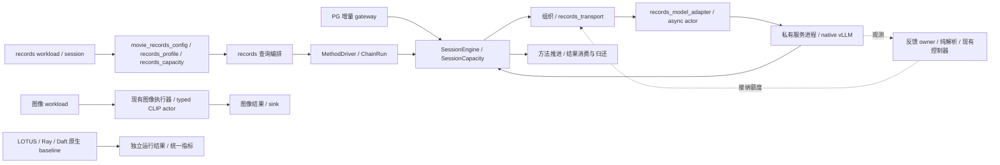

# Records 执行模块整理与容量责任

本记录对应 PostgreSQL 内置 AI 语义算子的外部分布式物理执行与调度优化中的执行工程整理。
基准为 PR #90 的 `bfb9100e2f3fa090fdf2304359979b853236e06a`，tree 为
`c8a86b0bcff8bf0161dcbbd005bc2660060d228e`。该 PR 当时为 Draft，未合并。
本地候选只做 CPU 检查，尚待独审与统一 Git 整合；不提供模型性能结论。
机器摘要见 [checks.json](raw/checks.json)，完整输出通过运行标识
`semloom-runtime-refactor-20261104` 和其中的 SHA-256 交接。

## 整个 SemLoom 的当前结构与替换范围

这是当前源码的职责图，不代表所有入口已经完成相同的实机资格。PG 增量路径、外部 records workload
与图像路径分别保留自身接入身份；原生 baseline 自己执行和调度。

| 部分 | 现在的实际状态 | 本次是否替换执行实现 |
|---|---|---|
| SQL、快照、权限与查询生命周期 | 数据库与已有 gateway／carrier 负责；各接入路径分别验证 | 否 |
| 方法语义、prompt/parser、合法后继 | `semantic_methods` 与已有 compatibility adapter；LOTUS 不替代数据库语义 | 否 |
| 组织、准入与任务责任 | 共享 Core、`SessionCapacity`、既有组织器与策略 | 否 |
| records 查询编排 | 普通 owner、`PreparedRecordsCore`、`SemLoomRecordChainCore` 仍同时存在 | 否 |
| 配置和容量解析 | 原普通／Session 共用 `movie_records_config.py`；本次新增容量与执行选项模块 | 已拆分职责，默认行为未变 |
| 快照观测 | 原 owner 仍负责锁、时钟和采样；本次提取纯解析与报告字段 | 已拆分纯函数，控制算法未变 |
| 模型适配与传输 | 共用编码、actor 与传输不再依赖单 Filter 查询 host | 已拆开依赖方向，原交接实现保持 |
| 原生模型服务 | 原 async actor／IPC 与 vLLM，实例内 token／KV 由引擎管理 | 否 |
| 图像与其他后端 | 原有实现和各自 baseline 继续保留 | 否 |
| 未接入的 UCB 原型 | 当前模块与导出已退出，准确原件及五项原测试保留供历史恢复 | 仅清理无运行入口的原型 |

因此，目前成果是可核验的结构整理、参数校验修正和一项原型清理，不能写成整个 SemLoom 已经重构完成。

### 全模块实施清单

当前静态清单覆盖 `code/src` 的 456 个 Python 文件和 127 个脚本入口，另列 PG C 载体与测试。
目录和脚本的逐文件信息见 [module_inventory.json](raw/module_inventory.json)。
字面引用扫描区分现行、结果、历史文件；没有引用不是删除证据，动态导入和仓库外调用仍需人工核对。

| 模块与源码入口 | 复用／重构／退出安排 | 尚未完成与依赖 |
|---|---|---|
| PG carrier：`code/postgres/semloom_pg` | 复用 SQL、计划、快照、权限及取消职责；只随真实接入补必要修改 | 新 batch/reorder 路径单独核对，不能借 records fixture 取得 PG 资格 |
| gateway／wire：`execution_provider` | 复用版本化任务／结果与 accepted-prefix；按连接、路由、查询生命周期拆职责 | 模型／IPC 与数据库生命周期分别验证 |
| 算子语义：`semantic_methods` | 复用同步 reference、prompt/parser、NULL／错误／顺序策略 | 中性语义与 LOTUS compatibility 分开，不能由调度改写 |
| 算子链：`lotus_record_chain_core`、`MethodDriver` | 重构 query host，保留合法后继、原数据和 Extract 完整关系处理 | 需同输入、多阶段及取消／晚到结果对照 |
| 数据源／准备／sink：`data` | 复用 Arrow／Daft／PG 读写；按 source、准备与消费分别计时和持有 | 不引入全量 collect；CPU 准备与派发交错另批处理 |
| work 描述：`planning` | 复用中性 work descriptor，逐步退出模态专用字段向公共策略的渗透 | token／frame 换算留 adapter，旧身份保持 |
| Core 责任：`scheduling/core` | 复用单一 `SessionCapacity.records`、租约与已确认终态；避免第二套记账 | 受新能力影响时补旧路径检查，不为统一外观重写 |
| 组织：`scheduling/organization` | 复用 ready 选择、token／字节组批、帧与候选计量缓存 | 不改变已提交批成员；准备交错需完整查询计时 |
| 动态接纳：`submission_control` | 专项重构现代资源策略；旧算法退出普通入口前必须有替代 | 动态会话拥有四个策略文件与专项测试，保留 `update_supply(...)` |
| 容量／资源责任 | 本会话集中 Core／Method／IPC 解析；R、结果、续算和字节分别表达 | 普通默认 R 解耦未完成，不能将声明额度当物理余量 |
| 路由／多 Job：`endpoint_routing` 与公共 runtime | 复用现行路由和公平性接口；清理前核对普通、诊断、历史调用 | 多副本／多卡结论仍需真实部署资格 |
| 异步 runtime：`scheduling/runtime` | 复用已有 backend、wake、借用与退休证据；缩减反向依赖 | 共享字段变化由双方先协调，unknown 不提前归还 |
| 模型适配：`records_model_adapter` 与 actor owner | 本批解除 async actor 对 query host 的反向引用，保留类身份 | 真 Ray 序列化和服务运行仍需独立资格 |
| 模型服务：`serving/backends` | 复用 IPC、ready 与已解析模型能力；vLLM 管实例内 token／KV | 不改 vLLM 源码；未知能力不当无限，显式参数保持 |
| 图文模态：`modalities` | 复用 tokenization、图像准备和 typed CLIP；公共调度仅消费能力描述 | 图像旧 HSE 与普通入口分别核对，不能外推多卡 |
| 配置／默认值 | 已拆容量与执行配置；继续核参数来源、显式／省略及缓存身份 | PID 非法窗口已修正并保留旧源；dtype／显存比例另验，不盲改 |
| 观测：`observability` | 已拆纯资源／快照解析；采样、时钟、消费和控制分别整理 | 整组额外增长失败保留；不刷新旧样本来取得通过 |
| 环境／进程责任：`infrastructure` | 复用 preflight、私有配置、监督和资源归属 | 不修改运行中 GPU 会话或把本机检查当服务资格 |
| 原生对照：`baselines` | 保留系统自己的 graph、调度与结果评价 | 历史投影精确恢复；不把 SemLoom 控制注入 baseline |
| 实验编排：`experiments` | 将运行器限定为现有能力的配置与编排，逐项核旧实验身份 | 删除前核 source、质量、调用额度与失败证据 |
| 脚本：`code/scripts` | 全量登记后分保留、历史恢复、删除；薄 CLI 入口不因短小被误删 | 已识别七个无现行字面引用的待审入口，逐个查独有用途 |
| 测试：`code/tests`、PG tests | 复用行为、协议、CPU／SDK 与历史差分；减少依赖固定源码位置 | 原失败不能删除或改 skip；真实库与 GPU 检查另列 |

当前工程顺序是模型适配依赖、已复现配置缺陷、旧脚本恢复与退出，再处理 query host 和默认 R；
动态专项并行推进。研究观察排在这些工程与实验问题之后。

### 继续批次：模型适配依赖

基于 `ee367861` 建立独立工作树，原候选工作树保持干净供独审。
原 async actor 从 `lotus_records_core` 导入结果编码、容量失败表示与 actor 基类，连带加载查询编排。
本批新增 [records_model_adapter.py](../../../../code/src/execution_provider/adapters/records_model_adapter.py)，
由查询 host 依赖模型适配，async actor 直接复用该模块；不增加 query loop、队列或容量账本。
原 `_ActorOwner`、`_CoreModelActor` 的旧导入与序列化位置保持，其余四个 helper 保持同一对象。

六份提取定义的语法树不变；新增检查在新进程中禁止加载 query host，确认 async actor 可独立导入。
该检查改前失败，改后通过；原 actor 类型的 pickle 路径也通过。
源码位置读取器随 `_measure` 的实际提供模块更新，原历史 oracle 仍只读摘要匹配原件。
改前相关 110 项成功；最终候选 130 项全部成功，无失败、错误或跳过，运行中源码未变。
首次新增检查与四项旧源码位置失败的输出保留，未改断言取得通过。
这证明本批 CPU 接口与生命周期回归，不证明模型加载、真实 Ray 或性能改进。

### 继续批次：PID 非法配置

原 PID 配置接受小数／布尔请求窗口和布尔数值参数，声明探针实际输出过 `2.5` 或 `True` 窗口。
现按原字段单位检查：窗口及初始窗口须为整数；增益、目标和积分额度须为有限数值，布尔与不可表示的大数拒绝。
另有反例确认极大整数窗口在旧检查后仍会使 PID 浮点运算溢出，现按其实际数值表示检查有限性，未加任意计数上限。
默认值、有效数值的表示、PID 公式和三个运行方法保持，未改任何现代资源控制器。
16 条有效轨迹的 112 次决定与改前逐字节一致。

三项非法配置检查改前复现问题；修后相关 195 项全部成功，包含 profiler 配置、现行算法与历史恢复检查。
准确原 `pid.py` 保存到既有 bfb 历史目录，五份投影各追加一条 override；原摘要／投影身份保持。
3010 条历史绑定仍只有原十处不匹配，新增为零。
[机器摘要](raw/pid_configuration_checks.json)保留改前拒绝检查、有效轨迹及检查输出摘要。

### 继续批次：请求准入计数

相同类型问题也存在于通用准入：旧静态额度、动态初始窗口、在途计数及策略输出会接受布尔或小数。
现按原请求单位检查整数，非法在途计数在读取观察器／调用策略之前拒绝；非法策略输出不能覆盖现有额度或写成功 trace。
原更新间隔仍接受零与有限正数，布尔、非数值及不可表示值明确拒绝。
没有增加容量上限、修改默认值或调整旧／新控制器公式。

四项反例改前复现问题；修后相关 291 项全部成功，包含 Core、异步请求、调度、容量等待与 profiler。
旧五份投影已经各自指向原准入源码，保留这些映射，不重复保存或改写旧摘要。
[机器摘要](raw/admission_count_checks.json)记录反例及最终检查。

脚本盘点另核对 590 份生产／脚本 Python 文件的静态本地模块导入，没有发现目标模块缺失；
它不能证明所有脚本都有用途。旧 eager 汇总虽没有名称引用，仍与现行配置及其测试共享场景 ID，
这条间接关系已确认，因此本轮保留，不把它当无用脚本删除。

### 继续批次：测试接到当前异步交接

六个帧计量测试的 owner fixture 缺少实际引擎声明，本批仅为 fixture 声明显式、有限的合成上下文；
另补完整请求超长拒绝与省略上下文且没有 ready 时拒绝两项检查，没有给生产恢复 4096 默认值。
帧计量、打包旁路和请求统计相关 31 项全部成功，原选择 oracle 的语法树与所有原有断言保持。

两个 token 责任测试仍暂停已退出当前路径的阻塞方法，现暂停实际非阻塞交接的 accepted 回执；
原 W 归还、unknown 保留和迟到结果断言全部保留，两项定向检查成功。
prompt 审计改读实际 `try_submit_core` 事件，并要求覆盖全部输入 occurrence；重试的提示须保持一致。
原 prompt／结果对照断言保留，Q1／Q3／Q2／Q3 复用检查已成功。

随后选择 668 个不同方法：666 成功、1 个动态增长测试失败、1 个真实 Ray 资格检查跳过，错误为零；
运行期间源码保持。10 毫秒增长检查再次未升档，226 次更新因缺测或过期被拒，未修改采样资格或放宽断言。
初次错误、旧三项失败及全部重跑原件继续保留，不能把本轮写成整体通过。
本批只修改测试，四份受影响历史投影原件保持，未增映射或改写旧摘要。
[机器摘要](raw/fixture_checks.json)记录原断言核对、定向结果与完整重跑。

### 继续批次：链执行与共享传输

原 `LotusChainActorBackend` 和链查询 host 都要导入单 Filter 查询 host 才能取得传输与清理函数。
现由 [records_transport.py](../../../../code/src/execution_provider/adapters/records_transport.py)
集中原传输、异步等待、期限检查与 producer 清理；两个查询 host 依赖该模块，链 backend 直接使用共享模型 helper。
四份提取定义保持原语法树；单 Filter host 的其余定义保持，链 host 只改配置来源导入。
没有第二个执行循环、额外容量账本或新的重试规则。

新进程检查确认链 backend 与 host 能在禁止加载单 Filter host 时导入；原导入与序列化位置保持。
初轮回归暴露遗漏 `TaskKey` 导出，现已恢复，并保留原 backend／失败类型导出。
清理时钟和 backend mock 接到实际定义模块，断言保持；另两个旧优先级测试的暂停点接到当前 accepted 交接，
原 W、提交顺序、unknown 和迟到结果断言保持。

定向 21 项成功后，生命周期／历史对照完整 215 项全部成功，无失败、错误或跳过，运行中源码保持。
原初轮 4 个失败方法、15 个错误方法的输出保留，不能把它们从记录中移除。
历史 3010 条绑定仍为原十处不匹配，manifest 保持；本批仍只取得 CPU 资格。
[机器摘要](raw/transport_checks.json)列原断言核对、早期问题与最终检查。

### 主要结构问题

- 查询 host 同时处理 source、方法阶段、准备填充、派发、结果、取消和关闭，仍有跨类私有属性依赖。
  `_RecordLocalRows._tick` 先填充再推进的行为也没有因本次提取而改变。
- R 的默认换算仍混合请求、驻留与存储；完整独立预算虽已支持，普通入口仍不够清楚。
  完整关系和审计对象不都计入现有逻辑字节额度。
- 现代请求反馈仍沿 `AscendingRequestController → SupplyFeedbackController → ResourceFeedbackController → AimdAdmissionController`
  继承。源码中的 `low_load_kv_usage`、`congestion_kv_usage`、增减步长仍有实际读取，
  不能说旧 AIMD 已经被完全替换，也不能删除基类后留下唯一调用路径无法执行。
- 快照资格、压力、性能试探和历史兼容交织；一次 10 毫秒测试未升档不能单凭结果判定硬件不足或算法错误。
  本次保留了整组额外失败，尚无原因已查清的结论。
- 一些旧研究原型仍放在生产目录。UCB 已清理；`BoundedStageWorkController` 仅见测试与历史材料，
  但与当前资源控制共用文件，本轮先列交集，不同时修改该专责会话负责的方法。
- 配置校验并不一致：只读 CPU 声明探针确认 PID 接受小数或布尔窗口，并可输出同类型窗口。
  该缺陷随后已修正；有效旧配置轨迹与历史原件分别验证，详见 PID 继续批次。

### 两条实施路线

| 路线 | 可执行起点 | 收益与主要风险 | 判断 |
|---|---|---|---|
| 扩大渐进重构 | 先拆部署容量与请求策略，再拆查询 host，接着将现代反馈改为独立策略输入／输出；每批以原路径作对照 | 能复用已有任务责任、IPC、取消、方法语义与测试；若只搬函数而不解除职责耦合，问题会继续存在 | 当前优先 |
| 并行新实现 | 在独立工作树实现新的 SemLoom query runtime，先接 sealed-task producer 和合成 backend，再逐条接原 provider | 可以重新组织模块；需重新证明所有晚到终态、未消费结果、取消、重排和质量行为，不能假定重写后更快 | 保留为替代方案 |

推荐继续较大范围渐进重构，同时允许用一个独立的新 host 切片检验接口设计；不用新旧两个控制器共同决定同一请求。
当前源码不能支持“删除整个仓库即可解决问题”的判断。若新 host 仍必须读取旧 owner 的大量私有状态，
应以该具体阻断评估独立实现，而不是继续增加薄 wrapper。

迁移按职责逐批推进：

1. 先交本页全貌、已改／未改和失败原件；当前候选保持可恢复，停止无证据的大量删除。
2. 与资源控制专责统一现代策略的输入、压力证据及容量来源；把仍有效的保护与旧试探规则分别核对，
   有可测试替代后再退出旧生产分支，历史具名选项从原投影恢复。
3. 将准备、接纳、派发、消费编排聚合到单一 query runtime，复用方法与 Core 的现有事实记录，避免第二套任务账本。
4. 用同一输入运行同步 reference 与候选，核 Filter→Map 原数据、合法后继、Extract 关系、关联、顺序、NULL／错误、
   exactly-once、未消费结果、unknown 与迟到终态；PG 接入另验 accepted-prefix、快照和取消。
5. CPU／SDK 通过并独审后，由唯一实机会话比较同模型、生成、服务和资源配置下的完整查询时钟与质量。
   首次／复用和 source、准备、传输、排队、模型、消费分列；不把 CPU 或单次组件检查当性能收益。
6. 逐入口替换后删除无调用的旧分支和配置；实验 CLI 先查调用、文档、CI 与历史恢复，再决定保留、归档或删除。

以上两条路线都保留原生 baseline 的执行所有权、历史摘要、失败证据与恢复材料。
本次没有启动新的 Ray／模型／GPU 实验，也没有删除用户原仓库或其未提交文件。

### 已实际完成的旧原型清理

对 UCB 查过维护代码、脚本、公开导出、文档与历史投影：未发现运行调用，profiler 也未提供该选项。
仓库无 `.github` workflow；现有 `pyproject.toml` 为代码检查配置，未发现 UCB 的 CI 执行入口。
理论文献中的 UCB 名称与旧研究计划仍保留各自用途，不据此删除文献或历史结果。

本批删除当前 `code/src/scheduling/submission_control/ucb.py`、四项公共导出及当前测试文件中的五项原型用例。
先核对并保存准确 bfb 的实现、原导出和完整原测试文件，再修改当前路径；没有丢弃唯一字节。
五份历史投影共追加十条来源映射，原 expected 摘要和投影 ID 不变。
原五项用例仍从准确旧源运行；归档不是算法被现代控制器等价替换的证明。

清理前相关 43 项全部成功；清理后现行控制、历史策略、阶段工作与归档恢复共 61 项全部成功。
61 项包含一个内部运行原五项用例的恢复检查，不另外相加。完整 3010 条历史绑定保持原十处不匹配，新增为零。
UCB 清理时 PID 探针只记录缺陷，随后配置修正另批实现；仍在执行的 AIMD／EWMA／HOL-age／PID 未删除。
古早脚本仍需按实际调用与恢复关系逐项审查，本轮没有无证据地批量删除，也不声称整个项目已清理完成。

### 与动态专项的实际交集

只读核对 `/tmp/semloom-capacity-bfb-integration-20261104` 时，该工作树以 bfb 为父提交，
正在修改 `adaptive.py`、`request_scan.py`、`stage_work.py`、`resource_probe.py`、
`scheduling/core/models.py`、`scheduling/runtime/observations.py`、`lotus_chain_token_batches.py` 及三个专项测试。
这是未提交候选，不能写成 PR 已有能力。本次不修改其工作树，也不继续编辑这些策略文件。

与本会话已经提交的第二批只有 `lotus_chain_token_batches.py` 存在文件交集，
本会话集中在纯解析／报告与薄委托，原状态方法保持；整合者仍需对照专项的新调用与报告字段逐方法处理。
当前 UCB 清理文件与上述只读清单没有交集。
容量解析先接兼容导入，再接观测纯函数，随后整合动态专项；默认 R 的行为迁移须单独验证，不能混入移动代码。

## 容量实际归属

以下为源码核对结果。R 是旧 `RecordsResources.max_active_batches`，C 是查询接纳窗口；
IPC 表示模型进程间通信。已有独立资源对象继续负责记账，没有新增控制器。

| 资源 | 实际记账与归还 | 旧默认换算 | 显式独立声明 |
|---|---|---|---|
| Core 驻留任务 | `SessionCapacity.records`；结果租约归还后删除记录 | `held_tasks=R` | `budget.held_tasks` |
| Core 输入／结果字节 | 真实输入长度与每任务结果预留；随记录保留 | 各为 R × 单项额度 | `budget.input_bytes/result_bytes` |
| Core 模型请求／工作量 | 记录上的 compute 状态；确认终态后归还 | 请求和普通请求工作量为 R | `budget.active_requests`；既有可选 token 工作量仍单独解释 |
| Method 续算及最终结果 | `MethodBudgetPool`；消费者归还最终行后释放 | R 个续算；R × 完整逐行预留 | `budget.method_runs/method_bytes` |
| IPC 请求／结果／命令／控制槽 | `AsyncEngineLimits` 与原进程 owner；沿原 ACK、消费和清理路径归还 | 请求、结果、命令槽从 R 换算；控制预留保持原式 | 完整有限 `async_limits` |
| IPC 输入／结果字节 | 原进程 owner 持有；unknown 不能当已完成 | 输入总额从 owner R 换算；结果总额从结果槽换算 | 显式总额和单项额度分别保留 |
| 引擎序列／每轮 token／模型上下文 | vLLM 解析与实际 ready 回执 | 异步省略值已交给引擎 | 显式值保留；实际模型长度仍检查 |

旧默认的 R 仍会同时影响多种容量。本批将该换算集中表达，保留历史行为；
不能据此称普通默认已经完成 R 解耦。显式独立预算已能分别生效，但要求完整字节与槽位声明，
目前不自动探测硬件，也没有面向普通调用方的少量参数配置方案。
完整预期关系、调用审计及 Python 对象开销不都包含在上述逻辑额度中，不能把它们称为进程内存上限。

## 可达执行链与验收

维护配置经 `movie_records_config`、`create_records_core` 进入普通 Core 或
`PreparedRecordsCore`。后者复用 `SemLoomRecordChainCore`：方法产生合法 ready 请求，
`PreparedTokenOrganizer` 组织传输批，原 transport、async actor 与私有模型进程负责交接，
Core 处理逐成员终态和结果，Method 推进合法后继，消费者归还最终行。
这条 records 路径保持外部 workload／fixture 身份；PG gateway 使用共享 Core 不能代替其自身接入检查。

| 验收对象 | 本批保持的行为与已有检查 | 尚需处理 |
|---|---|---|
| 合法依赖与原数据 | Filter→Map 原数据、逐记录补位、Extract 完整关系要求；运行既有多阶段 CPU 用例 | 新推进策略须另验完整查询与输出 |
| 准备、传输、模型、消费 | 主推进方法与 actor 方法定义保持；慢结果不改批成员 | `_tick` 先填充再推进的交错候选另审 |
| 容量及 unknown 责任 | Core、Method、IPC 沿原对象保留额度；结果未消费和未知终态不提前归还 | 普通默认仍耦合 R；完整关系与审计占用另核 |
| 引擎参数 | 不改已接入的实际上下文、原生序列／token 默认委托 | dtype 与显存比例默认另行核对 |
| 查询时钟与质量 | 不移动 start/evaluate/消费时钟，不改 prompt/parser、输出或计量字段 | 真模型、真实 Ray、多卡与完整查询比较尚未验证 |

## 首批：容量与执行配置分离

新增 [records_capacity.py](../../../../code/src/execution_provider/adapters/records_capacity.py)，
集中原 `RecordsCapacityBudget`、`CoreRecordsCapacity` 及 IPC 解析；各资源仍消费
`SessionLimits`、`MethodCapacity`、`AsyncEngineLimits`。
新增 [records_profile.py](../../../../code/src/execution_provider/adapters/records_profile.py)，
集中 sync/async 选择、具名历史选项和 token 组批选项的验证。
旧 `lotus_records_core` 导入保留同一对象，容量类型的序列化路径保持。
异步 actor 与链直接引用容量模块；生命周期、模型分配、关闭与 ACK 代码不搬动。

六份提取定义的语法树与 bfb 完全相同；其余 Core、链和异步 actor 的类／函数定义保持。
402 组声明回放的结果、错误类型与消息相同，包含普通／独立预算、C、R、IPC、历史选项与非法值。
原套件 145 项为 144 成功、1 既有失败；候选相同 145 项加 4 项新检查为 148 成功、相同 1 项失败，
没有错误或跳过。新检查覆盖旧导入、序列化、各预算只改变所属资源，以及独立预算不随旧 R 改变。
既有失败为 `CoreFeedbackTests.test_actual_new_method_prompts_Q1_Q3_Q2_Q3_reuse_one_model`，
本批没有改写它。两个套件运行期间源码均未变化。

随后扩大检查发现历史策略的测试读取器只在旧文件查找配置函数，产生 4 项新失败。
已让当前源码读取跟随显式 `records_profile` 导入，历史 oracle 仍只从 manifest 核对的原件读取，
重复定义立即报错；该组 18 项修订后全部通过。初次 4 项失败的原输出保留。
另在独立 bfb 原源码工作树复现 2 项 token 生命周期失败和 6 个帧计量方法错误
（共 68 次错误事件，含子用例），这些不是本批引入，不能改报成功；具体标识见机器摘要。

五份历史投影的 3010 条绑定保持原 10 处不匹配，本批新增 0；原 manifest、摘要、投影身份和副本不变。
此前配置工作的六项失败及资产／SDK 缺项仍从原报告读取，本批没有重跑全部用例，
不能将不同源码或范围的数字相加，也不能称整体回归全绿。

## 第二批：纯观测与快照报告

[records_feedback_observation.py](../../../../code/src/execution_provider/adapters/records_feedback_observation.py)
接收已有观测值和复制的 RPC 状态，负责资源值解读、CPU 观测时段检查、快照头、有限整数及报告字段拼装。
`BatchSupplyFeedback` 保留旧方法名作为薄委托；`_read_resource` 仍先调用其原可替换的 `_resource_view`。
组织器、实际采样、原锁、时钟、样本消费、收尾与控制决定留在原处。

1,234 组改前／改后回放字节一致，覆盖缺测、非法类型、非有限数、大整数、多设备、CPU 观测时段，
以及关闭、未取回终态、取消 Future、保留引用、回执缺项等报告状态。
语法树检查确认 `PreparedTokenOrganizer`、`RequestSupplyFeedback` 和其他状态修改方法完全相同，
报告复制责任信息的原取锁范围相同；没有重做帧头计量或候选缓存。

并发报告测试原先按旧函数的源码行号暂停，提取后出现 1 个方法的 2 次错误事件。
现只将暂停点移到实际报告函数，保留后台晚到终态、原报告 unknown 与后续报告 closed 的全部断言；
快照与资源诊断相关 52 项全部通过。初次错误输出保留。

最终去重相关检查选择 326 个方法：315 成功、4 个方法失败、6 个方法错误、1 个方法跳过。
错误共 68 次事件，包含帧计量的子用例；跳过为未选择真实 Ray CPU 检查。
相同顺序的准确 bfb 对照选择 322 个旧方法：312 成功、3 个方法失败、相同 6 个方法错误、1 个方法跳过。
候选新增的 4 个容量检查均成功，但最终整组另有反馈增长断言失败，不能宣称没有剩余问题。

该额外失败为 `CoreFeedbackTests.test_unbudgeted_feedback_grows_on_CPU_IPC_once_and_matches_fixed_results`：
当轮 232 次控制调用中 229 次记录 `missing_or_stale_feedback`，没有扩大窗口。
原套件两次较小范围检查通过，准确 bfb 的整组对照通过；预定两组原源码／候选单项配对均通过。
完整整组失败保留，原因仍待查，不能仅凭重跑成功归为原有失败或视作已修复。
普通 Core 反馈方法的语法树未变；本批不修改其时间、采样或策略来取得通过。
独审与该时序问题完成核对前，不进入发布整合。

另用已有含 LOTUS 1.2.4／DuckDB 的 CPU 环境检查上下文、旧 Session、普通 token 入口及配置：
81 项选择中 80 成功、1 项跳过，没有失败或错误。该组保留自己的解释器与依赖身份，
不与上述重叠用例累加；跳过原因和方法标识见机器摘要。同步、IMLane、常驻／独立查询兼容仅有 CPU 资格。

## 默认 R 解耦的后续实施次序

1. 以本次已集中表达的容量解析为唯一入口，保留具名历史／同步选项的旧换算。
2. 对普通入口补齐部署资源声明的来源与共享方式，再将请求额度与驻留／结果／续算存储分别绑定。
   复用已有类型与有限字节声明；未知值继续拒绝或保留原有限配置，不能当无限额度。
3. 在配对 CPU 用例中核输入、未消费结果、未知终态、跨查询复用与缓存身份，再交独审和实机比较。

本批不增加用户必须逐项填写的参数，也不从剩余显存或原生序列数推导宿主存储额度。
少量配置的普通入口仍需以上来源核对；没有新增容量策略或声称已自动选择硬件最优值。

## 后续拆分与并行职责

| 对象 | 当前核对与下一步 | 分工 |
|---|---|---|
| R 与默认配置 | 先完成本批结构提取，再以配对 CPU 用例验证少量声明如何解析为已有独立额度；未定默认不能写成最佳值 | 本会话统一安排 |
| 纯观测解析与报告 | 本批已提取无状态资源解读、快照头及报告拼装；原锁、时钟、样本消费和控制决定保持 | 本会话 CPU 候选，待独审 |
| 准备／派发交错 | `_RecordLocalRows._tick` 仍先填充再推进；变更会影响调度与完整耗时，不能作为单纯移动代码处理 | 已有准备交错会话负责行为候选 |
| 压力样本消费 | 待 RPC 时清除未消费样本的候选已有独立证据；提取不改 `_consume_snapshot` | 已有压力会话负责修正 |
| 取消与审计交付 | bfb 保留被接收方暂拒的审计回执；计算退休、审计交付和 ACK 分别核对 | 已有生命周期会话继续负责 |
| `adaptive.py` | Aimd、EwmaAimd、HolAgeAimd 在 PG profiler 可达；ResourceFeedbackController 在普通 records 可达 | 动态专项负责替换前的核对，本会话不并行修改 |
| `request_scan.py` | AscendingRequestController 在 request feedback 可达，并复用原几何搜索／成对证据 | 先列现行和历史调用方，再决定是否归并 |
| 帧与候选计量 | 原 `_header_sizes` 缓存及已有重复计量修正保持 | 不重新实现同类缓存 |
| Git 与实机 | 每批 CPU 证据交独审，准确候选交唯一 Git 整合；GPU 会话独立使用服务与测试计划 | 本会话不推送或合并、不启动模型／Ray／GPU |

普通默认 R 解耦、完整关系与审计内存、真实库及模型资格均为后续工作，
不能用本次代码提取或 CPU 通过替代。多卡路由仍属待验证设计。

文件交集须按方法核对：压力候选也修改 `lotus_chain_token_batches.py`，但本批未改其样本消费方法；
生命周期会话使用 `lotus_record_chain_core.py`，本批仅调整容量导入。整合时不能用整文件覆盖对方修改。
状态、台账与 README 也有文档交集，由唯一 Git 整合者逐项处理。
