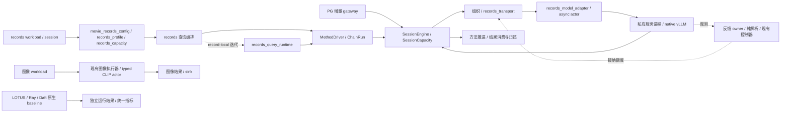
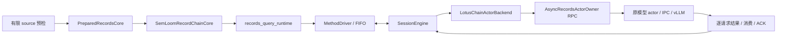

# Records 执行模块整理与容量责任

本记录对应 PostgreSQL 内置 AI 语义算子的外部分布式物理执行与调度优化中的执行工程整理。
基准为 PR #90 的 `bfb9100e2f3fa090fdf2304359979b853236e06a`，tree 为
`c8a86b0bcff8bf0161dcbbd005bc2660060d228e`。该 PR 当时为 Draft，未合并。
本地候选只做 CPU 检查，尚待独审与统一 Git 整合；不提供模型性能结论。
同步两份 CPU 归档的当前公开格式见[路径规范化与复算](#public-cpu-evidence-copy)：公开副本删除个人 home 前缀，
私有原件及其 SHA 保留。下方早期“准确恢复原始 JSON”的叙述按当时私有原件解释，当前公开副本按各自公开摘要恢复。
机器摘要见 [checks.json](raw/checks.json)，完整输出通过运行标识
`semloom-runtime-refactor-20261104` 和其中的 SHA-256 交接。

## 整个 SemLoom 的当前结构与替换范围

这是当前源码的职责图，不代表所有入口已经完成相同的实机资格。PG 增量路径、外部 records workload
与图像路径分别保留自身接入身份；原生 baseline 自己执行和调度。

| 部分 | 现在的实际状态 | 本次是否替换执行实现 |
|---|---|---|
| SQL、快照、权限与查询生命周期 | 数据库与已有 gateway／carrier 负责；各接入路径分别验证 | 否 |
| 方法语义、prompt/parser、合法后继 | `semantic_methods` 与已有 compatibility adapter；LOTUS 不替代数据库语义 | 否 |
| 组织、准入与任务责任 | 共享 Core、`SessionCapacity`、既有组织器与策略 | 否 |
| records 查询编排 | 记录链 owner 与 record-local 迭代已分开；普通 Core 与 `PreparedRecordsCore` 继续存在 | 已拆开组装与迭代，推进顺序保持 |
| 配置和容量解析 | 普通／Session 共用解析；普通 async Filter／rolling 的存储与 R 已在 CPU 候选分开 | 请求 R 可来自完整独立预算；自动容量仍未完成，大单项修正已组合，待复审 |
| 快照观测 | 原 owner 仍负责锁、时钟和采样；本次提取纯解析与报告字段 | 已拆分纯函数，控制算法未变 |
| 模型适配与传输 | 共用编码、actor 与传输不再依赖单 Filter 查询 host | 已拆开依赖方向，原交接实现保持 |
| 原生模型服务 | 共享请求值与同步／异步实例分开，原 actor／IPC 与 vLLM 继续执行 | 当前同步缺省、完整提示和 fused 实际上下文已有 CPU 候选；原生对照显式保留原参数，真实模型及计算中关闭仍待检查 |
| 图像与其他后端 | 原有实现和各自 baseline 继续保留 | 否 |
| 未接入的 UCB 原型 | 当前模块与导出已退出，准确原件及五项原测试保留供历史恢复 | 仅清理无运行入口的原型 |

目前完成了可核验的结构整理、参数校验修正，以及确认退出维护的原型和历史工具清理；整个 SemLoom 重构尚未完成。

### 全模块实施清单

起始静态清单覆盖当时 `code/src` 的 458 个 Python 文件和 127 个脚本入口，另列 PG C 载体与测试。
目录和脚本的逐文件信息见 [module_inventory.json](raw/module_inventory.json)。
字面引用扫描区分现行、结果、历史文件；没有引用不是删除证据，动态导入和仓库外调用仍需人工核对。

| 模块与源码入口 | 复用／重构／退出安排 | 尚未完成与依赖 |
|---|---|---|
| PG carrier：`code/postgres/semloom_pg` | 复用 SQL、计划、快照、权限及取消职责；只随真实接入补必要修改 | 新 batch/reorder 路径单独核对，不能借 records fixture 取得 PG 资格 |
| gateway／wire：`execution_provider` | 复用版本化任务／结果与 accepted-prefix；按连接、路由、查询生命周期拆职责 | 模型／IPC 与数据库生命周期分别验证 |
| 算子语义：`semantic_methods` | 复用同步 reference、prompt/parser、NULL／错误／顺序策略 | 中性语义与 LOTUS compatibility 分开，不能由调度改写 |
| 算子链：`lotus_record_chain_core`、`MethodDriver` | 重构 query host，保留合法后继、原数据和 Extract 完整关系处理 | 需同输入、多阶段及取消／晚到结果对照 |
| 数据源／准备／sink：`data` | 复用 Arrow／Daft／PG 读写；按 source、准备与消费分别计时和持有 | 不引入全量 collect；CPU 准备与派发交错另批处理 |
| work 描述：`planning` | 复用中性 work descriptor，逐步退出模态专用字段向公共策略的渗透 | token／frame 换算留 adapter，旧身份保持 |
| Core 责任：`scheduling/core` | 复用单一 `SessionCapacity.records`、租约与已确认终态；避免第二套记账 | 受新能力影响时补旧路径检查，不为统一外观重写 |
| 组织：`scheduling/organization` | 复用 ready 选择、token／字节组批、帧与候选计量缓存 | 不改变已提交批成员；准备交错需完整查询计时 |
| 动态接纳：`submission_control` | 专项重构现代资源策略；旧算法退出普通入口前必须有替代 | 动态会话拥有四个策略文件与专项测试，保留 `update_supply(...)` |
| 容量／资源责任 | 本会话集中 Core／Method／IPC 解析；R、结果、续算和字节分别表达 | 普通默认存储已分开；请求 R 仍来自声明或完整独立预算；自动容量尚未接入 |
| 路由／多 Job：`endpoint_routing` 与公共 runtime | 复用现行路由和公平性接口；清理前核对普通、诊断、历史调用 | 多副本／多卡结论仍需真实部署资格 |
| 异步 runtime：`scheduling/runtime` | 复用已有 backend、wake、借用与退休证据；缩减反向依赖 | 共享字段变化由双方先协调，unknown 不提前归还 |
| 模型适配：`records_model_adapter` 与 actor owner | 本批解除 async actor 对 query host 的反向引用，保留类身份 | 真 Ray 序列化和服务运行仍需独立资格 |
| 模型服务：`serving/backends` | 复用 IPC、ready 与已解析模型能力；vLLM 管实例内 token／KV | 不改 vLLM 源码；未知能力不当无限，显式参数保持 |
| 图文模态：`modalities` | 复用 tokenization、图像准备和 typed CLIP；公共调度仅消费能力描述 | 图像旧 HSE 与普通入口分别核对，不能外推多卡 |
| 配置／默认值 | 已拆容量与执行配置；继续核参数来源、显式／省略及缓存身份 | PID 非法窗口已修正并保留旧源；dtype／显存比例另验，不盲改 |
| 观测：`observability` | 已拆纯资源／快照解析；采样、时钟、消费和控制分别整理 | 整组额外增长失败保留；不刷新旧样本来取得通过 |
| 环境／进程责任：`infrastructure` | 复用 preflight、私有配置、监督和资源归属 | 不修改运行中 GPU 会话或把本机检查当服务资格 |
| 原生对照：`baselines` | 保留系统自己的 graph、调度与结果评价 | 历史投影精确恢复；不把 SemLoom 控制注入 baseline |
| 实验编排：`experiments` | 将运行器限定为现有能力的配置与编排，逐项核旧实验身份 | 删除前核 source、质量、调用额度与失败证据 |
| 脚本：`code/scripts` | 全量登记后分保留、历史恢复、删除；薄 CLI 入口不因短小被误删 | 六项旧工具已退出维护；其余候选逐个查独有用途，现用清单保留证据 |
| 测试：`code/tests`、PG tests | 复用行为、协议、CPU／SDK 与历史差分；减少依赖固定源码位置 | 原失败不能删除或改 skip；真实库与 GPU 检查另列 |

当前先修省略 IPC 总额的大单项问题并组合已审动态策略，再迁移同步默认、启动清理和准备交错；
旧入口继续按实际替代关系清理。研究观察排在工程与实验问题之后。

### 继续批次：模型适配依赖

基于 `ee367861` 建立独立工作树，原候选工作树保持干净供独审。
原 async actor 从 `lotus_records_core` 导入结果编码、容量失败表示与 actor 基类，连带加载查询编排。
本批新增 [records_model_adapter.py](../../../../code/src/execution_provider/adapters/records_model_adapter.py)，
由查询 host 依赖模型适配，async actor 直接复用该模块；不增加 query loop、队列或容量账本。
原 `_ActorOwner`、`_CoreModelActor` 的旧导入与序列化位置保持，其余四个 helper 保持同一对象。

六份提取定义的语法树不变；新增检查在新进程中禁止加载 query host，确认 async actor 可独立导入。
该检查改前失败，改后通过；原 actor 类型的 pickle 路径也通过。
源码位置读取器随 `_measure` 的实际提供模块更新，原历史 oracle 仍只读摘要匹配原件。
改前相关 110 项成功；最终候选 130 项全部成功，无失败、错误或跳过，运行中源码未变。
首次新增检查与四项旧源码位置失败的输出保留，未改断言取得通过。
这证明本批 CPU 接口与生命周期回归，不证明模型加载、真实 Ray 或性能改进。

### 继续批次：PID 非法配置

原 PID 配置接受小数／布尔请求窗口和布尔数值参数，声明探针实际输出过 `2.5` 或 `True` 窗口。
现按原字段单位检查：窗口及初始窗口须为整数；增益、目标和积分额度须为有限数值，布尔与不可表示的大数拒绝。
另有反例确认极大整数窗口在旧检查后仍会使 PID 浮点运算溢出，现按其实际数值表示检查有限性，未加任意计数上限。
默认值、有效数值的表示、PID 公式和三个运行方法保持，未改任何现代资源控制器。
16 条有效轨迹的 112 次决定与改前逐字节一致。

三项非法配置检查改前复现问题；修后相关 195 项全部成功，包含 profiler 配置、现行算法与历史恢复检查。
准确原 `pid.py` 保存到既有 bfb 历史目录，五份投影各追加一条 override；原摘要／投影身份保持。
3010 条历史绑定仍只有原十处不匹配，新增为零。
[机器摘要](raw/pid_configuration_checks.json)保留改前拒绝检查、有效轨迹及检查输出摘要。

### 继续批次：请求准入计数

相同类型问题也存在于通用准入：旧静态额度、动态初始窗口、在途计数及策略输出会接受布尔或小数。
现按原请求单位检查整数，非法在途计数在读取观察器／调用策略之前拒绝；非法策略输出不能覆盖现有额度或写成功 trace。
原更新间隔仍接受零与有限正数，布尔、非数值及不可表示值明确拒绝。
没有增加容量上限、修改默认值或调整旧／新控制器公式。

四项反例改前复现问题；修后相关 291 项全部成功，包含 Core、异步请求、调度、容量等待与 profiler。
旧五份投影已经各自指向原准入源码，保留这些映射，不重复保存或改写旧摘要。
[机器摘要](raw/admission_count_checks.json)记录反例及最终检查。

脚本盘点另核对 590 份生产／脚本 Python 文件的静态本地模块导入，没有发现目标模块缺失；
它不能证明所有脚本都有用途。旧 eager 汇总虽没有名称引用，仍与现行配置及其测试共享场景 ID，
这条间接关系已确认，因此本轮保留，不把它当无用脚本删除。

### 继续批次：测试接到当前异步交接

六个帧计量测试的 owner fixture 缺少实际引擎声明，本批仅为 fixture 声明显式、有限的合成上下文；
另补完整请求超长拒绝与省略上下文且没有 ready 时拒绝两项检查，没有给生产恢复 4096 默认值。
帧计量、打包旁路和请求统计相关 31 项全部成功，原选择 oracle 的语法树与所有原有断言保持。

两个 token 责任测试仍暂停已退出当前路径的阻塞方法，现暂停实际非阻塞交接的 accepted 回执；
原 W 归还、unknown 保留和迟到结果断言全部保留，两项定向检查成功。
prompt 审计改读实际 `try_submit_core` 事件，并要求覆盖全部输入 occurrence；重试的提示须保持一致。
原 prompt／结果对照断言保留，Q1／Q3／Q2／Q3 复用检查已成功。

随后选择 668 个不同方法：666 成功、1 个动态增长测试失败、1 个真实 Ray 资格检查跳过，错误为零；
运行期间源码保持。10 毫秒增长检查再次未升档，226 次更新因缺测或过期被拒，未修改采样资格或放宽断言。
初次错误、旧三项失败及全部重跑原件继续保留，不能把本轮写成整体通过。
本批只修改测试，四份受影响历史投影原件保持，未增映射或改写旧摘要。
[机器摘要](raw/fixture_checks.json)记录原断言核对、定向结果与完整重跑。

### 继续批次：链执行与共享传输

原 `LotusChainActorBackend` 和链查询 host 都要导入单 Filter 查询 host 才能取得传输与清理函数。
现由 [records_transport.py](../../../../code/src/execution_provider/adapters/records_transport.py)
集中原传输、异步等待、期限检查与 producer 清理；两个查询 host 依赖该模块，链 backend 直接使用共享模型 helper。
四份提取定义保持原语法树；单 Filter host 的其余定义保持，链 host 只改配置来源导入。
没有第二个执行循环、额外容量账本或新的重试规则。

新进程检查确认链 backend 与 host 能在禁止加载单 Filter host 时导入；原导入与序列化位置保持。
初轮回归暴露遗漏 `TaskKey` 导出，现已恢复，并保留原 backend／失败类型导出。
清理时钟和 backend mock 接到实际定义模块，断言保持；另两个旧优先级测试的暂停点接到当前 accepted 交接，
原 W、提交顺序、unknown 和迟到结果断言保持。

定向 21 项成功后，生命周期／历史对照完整 215 项全部成功，无失败、错误或跳过，运行中源码保持。
原初轮 4 个失败方法、15 个错误方法的输出保留，不能把它们从记录中移除。
历史 3010 条绑定仍为原十处不匹配，manifest 保持；本批仍只取得 CPU 资格。
[机器摘要](raw/transport_checks.json)列原断言核对、早期问题与最终检查。

### 本轮最终合并检查

在 `f548d4ed4678b9229cf5c840ae0219d7ea467d5a`、tree
`5a8cb33ccded60158130d7838db594ef15cb410d` 上合并两组方法并去重：
752 个不同方法中 751 成功，1 个真实 Ray 资格检查跳过，无失败或错误；运行期间源码保持。
随后只补结果记录，Python 源码与受测摘要逐项相同。
本次动态增长检查通过，之前两次零升档及最初额外失败原件仍保留，不能据此声称其时序问题已解决。
模型、真实 Ray 与 GPU 运行仍为零；本地候选尚待独审，未推送或合并。
[最终摘要](raw/final_engineering_checks.json)列源码身份、完整原输出摘要与历史核对。

### 后续独立批次：配置预检直接读取声明

在保留 `eb8c3836` 独审工作树的新分支中，将 `movie_records_config.py`、Session 的 `check_plan`
及矩阵固定容量校验直接接到 `records_capacity`／`records_profile`，不再为读取配置导入查询 host。
三个文件的非导入语法树保持；默认值、返回、异常、实际 owner 工厂和缓存身份均未改。
新增两个新进程检查，禁止加载查询及模型 owner：改前均复现反向导入，改后配置与公开 Session 预检均成功。
相关 167 项全部成功，无失败、错误或跳过；运行期间源码保持，未启动真实服务。
[摘要](raw/config_import_checks.json)保存改前 107 项、两项反例与改后结果。

查询主循环只读核对确认 `_tick` 仍先填充再推进；结果归还已经通知既有 wake，不能据此新增重复唤醒。
准备交错的行为改动与既有候选分别核对，本批没有改它的顺序或时钟。

### 后续行为批次：独立预算提供有限 IPC 缺省值

原独立预算调用仍须重复填写六个 IPC 字段，省略或只调反馈间隔会在创建 owner 前被拒。
现在仅在已声明完整独立预算时，以 `active_requests` 提供 IPC 请求／命令槽，以 `held_tasks` 提供结果槽，
输入／结果总字节取各自预算，控制预留沿原公式。显式值优先，未知字节和容不下一项的额度仍拒绝。
没有新增手工参数、物理容量推断或第二个账本；Core、Method 与 IPC 继续分别持有和归还额度。
普通 `budget=None` 的旧默认尚未改变，因此这不是普通默认 R 已全面解耦的结论。

三项新增反例改前复现缺省拒绝，修后相关 118 项全部成功；包括省略／部分覆盖、不同旧 R／查询 C、
缓存等价与隔离，以及复用原完整生命周期场景的 unknown、取消、迟到结果与回收检查。
另有 90 组旧默认与 30 组完整显式配置差分，返回／异常无差异；历史 3010 条绑定保持原十处不匹配。
原“缺省必须拒绝”用例按这项已授权行为变化更新，保留显式未知字节的拒绝断言及改前输出。
[机器摘要](raw/independent_IPC_checks.json)保存原反例、差分及最终检查；没有真实模型／Ray／GPU 资格。

### 后续批次：旧脚本的实际清理与用途登记

`estimate_operator_cost.py` 的私有 `_signature` 已无调用；现行分组及两种 context／candidate 身份使用
`scenario_group`／`_payload_signature`。移除该七行旧 helper，其余语法树保持，相关 20 项 CPU 检查成功。
完整原脚本逐字节存入既有 bfb 历史目录，未删除唯一来源。

七个没有现行名称引用的入口分别核对后保留，用途登记到[脚本入口](../../../../code/scripts/README.md)。
其中 PGAI 的 `--help` 首轮因顶层导入可选 `psycopg` 失败，改为实际 `connect` 时导入；
连接参数与其余函数语法树保持。重跑七项 CLI 全部通过，检查禁止模型／Ray／数据库驱动导入、网络、监听及子进程。
没有执行 SQL、加载模型或运行服务；首次依赖错误输出保留，不用安装依赖掩盖它。

两份准确旧源共增加十条历史来源映射，3010 条绑定保持原十处不匹配，新增为零；原摘要及投影身份保持。
当前没有确认整份脚本可删除，不能将这项私有 helper 清理写成历史脚本已全部清空。
[机器摘要](raw/script_cleanup_checks.json)登记旧源、测试、首次 CLI 失败和最终结果。

### 后续批次：记录查询迭代与 owner 组装分开

将完整 `_RecordLocalRows` 及原期限检查移入
[records_query_runtime.py](../../../../code/src/execution_provider/adapters/records_query_runtime.py)，
让查询迭代独立于模型／传输／容量组装。原 host 导入与序列化位置保持，没有新增控制循环或任务记录。
两份提取定义和 owner 其余定义的语法树保持；准备、advance、消费、采样顺序与异常处理均未改。

新进程检查禁止加载两个查询 owner、async actor 及反馈组织模块，仍可导入迭代器并检查取消。
相关 153 项全部成功，无失败、错误或跳过，覆盖原数据、合法后继、Extract、W、结果消费、unknown、取消与回收。
历史 3010 条绑定仍有原十处不匹配，没有新映射。该结构整理不等于准备与派发交错已完成。
已有 `b258c575` 候选仍默认关闭，尚未与当前独立预算组合验证；本批只读其来源，不重复实现或导入。
[机器摘要](raw/query_runtime_checks.json)保留准确源码与检查结果。

### 后续四批的最终合并检查

在 `ce75c7c5c37191ceb70b4822c3fef78fefef5a0a`、tree
`aa69f857bd9c16626e544d9dd35b613416853b98` 上合并去重：956 个不同方法，955 成功，
1 个真实 Ray 资格检查跳过，无失败或错误；运行期间源码保持。随后只补记录，Python 文件与受测摘要相同。
此前 897 项合并检查、最初反例、CLI 缺驱动与历史失败原件全部保留，不以最新通过替代旧时序问题。
[最终摘要](raw/followup_final_checks.json)记录完整原输出与源码身份。

动态专项 `b99d9f05` 的两项采样修正及后续计数倒退修正已通过对应增量独审，未发现新阻断；
该结论不覆盖本工作树组合，公共工厂仍未切换。已只读核对其接口及补丁摘要，下一批接实际 owner／IPC／存储许可，
保持源引擎／查询／原生采样身份，拒绝旧调参字段的隐式套用，不制造缺失的拒绝计数。
本轮仍未运行真实模型、Ray、GPU、SQL 或服务，未推送或合并。

### 新接线批次：保留已审控制器原件

上一批实际 HEAD 为 `a59f4236cd8d6eabe06c1ddce1d89b7322ef18d9`，tree
`5f436cacb611e7bf8e67a1d15a62ddb3a99d4cc3`；早先聊天回复拼错的完整字符串不属于 Git 交付。
落盘交接和 bundle 均使用上述真实值，原审查工作树保持干净。

新独立工作树先导入 `b99d9f05` 的三个生产文件与三个测试文件，六份字节均与已审候选相同。
相同模块选择在当前底稿运行 327 个不同方法，全部成功；原 332 项中的五项 UCB 原型已从现行模块退出，
准确原件与原测试仍由已有归档检查恢复，未将这些用例误记为新失败或跳过。
历史 3010 条绑定仍为原十处不匹配，未改公共工厂或默认行为。
[摘要](raw/policy_import_checks.json)记录源码、补丁与测试身份；组合独审尚待安排。

### 新接线批次：原生采样与窗口策略分开

`records_native_sampler.py` 接管原单 RPC、Source 资格、取消与回执状态，批反馈复用同一实现。
十五份采样方法的语法树保持；查询及窗口控制状态留在调用方，没有新请求队列或容量记录。
新增独立导入检查确认采样器不加载查询 owner 或窗口策略。

初轮 124 项有十个方法失败，原因是模拟时钟仍只注入旧模块；现同时接到采样与策略的实际模块，
原快照断言全部保留。最终相关 126 项全部成功，无失败、错误或跳过，初轮输出保留。
[摘要](raw/native_sampler_checks.json)列准确方法与输出；公共工厂、源端时钟映射及默认 R 尚未在该批改变。

### 主要结构问题

- 查询 runtime 仍处理 source、方法阶段、准备填充、派发、结果、取消和关闭，仍有跨类私有属性依赖。
  `_RecordLocalRows._tick` 先填充再推进的行为也没有因本次提取而改变。
- R 的默认换算仍混合请求、驻留与存储；完整独立预算虽已支持，普通入口仍不够清楚。
  完整关系和审计对象不都计入现有逻辑字节额度。
- 现代请求反馈仍沿 `AscendingRequestController → SupplyFeedbackController → ResourceFeedbackController → AimdAdmissionController`
  继承。源码中的 `low_load_kv_usage`、`congestion_kv_usage`、增减步长仍有实际读取，
  不能说旧 AIMD 已经被完全替换，也不能删除基类后留下唯一调用路径无法执行。
- 快照资格、压力、性能试探和历史兼容交织；一次 10 毫秒测试未升档不能单凭结果判定硬件不足或算法错误。
  本次保留了整组额外失败，尚无原因已查清的结论。
- 一些旧研究原型仍放在生产目录。UCB 已清理；`BoundedStageWorkController` 仅见测试与历史材料，
  但与当前资源控制共用文件，本轮先列交集，不同时修改该专责会话负责的方法。
- 配置校验并不一致：只读 CPU 声明探针确认 PID 接受小数或布尔窗口，并可输出同类型窗口。
  该缺陷随后已修正；有效旧配置轨迹与历史原件分别验证，详见 PID 继续批次。

### 两条实施路线

| 路线 | 可执行起点 | 收益与主要风险 | 判断 |
|---|---|---|---|
| 扩大渐进重构 | 先拆部署容量与请求策略，再拆查询 host，接着将现代反馈改为独立策略输入／输出；每批以原路径作对照 | 能复用已有任务责任、IPC、取消、方法语义与测试；若只搬函数而不解除职责耦合，问题会继续存在 | 当前优先 |
| 并行新实现 | 在独立工作树实现新的 SemLoom query runtime，先接 sealed-task producer 和合成 backend，再逐条接原 provider | 可以重新组织模块；需重新证明所有晚到终态、未消费结果、取消、重排和质量行为，不能假定重写后更快 | 保留为替代方案 |

推荐继续较大范围渐进重构，同时允许用一个独立的新 host 切片检验接口设计；不用新旧两个控制器共同决定同一请求。
当前源码不能支持“删除整个仓库即可解决问题”的判断。若新 host 仍必须读取旧 owner 的大量私有状态，
应以该具体阻断评估独立实现，而不是继续增加薄 wrapper。

迁移按职责逐批推进：

1. 先交本页全貌、已改／未改和失败原件；当前候选保持可恢复，停止无证据的大量删除。
2. 与资源控制专责统一现代策略的输入、压力证据及容量来源；把仍有效的保护与旧试探规则分别核对，
   有可测试替代后再退出旧生产分支，历史具名选项从原投影恢复。
3. 将准备、接纳、派发、消费编排聚合到单一 query runtime，复用方法与 Core 的现有事实记录，避免第二套任务账本。
4. 用同一输入运行同步 reference 与候选，核 Filter→Map 原数据、合法后继、Extract 关系、关联、顺序、NULL／错误、
   exactly-once、未消费结果、unknown 与迟到终态；PG 接入另验 accepted-prefix、快照和取消。
5. CPU／SDK 通过并独审后，由唯一实机会话比较同模型、生成、服务和资源配置下的完整查询时钟与质量。
   首次／复用和 source、准备、传输、排队、模型、消费分列；不把 CPU 或单次组件检查当性能收益。
6. 逐入口替换后删除无调用的旧分支和配置；实验 CLI 先查调用、文档、CI 与历史恢复，再决定保留、归档或删除。

以上两条路线都保留原生 baseline 的执行所有权、历史摘要、失败证据与恢复材料。
本次没有启动新的 Ray／模型／GPU 实验，也没有删除用户原仓库或其未提交文件。

### 已实际完成的旧原型清理

对 UCB 查过维护代码、脚本、公开导出、文档与历史投影：未发现运行调用，profiler 也未提供该选项。
仓库无 `.github` workflow；现有 `pyproject.toml` 为代码检查配置，未发现 UCB 的 CI 执行入口。
理论文献中的 UCB 名称与旧研究计划仍保留各自用途，不据此删除文献或历史结果。

本批删除当前 `code/src/scheduling/submission_control/ucb.py`、四项公共导出及当前测试文件中的五项原型用例。
先核对并保存准确 bfb 的实现、原导出和完整原测试文件，再修改当前路径；没有丢弃唯一字节。
五份历史投影共追加十条来源映射，原 expected 摘要和投影 ID 不变。
原五项用例仍从准确旧源运行；归档不是算法被现代控制器等价替换的证明。

清理前相关 43 项全部成功；清理后现行控制、历史策略、阶段工作与归档恢复共 61 项全部成功。
61 项包含一个内部运行原五项用例的恢复检查，不另外相加。完整 3010 条历史绑定保持原十处不匹配，新增为零。
UCB 清理时 PID 探针只记录缺陷，随后配置修正另批实现；仍在执行的 AIMD／EWMA／HOL-age／PID 未删除。
古早脚本仍需按实际调用与恢复关系逐项审查，本轮没有无证据地批量删除，也不声称整个项目已清理完成。

### 与动态专项的实际交集

只读核对 `/tmp/semloom-capacity-bfb-integration-20261104` 时，该工作树以 bfb 为父提交，
正在修改 `adaptive.py`、`request_scan.py`、`stage_work.py`、`resource_probe.py`、
`scheduling/core/models.py`、`scheduling/runtime/observations.py`、`lotus_chain_token_batches.py` 及三个专项测试。
这是未提交候选，不能写成 PR 已有能力。本次不修改其工作树，也不继续编辑这些策略文件。

与本会话已经提交的第二批只有 `lotus_chain_token_batches.py` 存在文件交集，
本会话集中在纯解析／报告与薄委托，原状态方法保持；整合者仍需对照专项的新调用与报告字段逐方法处理。
当前 UCB 清理文件与上述只读清单没有交集。
容量解析先接兼容导入，再接观测纯函数，随后整合动态专项；默认 R 的行为迁移须单独验证，不能混入移动代码。

## 容量实际归属

以下为源码核对结果。R 是旧 `RecordsResources.max_active_batches`，C 是查询接纳窗口；
IPC 表示模型进程间通信。已有独立资源对象继续负责记账，没有新增控制器。

| 资源 | 实际记账与归还 | 旧默认换算 | 显式独立声明 |
|---|---|---|---|
| Core 驻留任务 | `SessionCapacity.records`；结果租约归还后删除记录 | `held_tasks=R` | `budget.held_tasks` |
| Core 输入／结果字节 | 真实输入长度与每任务结果预留；随记录保留 | 各为 R × 单项额度 | `budget.input_bytes/result_bytes` |
| Core 模型请求／工作量 | 记录上的 compute 状态；确认终态后归还 | 请求和普通请求工作量为 R | `budget.active_requests`；既有可选 token 工作量仍单独解释 |
| Method 续算及最终结果 | `MethodBudgetPool`；消费者归还最终行后释放 | R 个续算；R × 完整逐行预留 | `budget.method_runs/method_bytes` |
| IPC 请求／结果／命令／控制槽 | `AsyncEngineLimits` 与原进程 owner；沿原 ACK、消费和清理路径归还 | 请求、结果、命令槽从 R 换算；控制预留保持原式 | 完整独立预算提供有限缺省值，`async_limits`可部分覆盖 |
| IPC 输入／结果字节 | 原进程 owner 持有；unknown 不能当已完成 | 输入总额从 owner R 换算；结果总额从结果槽换算 | 显式总额和单项额度分别保留 |
| 引擎序列／每轮 token／模型上下文 | vLLM 解析与实际 ready 回执 | 异步省略值已交给引擎 | 显式值保留；实际模型长度仍检查 |

旧默认的 R 仍会同时影响多种容量。本批将该换算集中表达，保留历史行为；
不能据此称普通默认已经完成 R 解耦。显式独立预算已能分别生效，并能为省略的 IPC 字段提供有限缺省值；
当前仍须声明完整 Core／Method 预算，不自动探测硬件，普通调用方配置还需继续简化。
完整预期关系、调用审计及 Python 对象开销不都包含在上述逻辑额度中，不能把它们称为进程内存上限。

## 可达执行链与验收

维护配置经 `movie_records_config`、`create_records_core` 进入普通 Core 或
`PreparedRecordsCore`。后者复用 `SemLoomRecordChainCore`：方法产生合法 ready 请求，
`PreparedTokenOrganizer` 组织传输批，原 transport、async actor 与私有模型进程负责交接，
Core 处理逐成员终态和结果，Method 推进合法后继，消费者归还最终行。
这条 records 路径保持外部 workload／fixture 身份；PG gateway 使用共享 Core 不能代替其自身接入检查。

| 验收对象 | 本批保持的行为与已有检查 | 尚需处理 |
|---|---|---|
| 合法依赖与原数据 | Filter→Map 原数据、逐记录补位、Extract 完整关系要求；运行既有多阶段 CPU 用例 | 新推进策略须另验完整查询与输出 |
| 准备、传输、模型、消费 | 主推进方法与 actor 方法定义保持；慢结果不改批成员 | `_tick` 先填充再推进的交错候选另审 |
| 容量及 unknown 责任 | Core、Method、IPC 沿原对象保留额度；结果未消费和未知终态不提前归还 | 普通默认仍耦合 R；完整关系与审计占用另核 |
| 引擎参数 | 不改已接入的实际上下文、原生序列／token 默认委托 | dtype 与显存比例默认另行核对 |
| 查询时钟与质量 | 不移动 start/evaluate/消费时钟，不改 prompt/parser、输出或计量字段 | 真模型、真实 Ray、多卡与完整查询比较尚未验证 |

## 首批：容量与执行配置分离

新增 [records_capacity.py](../../../../code/src/execution_provider/adapters/records_capacity.py)，
集中原 `RecordsCapacityBudget`、`CoreRecordsCapacity` 及 IPC 解析；各资源仍消费
`SessionLimits`、`MethodCapacity`、`AsyncEngineLimits`。
新增 [records_profile.py](../../../../code/src/execution_provider/adapters/records_profile.py)，
集中 sync/async 选择、具名历史选项和 token 组批选项的验证。
旧 `lotus_records_core` 导入保留同一对象，容量类型的序列化路径保持。
异步 actor 与链直接引用容量模块；生命周期、模型分配、关闭与 ACK 代码不搬动。

六份提取定义的语法树与 bfb 完全相同；其余 Core、链和异步 actor 的类／函数定义保持。
402 组声明回放的结果、错误类型与消息相同，包含普通／独立预算、C、R、IPC、历史选项与非法值。
原套件 145 项为 144 成功、1 既有失败；候选相同 145 项加 4 项新检查为 148 成功、相同 1 项失败，
没有错误或跳过。新检查覆盖旧导入、序列化、各预算只改变所属资源，以及独立预算不随旧 R 改变。
既有失败为 `CoreFeedbackTests.test_actual_new_method_prompts_Q1_Q3_Q2_Q3_reuse_one_model`，
本批没有改写它。两个套件运行期间源码均未变化。

随后扩大检查发现历史策略的测试读取器只在旧文件查找配置函数，产生 4 项新失败。
已让当前源码读取跟随显式 `records_profile` 导入，历史 oracle 仍只从 manifest 核对的原件读取，
重复定义立即报错；该组 18 项修订后全部通过。初次 4 项失败的原输出保留。
另在独立 bfb 原源码工作树复现 2 项 token 生命周期失败和 6 个帧计量方法错误
（共 68 次错误事件，含子用例），这些不是本批引入，不能改报成功；具体标识见机器摘要。

五份历史投影的 3010 条绑定保持原 10 处不匹配，本批新增 0；原 manifest、摘要、投影身份和副本不变。
此前配置工作的六项失败及资产／SDK 缺项仍从原报告读取，本批没有重跑全部用例，
不能将不同源码或范围的数字相加，也不能称整体回归全绿。

## 第二批：纯观测与快照报告

[records_feedback_observation.py](../../../../code/src/execution_provider/adapters/records_feedback_observation.py)
接收已有观测值和复制的 RPC 状态，负责资源值解读、CPU 观测时段检查、快照头、有限整数及报告字段拼装。
`BatchSupplyFeedback` 保留旧方法名作为薄委托；`_read_resource` 仍先调用其原可替换的 `_resource_view`。
组织器、实际采样、原锁、时钟、样本消费、收尾与控制决定留在原处。

1,234 组改前／改后回放字节一致，覆盖缺测、非法类型、非有限数、大整数、多设备、CPU 观测时段，
以及关闭、未取回终态、取消 Future、保留引用、回执缺项等报告状态。
语法树检查确认 `PreparedTokenOrganizer`、`RequestSupplyFeedback` 和其他状态修改方法完全相同，
报告复制责任信息的原取锁范围相同；没有重做帧头计量或候选缓存。

并发报告测试原先按旧函数的源码行号暂停，提取后出现 1 个方法的 2 次错误事件。
现只将暂停点移到实际报告函数，保留后台晚到终态、原报告 unknown 与后续报告 closed 的全部断言；
快照与资源诊断相关 52 项全部通过。初次错误输出保留。

最终去重相关检查选择 326 个方法：315 成功、4 个方法失败、6 个方法错误、1 个方法跳过。
错误共 68 次事件，包含帧计量的子用例；跳过为未选择真实 Ray CPU 检查。
相同顺序的准确 bfb 对照选择 322 个旧方法：312 成功、3 个方法失败、相同 6 个方法错误、1 个方法跳过。
候选新增的 4 个容量检查均成功，但最终整组另有反馈增长断言失败，不能宣称没有剩余问题。

该额外失败为 `CoreFeedbackTests.test_unbudgeted_feedback_grows_on_CPU_IPC_once_and_matches_fixed_results`：
当轮 232 次控制调用中 229 次记录 `missing_or_stale_feedback`，没有扩大窗口。
原套件两次较小范围检查通过，准确 bfb 的整组对照通过；预定两组原源码／候选单项配对均通过。
完整整组失败保留，原因仍待查，不能仅凭重跑成功归为原有失败或视作已修复。
普通 Core 反馈方法的语法树未变；本批不修改其时间、采样或策略来取得通过。
独审与该时序问题完成核对前，不进入发布整合。

另用已有含 LOTUS 1.2.4／DuckDB 的 CPU 环境检查上下文、旧 Session、普通 token 入口及配置：
81 项选择中 80 成功、1 项跳过，没有失败或错误。该组保留自己的解释器与依赖身份，
不与上述重叠用例累加；跳过原因和方法标识见机器摘要。同步、IMLane、常驻／独立查询兼容仅有 CPU 资格。

## 默认 R 解耦的后续实施次序

1. 以本次已集中表达的容量解析为唯一入口，保留具名历史／同步选项的旧换算。
2. 对普通入口补齐部署资源声明的来源与共享方式，再将请求额度与驻留／结果／续算存储分别绑定。
   复用已有类型与有限字节声明；未知值继续拒绝或保留原有限配置，不能当无限额度。
3. 在配对 CPU 用例中核输入、未消费结果、未知终态、跨查询复用与缓存身份，再交独审和实机比较。

本批不增加用户必须逐项填写的参数，也不从剩余显存或原生序列数推导宿主存储额度。
少量配置的普通入口仍需以上来源核对；没有新增容量策略或声称已自动选择硬件最优值。

## 后续拆分与并行职责

| 对象 | 当前核对与下一步 | 分工 |
|---|---|---|
| R 与默认配置 | 先完成本批结构提取，再以配对 CPU 用例验证少量声明如何解析为已有独立额度；未定默认不能写成最佳值 | 本会话统一安排 |
| 纯观测解析与报告 | 本批已提取无状态资源解读、快照头及报告拼装；原锁、时钟、样本消费和控制决定保持 | 本会话 CPU 候选，待独审 |
| 准备／派发交错 | `_RecordLocalRows._tick` 仍先填充再推进；变更会影响调度与完整耗时，不能作为单纯移动代码处理 | 已有准备交错会话负责行为候选 |
| 压力样本消费 | 待 RPC 时清除未消费样本的候选已有独立证据；提取不改 `_consume_snapshot` | 已有压力会话负责修正 |
| 取消与审计交付 | bfb 保留被接收方暂拒的审计回执；计算退休、审计交付和 ACK 分别核对 | 已有生命周期会话继续负责 |
| `adaptive.py` | Aimd、EwmaAimd、HolAgeAimd 在 PG profiler 可达；ResourceFeedbackController 在普通 records 可达 | 动态专项负责替换前的核对，本会话不并行修改 |
| `request_scan.py` | AscendingRequestController 在 request feedback 可达，并复用原几何搜索／成对证据 | 先列现行和历史调用方，再决定是否归并 |
| 帧与候选计量 | 原 `_header_sizes` 缓存及已有重复计量修正保持 | 不重新实现同类缓存 |
| Git 与实机 | 每批 CPU 证据交独审，准确候选交唯一 Git 整合；GPU 会话独立使用服务与测试计划 | 本会话不推送或合并、不启动模型／Ray／GPU |

普通默认 R 解耦、完整关系与审计内存、真实库及模型资格均为后续工作，
不能用本次代码提取或 CPU 通过替代。多卡路由仍属待验证设计。

文件交集须按方法核对：压力候选也修改 `lotus_chain_token_batches.py`，但本批未改其样本消费方法；
生命周期会话使用 `lotus_record_chain_core.py`，本批仅调整容量导入。整合时不能用整文件覆盖对方修改。
状态、台账与 README 也有文档交集，由唯一 Git 整合者逐项处理。

## 原生采样时间与实际服务归属

实际 vLLM ready 新增自身实例标识及内存分配／错误处理归属；它不提供物理可用请求数。
同主机模型 actor 根据私有子进程原生时间给出采样年龄，driver 使用 RPC 发起时刻保守映射，
同一源序号重复读取保留首次时间。无效年龄、不同实例／查询、逆序或同序号改时均拒绝。
现有公共策略尚未切换，旧采样与模型参数保持；新增信息只在验证过的 ready 上产生。
51 项 CPU 检查全部成功，含实际 ready 打包和 actor 快照、跨时钟偏移及进程收尾；
不加载模型、不启真实 Ray／GPU。3010 条历史来源保持原十处不匹配，无新增。
[摘要](raw/native_source_checks.json)登记准确输出身份；真实服务与整树独审仍待完成。

## 公共工厂与实际资源许可接线

普通 Core、滚动 token、Movie CLI 和 session 的 `kind="resource_feedback"` 现选择已审 b99 策略，
三个原策略文件逐字相同。新 adapter 复用已有 Core、传输、单 RPC 采样与完成回执；
请求从一开始，仅改变未来选择。同次 provider 读取返回观察值与其准确源对象，许可不借用较新的缓存帧。
许可来自实际 owner／Core／IPC／结果字节；vLLM ready 只说明分配及错误处理归属。
原生拒绝计数仍未知，未捏造零；没有已接通的独立内存压力来源时，要求该来源的配置直接拒绝。

新入口拒绝旧 KV／busy 阈值选项，不导入跨查询推荐。显式 `legacy_resource_feedback`、两种具名历史配置
及直接传入旧 typed 对象保留原策略，历史缓存只接受该显式选项。旧数值、方法规则和原生 baseline 保持。
Core 的旧反馈原方法语法树保持；3010 条来源仍只有原十处不匹配，摘要和映射不改。

最终 309 个不同方法为 308 成功、1 个上游 checkout 资格跳过，无失败或错误。
覆盖实际本地 CPU IPC、两次查询复用、空查询、缺 ready 拒绝、较小结果字节额度、同次采样来源、
快后继／慢同批成员、取消／unknown、配置、历史缓存及策略状态机。
[机器摘要](raw/public_request_wiring_checks.json)保存每次选择、首次错误和准确输出摘要；各轮相互重叠，不相加。
初轮逻辑 Movie 时钟只接旧模块，现同时传给采样模块且保留全部原断言。
两项 10 毫秒旧增长检查在一次扩大运行失败、干净底稿与后续候选检查成功，时序原因仍未解决。
一次不存在的测试模块选择错误已保留，修正选择后才得到上述最终结果。

本地候选待整树独审，未推送或合并。普通默认 R 和 b258 准备交错组合仍待后续实现与测试；
本轮没有模型、真实 Ray、GPU 或服务器运行，不证明查询性能或多卡能力。

## 公共工厂独审后的测试与说明修订

独审发现两个历史差分用例没有迁移当前侧的显式旧策略选择和计算工作量属性；
现已修正，原 ee39 来源及全部数值、交付、工作量、顺序断言语法树保持。
原链接的校准说明改为给出可直接解析的新配置，并明确当前请求从一开始、不支持跨查询 hint／缓存；
几何、压力模式及条件续扫段落全部标为显式历史路径。采样文件多余尾空行已清理。
新增说明示例检查与历史／公共入口共 30 项 CPU 检查全部成功，运行中源码保持。

独审原 309 项为 305 成功、3 个方法在本地 Unix socket 创建时被拒、1 项上游 checkout 跳过；
另选的 18 项中有上述两个新增错误。原独审与作者运行各自保留，不以本轮改报原检查通过。
这棵修订树的普通默认 R 仍是声明量、未指定预算时仍与存储相连；没有自动硬件额度。
默认容量与准备交错另批验证，本次待复审且未推送、合并或运行真实模型／Ray／GPU。
[修订摘要](raw/wiring_review_checks.json)记录准确原输出与独审来源摘要。

## 普通默认 R、存储分配与校准身份

普通 async Filter／rolling token 工厂、Movie 预检／执行、session 和离线校准现在共用一个配置解析结果。
C 只限制未来请求选择；R 仍来自调用方声明，默认值 2 未改，也没有自动探测硬件。
省略完整 budget 时，Core 字节来自已有 IPC 有限总量并至少容纳一个自身单项；
Method 字节按单阶段完整 continuation 与输入／结果整项容量推导，任务和行数保护位于字节容量之上。
结果槽、IPC 字节及请求许可继续独立生效；显式较小 IPC 总量／单项不扩大，完整显式 budget 和 typed IPC 保持。
因此这些值仍可限制接纳，但它们是软件分配，不能称物理内存余量或可持续模型并发。

发现并修正离线校准仍按旧 C 解释存储的问题；新默认使用 `records_capacity_policy_v2` 记录实际解析结果，
C 扫描不重新分配存储，原生每轮序列数不再截断新外层请求候选。旧显式历史策略沿用原分配和身份。
低层直接构造、非 rolling 整批默认、同步／异步模型规范及生命周期仍待迁移，不宣称整个 R 问题已完成。

最终 388 个不同 CPU 方法为 387 成功、1 个上游 checkout 资格跳过，无失败或错误；
模型、真实 Ray、GPU 和外部服务运行为零。覆盖硬 R／软 C、Core／Method／IPC、不同显式帧大小、
unknown 预留、连续查询／消费／收尾、空查询、配置示例、历史差分及缓存隔离。
首次旧默认预期、非法布尔入参和遗漏的校准解释均按原运行保存；各轮重叠，不合并相加。
[机器摘要](raw/default_capacity_checks.json)保存准确输出摘要和未迁移范围。
3010 条历史来源仍只有原十处不匹配，manifest／原摘要未改；候选待独审且未推送或合并。

## 历史启动脚本退出维护目录

按现用调用、测试导入、配置和可恢复来源核对后，移除以下三条旧启动入口，共 281 行：

| 移除文件 | 原行数 | 保留用途 |
|---|---:|---|
| `code/scripts/experiments/run_saor_project_mechanism.py` | 103 | 旧 Project 机制运行的准确来源 |
| `code/scripts/experiments/run_saor_feeding_ceiling.py` | 79 | 旧直接供给上限运行的准确来源 |
| `code/scripts/experiments/run_saor_feeding_gap_diagnostic.py` | 99 | 旧供给间隙运行的准确来源 |

没有现用 Python 或测试导入这三条脚本，配置中的相关记录属于历史源码摘要，原始结果不改。
历史原件从 10073 字节压缩为 3651 字节，五份具名投影新增十五条恢复映射；逐文件 SHA、
投影身份和已有映射保持。解码长度取原件实际字节数，不作为执行或模型策略参数。

49 项针对性 CPU 检查全部成功，含保留的 SAOR 离线分析；加入历史差分及说明示例后，最终 68 项全部成功。
三个恢复后 CLI 的解析检查成功，
模型模块、网络、服务和进程创建均被测试拒绝。原完整历史检查仍在五份投影遇到原来源问题，
3010 条来源的原十处不匹配保持，首次失败输出保留。已有输出目录现在在读源前明确拒绝，
保留其中原文件；没有输出覆盖或模型运行。
[清理摘要](raw/obsolete_entry_checks.json)登记逐文件来源、检查与剩余项。

当前保留仍有调用的 native-system 入口、离线汇总器和实际后端；没有把全部 SAOR 文件当作无用代码删除。
本地候选待独审，未推送或合并；其他过期执行流程与入口继续按同样方式逐项清理。

## 历史源码缺失映射修复

原 3010 条来源中的十处不匹配来自两份维护文件后来改变、历史映射未补齐。
只读查询原仓库保留的 Git 历史，找到与全部五份既定 SHA 完全相同的原件：

| 来源文件 | 准确 Git 来源 | 原件字节数 |
|---|---|---:|
| `code/src/observability/metrics/resources.py` | `e8eb34555ad39d575a5d86b54260eca0e72cf701` | 13747 |
| `code/src/scheduling/core/session_policy.py` | `219094151c59346f106c77545730f6941e15821b` | 5070 |

原件按实际来源目录各保存一次，五份投影只增加十条对应映射。维护实现、预期逐文件 SHA、
投影 ID、原始来源版本、全部既有映射及压缩元数据保持；原仓库和用户工作文件未写入。
修复后 3010 条来源全部匹配，五份完整投影实际构造并逐文件核对成功。
51 项 CPU 检查全部成功，无错误、失败或跳过；旧失败输出和当时十处问题的记录全部保留。
[机器摘要](raw/history_source_repair_checks.json)记录精确来源与原输出摘要。

这只修复可验证的代码恢复，不补报旧失败运行、上游环境、真实模型、质量或性能。
没有模型／真实 Ray／GPU 或外部服务访问；候选待独审，未推送或合并。

### 原生参数测试跟随公共容量解析

扩展回归在共享模型规范提取前的 `29de82b` 上复现四个未迁移方法：旧断言仍把 C 当作 owner R，
把结果槽绑定 R，且旧缓存用例选择了当前无提示策略。只迁移三处容量断言与一处显式历史选择，
保留省略／显式模型参数和签名差分断言，并补当前策略拒收旧缓存的检查。
相关 47 项全部成功，无错误、失败或跳过；生产源码、历史映射和原生 baseline 行为保持。
[机器摘要](raw/capacity_native_test_checks.json)保留改前 14 项的全部失败及错误摘要和原件 SHA。

### 查询容量测试覆盖独立驻留额度

提取前原树又复现七个未迁移方法。测试现分别核对 owner R、当前 C、实际请求峰值和输入／结果
驻留额度；全部原输入、usage、逐查询回收、取消回执、小 RPC 池与调用次数检查继续保留。
52 项全部成功，生产代码未改。一份准确旧测试保存为恢复来源，五份投影只追加映射，
3010 条来源全部匹配，既定摘要不改。[机器摘要](raw/query_capacity_test_checks.json)
保留改前结果、一次错误迁移 RPC 池断言的失败、来源缺项发现和最终检查，原始输出保持。

### 同步与异步共享请求值提取

共享定义迁到 [vllm_protocol.py](../../../../code/src/serving/backends/vllm_protocol.py)，
包含 EngineSpec、GenerationSpec、解释器检查、完整请求身份／内容校验与结果转换；十三份原定义
语法树保持。四十份调用文件只改变共享定义的导入位置，旧导入和旧 pickle 名称继续解析为同一对象。
异步 kernel 与 IPC 可在禁止加载同步 owner 的新进程中导入，异步采样也不再借用同步类的方法。
没有复制请求／结果转换，也没有引入新调度器或改写模型实例的执行算法。

跨模块组选中 1350 个方法，实际运行 1345 个；1315 成功、30 个方法跳过，另一个包含五个选中方法的类
因缺固定 vLLM 源码跳过。没有失败或错误，运行期间源码保持；使用已有固定版本 CPU 环境，
禁止真实 Ray 初始化与 vLLM 加载。覆盖同步管道、异步 IPC、CPU 原生 Daft、方法链、取消、
回执／ACK、资源反馈和历史恢复；没有真实模型或性能资格。新增二十条准确恢复映射后，3010 条全部匹配。
[机器摘要](raw/engine_protocol_checks.json)保留改前导入失败、首轮环境／旧数值问题、所有跳过与原件摘要。

本批仅拆共享定义与方法借用。`legacy_*` 属性、同步的旧默认和启动失败清理仍待迁移；
共享 BF16／0.8 未改，GenerationSpec 的 max_tokens=8 仍属于算子输出语义。
省略 IPC 总额的大单项独审反例与 c4d5e5c 的动态策略组合另批处理，不能据本组检查声称它们已完成。
原五项基线失败与旧跳过保留原证据，本组选定检查不为它们补报资格。

### 省略 IPC 总额时容纳声明的大单项

独审发现普通默认从既有 16 MiB 总额构造 typed IPC 时，会先拒绝已声明的 32 MiB 单项，
之后的 Core 存储推导执行不到。修正只对省略的 input_bytes／result_bytes 取既有默认与
对应有效 IPC 单项的较大值，再运行原类型检查；显式总额和 typed limits 不改，小总额不能容纳
自己的单项时仍拒绝，Core 与 IPC 分别声明较小单项也继续保留。没有按 R 扩大字节、增加策略或改模型参数。

相关 107 项 CPU 检查成功，无失败、错误或跳过；覆盖普通／rolling、不同 R、Core／IPC 大单项、
显式小额度、非法类型、session 解析及原有 unknown／取消。作者直接重放原审查脚本的 16 个
构造案例全部接纳，均未分配模型；原脚本未改，重放不等于独立复审。
[机器摘要](raw/implicit_ipc_total_checks.json)保存改前错误、最终结果与原件摘要；真实模型仍未验证。

### 已审动态策略与真实回执工作量接线

实际入口现组合已审 `c4d5e5c0a66b61e117bd6a71bc13c06a4d93149b` 的三份生产文件及四份测试，
七份原件字节一致；普通与 rolling 路径继续通过明确的 update_supply 调用它。
许可取实际 Core／IPC／结果字节声明，接纳观察与已接受的 native 来源成对读取，
真实 session 与 model owner 在首次派发前绑定；原采样、时钟和 RPC 责任实现保持。
旧 KV／busy 阈值只由显式历史选择使用，当前策略没有跨查询提示或自动硬件容量。

进一步修正普通路径工作量只随消费更新的问题：把已交付累计值与同 session 的已校验保留回执合并，
在读取 native 观察时间前捕获；已消费、其他查询和重复读取不重复计数。unknown／失败不计为
成功工作，缺失成本保持未知。复用既有累计值和仍由传输持有的结果，不另保存结果或资源账本。
原消费、ACK、释放、取消和历史反馈方法语法树保持。

定向组合 441 项 CPU 检查全部成功，无失败、错误或跳过，运行期间源码保持；
覆盖已审策略的全部相关组、实际普通／rolling 工厂、源绑定、RPC 与大单项修正。
历史 3010 条来源全部匹配。[机器摘要](raw/current_request_policy_checks.json)保存工作量改前反例、
准确策略摘要与组合结果；更广回归按其自身提交和源码指纹单独交接，不叠加计数。
R 仍是默认 2 的调用方声明，IPC 默认许可仍有限；这些值不表示硬件探测。
整个候选仍待独审和真实模型验证，同步默认及准备交错尚未迁移完。

## 已有完整预算时省去旧 R 声明

普通 async Filter 与 rolling 工厂现可保留显式 `max_active_batches=None`，实际 owner 请求许可
从已有完整预算取得，Core、Method、IPC 分别保持自己的计数与字节额度。无完整预算时提前拒绝，
包括 `max_inflight="auto"`；不会回落到旧值或将缺测当无限。调用方原配置与 None 声明保持，
CLI、常驻／隔离 session、离线身份和真实 CPU IPC 的连续查询均有覆盖。

原九项反例全部发生配置错误；修正后相关 167 项全部成功，无跳过，历史 3010 条来源全部匹配，
没有改预期摘要或投影身份。见[检查摘要](raw/unspecified_request_checks.json)；完整输出以运行标识
`semloom-automatic-request-capacity-20261104` 与其中摘要交接，各组重叠不能相加。
普通省略默认仍为 2，默认 IPC 结果槽仍为 8；自动容量、默认迁移及真实模型资格尚未完成。
本批未改动态控制器或 native 采样；先前独审发现的回执与压力问题由专项修正，组合仍待复审。

## 未知工作量下的 native 压力与容量组合

已审 `54b1f526` 的两文件增量按准确原字节接到 None／完整预算候选。native 观察继续使用
自身来源的新鲜度；回执工作量不可用只暂停性能比较，不吞掉真实压力。原序号／时间去重、
unknown 的资源持有、消费、ACK 与归还保持，actor、transport 和 async backend 字节与 7702 相同。

首次完整组合选中 1556 方法，运行 1551：1518 成功、三项错误、30 方法跳过，另有五方法的类跳过。
两项错误是新资源读取要求旧 namespace 提供方法，现改为直接检查声明值并增加相容反例。
另一项发生于晚到结果用例：原 fixture 在 actor 接纳后即关闭，却断言必定有成功终态。现在使用
有明确延迟的 CPU 响应，确认真实成功回执后再阻住向 Core 的交付，原 W 持有和关闭断言保持。
66 项定向检查成功；原首次输出与原树探针均保留，不将人工阻塞提交的诊断混称为首次错误。
[组合摘要](raw/capacity_pressure_composition_checks.json)记录最终完整回归与独审状态。
默认 R、自动资源容量、同步默认和真实模型资格仍未完成。

## 脚本与测试逐文件清理

按本批起点源码盘点 132 个脚本 Python 文件与 509 个测试／fixture 文件，共 641 项。
每项记录实际导入、源码／测试字面引用、当前指引、历史与结果证据，另列文档中的统一 unittest
发现命令；没有将摘要中的文件名当成运行调用，也没有因没有逐文件调用记录而删除测试。
[完整压缩清单](raw/entry_inventory.json.gz)包含每个文件的保留／退出决定，
[摘要](raw/entry_slimming_checks.json)提供原长度、压缩摘要与获取完整本机输出的运行标识。

| 退出维护的文件 | 行数 | 当前处理 |
|---|---:|---|
| `code/scripts/profiling/daft_text_organizer_smoke.py` | 129 | 生产组织器与维护行为测试保持；旧 CSV 入门探针从准确来源恢复 |
| `code/scripts/baselines/time_duckdb_ai_baseline.py` | 207 | 统一 native baseline 入口与同一 DuckDB adapter 保持；旧单分片外推仍按历史解释 |
| `code/scripts/data/build_opening_multijob_manifests.py` | 166 | 旧选择算法仅作明确历史恢复，不声称另一生成器等价 |

共移除 502 行、18636 字节，原字节压缩为 6692 字节。五份历史投影仅增加十五条来源映射，
3010 条来源全部匹配；实际生成五份历史代码树，十五次恢复后 CLI 解析全部成功，服务、
数据库、模型和进程启动均被解析检查拒绝。原生 DuckDB、统一 CLI、Arrow／Daft 组织器
及既有历史检查共 46 项全部成功，无失败、错误或跳过。原始实验和全部既有测试保持，
没有运行模型、真实 Ray、GPU 或下载。各组有重叠，不能相加为更多独立测试。

仍有五个脚本没有经本次静态扫描找到现用调用，先保留其独有分析、质量或导入用途，
逐个核对后再决定；其清单保留在完整证据中。薄 CLI 与 fixture 按用途保留，不按行数退出。
当前全项目重构仍未完成，自动容量、同步默认与准备交错继续独立处理。

最终扩大组合基于 `99798045630002b1eb2d5c82112951320ecc5344` 的准确代码，选中 1593 方法，
运行 1588：1557 成功、一项失败，无错误；另有 30 方法跳过和一个含五方法的类跳过。
全部 1289 个 code 文件摘要与受测源码匹配，运行中源码未改。前轮三项错误不再出现。
剩余失败是原 `CoreGeometricTests` 在探索预算内未升档，与 `7eda` 原独审记录的失败方法相同；
其原测试、旧 `_CoreFeedback` 语法树与 7702 相同，不改阈值、删除或跳过该项，也不改报全部成功。
首次完整输出、定向修正、原树探针和最终完整输出分别按自身运行标识保存，不能相加。
最终组合仍需独审；普通省略 R 为 2、默认 IPC 结果槽为 8，None 仍要求完整有限预算，
自动容量、同步旧默认及准备交错尚未完成。无模型、真实 Ray 或 GPU 运行，未推送或合并。

## static 容量预检修订与公共采样交接调查

独审发现原组合允许 static session 的 `R=None` 通过 CPU 检查，实际 driver 先调用
Ray 初始化再因缺少有限额度而报错。现于 static 预检和 driver 启动分别核对额度，并把
已有 Core 容量解析移到创建私有目录及触碰 Ray 之前；没有新增解析器、控制器或固定额度。
直接绕过计划检查也会提前拒绝，普通 async／rolling 的 None 加完整预算、旧静态显式值、
Core／Method／IPC 各自额度保持。初始反例、六项新用例及扩大检查见
[预检摘要](raw/static_capacity_preflight_checks.json)，原 f208 与既有失败输出保持不变。

geometric 的失败已由独审在准确 7702 与 f208 分别复现。公共 provider 会在 regular poll
返回 None 时清掉当前帧，却保留已见序号，随后同序号无法重新发布；确定性回放已有
“不插空轮询有两次调整、插空轮询零调整”的见证。它是实际交接问题，不能只称随机时间抖动。
原失败只有聚合，尚不能证明每次失败的唯一原因均相同。

新增一次 128 请求 CPU 跟踪观察到 428 次 pending RPC 空返回、213 次缺少 snapshot、
267 次重复／旧序号；该次有两次升档。128 个原调用身份、返回数量、请求计数与资源归还
核对通过。跟踪会改变调度时序，不能据其升档关闭原失败、计算性能收益或替代原用例。
第一版诊断 wrapper 错读现代 sampler 的锁字段，输出保留但排除；修正后的跟踪错误为零。
[调查摘要](raw/geometric_source_handoff_checks.json)和[压缩事件](raw/legacy_provider_trace.json.gz)
分别登记来源、限制和真实事件；本批 provider、sampler 与控制器源码均保持。

当前阻碍包括旧 geometric 功能资格，以及复用同一 provider 的普通现代请求／rolling
交接检查；不同策略类和已通过的局部压力用例不足以证明全部路径不受影响。下一项需明确
pending 与不可用／非法返回，保留原时间和序号、查询身份及 unknown RPC 责任，不能改阈值凑绿。
此外，晚到 known fixture 只覆盖已成功但尚未交付的结果，不覆盖 accepted 仍计算时关闭；
首轮 ModelCallFailed 的生产唯一原因仍未证明，原输出不能被后续定向通过替代。

本修订最终相关组 205 方法全部成功，无失败、错误或跳过；准确 code 目录的 1290 个文件
摘要均与受测源码匹配。原六项用例的首轮失败及一处静态 close 参数误用保留，
fixture 修正没有更改生产关闭实现。历史五份投影实际还原、3010 条来源核对成功。
这些是本修订的局部资格，不能替代原完整组合结果或关闭上述公共 provider 与关闭时序问题。
候选待复审，未推送、合并，也未运行模型、真实 Ray 或 GPU。

## 同步模型的实际上下文回执

基于 `f2089db2774a7d3efdf30f3a28240e9dc19dc7f5` 的独立工作树，仅为同步 ready 增加
同一实例原生上下文的读取、自校验和已存在身份格式的发布。来源对应
[vLLM 0.25.1 的 LLM.model_config](https://raw.githubusercontent.com/vllm-project/vllm/v0.25.1/vllm/entrypoints/llm.py)。
缺失、布尔／非整数、非正数、显式不符、输出上限不容纳及同实例改变均拒绝 ready；
现有私有管道正常传递回执，失败时仍保留已分配实例供原关闭流程回收。

生产改动 16 行。原 `LLM(...)` 构造调用与五个运行／采样／结果／关闭方法语法树相同；
同步旧 4096／8／4096、BF16、显存比例与 native chat 执行保持，异步和控制器文件未改。
新增原六项反例未通过；补齐后八项直接检查成功，再增加两项实际本机管道检查。
补充的关闭未确认反例先失败，再增加 ready 检查后通过；确认后仍可查询已关闭回执。
最终相关组选中 146，运行 143 项全部成功；一个含三方法的类因上游 checkout 缺失而跳过。
首次最小环境的进程权限与缺 DuckDB 问题保留，使用既有完整 CPU 解释器和获准的进程检查
后通过，没有删除测试或安装依赖。历史 3010 条来源全部匹配，原摘要和投影身份保持。
[检查摘要](raw/sync_context_checks.json)记录运行标识、原输出摘要和来源证明。

本批是后续迁移的准备，同步旧默认、链与缓存完整传播、构造中途失败清理尚未完成；
CPU stub 故意报告不同长度以验证读取来源，不证明真实 vLLM 会忽略构造参数。
未运行模型、真实 Ray 或 GPU，候选待独审，不继承前一组合的完整回归或真实模型资格。

## 已审容量预检与同步回执的组合

以 `58be4756` 加入 `7a312188`，生产文件无重叠；五份文档通过相同前缀核对后保留双方追加，
没有选择单方覆盖。独审各自检查范围未发现新增问题，但未验证组合树；其同步组因缺 DuckDB
有三项未运行及类级错误，作者原环境同三项因缺上游 checkout 跳过，两者不可合称已独审通过。
本组合使用既有完整 CPU 解释器，结果及准确方法见[组合摘要](raw/reviewed_context_capacity_checks.json)。

geometric 原失败、待完成采样清除缓存帧的机制与唯一原因未定继续保留；同步旧默认、部分构造失败
清理及自动容量尚未完成。绕过 check_plan 的非法组批参数仍可能先调用 Ray 初始化，再由工厂拒绝；
本组合不声称所有非法配置都能提前拒绝。没有模型、真实 Ray 或 GPU 运行。

## 直接 session 启动的组批参数检查

独审在 `f208` 与 `58be4756` 均确认：绕过 check_plan 的 `batch_concurrency=0/True`
先启动 inert Ray，再由工厂拒绝。本批在 `2d857924` 组合上，将现有组批选项解析移到启动前，
并调用正常预检已使用的 `resolve_record_batching`；工厂继续接收同一份选项，没有新默认或策略。

[CPU 摘要](raw/session_batching_preflight_checks.json)保留原反例、修正及相关结果。初始正例通过，
无效输入在检查目录／Ray 调用时出现断言失败，未运行真实 Ray。一次相关检查命令误含不存在的
测试模块，原加载错误保留；随后按实际文件清单更正，未把命令错误记作依赖问题或生产修复。
合法有限固定批仍延后模型启动，已有 rolling 完整预算路径继续单列。geometric 失败、自动容量
及同步旧默认未由本改动解决；实际模型和最终组合的独审仍需后续处理。

## 准备与派发交错移入当前组合

基于 f208 的独立工作树移植已审 b258c575；不是覆盖整份旧文件。原始 token 帧头／候选
计量缓存、原生上下文检查、现代请求控制器、当前资源类型和关闭／不确定责任保持。查询循环
位于已拆出的 records_query_runtime，原方法调用与别名继续保留。公共工厂增加两个显式
选项，均默认关闭；只支持原有限 source 预检后的固定 rolling 请求，不加入 Movie JSON／CLI。

原候选按 R 判断能否继续准备，当前组合使用 MethodBudgetPool.runs，原 Method 字节判断
仍有效；一次 offer 不成功就保留原退让。RPC 通知现在由实际开关选择，不再因为 held_tasks=1
而被关闭；已有 RPC 槽与 Core 接纳仍决定是否接收，通知本身不授予或归还资源。

[原始检查摘要](raw/prepared_supply_composition_checks.json)保留两个未移植时的反例，以及移植后
首次 67 项中的两项测试失败：拆分后测试时钟仍指向旧 core 模块。三处时钟 patch 移到当前
query 模块，原断言语法树全部保留。新公共工厂正例最初给 CPU 子进程准备了 step_0 的响应，
实际普通 Filter 使用 filter；改为同一实际阶段后定向通过，没有更改生产错误处理。

新增检查分别让 Method 行数大于／小于请求数、Method 字节先于行数用完、held_tasks=1
但请求数为 4，并运行 None 加完整预算的正常工厂；查询须完成且资源与保留引用清零。
原候选的 CPU 单许可负结果约 355.590ms 对 54.501ms 保留，原因仍未知；后续一次未复现
不能替换原结果。没有新模型、真实 Ray／GPU 或速度结论，自动容量和几何失败仍另行处理。

首次完整相关组选中 1733、运行 1728：1685 成功、13 方法错误（24 条子用例记录），
30 方法及一个含五方法的类跳过。错误仅见于两种缺省开关访问：原精简 owner 和 namespace
fixture 没有新属性。补回未声明即关闭的兼容行为后，原用例及交错／独立预算合计 86 项通过；
不删除原测试或断言。完整最终组合仍需重跑；首次这一组 geometric 通过但其源码未改，
不能将旧失败写成已修复。

## 当前统一候选与后续工程范围

当前组合包括已审的容量提前检查与同步实际上下文回执、直接 session 的组批参数提前校验，
以及移入现用模块的准备交错／RPC 通知候选。八个交错生产文件按 ad0bdd5e 核对，session
按 18ad4382、同步模型按 7a312188 核对，六份文档合并保留双方追加。
[组合原始摘要](raw/system_followup_checks.json)记录准确源码、所有方法与未执行范围；
不能将先前补丁各自通过等同于组合通过。此前 geometric 及其他基线失败保留原记录，
单次通过不证明采样交接已修；完整真实模型检查仍未进行。

本批调用关系如下，只描述有限 LOTUS producer 的候选路径，不表示 PostgreSQL 接入已完成：

### 旧入口的逐文件判断

补充清单扫描 647 个 Python 脚本／测试文件，含 129 脚本和 518 测试／fixture；仅为静态来源
判断，不代表全部执行。首轮只匹配完整模块名，漏记脚本同目录的裸模块导入；现在也检查
包内相对导入。[补充清单](raw/entry_inventory_followup.json.gz)与首轮原件分别保留，
[审计摘要](raw/entry_capacity_source_audit.json)保存字节／摘要、五项逐文件判断及局限。

图像 bottleneck helper 确有两个现用预处理调用，予以保留。其余四项分别承担 SAOR 原结果
身份／授权核验、原生请求一致性、历史任务变换或 embedding 离线语义比较，尚无等价替代；
其中请求一致性职责仍出现在现用 provenance，但未建立当前直接命令调用，属于待补接线。
未发现不含测试方法、又没有记录调用的非包测试 helper。本批没有新增删除，也不删短测试充数；
前批已退出的六个工具及其准确历史恢复保持。

### 同步旧默认仍在使用的位置

源码共有 14 文件、22 处 legacy 属性读取，完整符号／方法／行号见来源审计。它们覆盖同步
LLM 构造与长度检查、fused worker 把省略上下文写成显式 4096、fused Core 检查、非异步
实验预检，以及原生 LOTUS／Daft／Ray 的原参数。普通 async 的三项省略已交给引擎，不能将
这 22 处直接解释为 async 构造也被覆盖。共享 BF16 与显存比例仍未由本批修改。

下一批需分别验证当前同步构造的省略／显式值、同一模型的 ready 长度、prompt 加输出总长、
缓存／跨查询身份，以及失败 ready／部分分配／关闭未确认。历史参数须显式保持，原生 baseline
继续拥有各自执行，不以修改当前同步默认顺带改掉它们。当前只有真实上下文回执，尚未完成
同步默认省略或 fused 链上的完整传播。

### 自动容量的实现前提

| 当前来源 | 能证明的事实 | 不能直接提供的值 |
|---|---|---|
| host available RAM | 主机共享内存现状 | 此服务已获可长期持有的 payload 字节 |
| cgroup limit／headroom | 可见祖先组的额度与当前余量 | driver、模型和其他进程之间未重复分配的内存 |
| native running／waiting／KV／抢占帧 | 同一模型实例内的实际压力 | 主机输入、状态和未消费结果的存储许可 |
| Core／Method／IPC 声明 | 各自有限逻辑字节与槽许可 | 实测 RSS 或自动发现的硬件容量 |

自动容量尚未实现：普通 R=2、默认 IPC 结果槽=8 仍在；None 加完整预算只移除了调用方的旧 R，
仍使用有限 active_requests 和独立声明。下一步需确定服务实际持有的字节授予来源，复用现有
输入／状态／prepared／结果记账，根据各项实际剩余字节和完整单项包络接纳，不能把主机余量
重复花给多个管理对象。模型相关值从该实例 ready 后解析，并随模型或管理对象变化重新检查。
unknown、取消和未消费结果继续保留各自责任；缺少授予证明时提前拒绝，不将未知视为无限，
也不把换一个固定计数或百分比称为自动容量。当前逻辑字节尚不能证明 Python／元数据 RSS。

### geometric 采样交接待处理

已确认普通 poll 返回空值会清除缓存帧并保留 source_sequence，之后同序号帧无法重新接纳；
新鲜 native 压力修正不等于解决了这个交接。原失败的唯一原因仍未证实。后续修复应区分
RPC 等待中、没有有效观测、无效响应三种状态，保留原时间和一次消费，继续检查 epoch、
模型／session 身份以及 unknown 的 RPC 持有。本批未改采样器或控制器阈值。

最终统一 CPU 组选中 1805 方法，运行 1797：1767 成功、30 方法跳过，无失败或错误；
两个类合计八方法未运行。所有前轮选中方法均在本轮，原 13 项错误方法均通过，代码文件
1297 份摘要与最终源码匹配，运行中未变；逐项原件见压缩 JSON。此处只报告本次选中范围，
不把未执行、旧问题或真实模型验证写成成功。

### legacy 等待中帧交接的最小修正

只修改 `_CoreFeedback` 对已有非阻塞观察者的采样入口：新 RPC 尚未完成时保留一个同模型、同查询的
原始有序号帧。原时间、代数、速率与一次消费由原观察者处理；没有有效来源、错误响应、请求到期、
模型／查询变化仍清除。无序号帧不会在后续轮询制造新样本。公开 `sample()` 等待时仍返回空值，
到期取消后仍持有原 ref／Future，不重新派发或释放不确定请求。现代 `RecordsNativeSampler` 已在等待中
保留 `last_native`，本批未改其实现、公共观察者或控制器，也不改原 geometric 的增长断言。

[交接摘要](raw/pending_frame_checks.json)对应四次不累加的运行：八项原反例中五项失败；修正后的
相关 49 项有 43 成功、一个原 geometric 失败、五跳过；补齐反例后确定性 34 项通过；最终相关完整
组选中 1815、运行 1807，1777 成功、30 方法跳过，两个类共八方法未运行。最终代码 1298 份摘要
一致且运行中未变，五个历史投影可准确还原，3010 个来源绑定无差异。逐方法原件分别无损压缩，
原失败没有改判或删除。前一 64193 独审的 1752 成功与其 15 项 Daft 环境错误、类级 DuckDB 缺失
仍属于那一环境，不能与本次成功数合并，也不扩大默认关闭 SDK 的使用资格。

geometric 本轮通过，修正后的上一轮仍失败，故旧问题继续标为未完成。一次只观察控制器输入的
[完整年龄跟踪](raw/geometric_age_trace.json.gz)与[分类摘要](raw/geometric_age_trace_summary.json)中，
416 次输入有 221 个由观察者标为新鲜且带服务指标，212 个仍因年龄超过控制器设置的 10 毫秒被拒绝。
该 CPU 替身的模型事件间隔包含 25 毫秒等待，四秒探索时间内不保证出现足够有效比较窗口。
该次跟踪改变了观测开销，且没有运行前后源码指纹；它使用加入无序号保护之前的适配器草稿，
可按相邻回归记录还原其摘要。它只分类该次观测，不能证明先前失败的唯一原因，更不是性能比较。
新增手动时钟用例明确检查：保留帧不会跳过原有年龄拒绝。后续需与控制器负责者核对样本年龄与
比较窗口的含义，并用可重复输入验证；本批没有放宽阈值，也不以增大探索时间换取通过。

### 同步默认与自动容量继续处理

[逐调用来源与实施顺序](raw/sync_capacity_followup_design.json)重新核对 14 文件的 22 处旧默认读取。
同步 `ready` 已可从同一实际 LLM 读取上下文；构造和 `_max_model_len` 检查、fused worker 的显式 4096
重写及共享预检尚未迁移。固定版本原生源码中，上下文回执 API 可用；chat 渲染与请求加入在原生层
相连，提示加输出总长的提前拒绝还须核对准确 API，不能假设原生 prompt 检查已经提供同样语义。
下一批应先让 native baseline 自己显式保留原参数，再迁移当前同步省略／显式行为、实际长度、fused
准备、关系复用与缓存身份，并验证失败 ready 和部分分配后的关闭。BF16／显存比例本批没有改。

容量仍不是自动解析：普通 R=2、默认 IPC 结果槽=8，None 仅支持完整有限预算。实际 vLLM 配置
不等于空闲容量；cgroup 祖先额度／余量也不证明服务独占它。后续须先接入真实部署的字节授予和
所属对象，再复用 Core／Method／IPC 对同时持有的输入、续体、准备数据与未消费结果记账，
避免重复花费同一份内存。缺少该来源时不视为无限，不替换为另一个固定计数或百分比，也不新建
压力控制器。当前只有上述实现计划，没有新增硬件探测或自动容量代码；完整查询、模型与 GPU 检查仍待进行。

### Movie 准备模式的完整入口接线

单次 Movie 与 session JSON 增加 preparation_mode，serial／省略保持原路径；interleaved 与 event_driven
映射到已审 SDK。纯解析和实际包装器使用同一检查，只允许固定 rolling token 请求，动态反馈与其他
backend 提前拒绝；直接 session start 不先创建目录或 Ray。启用模式分别进入校准身份和实际回执，
未启用时不增加身份字段。实际 worker CLI、连续查询同模型复用及 None 加完整有限预算均有 CPU 用例。

[接线摘要](raw/preparation_cli_checks.json)记录最终与 e60c 的组合：1826 方法选中、1818 运行，
1788 成功、30 方法跳过，两个类共八方法未执行；全部 1299 个代码摘要匹配，运行期间未变，历史 3010
绑定与五项准确还原保持。原八项用例、31 项相关检查与新增后期错误检查不相加为独立数量。
[各轮原件](raw/preparation_cli_methods.json.gz)复用已有源摘要再记录各轮增量，按摘要说明可恢复
每份原始 JSON 的准确字节；本地原件及失败日志仍保留，没有为工程检查重复存储整套来源清单。

新 fixture 的 sentiment 值最初不符合原 source schema，之后已按原值修正；另有新断言错误假定
serial 在后期提示报错前总是零提交，实际本入口可已有四个合法完成请求。现在逐项比对 CPU 原生成功
事件和保留回执／用量，保持 query_completed=False，原失败均保留。合法前缀取决于具体输入、资源
和调度顺序，两种模式都不承诺错误查询零提交，也不声称严格错误副作用等价。

此候选没有改同步构造、动态控制器、模型／IPC 默认或原 geometric 断言。geometric 本轮通过仍不等于
旧不稳定已解决；前轮失败和负计时继续保留。普通 R=2、结果槽=8 与自动容量待实现状态保持，
新入口只有明确替身的 CPU 资格，真实模型、Ray/GPU 和完整查询比较仍待相应环境核验。

### 同步逐调用的实际模型上下文

ready 与每次 run_prepared 现在调用同一实际 ModelConfig 核对：沿用同一 owner／spec 身份，拒绝
未知、显式配置不匹配或同一实例长度变化；输出上限在 chat 及调用数预留前检查，拒绝项不消耗下一次
合法调用的额度。运行中的长度缓存使用实际值。构造、chat 调用、结果转换和关闭保持原实现，
CLI 六个生产文件与 8698012 准确匹配。该增量没有省略同步构造旧默认，fused 的 4096、完整
渲染提示加输出的预检、BF16／显存比例及自动容量均不由此宣称完成。

[逐调用摘要](raw/sync_generation_checks.json)保留八项初始反例和全部中间运行；
[公开副本](raw/sync_generation_methods.json.gz)沿用既有源摘要加每轮增量，可恢复规范化后的 JSON；
私有原件摘要和获取对应关系见[路径规范化](raw/cpu_public_path_normalization.json)。
首次相关检查的四方法／六条错误来自本地 psutil 无法读取进程列表，确认本工作树没有遗留 CPU 子进程后，
获准的本机 CPU 复查覆盖相同方法。一次执行连接短暂断开后先读取原会话，取回 43 项成功的既有结果，
没有重复启动该轮检查，也未改用其他环境。

第一轮完整组合为 1795 成功、一个优先级关闭断言失败，原件保留。该 fixture 在接纳回执尚未交付时
关闭，却没有先确认模型成功；源码本身不足以推出 succeeded。父候选和当前候选各一次对照均通过，
且拦截同步构造的调用数均为零；这些对照不能证明原失败的唯一原因。现在优先级用例复用原有
“确认模型成功后延迟交付”的完整检查，显式保持 successor_first，并保留用量、Core 持有、无 parser／
后继重放等断言，删除重复等待逻辑及两个无用 import。旧方法身份保持，原失败不改判；
接纳但仍在计算的关闭情况仍待单独证明，这次测试维护不构成生产关闭逻辑修复。

修正 fixture 后 43 项目标检查成功，最终实际组合选中 1834、运行 1826，
1796 成功、30 方法跳过，两个类共八方法未执行；全部 1300 个代码摘要匹配，
运行期间未变，五个历史投影和 3010 个来源绑定准确。原 geometric 本轮通过仍不证明其不稳定问题已修。
新增同步八项和 CLI 十一项都在本轮，既有默认及历史 native 参数未被改写；没有实际模型、Ray/GPU 或性能结论。

自动容量继续缺少实际授予来源。补查的 ResourceMonitor 明确声明 kernel_memory_limit_enforced=False，
它对已观测 RSS 做看门狗检查，不能直接当成服务独占 payload 字节。没有将它、主机余量或 vLLM 的
配置槽数改名为可用内存；普通 R=2、默认结果槽=8 和现有有限独立预算仍保持。

### 同步构造、原生对照与完整提示

本批以已审 129c5555 为起点，分别检查参数选择、现有执行接线和原生对照。当前 SemLoom 的
同步构造省略未指定的上下文、序列和组批 token 参数，显式值保持；实际 ModelConfig 由同一实例
返回。fused 不再把 None 改为 4096，首次调用、后续阶段及关系复用均核对 spec／模型身份和实际长度，
组批审计记录对应摘要。普通与 static session、Core cascade 的当前预检也不再借用原生对照缺省。

同步完整提示经 vLLM 原生渲染一次，先检查提示 tokens 加输出上限，再调用原生请求加入与等待；
超限、渲染或 ready 出错都明确保留未提交状态，调用数不增加。开始原生提交后异常继续为 unknown，
预留不退；返回提示 tokens 不匹配则失败并保留已观测用量。模型分配及清理 unknown 仍单独保留。
原生 Ray／Daft／IMLane 现在明确选择 baseline 参数适配，仍传原 4096／8／4096 或显式值并使用
原 LLM.chat；共用原 IPC、方法和关闭实现。旧公开类型导入、LOTUS HTTP 与 Kalypso 实现保持。

[检查摘要](raw/sync_default_checks.json)记录最终准确组合：选中 1936、运行 1928，
1898 成功、30 方法跳过，两个类共八方法未执行；共 38 项未运行。
新增行为用例 29 项，扩充选择的既有用例与各轮重跑不重复相加。全部 1306 个
代码摘要与本地候选匹配，运行期间未变。两类原生子进程实际跨 CPU 管道传回 ready 并确认进程退出；
这不确认 GPU 退出。受限进程查询的原错误及获准本地复查均保留，后查没有遗留本工作树 CPU 子进程。

首次组合发现原生 fixture 替换了旧共享类、历史两份 IMLane 文件缺少原件路由；修正 fixture 又使一份
历史测试需保留原字节。共保存三份准确旧源并增加十一条映射，3010 条来源、五个完整投影、原 SHA、
投影身份及既有映射保持。下一轮组合记录了 RPC 包装器进入与实际回执到达之间的时序断言错误：
[受控延迟](raw/sync_ack_order_control.json)在两种 RPC 宽度下使原断言失败，等待实际事件后通过；
只改 CPU 用例，不改变生产顺序、等待或额度。[公开副本](raw/sync_default_methods.json.gz)保存
17 轮 JSON 的规范化去重表示，复用原源摘要清单并逐轮核对公开副本；私有原件及摘要另外保留。

[固定上游函数体检查](raw/sync_native_pipeline_source_check.json)比较原 chat 与当前接线的渲染选项、
完整 EngineInput、采样和队列参数及语义／用量字段，使用 CPU renderer 和 engine 替身；
实例身份和实测时间不参与值相等判断。它没有执行实际 LLM 构造、真实 tokenizer／模型或 GPU。
[容量与剩余旧读取](raw/sync_capacity_sources.json)列出实际来源及 25 处原生／兼容读取，不做无证据删除。

BF16、显存比例 0.8、单卡支持、普通 R=2 与默认结果槽=8 仍保持。自动容量缺少服务独占字节授予，
共享 cgroup 余量、RSS 看门狗与 vLLM 配置不能代替该来源。geometric 本轮通过不证明其不稳定已修，
计算中关闭仍未单独证明；真实模型、Ray／GPU、PG 接入和完整查询比较均未由此补全。整个项目重构未完成，
本批待准确树独审，不推送、不合并 main。

### 公开 CPU 副本与仓内复算

独审确认同步运行行为的已检查部分，同时指出公开归档仍有个人 home 前缀、补充检查缺少仓内入口，
以及旧同步说明与当前实现不一致。本修订只处理证据和说明，489 份已有运行时 Python 文件保持，
不把原检查改写为新树的完整系统、真实 Ray／Daft 或模型资格。

[规范化映射](raw/cpu_public_path_normalization.json)登记两份原压缩包及 24 份私有 JSON 的 bytes／SHA，
以及各公开副本的新摘要和修改位置。公开格式为 semloom.cpu_methods.public_source_delta.v2，
只将个人 home 前缀替换为占位符，保留失败用例、栈后缀、行号、用量和代码摘要；共替换 40 处前缀。
恢复 source_sha256 后以 JSON 的 ensure_ascii=False、indent=2 加换行序列化，可准确恢复公开副本，
使用 public_json_* 核对；original_json_* 继续指向仓库外原件，原 v1 压缩包与未改的来源清单可恢复其准确字节。
公开包不包含反向推导个人路径所需的值。当前报告内压缩 JSON 和普通 JSON 均已检查个人 home 前缀。

[仓内入口](../../../../code/scripts/analysis/check_sync_cpu_evidence.py)分别运行 native-pipeline 和 ack-order，
用法见[脚本说明](../../../../code/scripts/README.md#同步-cpu-补充检查复算)。
[复算来源](raw/sync_supplemental_reproduction.json)给出固定 vLLM v0.25.1 的 URL 和字节摘要；
原私有准备文件比官方文件多一个尾部换行，11 个方法的语法树摘要相同，现在按官方原始字节校验。
ACK 负例由当前用例反向替换一个 wait 并核对原方法语法树摘要，无需访问本地未发布 Git 节点。
两个 CLI 均已运行；它们只执行明确的 CPU 替身，不安装或下载依赖。

[修订检查](raw/public_evidence_checks.json)保留脱敏前两个失败子例、新的 JSON tuple／list 比较修正和复查：
53 项相关检查成功，四项新增证据检查在最终源码上成功。不同轮次不相加；原 f577 的 1898 成功、38 未运行
保持原身份，本轮没有重跑该整套选择。独审原有一项 runtime import 守卫失败、两项缺 Daft 仍无资格，
未用替身将它们改报成功。历史 3010 条来源保持，原 negative／unknown 记录均未删去。

未发布的旧版本与原件留在本地；发布候选应从已核对的 PR 起点建立相同修订内容，避免把旧个人路径
所在的本地节点一同推送。新提交与树仍须复审。R=2、默认 IPC 结果槽=8、自动物理字节授予、
旧 geometric 不稳定、计算中关闭和实际模型／GPU／完整查询比较仍未由本轮补全。

### 计算中关闭的独立 CPU 检查

[新增用例](../../../../code/tests/execution_provider/test_computing_query_close.py)保留此前确认成功但延迟交付的检查，
另外让实际 CPU 子进程在首次 close 时仍停留于计算。FIFO 与后继优先分别覆盖晚到成功、失败和 unknown；
三项方法包含六个场景。首次短等待返回 unknown 时，原请求／输入／结果额度仍被持有。
同一子进程结束并取得清理证据后才归还，实际结果和用量只记录一次；不解释结果、不推进后继、不补报查询完成。
重复 close 不新增调用。Ray RPC 由线程替换，推理由明确的 CPU fixture 替换，Core 与本地 IPC 使用实际实现。

[检查摘要](raw/computing_close_checks.json)及[逐方法原记录](raw/computing_close_methods.json.gz)
保留首次六个报告层级读取错误、三项复查和最终 66 项相关回归。首次错误来自测试把 process_exit_confirmed
读取在 ipc_close 之上一层，只修正该读取；生产代码没有改变。三项新增方法已包含在 66 项中，不重复相加。
源码摘要按既有 source_delta 格式复用 pending_frame_final_methods.json.gz，可准确恢复三份原始 JSON。
已有 489 份运行时 Python 文件与父候选相同，最终 1311 份代码摘要匹配；仅有 CPU 资格，仍需独审。

这六个受控场景不证明所有关闭竞争均已解决，也不确定旧偶发失败的唯一原因；实际 Ray、模型和 GPU 退出尚未验证。
原 geometric 不稳定、原失败输出及未执行项继续保留，不据本批检查宣称整个重构完成。

### 自动容量的实际来源

[源码核对](raw/service_grant_source_audit.json)区分三个已有负责者：共享 Core 的 JobRegistry 核对服务存储授予，
MethodBudgetPool 管理续算载荷的生存期，IPC 保留自己的输入／结果／命令额度。增量 provider 已从同一 Core
分配 Job；私有 records 查询仍自行建立 Core 和 Method pool，尚未接收同一服务拥有的字节授予。

下一步应复用这些负责者，把服务实际控制的有限字节分别分给同时存在的输入、序列化副本、未消费结果和 unknown
持有。不能让每个副本都取得整份额度，也不能用共享 cgroup 余量、RSS 看门狗、模型长度或 vLLM 配置声称已有独占授予。
未知或外来授予应在工作进程创建前拒绝，连续／并行查询、慢消费及部分清理须各自检查。
这是源码与待接线事项的记录，没有实现自动硬件容量；普通 R=2、默认 IPC 结果槽=8 继续存在，未用其他固定数替换。

### 统一直接 actor 的容量配置并派生计数

直接 AsyncRecordsActorOwner 先前另写一份 2 MiB 的 IPC 缺省组装，忽略调用方给出的 Core 单项大小。
[反例与检查](raw/actor_capacity_source_checks.json)记录小额单项未拒绝大输入、较大单项仍被旧默认拒绝，
以及修订前后实际 CPU 子进程的结果。现在直接 owner 复用公共解析器；显式 IPC 对象和字段不覆盖，
独立预算仍要求显式有限 IPC，普通省略值逐字段保持。动态策略和 vLLM 参数未改。

较大选择额外纳入三项原有失败：两处提示观测仍看 run_core，而现用路径已经改为 try_submit_core；
另一处仍把驻留数和传输任务数都认作请求数。父候选上相同三项得到同样失败，原记录保留。
维护检查现观测实际请求，继续比较原提示、相同实例、调用关联及未完成同伴下的补位；存储和请求分别核对。
原 f577 的 1936 项选择不含该模块，不改写当时数字；其他已知原问题也不由本次迁移改报。

CoreRecordsCapacity.with_storage_bytes 接收已经授予的输入、结果和续算字节，返回原有完整预算。
请求数取完整 IPC 结果预留能容纳的个数，存储计数在该字节数可容纳值之上保留一个名额；输入字节不随 R 缩放。
续算计数由合法最小行预留推导，实际状态／结果的字节检查先起作用。R=None 可沿公共普通、rolling 及现代反馈
工厂使用这些值；没有第二套调度、记账或物理探测，也不添加 CLI 开关。
[接口说明](../../../../code/src/execution_provider/adapters/README.md#byte-derived-records-capacity)列出前提和未覆盖内容。
两次 CPU 查询在同一实例处理各十四行，实际驻留超过旧默认八行，关联、原结果和归还均通过；这不是硬件容量或性能结论。

[逐方法记录](raw/actor_capacity_source_methods.json.gz)按原 source_delta 格式保存十次运行，可准确恢复各原始 JSON。
直接 owner 修订及旧检查迁移的较大选择为 1956 项、1948 运行、1916 成功，32 方法及两个类共八方法未执行。
加入字节派生后的准确组合检查为 143 项、142 成功、1 项缺固定上游资产未运行；较大选择不重标为最终组合的执行，
已有容量方法语法树相同，新增转换与 actor 接线在组合中共同检查。最终 1313 个代码摘要匹配，五份历史投影的 3010 条来源不改。
各选择存在重叠，方法数不相加。四轮成功查询的已消费标记、注册任务、结果、引用与 Core 持有均回到零，
因此没有按最初怀疑删除这部分保护；首次探针加载格式错误同样保留。

[服务来源核对](raw/service_grant_source_audit.json)补充实际可复用对象和后续接线：现有 PG Job 授予只属于同一共享 Core，
私有 records 实例另建 Core／backend，不能复制标签或建立未使用的 Core 来声称已经全局记账。
当前尚无实际服务／部署授予来源可证明独占性和跨实例归属；模型停止也不等于未消费结果已经归还。
新增转换仅处理已有逻辑字节，不建立这些事实。全查询关系、审计保留、Python／Ray 对象和模型内存仍需各自负责，
普通未配置路径继续为 R=2／默认结果槽=8。实际 Ray、模型、GPU、完整查询内存和性能均未由本批验证。

成功查询的标记保留检查另补到上述[仓内常驻测试](../../../../code/tests/execution_provider/test_core_query_method_reuse.py)，
不只依赖私有探针。新增方法运行四轮、每轮三行，核对同一实例的注册、结果、引用、标记和 Core 归还。
[最新组合原记录](raw/actor_capacity_followup_methods.json.gz)为 144 项、143 成功、1 项未运行；
代码运行中未变，1313 个代码摘要与最终内容匹配。前一组合及私有探针的原身份和摘要保留，轮次数不相加。

### 容量候选与已审来源期限修正的组合

在 418473fb 容量候选上单独接入已审 faab48cd 的五文件增量，来源为
faab48cd350963bd788cb6d379ed3ab9ba3a8a81，原树 a92a1da87390c192de321ff551eee3bf8084c021。
这五份内容与已审文件逐字节相同，容量转换、actor 来源修正和维护测试继续保持 418 的内容。
没有同时编辑动态专项工作区，也没有新增控制器或修改现代请求策略。

修正只使 legacy_resource_feedback 的 sample 响应使用同一 provider 已声明的 stale_after_s，
不再把工作测量窗当作第二次来源期限。未绑定构造参数的直接调用继续使用原年龄规则，
历史 window 响应、ResourceFeedbackConfig 的序列化和提示结构不改。原 provider 的 0.5 秒声明与
工作窗 0.01 秒分别承担来源与测量职责；这里没有用新的固定数替换测量设置。

[组合摘要](raw/capacity_source_clock_checks.json)及[逐方法原记录](raw/capacity_source_clock_methods.json.gz)
覆盖双方选择的并集：2019 项选中、2011 运行、1974 成功，无失败或错误。
37 项方法及两个类共八项方法未执行，共 45 项；其中六项需真实 Ray，包含专项保留的五项。
其余缺项按固定 SDK／源码／SemBench 资产及显式运行选项逐项登记，不改报成功。
全部 1316 个代码摘要与组合内容一致，五份具名历史投影的 3010 条来源继续准确匹配。
这不是整个仓库所有测试或真实模型资格，各轮选择不相加；准确组合仍待独审。

组合中的 474 份原输入在未绑定时精确复现零次调整、零测量；绑定原报告来源期限后为四次调整、七个测量。
248 份新鲜且服务指标完整的输入不再因工作窗年龄被拒绝。原输入、年龄、计数、测量窗和四秒探索额度保持，
这只是在旧输入上的策略回放，后续输入没有随新策略重新采集，不能解释为新查询时间、吞吐或 GPU 收益。
原几何查询 fixture、压力、重复／过期来源、未知任务持有、普通／rolling 容量及关闭均参与组合检查。

来源时钟仍限于已验证的同机情形，异机 native 时间映射未提供。后续执行须声明本次交付的最终源码版本，
或使用独立 admission 缓存；现有键不会自动散列 controller 代码，不能沿用旧实现的声明身份而推定没有缓存混用。
新的 trace 另记 controller.source_stale_after_s，不能仅从原 options 推断实际来源期限。
本批未运行正式查询或复用持久缓存；真实 Ray、模型、GPU、全查询内存和服务独占字节授予仍未验证。
普通默认 R=2／结果槽=8 未由此删除，整个项目重构仍未完成。
